# Spring Boot 整合 Web 开发

## Json

### web中JSON框架的大致介绍

1. 三大主流框架
   - jackson
   - gson
   - fastjson
2. 序列化和反序列化
   - 序列化：对象->JSON(响应JSON)
   - 反序列化：JSON->对象(请求参数是JSON)
3. springmvc框架中，jackson和gson都已经自动配置好了,只需要添加依赖就能使用。Fastjson则需要开发者手动配置HttpMessageConverter
4. HttpMessageConverter：
   - 这是个接口
   - 是个转换器：对象->JSON,JSON->对象
   - 所有的JSON工具都会提供各自的HttpMessageConverter
     - jackson:MappingJackson2HtttpMessageConverter
     - gson:GsonHttpMessageConverter
     - fastjson:

<br><br>

### 第一个例子

1. 创建一个User实体类、

   ```java
   public class User {
       private Integer id;
       private String username;
       private String address;
   
   //    @JsonFormat(pattern = "yyyy-MM-dd")
       private Date birthday;
   
         @Override
       public String toString() {
           return "User{" +
                   "id=" + id +
                   ", username='" + username + '\'' +
                   ", address='" + address + '\'' +
                   ", birthday=" + birthday +
                   '}';
       }
   
       public Date getBirthday() {
           return birthday;
       }
   
       public void setBirthday(Date birthday) {
           this.birthday = birthday;
       }
   
       public Integer getId() {
           return id;
       }
   
       public void setId(Integer id) {
           this.id = id;
       }
   
       public String getUsername() {
           return username;
       }
   
       public void setUsername(String username) {
           this.username = username;
       }
   
       public String getAddress() {
           return address;
       }
   
       public void setAddress(String address) {
           this.address = address;
       }
   }
   
   ```

2. 创建一个UserController

   ```java
   //@Controller
   @RestController//==Controller+ResponseBody
   public class UserController {
   //    @ResponseBody
       @GetMapping("/user")
       public List<User> getAllUser(){
           List<User> users=new ArrayList<>();
           for (int i =0;i<10;i++){
               User user = new User();
               user.setAddress("www.lcdzzz.com>>"+i);
               user.setUsername("lcdzzz>>"+i);
               user.setId(i);
               user.setBirthday(new Date());
               users.add(user);
           }
           return users;
       }
   }
   
   ```

3. 运行结果：

<div style="text-align:center">
  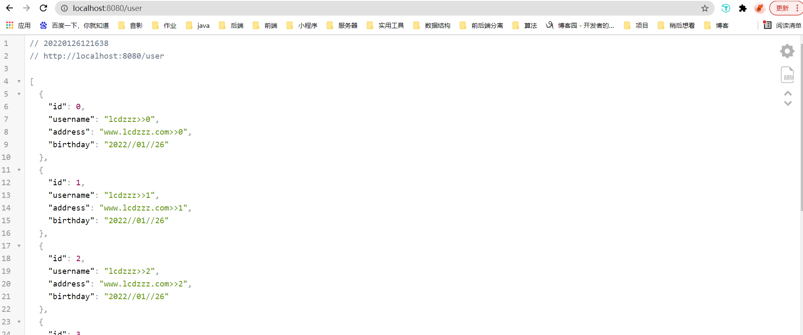
</div>

4. 其中，User类中可以有`@JsonProperty()`这个注解，用来指定属性序列化或反序列化时的名称，默认名称就是属性名。value改变显示的值，index（优先级）改变显示的顺序。

   ```java
    @JsonProperty(value = "aaaage",index = 99)//指定属性序列化或反序列化时的名称，默认名称就是属性名
       private Integer id;
       @JsonProperty(index = 98)
       private String username;
       @JsonProperty(index = 97)
       private String address;
       @JsonProperty(index = 96)
       private Date birthday;
   ```

<div style="text-align:center">
  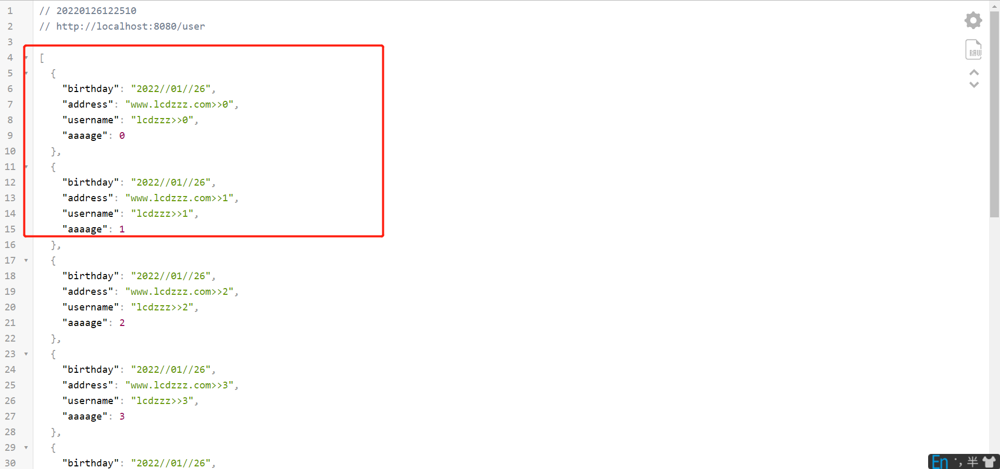
</div>

<br><br>

   

### 反序列化例子

   默认是以key，value形式传递，如果想让它以json格式传递，则需要加@RequstBody，这样前端传递参数的时候就会以字符串的形式传递参数

```java
@PostMapping("/user")
    public void addUser(@RequestBody User user){
        System.out.println(user);
    }
```

测试:

<div style="text-align:center">
  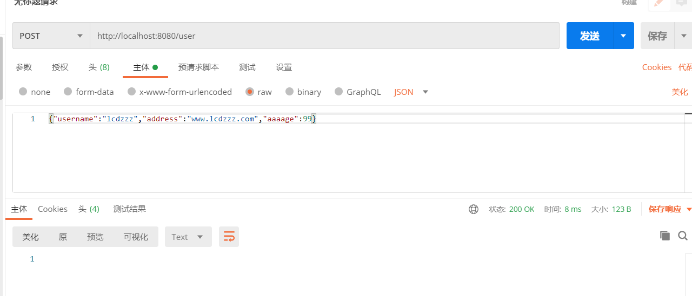
</div>

<div style="text-align:center">
  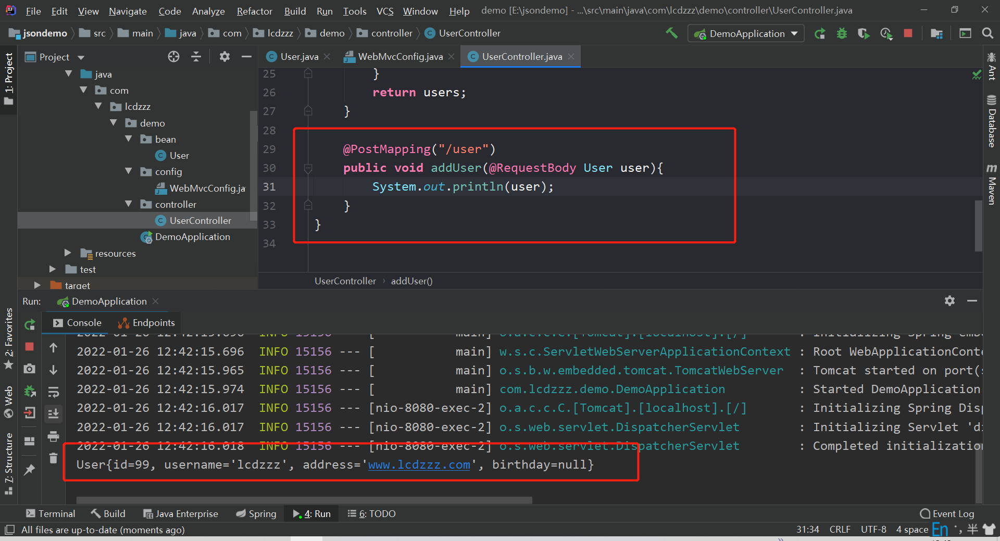
</div>

<br><br>


### 序列化或反序列化是忽略某个字段

1. @JsonIgnore

   ```java
    @JsonIgnore
       private String address;
   ```

2. @JsonIgnoreProperties批量忽略字段，写在类之上

   ```java
   @JsonIgnoreProperties({"birthday","address"})
   public class User {
   ```

<br><br>


### @JsonFormat

```java
//    @JsonProperty(index = 96)
    @JsonFormat(pattern = "yyyy-MM-dd HH:mm:ss",timezone = "Asia/Shanghai")
    private Date birthday;

```

测试：(注意时区问题)

<div style="text-align:center">
  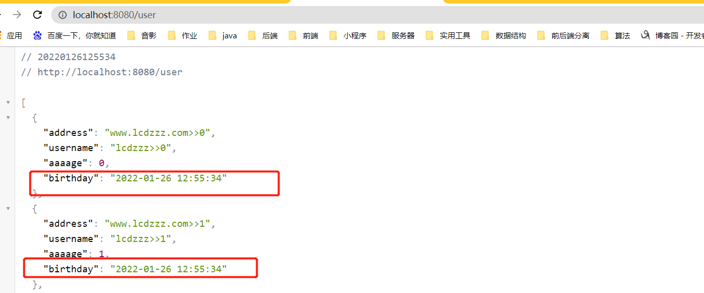
</div>

<br><br>


### 全局配置

创建一个WebMvcConfig类，定义一个ObjectMapper

```java
@Configuration
public class WebMvcConfig {
   @Bean
    ObjectMapper objectMapper(){
       ObjectMapper om = new ObjectMapper();
       om.setDateFormat(new SimpleDateFormat("yyyy//MM//dd HH:mm:ss"));
       return om;
   }
}

```

<br><br><br><br>

## 处理静态资源

### 默认的静态资源优先级：

都是在

1. META-INF/resources
2. resources
3. static
4. public
5. webapp

<div style="text-align:center">
  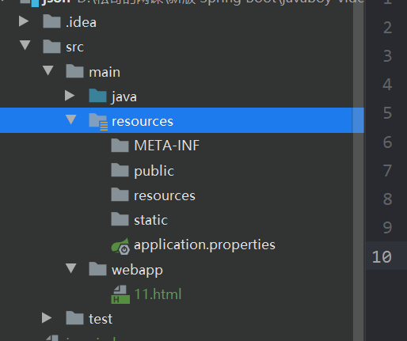
</div>

<br><br>

### 静态资源位置两种配置方法:

1. 第一种

   - `spring.web.resources.static-locations`

<div style="text-align:center">
  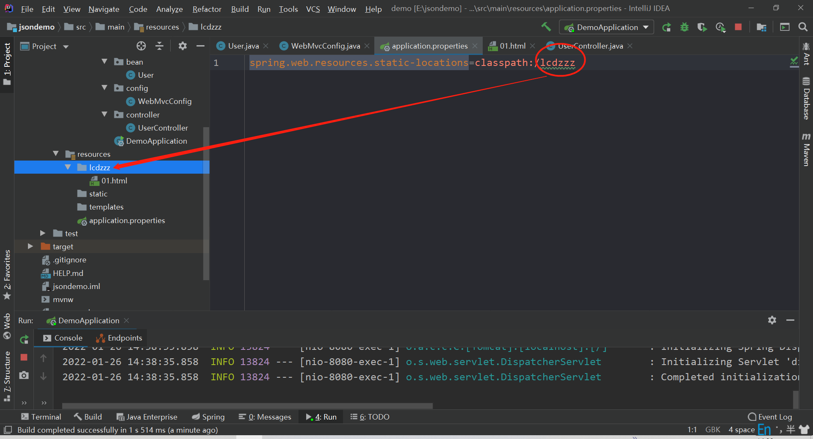
</div>

<div style="text-align:center">
  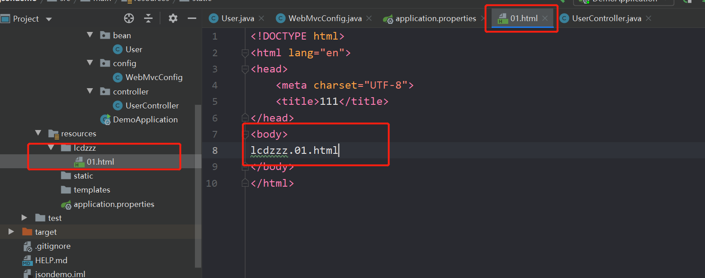
</div>

<div style="text-align:center">
  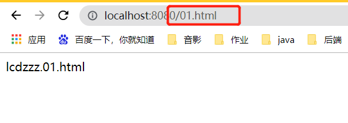
</div>

   - `spring.web.resources.static-locations`+``spring.web.resources.static-locations``

<div style="text-align:center">
  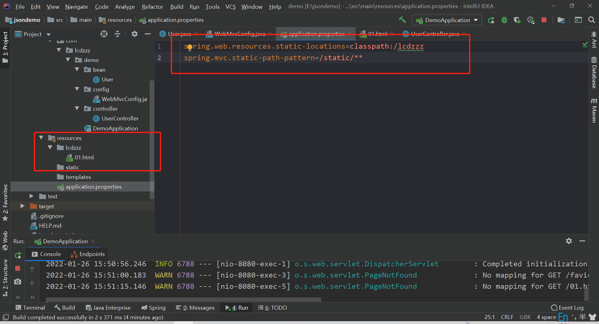
</div>

<div style="text-align:center">
  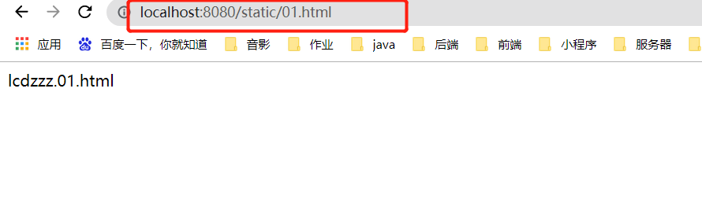
</div>

2. 第二种，自定义一个java类去继承` WebMvcConfigurer`

<div style="text-align:center">
  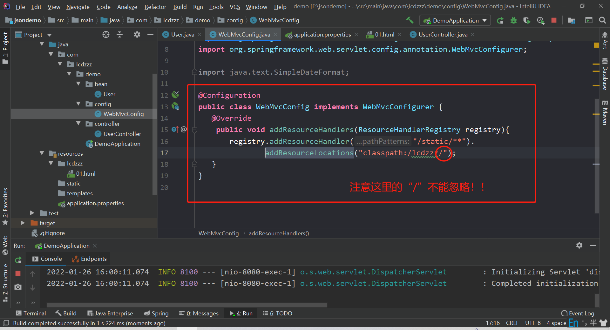
</div>


<br><br><br><br>

## 文件上传

### 单文件上传

1. 先在static下面写一个index.html,注意：以submit方式提交的字段必须有name属性，不然会忽略。

关于`enctype="multipart/form-data"`的解释：

- enctype就是encodetype就是编码类型的意思。
- multipart/form-data是指表单数据有多部分构成，既有文本数据，又有文件等二进制数据的意思。
- 需要注意的是：默认情况下，enctype的值是application/x-www-form-urlencoded，不能用于文件上传，只有使用了multipart/form-data，才能完整的传递文件数据。
- application/x-www-form-urlencoded不是不能上传文件，是只能上传文本格式的文件，multipart/form-data是将文件以二进制的形式上传，这样可以实现多种类型的文件上传。

```html
<!DOCTYPE html>
<html lang="en">
<head>
    <meta charset="UTF-8">
    <title>Title</title>
</head>
<body>
<form action="/upload" method="post" enctype="multipart/form-data">
    <input type="file" name="file">
    <input type="submit" value="提交">
</form>
</body>
</html>
```

2. 这里为了方便起见，把上传的文件放到了项目的临时目录里。（每当项目重启，临时目录里的文件就会消失）

3. 接着创建文件上传接口

   注意：`public String upload(MultipartFile file, HttpServletRequest req) {`中的**“file”文件名**必须和html中的`<input type="file" name="file">`的**name**属性一一对应！！！

   ```java
   @RestController
   public class FileUploadController {
   
       SimpleDateFormat sdf = new SimpleDateFormat("/yyyy/MM/dd/");//按日期来分类。因为等会要扮演一个目录的角色，所以必须有斜杠！
   
       @PostMapping("/upload")
       public String upload(MultipartFile file, HttpServletRequest req) {
           String format = sdf.format(new Date());
           String realPath = req.getServletContext().getRealPath("/img") + format;//字符串拼接，形成最终的路径！
           File folder = new File(realPath);//文件夹
   
           if (!folder.exists()) {
               folder.mkdirs();//如果不存在，那就创建
           }
           String oldName = file.getOriginalFilename();//原本的文件名
           String newName = UUID.randomUUID().toString() + oldName.substring(oldName.lastIndexOf("."));//oldName.substring(oldName.lastIndexOf(".")截取字符串，比如一个abc.png,那就截取abc
           try {
               file.transferTo(new File(folder, newName));//第一个参数是地址，第二个参数是文件名
               String url = req.getScheme() + "://" + req.getServerName() + ":" + req.getServerPort() + "/img" + format + newName;
               //getScheme:获取请求协议
               //getServerName：比如localhost
               //getServerPort：请求端口
               return url;
           } catch (IOException e) {
               e.printStackTrace();
           }
           return "";
       }
   }
   ```

<br><br>

### 多文件上传

```html
<!DOCTYPE html>
<html lang="en">
<head>
    <meta charset="UTF-8">
    <title>Title</title>
</head>
<body>
<form action="/uploads" method="post" enctype="multipart/form-data">
    <input type="file" name="files" multiple>
    <input type="submit" value="提交">
</form>
</body>
</html>
```

对应的接口如下

```java
 @PostMapping("/uploads")
    public String uploads(MultipartFile[] files, HttpServletRequest req) {
        String format = sdf.format(new Date());
        String realPath = req.getServletContext().getRealPath("/img") + format;
        File folder = new File(realPath);
        if (!folder.exists()) {
            folder.mkdirs();
        }

        try {
            for (MultipartFile file : files) {
                String oldName = file.getOriginalFilename();
                String newName = UUID.randomUUID().toString() + oldName.substring(oldName.lastIndexOf("."));

                file.transferTo(new File(folder, newName));
                String url = req.getScheme() + "://" + req.getServerName() + ":" + req.getServerPort() + "/img" + format + newName;
                System.out.println(url);
            }
        } catch (IOException e) {
            e.printStackTrace();
        }

        return "success";
    }
```

<br><br>

### 上传到指定目录（相对路径）

html页面大同小异

**controller**接口如下：

```java
@RestController
public class FileUploadController {

    private static  final Logger logger = LoggerFactory.getLogger(FileUploadController.class);

    // 项目根路径下的目录  -- SpringBoot static 目录相当于是根路径下（SpringBoot 默认）
    public final static String UPLOAD_PATH_PREFIX = "static/uploadFile/";

    @PostMapping("/upload")
    public String upload(MultipartFile uploadFile, HttpServletRequest request){
        if(uploadFile.isEmpty()){
            //返回选择文件提示
            return "请选择上传文件";
        }
        SimpleDateFormat sdf = new SimpleDateFormat("yyyy/MM/dd/");
        //构建文件上传所要保存的"文件夹路径"--这里是相对路径，保存到项目根路径的文件夹下
        String realPath = new String("src/main/resources/" + UPLOAD_PATH_PREFIX);
        System.out.println("-----------上传文件保存的路径【"+ realPath +"】-----------");
        String format = sdf.format(new Date());
        //存放上传文件的文件夹
        File file = new File(realPath + format);
        System.out.println("-----------存放上传文件的文件夹【"+ file +"】-----------");
        System.out.println("-----------输出文件夹绝对路径 -- 这里的绝对路径是相当于当前项目的路径而不是“容器”路径【"+ file.getAbsolutePath() +"】-----------");
        if(!file.isDirectory()){
            //递归生成文件夹
            file.mkdirs();
        }
        //获取原始的名字  original:最初的，起始的  方法是得到原来的文件名在客户机的文件系统名称
        String oldName = uploadFile.getOriginalFilename();
        System.out.println("-----------文件原始的名字【"+ oldName +"】-----------");
        String newName = UUID.randomUUID().toString() + oldName.substring(oldName.lastIndexOf("."),oldName.length());
        System.out.println("-----------文件要保存后的新名字【"+ newName +"】-----------");
        try {
            //构建真实的文件路径
            File newFile = new File(file.getAbsolutePath() + File.separator + newName);
            //转存文件到指定路径，如果文件名重复的话，将会覆盖掉之前的文件,这里是把文件上传到 “绝对路径”
            uploadFile.transferTo(newFile);
            String filePath = request.getScheme() + "://" + request.getServerName() + ":" + request.getServerPort() + "/uploadFile/" + format + newName;
            System.out.println("-----------【"+ filePath +"】-----------");
            return filePath;
        } catch (Exception e) {
            e.printStackTrace();
        }
        return "上传失败!";
    }
}
```

结果：

<div style="text-align:center">
  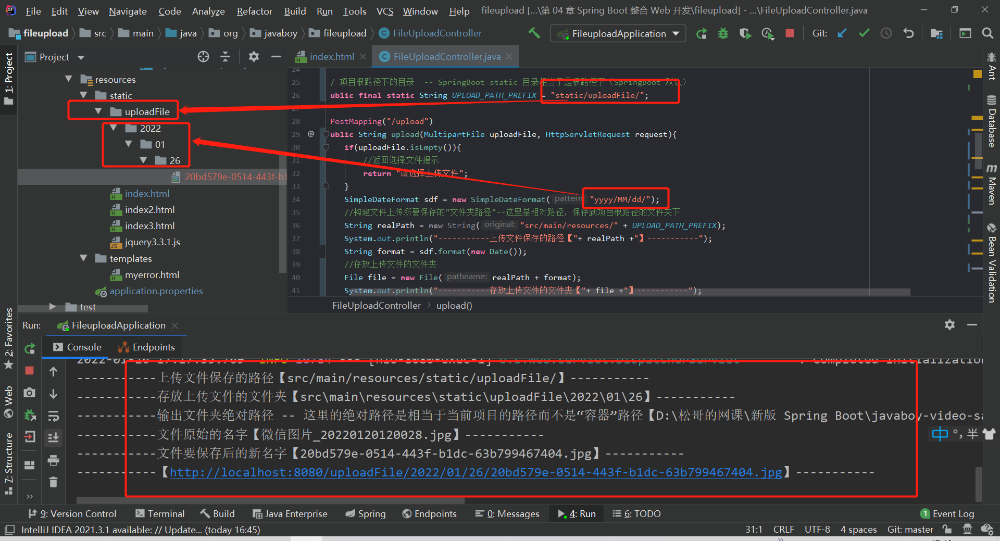
</div>

<br><br>

### 限制上传文件的大小

```properties
spring.servlet.multipart.max-file-size=1MB=
```

<br><br><br><br>

## Spring Boot+@ControllerAdvice

### 全局异常处理

捕获一个MaxUploadSizeExceededException异常，因为在上面，我们限制了上传文件的大小为1MB，如果上传的文件超过MB就会有异常

```java
@RestControllerAdvice
public class MyGlobalException {
    @ExceptionHandler(MaxUploadSizeExceededException.class)
    public String customException(MaxUploadSizeExceededException e){
        return "上传文件大小超出限制";
    }
}

```

测试：

<div style="text-align:center">
  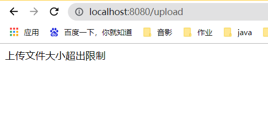
</div>

<br><br>

### 全局数据绑定

用@Controller去定义全局数据，只要定义好，在任何一个Controller下都可以拿到它

1. MyGlobalData:

   `@ModelAttribute("info")`中，默认的key是map。这里指定了，所以是info

   ```java
   @ControllerAdvice
   public class MyGlobalData {
       @ModelAttribute("info")
       public Map<String,String> mydata() {
           Map<String, String> info = new HashMap<>();
           info.put("username", "lcdzzz");
           info.put("address", "lcdzzz.github.io");
           return info;
       }
   }
   ```

   

2. HelloController    第6行的asMap.get("info")和上面的 @ModelAttribute("info")相对应

   ```java
   @RestController
   public class HelloController {
       @GetMapping("/hello")
       public void hello(Model model) {
           Map<String, Object> asMap = model.asMap();
           Map<String, String> info = (Map<String, String>) asMap.get("info");
           Set<String> keySet = info.keySet();
           for (String s : keySet) {
               System.out.println(s + "----" + info.get(s));
           }
   
       }
   }
   ```

测试：

<div style="text-align:center">
  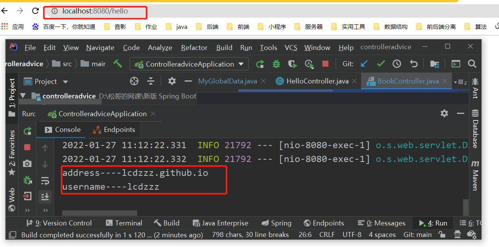
</div>


<br><br>

### 全局数据预处理

1. 实体类：【tostring方法和getset方法省略】

   ```java
   public class Author {
           private String name;
           private Integer age;
   }
   ```

   ```java
   public class Book {
       private String name;
       private Double price;
   }
   ```

2. BookController

   ```java
   @RestController
   public class BookController {
   
       @PostMapping("/book")
       public void addBook(@ModelAttribute("b") Book book, @ModelAttribute("a") Author author) {
           System.out.println("book = " + book);
           System.out.println("author = " + author);
       }
   }
   
   ```

3. MyGlobalData

   ```java
   @ControllerAdvice
   public class MyGlobalData {
   
   
       @InitBinder("b")
       public void b(WebDataBinder binder) {
           binder.setFieldDefaultPrefix("b.");
       }
       @InitBinder("a")
       public void a(WebDataBinder binder) {
           binder.setFieldDefaultPrefix("a.");
       }
   
   }
   ```

   


## 异常处理

### 异常页面定义

#### 静态页面

一定要按图中的规则来定义异常页面，路径不能变，文件名和异常状态码一一对应。注意：在templates路径下的优先级更高（动态高于静态，精确高于模糊）

<div style="text-align:center">
  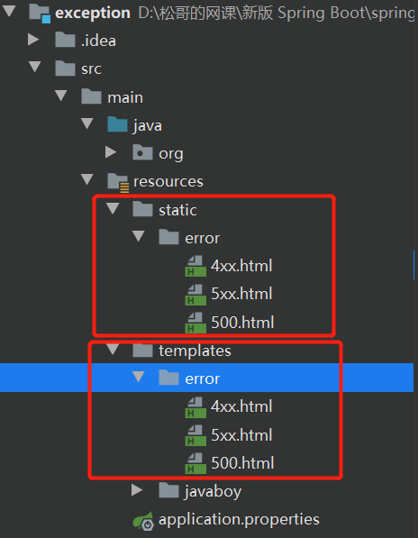
</div>

<br>

#### 动态页面

```html
<!DOCTYPE html>
<html lang="en" xmlns:th="http://www.thymeleaf.org">
<head>
    <meta charset="UTF-8">
    <title>Title</title>
</head>
<body>
<table border="1">
    <tr>
        <td>path</td>
        <td th:text="${path}"></td><!--异常路径 -->
    </tr>
    <tr>
        <td>error</td>
        <td th:text="${error}"></td><!--错误信息-->
    </tr>
    <tr>
        <td>message</td>
        <td th:text="${message}"></td>
    </tr>
    <tr>
        <td>timestamp</td>
        <td th:text="${timestamp}"></td><!--异常发生的时间-->
    </tr>
    <tr>
        <td>status</td>
        <td th:text="${status}"></td><!--状态码-->
    </tr>
</table>
</body>
</html>
```

<div style="text-align:center">
  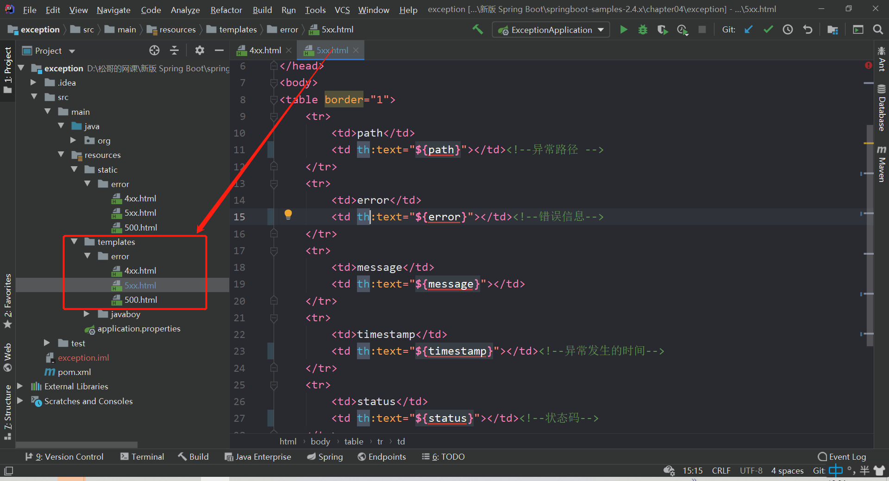
</div>

<br><br>

### 自定义异常处理

#### 自定义异常数据

<div style="text-align:center">
  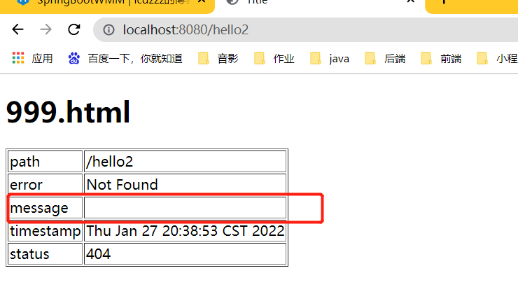
</div>

1. 创建一个MyErrorAtributes来继承DefaultErrorAttributes

   ```java
   @Component
   public class MyErrorAtributes extends DefaultErrorAttributes {
       @Override
       public Map<String, Object> getErrorAttributes(WebRequest webRequest, ErrorAttributeOptions options) {
           Map<String, Object> map = super.getErrorAttributes(webRequest, options);//这个就是服务端返回的数据
           if ((Integer) map.get("status") == 404) {
               map.put("message", "页面不存在");
           }
           return map;
       }
   }
   ```

2. 测试：

<div style="text-align:center">
  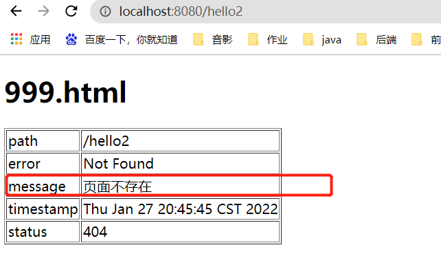
</div>

   ps：↓↓↓999是因为定义了异常视图999.html ↓↓↓

<br>

#### 自定义异常视图：

1. 创建一个MyErrorViewResolver来继承DefaultErrorViewResolver【这中方法既可以定义视图也可以定义数据，但是定义数据建议使用上面的一个方法。这里`Map<String, Object> model`是不可修改的，所以要重新放数据的话必须定义一个map。 	

   ```java
   @Component
   public class MyErrorViewResolver extends DefaultErrorViewResolver {
       public MyErrorViewResolver(ApplicationContext applicationContext, WebProperties.Resources resources) {
           super(applicationContext, resources);
       }
   
       @Override
       public ModelAndView resolveErrorView(HttpServletRequest request, HttpStatus status, Map<String, Object> model) {
           Map<String, Object> map = new HashMap<>();
           map.putAll(model);
           if ((Integer) model.get("status") == 500) {
               map.put("message", "服务器内部错误");
           }
           ModelAndView view = new ModelAndView("lcdzzz/999",map);
           return view;
       }
   }
   ```

2. 创建999.html【名字自定义】

   ```html
   <!DOCTYPE html>
   <html lang="en" xmlns:th="http://www.thymeleaf.org">
   <head>
       <meta charset="UTF-8">
       <title>Title</title>
   </head>
   <body>
   <h1>999.html</h1>
   <table border="1">
       <tr>
           <td>path</td>
           <td th:text="${path}"></td>
       </tr>
       <tr>
           <td>error</td>
           <td th:text="${error}"></td>
       </tr>
       <tr>
           <td>message</td>
           <td th:text="${message}"></td>
       </tr>
       <tr>
           <td>timestamp</td>
           <td th:text="${timestamp}"></td>
       </tr>
       <tr>
           <td>status</td>
           <td th:text="${status}"></td>
       </tr>
   </table>
   </body>
   </html>
   ```

<div style="text-align:center">
  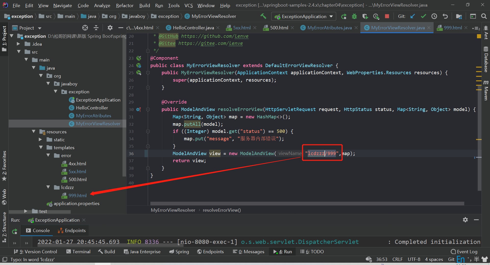
</div>

3. 测试

<div style="text-align:center">
  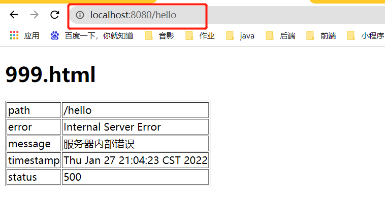
</div>


<br><br><br><br>


## 跨域

CORS: Cross-Origi Resource Sharing

- 域： 协议+域名/IP+duan端口  ，只要这三个其中有一个是不一样的，就是跨域了
- 资源：一个url对应一个内容。图片，html，json数据等
- 同源策略：浏览器客户端仅请求当前页面或来自同一个域的资源

### 提前准备好两个工程

- cors01 端口：8080
- cors02 端口：8081


### 第一种跨域方式

1. 在cors01中创建一个接口

   ```java
   public class HelloController {
       @GetMapping("/hello")
       public String hello() {
           return "hello cors";
       }
   }
   ```

   

2. 在cors02建一个名为01.html的静态页面，发送ajax请求

   ```html
   <!DOCTYPE html>
   <html lang="en">
   <head>
       <meta charset="UTF-8">
       <title>Title</title>
       <script src="https://code.jquery.com/jquery-3.5.1.js" integrity="sha256-QWo7LDvxbWT2tbbQ97B53yJnYU3WhH/C8ycbRAkjPDc=" crossorigin="anonymous"></script>
   </head>
   <body>
   <input type="button" onclick="getData()" value="get">
   <script>
       function getData() {
           $.get("http://localhost:8080/hello",function (msg) {
               alert(msg);
           })
       }
   </script>
   </body>
   </html>
   ```

3. 测试：

<div style="text-align:center">
  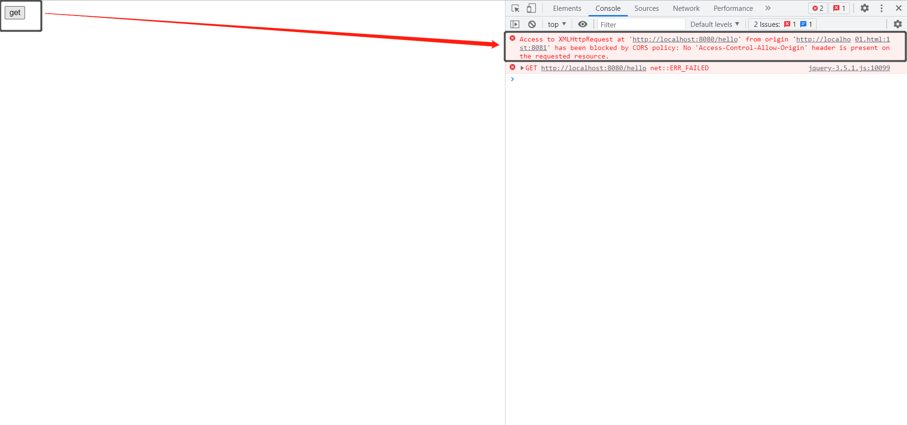
</div>

4. 因为同源策略，我们拿不到服务端的响应

5. 怎么办呢，第一种方法就是在cors01的HelloController加一个@CrossOrigin。这个注解可以加在方法上也可以加在类上。哪个方法/类想支持跨域，就加那个方法/类上。关于探测请求，接下来会说

   ```java
   @RestController
   @CrossOrigin(value = "http://localhost:8081",maxAge = 1800)/*第一个参数：表示允许来自"http://localhost:8081"这个地址访问
   第二个参数：过期时间（s），在有效期内，第一次探测结束后不需要再次探测*/
   public class HelloController {
       @GetMapping("/hello")
       public String hello() {
           return "hello cors";
       }
   }
   ```

6. 测试

<div style="text-align:center">
  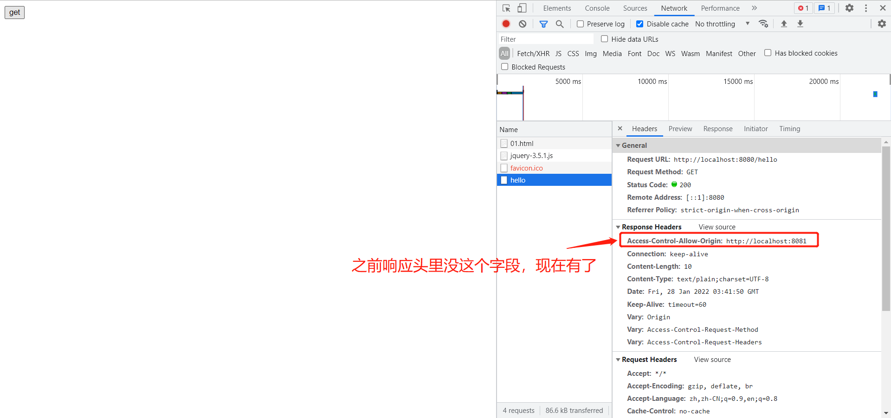
</div>

<br>

### 探测

get请求不需要探测，但是put需要，这边以put请求为例

1. 在cors01中的controller上，加一个put

   ```java
   @RestController
   @CrossOrigin(value = "http://localhost:8081",maxAge = 1800)/*表示允许来自"http://localhost:8081"这个地址访问*/
   public class HelloController {
       @GetMapping("/hello")
       public String hello() {
           return "hello cors";
       }
   
       @PutMapping("/hello")
       public String hello2() {
           return "hello cors put!";
       }
   
   }
   
   ```

2. 在cors02中的01.html上

   ```html
   <!DOCTYPE html>
   <html lang="en">
   <head>
       <meta charset="UTF-8">
       <title>Title</title>
       <script src="https://code.jquery.com/jquery-3.5.1.js" integrity="sha256-QWo7LDvxbWT2tbbQ97B53yJnYU3WhH/C8ycbRAkjPDc=" crossorigin="anonymous"></script>
   </head>
   <body>
   <input type="button" onclick="getData()" value="get">
   <input type="button" onclick="putData()" value="put">
   <script>
       function getData() {
           $.get("http://localhost:8080/hello",function (msg) {/*第一个参数：请求的地址
                                                                 第二个参数：服务端返回的信息*/
               alert(msg);
           })
       }
       function putData() {
           $.ajax({
               url:'http://localhost:8080/hello',
               type:'put',
               success:function (msg) {
                   alert(msg);
               }
           })
       }
   </script>
   </body>
   </html>
   ```

3. 测试：

<div style="text-align:center">
  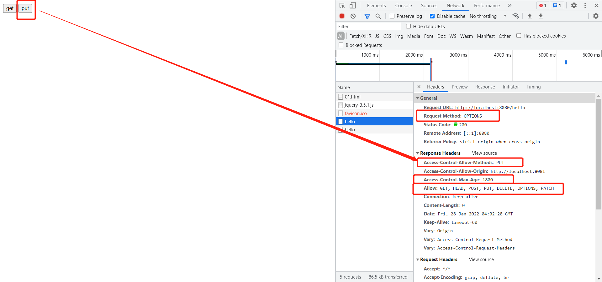
</div>


### 第二种跨域方式

- 创建一个类继承WebMvcConfigurer

  ```java
  @Configuration
  public class WebMvcConfig implements WebMvcConfigurer {
      @Override
      public void addCorsMappings(CorsRegistry registry) {
          registry.addMapping("/**")//要拦截的地址
                  .allowedHeaders("*")//是否允许的头
                  .allowedMethods("*")//允许的方法
                  .allowedOrigins("http://localhost:8081")//允许的域，也可以写“ * ”
                  .maxAge(1800);
      }
  }
  ```

<br>


### 第三种跨域方式

提供一个corsFilter实例，把它注册到spring容器里面去

```java
package org.javaboy.cors01;

import org.springframework.context.annotation.Bean;
import org.springframework.context.annotation.Configuration;
import org.springframework.web.cors.CorsConfiguration;
import org.springframework.web.cors.UrlBasedCorsConfigurationSource;
import org.springframework.web.filter.CorsFilter;

@Configuration
public class WebMvcConfig  {
    @Bean
    CorsFilter corsFilter() {
        UrlBasedCorsConfigurationSource source = new UrlBasedCorsConfigurationSource();
        CorsConfiguration cfg = new CorsConfiguration();
        cfg.addAllowedOrigin("http://localhost:8081");
        cfg.addAllowedMethod("*");//允许的请求
        source.registerCorsConfiguration("/**",cfg);
        return new CorsFilter(source);
    }
}

```


## 拦截器

1. 配置拦截器：

   ```java
   public class MyInterceptor implements HandlerInterceptor {
   
       //该方法返回 false，请求将不再继续往下走。在请求处理之前被调用
       @Override
       public boolean preHandle(HttpServletRequest request, HttpServletResponse response, Object handler) throws Exception {
           System.out.println("preHandle");
           return true;
       }
   
       //Controller 执行之后被调用。
       @Override
       public void postHandle(HttpServletRequest request, HttpServletResponse response, Object handler, ModelAndView modelAndView) throws Exception {
           System.out.println("postHandle");
       }
   
       //preHandle 方法返回 true，afterCompletion 才会执行。也就是在整个请求结束之后才会执行，可以做一些资源的清理工作
       @Override
       public void afterCompletion(HttpServletRequest request, HttpServletResponse response, Object handler, Exception ex) throws Exception {
           System.out.println("afterCompletion");
       }
   }
   
   ```

2. 使拦截器生效

   ```java
   @Configuration
   public class WebMvcConfig implements WebMvcConfigurer {//为了让拦截器生效
       @Override
       public void addInterceptors(InterceptorRegistry registry) {//这个方法是用来配拦截器的
           registry.addInterceptor(new MyInterceptor()).addPathPatterns("/**").excludePathPatterns("/hello");//拦截哪些请求，哪些请求不拦截
       }
   }
   ```

3. 测试类Controller

   ```java
   @RestController
   public class HelloController {
       @GetMapping("/hello")
       public String hello() {
           System.out.println("hello");
           return "hello";
       }
       @GetMapping("/hello2")
       public String hello2() {
           System.out.println("hello2");
           return "hello2";
       }
   }
   ```

4. 测试

<div style="text-align:center">
  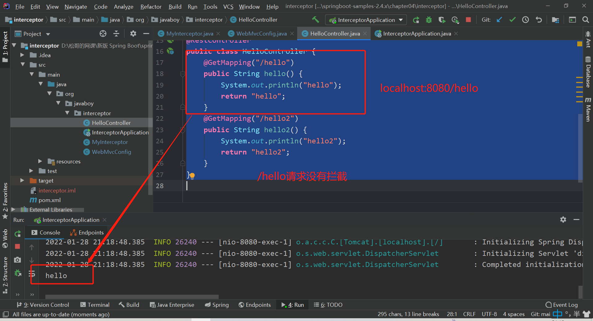
</div>

<div style="text-align:center">
  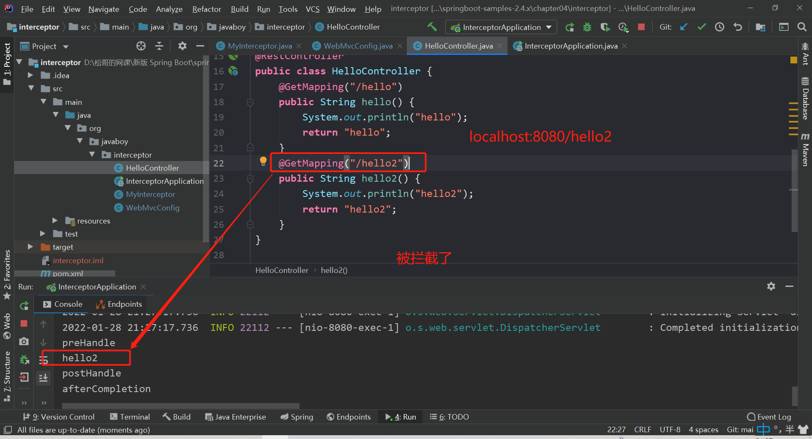
</div>


## 系统启动任务

### CommandLineRunner

1. MyCommandLineRunner01

   ```java
   @Component
   @Order(100)
   public class MyCommandLineRunner01 implements CommandLineRunner {
       //当系统启动时，run 方法会被触发，方法参数就是 main 方法所传入的参数
       @Override
       public void run(String... args) throws Exception {
           System.out.println("args1 = " + Arrays.toString(args));
       }
   }
   
   ```

2. MyCommandLineRunner02

   ```java
   @Component
   @Order(99)
   public class MyCommandLineRunner02 implements CommandLineRunner {
       //当系统启动时，run 方法会被触发，方法参数就是 main 方法所传入的参数
       @Override
       public void run(String... args) throws Exception {
           System.out.println("args2 = " + Arrays.toString(args));
       }
   }
   ```

3. 配置：

<div style="text-align:center">
  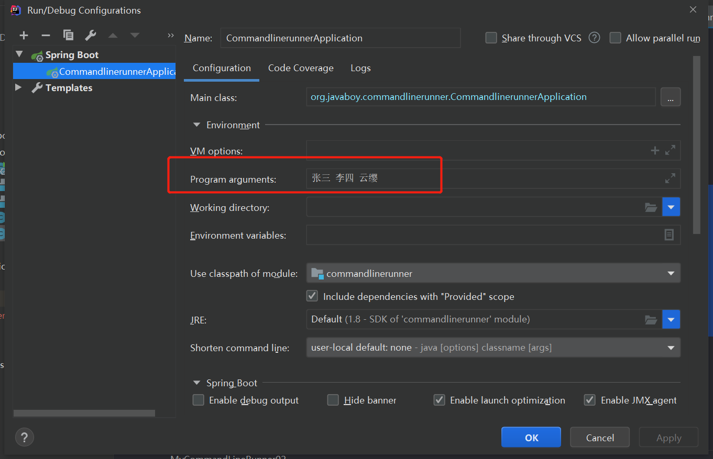
</div>

4. 测试：

<div style="text-align:center">
  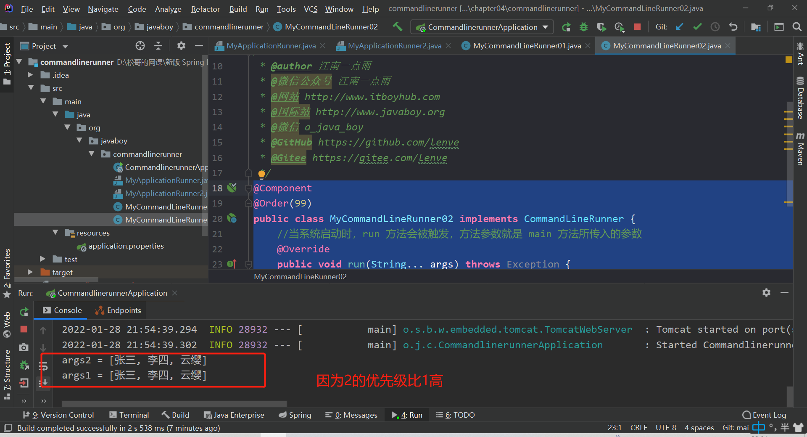
</div>

   <br><br>

### ApplicationRunner

   1. MyApplicationRunner

      ```java
      @Component
      @Order(98)
      public class MyApplicationRunner implements ApplicationRunner {
          @Override
          public void run(ApplicationArguments args) throws Exception {
              //获取没有键的参数，获取到的值和 commandlinerunner 一致
              List<String> nonOptionArgs = args.getNonOptionArgs();
              System.out.println("nonOptionArgs1 = " + nonOptionArgs);
              Set<String> optionNames = args.getOptionNames();
              for (String optionName : optionNames) {
                  System.out.println(optionName + "-1->" + args.getOptionValues(optionName));
              }
              //获取命令行中的所有参数
              String[] sourceArgs = args.getSourceArgs();//不管有没有key，统统获取到数组里去
              System.out.println("sourceArgs1 = " + Arrays.toString(sourceArgs));
          }
      }
      ```

   2. MyApplicationRunner2

      ```java
      @Component
      @Order(97)
      public class MyApplicationRunner2 implements ApplicationRunner {
          @Override
          public void run(ApplicationArguments args) throws Exception {
              //获取没有键的参数，获取到的值和 commandlinerunner 一致
              List<String> nonOptionArgs = args.getNonOptionArgs();
              System.out.println("nonOptionArgs2 = " + nonOptionArgs);
              Set<String> optionNames = args.getOptionNames();
              for (String optionName : optionNames) {
                  System.out.println(optionName + "-2->" + args.getOptionValues(optionName));
              }
              //获取命令行中的所有参数
              String[] sourceArgs = args.getSourceArgs();
              System.out.println("sourceArgs2 = " + Arrays.toString(sourceArgs));
          }
      }
      ```

   3. 配置

<div style="text-align:center">
  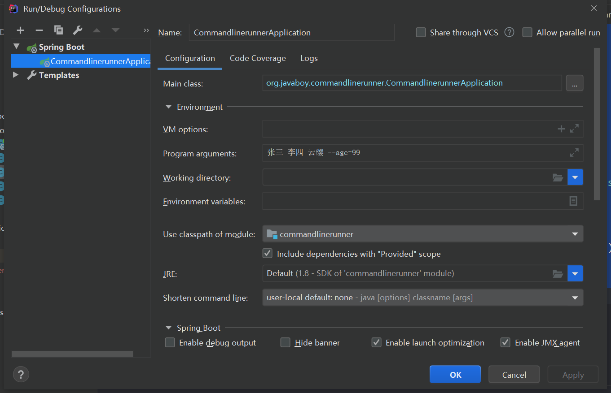
</div>

   4. 测试

<div style="text-align:center">
  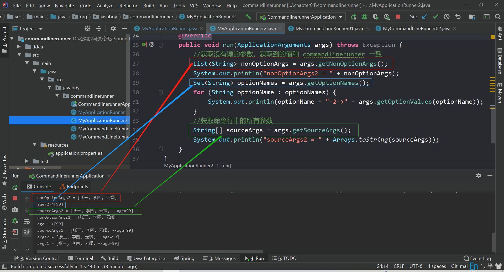
</div>


<br><br><br><br>

## SpringBoot整合web基础组件

- MyFilter

  ```java
  @WebFilter(urlPatterns = "/*")
  public class MyFilter implements Filter {
      @Override
      public void doFilter(ServletRequest request, ServletResponse response, FilterChain chain) throws IOException, ServletException {
          System.out.println("MyFilter");
          chain.doFilter(request,response);
      }
  }
  ```

- MyListener

  ```java
  @WebListener
  public class MyListener extends RequestContextListener {
      @Override
      public void requestInitialized(ServletRequestEvent requestEvent) {
          System.out.println("requestInitialized");
      }
  
      @Override
      public void requestDestroyed(ServletRequestEvent requestEvent) {
          System.out.println("requestDestroyed");
      }
  }
  ```

- MyServlet

  ```java
  @WebServlet(urlPatterns = "/hello")
  public class MyServlet extends HttpServlet {
  
      @Override
      protected void doGet(HttpServletRequest req, HttpServletResponse resp) throws ServletException, IOException {
          doPost(req,resp);
      }
  
      @Override
      protected void doPost(HttpServletRequest req, HttpServletResponse resp) throws ServletException, IOException {
          System.out.println("MyServlet");
      }
  }
  ```

- 扫描，让组件生效

  启动类：`@ServletComponentScan("org.javaboy.webcomponent")`是那三个组件所在的包

  ```java
  @SpringBootApplication
  @ServletComponentScan("org.javaboy.webcomponent")
  public class WebcomponentApplication {
  
      public static void main(String[] args) {
          SpringApplication.run(WebcomponentApplication.class, args);
      }
  
  }
  
  ```

- 测试：

<div style="text-align:center">
  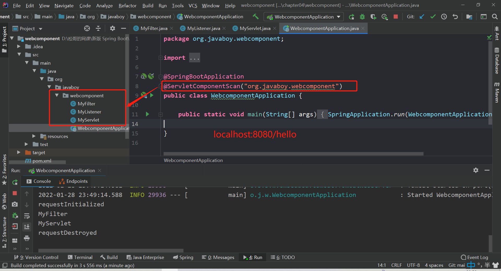
</div>


<br><br><br><br>

## SpringBoot注册过滤器的n种方式


### 第一种 @WebFilter

1. 在启动类上扫描包

```java
@SpringBootApplication
@ServletComponentScan("org.javaboy.filter")
public class FilterApplication {

    public static void main(String[] args) {
        SpringApplication.run(FilterApplication.class, args);
    }

}
```

2. 这个可以设置拦截谁，没法设置优先级

```java
@WebFilter(urlPatterns = "/*")
public class MyFilter01 implements Filter {
    @Override
    public void doFilter(ServletRequest request, ServletResponse response, FilterChain chain) throws IOException, ServletException {
        System.out.println("MyFilter01");
        chain.doFilter(request, response);
    }
}
```

<br><br>

### 第二种 @Component 

把它当成普通的组件这个可以设置优先级，但是不能设置拦截谁

```java
@Component
@Order(101)
public class MyFilter02 implements Filter {
    @Override
    public void doFilter(ServletRequest request, ServletResponse response, FilterChain chain) throws IOException, ServletException {
        System.out.println("MyFilter02");
        chain.doFilter(request, response);
    }
}
```

<br><br>

### 第三种 FilterRegistrationBean

```java
public class MyFilter04 implements Filter {
    @Override
    public void doFilter(ServletRequest request, ServletResponse response, FilterChain chain) throws IOException, ServletException {
        System.out.println("MyFilter04");
        chain.doFilter(request, response);
    }
}
```

```java
public class MyFilter05 implements Filter {
    @Override
    public void doFilter(ServletRequest request, ServletResponse response, FilterChain chain) throws IOException, ServletException {
        System.out.println("MyFilter05");
        chain.doFilter(request, response);
    }
}
```

```java
@Configuration
public class FilterConfiguration {
    @Bean
        //用@Bean注册成一个bean
    FilterRegistrationBean<MyFilter04> filter04FilterRegistrationBean04() {
        FilterRegistrationBean<MyFilter04> bean = new FilterRegistrationBean<>();
        bean.setOrder(90);
        bean.setFilter(new MyFilter04());
        bean.setUrlPatterns(Arrays.asList("/*"));
        return bean;
    }
    @Bean
    FilterRegistrationBean<MyFilter05> filter04FilterRegistrationBean05() {
        FilterRegistrationBean<MyFilter05> bean = new FilterRegistrationBean<>();
        bean.setOrder(89);
        bean.setFilter(new MyFilter05());
        bean.setUrlPatterns(Arrays.asList("/*"));
        return bean;
    }
}
```

测试全部：

<div style="text-align:center">
  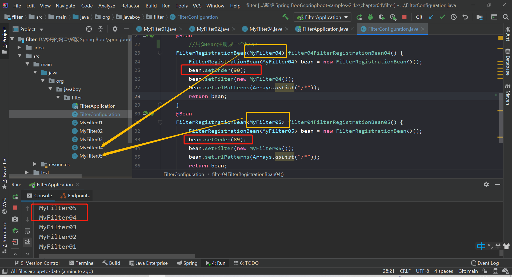
</div>

<br><br><br><br>

## 路径映射

这个方法有个局限性：就是这个页面没有需要渲染的数据。作为一个控制器实现简单的跳转

```java
@Configuration
public class WebMvcConfig implements WebMvcConfigurer {
     @Override //实现无业务逻辑跳转
    public void addViewControllers(ViewControllerRegistry registry) {
        registry.addViewController("/").setViewName("redirect:/managebooks/login");//forward和redirect区别在导航栏上
        registry.setOrder(Ordered.HIGHEST_PRECEDENCE);//order的值越小，优先级越高
    }
}
```

对上面代码这呢个的redirect的解释：

使用servlet重定向有两种方式

- 一种是forward，另一种就是redirect。forward是服务器内部重定向，客户端并不知道服务器把你当前请求重定向到哪里去了，地址栏的url与你之前访问的url保持不变。
- redirect则是客户端重定向，是服务器将你当前请求返回，然后给个状态标示给你，告诉你应该去重新请求另外一个url，具体表现就是地址栏的url变成了新的url。

<br><br><br><br>

## 参数类型转换

### 问题描述

- 代码：

  ```java
  /**
  以下省略tostring和getset方法
  **/
  
  public class User {
      private String username;
      private Date birthday;
  }
  ```

  ```java
  @RestController
  public class UserController {
      @PostMapping("/user1")
      public void addUser(User user) {
          System.out.println("user = " + user);
      }
  }
  ```

- 测试会报错，因为框架不知道如何把字符串转换成对象

<div style="text-align:center">
  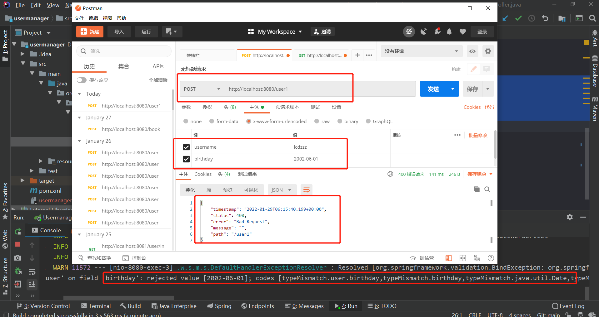
</div>

<br><br>

### 解决方法

#### 类型转换器

```java
@Component//注册到容器中，注册成一个组件
public class MyDateConverter implements Converter<String, Date> {//意思是把String类型转换成Date类型
    SimpleDateFormat sdf = new SimpleDateFormat("yyyy-MM-dd");
    @Override
    public Date convert(String source) {
        try {
            return sdf.parse(source);
        } catch (ParseException e) {
            e.printStackTrace();
        }
        return null;
    }
}
```


<br><br>

### 另一种情况

```java
@RestController
public class UserController {
    @PostMapping("/user2")
    public void addUser2(@RequestBody User user) {//用了@RequestBody，代码参数以json字符串的方式传递
        System.out.println("user = " + user);
    }
}
```

这个以json字符换的形式传递参数，不会报错，就算没有类型转换器


<br><br>

### 总结

POST请求，参数可以是key/value形式，也可以是JSON形式

自定义的类型转换器对key/value形式的参数有效

JSON形式的参数，不需要类型转换器。JSON字符串是通过==HttpMessageConverter==转换为User对象的

 


<br><br><br><br>

## 自定义首页与浏览器脚标

```java
@Configuration
public class WebMvcConfig implements WebMvcConfigurer {
    @Override
    public void addViewControllers(ViewControllerRegistry registry) {
        registry.addViewController("/index").setViewName("index");

    }
}
```

<div style="text-align:center">
  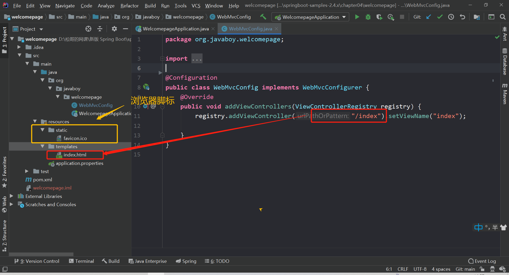
</div>

favicon制作网址:https://tool.lu/favicon/


## SpringBoot整合AOP

1. 添加依赖：

   ```xml
           <dependency>
               <groupId>org.springframework.boot</groupId>
               <artifactId>spring-boot-starter-aop</artifactId>
           </dependency>
   ```

2. 代码：

   ```java
   @Component
   @Aspect//表示当前这个类是一个切面
   public class LogAspect {
       /**
        *  execution中的第一个 * 表示方法返回值是任意的
        *  这里表示service包下的所有类中的所有方法都要拦截下来
        */
       @Pointcut("execution(* org.javaboy.aop.service.*.*(..))")//表示这是个切点
       public void pc1() {
   
       }
   
       @Before("pc1()")//pc1指定拦截规则
       public void before(JoinPoint jp) {
           String name = jp.getSignature().getName();
           System.out.println(name + " 方法开始执行了...");
       }
   
       @After("pc1()")
       public void after(JoinPoint jp) {
           String name = jp.getSignature().getName();
           System.out.println(name + " 方法执行结束了...");
       }
   
       @AfterReturning(value = "pc1()", returning = "s")
       public void afterReturning(JoinPoint jp, String s) {
           String name = jp.getSignature().getName();
           System.out.println(name + " 方法的返回值是 " + s);
       }
   
       @AfterThrowing(value = "pc1()", throwing = "e")
       public void afterThrowing(JoinPoint jp, Exception e) {
           String name = jp.getSignature().getName();
           System.out.println(name + " 方法抛出了异常 " + e.getMessage());
       }
   
       @Around("pc1()")
       public Object around(ProceedingJoinPoint pjp) {
           try {
   
               //类似于反射中的 invoke 方法
               Object proceed = pjp.proceed();
               return proceed;
           } catch (Throwable throwable) {
               throwable.printStackTrace();
           }
           return null;
       }
   }
   
   ```

3. service类

   ```java
   @Service
   public class UserService {
       public String getUserById(Integer id) {
           System.out.println("getUserById");
           int i = 1 / 0;
           return "user";
       }
   
       public void deleteUserById(Integer id) {
           System.out.println("delete id:" + id);
       }
   }
   ```

4. 测试

   ```java
   @SpringBootTest
   class AopApplicationTests {
   
       @Autowired
       UserService userService;
       @Test
       void contextLoads() {
           userService.getUserById(99);
       }
   
   }
   ```

5. 结果：

<div style="text-align:center">
  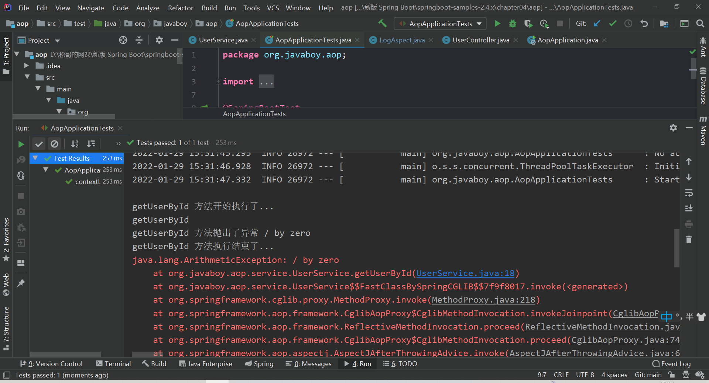
</div>

<br><br><br><br><br><br>

# Spring Boot整合视图层

## Thymeleaf配置

参考资料：https://mp.weixin.qq.com/s/Uvv1q3iQn2IwAB1crHWS1g

这部分的内容基本照搬了松哥的微信公众号，主要用于自己学习

**基本配置**

- 所需要的依赖

  ```xml
      <dependencies>
          <dependency>
              <groupId>org.springframework.boot</groupId>
              <artifactId>spring-boot-starter-thymeleaf</artifactId>
          </dependency>
          <dependency>
              <groupId>org.springframework.boot</groupId>
              <artifactId>spring-boot-starter-web</artifactId>
          </dependency>
  
          <dependency>
              <groupId>org.springframework.boot</groupId>
              <artifactId>spring-boot-starter-test</artifactId>
              <scope>test</scope>
          </dependency>
      </dependencies>
  ```

- 命名空间

  ```html
  <html lang="en" xmlns:th="http://www.thymeleaf.org"><!--默认导入的名称空间不对，应该是这个←-->
  ```
  


**手动渲染**

- 前端页面

  ```html
  <!DOCTYPE html>
  <html lang="en" xmlns:th="http://www.thymeleaf.org">
  <head>
      <meta charset="UTF-8">
      <title>Title</title>
  </head>
  <body>
  <p>Hello，欢迎 <span th:text="${username}"></span> 加入 XXX 公司！您的入职信息如下：</p>
  <table border="1">
      <tr>
          <td>职位</td>
          <td th:text="${position}"></td>
      </tr>
      <tr>
          <td>薪水</td>
          <td th:text="${salary}"></td>
      </tr>
  </table>
  </body>
  </html>
  ```

- 单元测试

  ```java
  
  @SpringBootTest
  class ThymeleafApplicationTests {
  
      @Autowired
      TemplateEngine templateEngine;
  
      @Test
      void contextLoads() {
          Context ctx = new Context();
          ctx.setVariable("username","javaboy");
          ctx.setVariable("position","Java 高工");
          ctx.setVariable("salary","30000");
          String mail = templateEngine.process("mail", ctx);//和hello一样，自动加上前缀和后缀，定位到文件
          System.out.println(mail);
      }
  
  }
  
  ```

- 测试结果

<div style="text-align:center">
  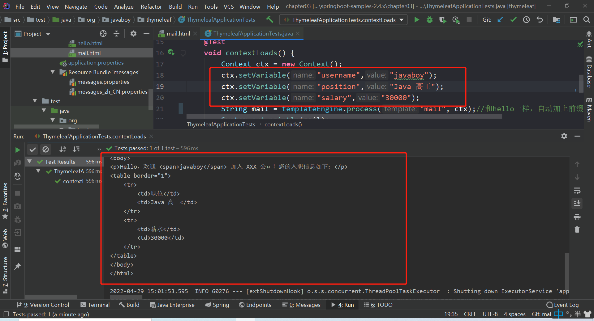
</div>

## Thymeleaf 细节

###  标准表达式语法

#### 简单表达式

后端controller的数据定义

<div style="text-align:center">
  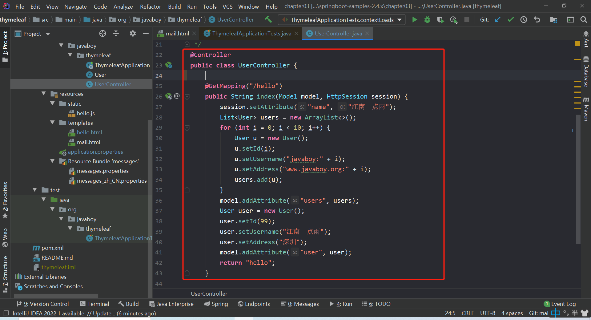
</div>

- **`${...}`**

  直接使用 `th:xx = "${}"` 获取对象属性。这个在前面的案例中已经演示过了，不再赘述。

- **`*{...}`**

  可以像 `${...}` 一样使用，也可以通过 `th:object` 获取对象，然后使用 `th:xx = "*{}"` 获取对象属性，这种简写风格极为清爽，推荐大家在实际项目中使用。

  ```html
  <table border="1" th:object="${user}">
  <tr>
      <td>用户名</td>
      <td th:text="*{username}"></td>
  </tr>
  <tr>
      <td>地址</td>
      <td th:text="*{address}"></td>
  </tr>
  </table>
  ```

- **`#{...}`**

  通常的国际化属性：`#{...}` 用于获取国际化语言翻译值。

  在 resources 目录下新建两个文件：messages.properties 和 messages_zh_CN.properties，内容如下：

  <u>messages.properties：</u>

  ```properties
  message = javaboy
  ```

  <u>messages_zh_CN.properties：</u>

  ```properties
  message = 周大侠
  ```
  
  然后<u>在 thymeleaf 中引用 message</u>，系统会根据<u>浏览器的语言环境</u>显示不同的值：
  
  ```properties
  <div th:text="#{message}"></div>
  ```
  
  结果：
  
<div style="text-align:center">
  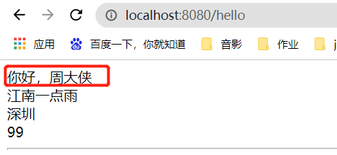
</div>

- **`@{...}`**

  - **引用绝对 URL：**

    ```html
    <script type="text/javascript" th:src="@{http://localhost:8080/hello.js}"></script>
    ```

    等价于：

    ```html
    <script type="text/javascript" src="http://localhost:8080/hello.js"></script>
    ```

  - **上下文相关的 URL：**

    首先在 application.properties 中配置 Spring Boot 的上下文，以便于测试：

    ```html
    server.servlet.context-path=/myapp
    ```

    引用路径：**注意{}里面的斜杠**

    ```html
    <script type="text/javascript" th:src="@{/hello.js}"></script>
    ```

    等价于：

    ```html
    <script type="text/javascript" src="/myapp/hello.js"></script>
    ```

    应用程序的上下文 **/myapp** 将被忽略。

    结果测试：

<div style="text-align:center">
  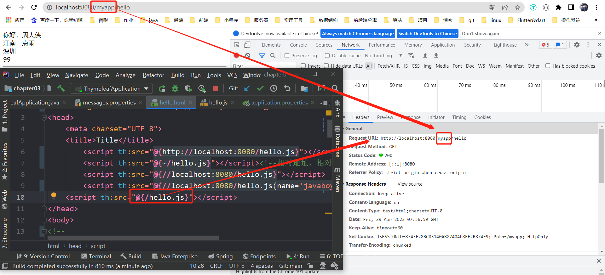
</div>

#### 字面量

这些是一些可以直接写在表达式中的字符，主要有如下几种：

- 文本字面量：'one text', 'Another one!',…
- 数字字面量：0, 34, 3.0, 12.3,…
- 布尔字面量：true, false
- Null字面量：null
- 字面量标记：one, sometext, main,…

```html
<div th:text="'这是 文本字面量(有空格)'"></div>
<div th:text="javaboy"></div>
<div th:text="99"></div>
<div th:text="true"></div>
```

如果文本是英文，并且不包含空格、逗号等字符，可以不用加单引号。

#### 文本运算

文本可以使用 `+` 进行拼接。

```html
<div th:text="'hello '+'javaboy'"></div>
<div th:text="'hello '+${user.username}"></div>
```

如果字符串中包含变量，也可以使用另一种简单的方式，叫做字面量置换，用 `|` 代替 `'...' + '...'`，如下：

```html
<div th:text="|hello ${user.username}|"></div>
<div th:text="'hello '+${user.username}+' '+|Go ${user.address}|"></div>
```

#### 算术运算

算术运算有：`+`, `-`, `*`, `/` 和 `%`

```html
<div th:with="age=(99*99/99+99-1)">
    <div th:text="${age}"></div>
</div>
```

`th:with` 定义了一个**局部变量** age，在其所在的 **div** 中可以使用该局部变量。

#### 布尔运算

- 二元运算符：and, or
- 布尔非（一元运算符）：!, not

```html
<div th:with="age=(99*99/99+99-1)">
    <div th:text="9 eq 9 or 8 ne 8"></div>
    <div th:text="!(9 eq 9 or 8 ne 8)"></div>
    <div th:text="not(9 eq 9 or 8 ne 8)"></div>
</div>
```

#### 比较和相等

表达式里的值可以使用 `>`, `<`, `>=` 和 `<=` 符号比较。`==` 和 `!=` 运算符用于检查相等（或者不相等）。注意 `XML`规定 `<` 和 `>` 标签不能用于属性值，所以应当把它们转义为 `<` 和 `>`。(数学运算符及转义写法)

<br>

如果不想转义，也可以使用别名：gt (>)；lt (<)；ge (>=)；le (<=)；not (!)。还有 eq (==), neq/ne (!=)。

```html
<div th:with="age=(99*99/99+99-1)">
    <div th:text="${age} eq 197"></div>
    <div th:text="${age} ne 197"></div>
    <div th:text="${age} ge 197"></div>
    <div th:text="${age} gt 197"></div>
    <div th:text="${age} le 197"></div>
    <div th:text="${age} lt 197"></div>
</div>
```

####  条件运算符

类似于 Java 中的三目运算符。

```html
<div th:with="age=(99*99/99+99-1)">
    <div th:text="(${age} ne 197)?'yes':'no'"></div>
</div>
```

####  内置对象

<u>基本内置对象：</u>

- \#ctx：上下文对象。
- \#vars: 上下文变量。
- \#locale：上下文区域设置。
- \#request：（仅在 Web 上下文中）HttpServletRequest 对象。
- \#response：（仅在 Web 上下文中）HttpServletResponse 对象。
- \#session：（仅在 Web 上下文中）HttpSession 对象。
- \#servletContext：（仅在 Web 上下文中）ServletContext 对象。

在页面可以访问到上面这些内置对象，举个简单例子：

```html
<div th:text='${#session.getAttribute("name")}'></div>
```

<u>实用内置对象：</u>

- \#execInfo：有关正在处理的模板的信息。
- \#messages：在变量表达式中获取外部化消息的方法，与使用＃{...}语法获得的方式相同。
- \#uris：转义URL / URI部分的方法
- \#conversions：执行配置的转换服务（如果有）的方法。
- \#dates：java.util.Date对象的方法：格式化，组件提取等
- \#calendars：类似于#dates但是java.util.Calendar对象。
- \#numbers：用于格式化数字对象的方法。
- \#strings：String对象的方法：contains，startsWith，prepending / appending等
- \#objects：一般对象的方法。
- \#bools：布尔评估的方法。
- \#arrays：数组方法。
- \#lists：列表的方法。
- \#sets：集合的方法。
- \#maps：地图方法。
- \#aggregates：在数组或集合上创建聚合的方法。
- \#ids：处理可能重复的id属性的方法（例如，作为迭代的结果）。

这是一些内置对象以及工具方法，使用方式也都比较容易，如果使用的是 IntelliJ IDEA，都会自动提示对象中的方法，很方便。

举例：

```html
<div th:text="${#execInfo.getProcessedTemplateName()}"></div>
<div th:text="${#arrays.length(#request.getAttribute('names'))}"></div>
```


### 设置属性值

这个是给 HTML 元素设置属性值。可以一次设置多个，多个之间用 `,` 分隔开。

例如：

```html

```

会被渲染成：

```html

```

当然这种设置方法不太美观，可读性也不好。Thymeleaf 还支持在每一个原生的 HTML 属性前加上 th: 前缀的方式来使用动态值，像下面这样：【可以在所有原生属性前面加一个`th:`，让他变成一个thymeleaf属性】

```html

```

这种写法看起来更清晰一些，渲染效果和前面一致。

上面案例中的 alt 和 title 则是两个特殊的属性，可以一次性设置，像下面这样：

```html

```

这个等价于前文的设置。

### 遍历

数组/集合/Map/Enumeration/Iterator 等的遍历也算是一个非常常见的需求，Thymeleaf 中通过 th:each 来实现遍历，像下面这样：

```html
<table border="1">
    <tr th:each="u : ${users}">
        <td th:text="${u.username}"></td>
        <td th:text="${u.address}"></td>
    </tr>
</table>
```

users 是要遍历的集合/数组，u 则是集合中的单个元素。

遍历的时候，我们可能需要获取遍历的状态，Thymeleaf 也对此提供了支持：

- index：当前的遍历索引，从0开始。
- count：当前的遍历索引，从1开始。
- size：被遍历变量里的元素数量。
- current：每次遍历的遍历变量。
- even/odd：当前的遍历是偶数次还是奇数次。
- first：当前是否为首次遍历。
- last：当前是否为最后一次遍历。

u 后面的 state 表示遍历状态，通过遍历状态可以引用上面的属性。

```html
<table border="1">
    <tr th:each="u,state : ${users}">
        <td th:text="${u.username}"></td>
        <td th:text="${u.address}"></td>
        <td th:text="${state.index}"></td>
        <td th:text="${state.count}"></td>
        <td th:text="${state.size}"></td>
        <td th:text="${state.current}"></td>
        <td th:text="${state.even}"></td>
        <td th:text="${state.odd}"></td>
        <td th:text="${state.first}"></td>
        <td th:text="${state.last}"></td>
    </tr>
</table>
```

### 分支语句

只显示奇数次的遍历，可以使用 th:if，如下：

```html
<table border="1">
    <tr th:each="u,state : ${users}" th:if="${state.odd}">
        <td th:text="${u.username}"></td>
        <td th:text="${u.address}"></td>
        <td th:text="${state.index}"></td>
        <td th:text="${state.count}"></td>
        <td th:text="${state.size}"></td>
        <td th:text="${state.current}"></td>
        <td th:text="${state.even}"></td>
        <td th:text="${state.odd}"></td>
        <td th:text="${state.first}"></td>
        <td th:text="${state.last}"></td>
    </tr>
</table>
```

th:if 不仅仅只接受布尔值，也接受其他类型的值，例如如下值都会判定为 true：

- 如果值是布尔值，并且为 true。
- 如果值是数字，并且不为 0。
- 如果值是字符，并且不为 0。
- 如果值是字符串，并且不为 “false”， “off” 或者 “no”。
- 如果值不是布尔值，数字，字符或者字符串。

但是如果值为 null，th:if 会求值为 false。

th:unless 的判定条件则与 th:if 完全相反。

```html
<table border="1">
    <tr th:each="u,state : ${users}" th:unless="${state.odd}">
        <td th:text="${u.username}"></td>
        <td th:text="${u.address}"></td>
        <td th:text="${state.index}"></td>
        <td th:text="${state.count}"></td>
        <td th:text="${state.size}"></td>
        <td th:text="${state.current}"></td>
        <td th:text="${state.even}"></td>
        <td th:text="${state.odd}"></td>
        <td th:text="${state.first}"></td>
        <td th:text="${state.last}"></td>
    </tr>
</table>
```

这个显示效果则与上面的完全相反。

当可能性比较多的时候，也可以使用 switch：

```html
<table border="1">
    <tr th:each="u,state : ${users}">
        <td th:text="${u.username}"></td>
        <td th:text="${u.address}"></td>
        <td th:text="${state.index}"></td>
        <td th:text="${state.count}"></td>
        <td th:text="${state.size}"></td>
        <td th:text="${state.current}"></td>
        <td th:text="${state.even}"></td>
        <td th:text="${state.odd}"></td>
        <td th:text="${state.first}"></td>
        <td th:text="${state.last}"></td>
        <td th:switch="${state.odd}">
            <span th:case="true">odd</span>
            <span th:case="*">even</span>
        </td>
    </tr>
</table>
```

`th:case="*"` 则表示默认选项。

### 本地变量

这个我们前面已经涉及到了，使用 `th:with` 可以定义一个本地变量。

### 内联

我们可以使用属性将数据放入页面模版中，但是很多时候，内联的方式看起来更加直观一些，像下面这样：

```
<div>hello [[${user.username}]]</div>
```

用内联的方式去做拼接也显得更加自然。

`[[...]]` 对应于 th:text （结果会是转义的 HTML），`[(...)]`对应于 th:utext，它不会执行任何的 HTML 转义。

像下面这样：【注意：通过 `th:with` 定义的变量，是在标签里生效的，所以第一种写法是错误的，没法显示不执行转义的html表情】

```html
<div th:with="str='hello <strong>javaboy</strong>'"></div>
    <div>[[${str}]]</div>
    <div>[(${str})]</div>
```

↑↑↑以上写法错误↑↑↑

↓↓↓以下写法正确↓↓↓

```html
<div th:with="str='hello <strong>javaboy</strong>'">
    <div>[[${str}]]</div>
    <div>[(${str})]</div>
</div>
```

最终的显示效果如下：

<div style="text-align:center">
  
</div>

不过内联方式有一个问题。我们使用 Thymeleaf 的一大优势在于*不用动态渲染就可以直接在浏览器中看到显示效果*，当我们使用属性配置的时候确实是这样，*但是如果我们使用内联的方式，各种表达式就会直接展示在静态网页中*。

也可以在 js 或者 css 中使用内联，以 js 为例，使用方式如下：

```html
<script th:inline="javascript">
    var username=[[${user.username}]]
    console.log(username)
</script>
```

js 中需要通过 `th:inline="javascript"` 开启内联。

通过这种“手段”，就可以在js代码里面直获取到服务端传过来的数据（比如在js里面获取request或者httpsession里边的东西）


*//本人在“照搬文章内容”基础上加了一些自学过程中自己的理解，这模块的内容仅用于学习，再次感谢松哥写的文章。*

<br><br><br>

## Freemarker简介

这是一个相当老牌的开源的免费的模版引擎，基于Apache许可证2.0版本发布。

通过 Freemarker 模版，我们可以将数据渲染成 HTML 网页、电子邮件、配置文件以及源代码等。Freemarker 不是面向最终用户的，而是一个 Java 类库，我们可以将之作为一个普通的组件嵌入到我们的产品中。

来看一张来自 Freemarker 官网的图片：

<div style="text-align:center">
  
</div>

可以看到，Freemarker 可以将模版和数据渲染成 HTML 。

Freemarker 模版后缀为 `.ftlh`(FreeMarker Template Language)。FTL 是一种简单的、专用的语言，它不是像 Java 那样成熟的编程语言。在模板中，你可以专注于如何展现数据， 而在模板之外可以专注于要展示什么数据。

##  整合 Spring Boot

```xml
<dependency>
    <groupId>org.springframework.boot</groupId>
    <artifactId>spring-boot-starter-freemarker</artifactId>
</dependency>
<dependency>
    <groupId>org.springframework.boot</groupId>
    <artifactId>spring-boot-starter-web</artifactId>
</dependency>
```

### 创建类

User类

```java
public class User {
    private Long id;
    private String username;
    private String address;
    //省略 getter/setter
}
```

UserController

```java
@Controller
public class UserController {
    @GetMapping("/hello")
    public String index(Model model) {
        List<User> users = new ArrayList<>();
        for (int i = 0; i < 10; i++) {
            User user = new User();
            user.setId((long) i);
            user.setUsername("javaboy>>>>" + i);
            user.setAddress("www.javaboy.org>>>>" + i);
            users.add(user);
        }
        model.addAttribute("users", users);
        return "index";
    }
}
```

在 freemarker 中渲染数据：

```html
<!DOCTYPE html>
<html lang="en">
<head>
    <meta charset="UTF-8">
    <title>Title</title>
</head>
<body>
<table border="1">
    <tr>
        <td>用户编号</td>
        <td>用户名称</td>
        <td>用户地址</td>
    </tr>
    <#list users as user>
        <tr>
            <td>${user.id}</td>
            <td>${user.username}</td>
            <td>${user.address}</td>
        </tr>
    </#list>
</table>
</body>
</html>
```

结果：

<div style="text-align:center">
  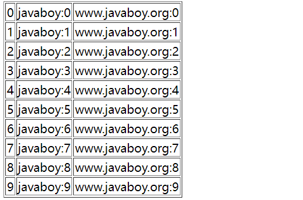
</div>

### 其他配置

如果我们要修改模版文件位置等，可以在 application.properties 中进行配置：

```properties
spring.freemarker.allow-request-override=false
spring.freemarker.allow-session-override=false
spring.freemarker.cache=false
spring.freemarker.charset=UTF-8
spring.freemarker.check-template-location=true
spring.freemarker.content-type=text/html
spring.freemarker.expose-request-attributes=false
spring.freemarker.expose-session-attributes=false
spring.freemarker.suffix=.ftl
spring.freemarker.template-loader-path=classpath:/templates/
```

配置文件按照顺序依次解释如下：

1. HttpServletRequest的属性是否可以覆盖controller中model的同名项
2. HttpSession的属性是否可以覆盖controller中model的同名项
3. 是否开启缓存
4. 模板文件编码
5. 是否检查模板位置
6. Content-Type的值
7. 是否将HttpServletRequest中的属性添加到Model中
8. 是否将HttpSession中的属性添加到Model中
9. 模板文件后缀
10. 模板文件位置


## Freemarker使用细节

### 插值与表达式

#### 直接输出值

**字符串**

可以直接输出一个字符串：

```ftl
<div>${"hello，我是直接输出的字符串"}</div>
<div>${"我的文件保存在C:\\盘"}</div>
```

\ 需要进行转义。

如果感觉转义太麻烦，可以在目标字符串的引号前增加 r 标记,在 r 标记后的文本内容将会直接输出，像下面这样：

```ftl
<div>${r"我的文件保存在C:\盘"}</div>
```

<div style="text-align:center">
  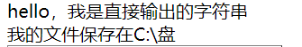
</div>

**数字**

在 FreeMarker 中使用数值需要注意以下几点:

1. 数值不能省略小数点前面的0，所以".5"是错误的写法。
2. 数值 8 , +8 , 8.00 都是相同的。

数字还有一些其他的玩法：

- 将数字以钱的形式展示

```ftl
<#assign num=99>
<div>${num?string.currency}</div>
```

`<#assign num=99>` 表示定义了一个变量 num，值为 99。最终的展示形式是在数字前面出现了一个人民币符号：

- 将数字以百分数的形式展示

```ftl
<div>${num?string.percent}</div>
```

**布尔**

布尔类型可以直接定义，不需要引号，像下面这样：

```ftl
<#assign flag=true>
<div>${flag?string("a","b")}</div>
```

首先使用 `<#assign flag=true>` 定义了一个 Boolean 类型的变量，然后在 div 中展示，如果 flag 为 true，则输出 a，否则输出 b。

**集合**

集合也可以现场定义现场输出，例如如下方式定义一个 List 集合并显示出来：

```ftl
<#list ["星期一", "星期二", "星期三", "星期四", "星期五", "星期六", "星期天"] as x>
    ${x}<br/>
</#list>
```

<div style="text-align:center">
  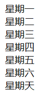
</div>

集合中的元素也可以是一个表达式：

```ftl
<#list [2+2,"javaboy"] as x>
    ${x} <br/>
</#list>
```

集合中的第一个元素就是 2+2 的结果，即 4。

也可以用 `1..5` 表示 1 到 5，`5..1` 表示 5 到 1，例如：

```ftl
<#list 5..1 as x>
    ${x} <br/>
</#list>
<#list 1..5 as x>
    ${x} <br/>
</#list>
```

<div style="text-align:center">
  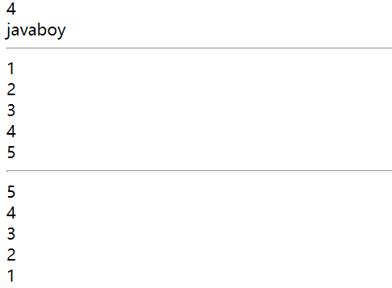
</div>

也可以定义 Map 集合，Map 集合用一个 `{}` 来描述：

```ftl
<hr>
<#assign userinfo={"name":"javaboy","address":"www.javaboy.org"}>

<#list userinfo?keys as key><#--意思是拿到userinfo这个map里面所有的key命名为key，并展示出来-->
    <div>${key}-${userinfo[key]}</div>
</#list>

<hr>

<#list userinfo?values as value>
    <div>${value}</div>
</#list>

<hr>
<div>${userinfo.name}</div>
<div>${userinfo['address']}</div>
```

最上面两个循环分别表示遍历 Map 中的 key+values 和 values。

下面的 `.name`和`['name']`两种写法是等价的

<div style="text-align:center">
  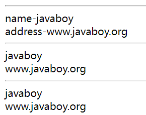
</div>

#### 输出变量

创建一个 HelloController，然后添加如下方法：

```java
@Controller
public class UserController {
    @GetMapping("/hello")
    public String hello(Model model) {
        List<User> users = new ArrayList<>();
        for (int i = 0; i < 10; i++) {
            User u = new User();
            u.setId((long) i);
            u.setUsername("javaboy:" + i);
            u.setAddress("www.javaboy.org:" + i);
            users.add(u);
        }
        model.addAttribute("users", users);
        Map<String, Object> info = new HashMap<>();
        info.put("name", "江南一点雨");
        info.put("age", 99);
        model.addAttribute("info", info);
        model.addAttribute("name", "javaboy");
        model.addAttribute("birthday", new Date());
        return "hello";
    }
}
```

**普通变量**

普通变量的展示很容易，如下：

```ftl
<div>${name}</div>
```

**集合**

集合的展示就有很多不同的玩法了。

直接遍历：

```ftl
<div>
  <table border="1">
    <#list users as u>
        <tr>
            <td>${u.id}</td>
            <td>${u.username}</td>
            <td>${u.address}</td>
        </tr>
    </#list>
</table>
</div>
```

输出集合中第三个元素：

```ftl
<div>${users[1].address}</div>
```

输出集合中第 4-6 个元素，即子集合：

```ftl
<div>
  <table border="1">
    <#list users[3..5] as u>
        <tr>
            <td>${u.id}</td>
            <td>${u.username}</td>
            <td>${u.address}</td>
        </tr>
    </#list>
</table>
</div>
```

遍历时，可以通过 `变量_index` 获取遍历的下标：

```ftl
<div>
<table border="1">
    <#list users as u>
        <tr>
            <td>${u.id}</td>
            <td>${u.username}</td>
            <td>${u.address}</td>
            <td>${u_index}</td>
            <td>${u_has_next?string("yes","no")}</td>
        </tr>
    </#list>
</table>
</div>
```

<div style="text-align:center">
  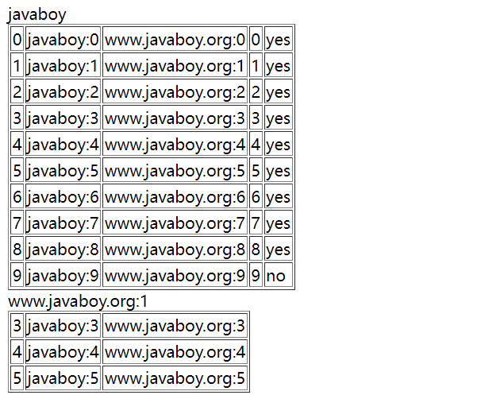
</div>


**Map**

直接获取 Map 中的值有不同的写法，如下：

```ftl
<div>${info.name}</div>
<div>${info['age']}</div>
```

获取 Map 中的所有 key，并根据 key 获取 value：【注意：循环写法时 `<div>${key}-${info.key}</div>`这种写法是错的】

```ftl
<div>
  <#list info?keys as key>
    <div>${key}-${info[key]}</div>
</#list>
</div>
```

获取 Map 中的所有 value：

```ftl
<div>
    <#list info?values as value>
        <div>${value}</div>
    </#list>
</div>
```

<div style="text-align:center">
  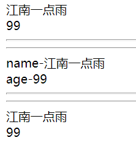
</div>


#### 字符串操作

字符串的拼接有两种方式：

```ftl
<div>${"hello ${name}"}</div>
<div>${"hello "+ name}</div>
```

也可以从字符串中截取子串：

```ftl
<div>${name[0]}${name[1]}</div>
<div>${name[1..3]}</div>
```

<div style="text-align:center">
  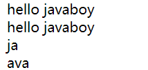
</div>

####  集合操作

集合或者 Map 都可以相加。

集合相加：

```ftl
<div>
<#list [1,2,3]+[4,5,6] as x>
    <div>${x}</div>
</#list>
</div>
```

Map 相加：

```ftl
<#list (info+{"address":"www.javaboy.org"})?keys as key>
    <div>${key}</div>
</#list>
```

<div style="text-align:center">
  
</div>

#### 3.1.5 算术运算符

`+`、`—`、`*`、`/`、`%` 运算都是支持的。

```ftl
<div>
    <#assign age=99>
    <div>${age*99/99+99-1}</div>
</div>
```

#### 3.1.6 比较运算

比较运算和 Thymeleaf 比较类似:

1. = 或者 == 判断两个值是否相等。
2. != 判断两个值是否不等。
3. `>`或者 `gt` 判断左边值是否大于右边值。
4. `>=` 或者 `gte` 判断左边值是否大于等于右边值。
5. `<` 或者 `lt` 判断左边值是否小于右边值。
6. `<=` 或者 `lte` 判断左边值是否小于等于右边值。

可以看到，带 `<` 或者 `>` 的符号，也都有别名，建议使用别名。

```ftl
<div>
    <#assign age=99>
    <#if age=99>age=99</#if>
    <#if age gt 99>age gt 99</#if>
    <hr>
    <#if (age > 99) || 1==1>(age > 99) || 1==1</#if>
    <hr>
    <#if age gte 99>age gte 99</#if>
    <#if age lt 99>age lt 99</#if>
    <#if age lte 99>age lte 99</#if>
    <#if age!=99>age!=99</#if>
    <#if age==99>age==99</#if>
</div>
```

<div style="text-align:center">
  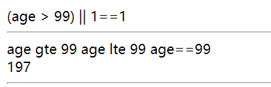
</div>

#### 逻辑运算

逻辑运算符有三个:

- 逻辑与 `&&`
- 逻辑或 `||`
- 逻辑非 `!`

逻辑运算符只能作用于布尔值,否则将产生错误。

```ftl
<div>
    <#assign age=99>
    <#if age=99 && 1==1>age=99 && 1==1</#if>
    <#if age=99 || 1==0>age=99 || 1==0</#if>
    <#if !(age gt 99)>!(age gt 99)</#if>
</div>
```

#### 空值处理

为了处理缺失变量,Freemarker 提供了两个运算符:

1. `!`：指定缺失变量的默认值
2. `??`：判断某个变量是否存在

如果某个变量不存在，则设置其为 javaboy，如下：

```ftl
<div>${aaa!"javaboy"}</div>
```

如果某个变量不存在，则设置其为空字符串，如下：

```ftl
<div>${aaa!}</div>
```

即，`!` 后面的东西如果省略了，默认就是空字符串。

判断某个变量是否存在：

```ftl
<div>${aaa!"javaboy"}</div>
<div>${aaa!}</div>
<div><#if aaa??>aaa</#if></div>
```

### 内建函数

内建函数涉及到的东西比较多，可以参考官方文档:http://freemarker.foofun.cn/ref_builtins.html

这里仅说一些比较常用的内建函数。

**cap_first**

使字符串第一个字母大写：

```ftl
<div>${"hello"?cap_first}</div>
```

**lower_case**

将字符串转换成小写：

```ftl
<div>${"HELLO"?lower_case}</div>
```

**upper_case**

将字符串转换成大写：

```ftl
<div>${"hello"?upper_case}</div>
```

**trim**

去掉字符串前后的空白字符：

```ftl
<div>${" hello"?trim}</div>
```

**size**

获取序列中元素的个数：

```ftl
<div>${users?size}</div>
```

**int**

取得数字的整数部分,结果带符号：

```ftl
<div>${3.14?int}</div>
```

**freemarker日期格式化**

```ftl
<div>${birthday?string("yyyy-MM-dd")}</div>
```

 

### 常用指令

#### if/else

分支控制指令，作用类似于 Java 语言中的 if：

```ftl
<div>
    <#assign age=23>
    <#if (age>60)>老年人
    <#elseif (age>40)>中年人
    <#elseif (age>20)>青年人
    <#else> 少年人
    </#if>
</div>
```

比较符号中用了 `()`，因此不用转义。

#### switch

分支指令，类似于 Java 中的 switch：

```ftl
<div>
    <#assign age=99>
    <#switch age>
        <#case 23>23<#break>
        <#case 24>24<#break>
        <#default>9999
    </#switch>
</div>
```

`<#break>` 是提前退出，也可以用在 `<#list>` 中。

#### include

include 可以包含一个外部页面进来。

```ftl
<#include "./javaboy.ftlh">
```

#### macro

macro 用来定义一个宏。

我们可以自定义一个名为 book 的宏，并引用它：

```ftl
<#macro book>
    三国演义
</#macro>
<@book/>
```

最终页面中会输出宏中所定义的内容。

在定义宏的时候，也可以传入参数，那么引用时，也需要传入参数：

```ftl
<#macro book bs>
    <table border="1">
        <#list bs as b>
            <tr>
                <td>${b}</td>
            </tr>
        </#list>
    </table>
</#macro>
<@book ["三国演义","水浒传"]/>
```

bs 就是需要传入的参数。可以通过传入多个参数，多个参数跟在 bs 后面即可，中间用空格隔开。

还可以使用 `<#nested>` 引入用户自定义指令的标签体，像下面这样：

```ftl
<#macro book bs>
    <table border="1">
        <#list bs as b>
            <tr>
                <td>${b}</td>
            </tr>
        </#list>
    </table>
    <#nested>
</#macro>
<@book ["三国演义","水浒传"]>
    <h1>hello javaboy!</h1>
</@book>
```

在宏定义的时候，`<#nested>` 相当于是一个占位符，在调用的时候，`<@book>` 标签中的内容会出现在 `<#nested>` 位置。

前面的案例中，宏都是定义在当前页面中，宏也可以定义在一个专门的页面中。新建 myjavaboy.ftlh 页面，内容如下：

```ftl
<#macro book bs>
    <table border="1">
        <#list bs as b>
            <tr>
                <td>${b}</td>
            </tr>
        </#list>
    </table>
    <#nested>
</#macro>
```

此时，需要先通过 `<#import>` 标签导入宏，然后才能调用，如下：

```ftl
<#import "./myjavaboy.ftlh" as com>
<@com.book bs=["三国演义","水浒传"]>
    <h1>hello javaboy!</h1>
</@com.book>
```

#### 3.2.5 noparse

如果想在页面展示一些 Freemarker 语法而不被渲染，则可以使用 noparse 标签，如下：

```ftl
<#noparse>
<#import "./myjavaboy.ftlh" as com>
<@com.book bs=["三国演义","水浒传"]>
    <h1>hello javaboy!</h1>
</@com.book>
</#noparse>
```

显示效果如下：

<div style="text-align:center">
  
</div>


<br><br><br><br>


# Spring Boot 整合数据持久层

## Spring Boot 整合 MyBatis【注解版】

1. 实体类准备

   ```java
   public class User {
       private Long id;
       private String username;
       private String address;
   
       public Long getId() {
           return id;
       }
   
       public void setId(Long id) {
           this.id = id;
       }
   
       public String getUsername() {
           return username;
       }
   
       public void setUsername(String username) {
           this.username = username;
       }
   
       @Override
       public String toString() {
           return "User{" +
                   "id=" + id +
                   ", username='" + username + '\'' +
                   ", address='" + address + '\'' +
                   '}';
       }
   
       public String getAddress() {
           return address;
       }
   
       public void setAddress(String address) {
           this.address = address;
       }
   }
   
   ```

2. 注册mapper

   ```java
   @SpringBootApplication
   @MapperScan(basePackages = "org.javaboy.mybatis.mapper")//指定扫描文件
   public class MybatisApplication {
       public static void main(String[] args) {
           SpringApplication.run(MybatisApplication.class, args);
       }
   
   }
   ```

3. sql语句

   ```java
   public interface UserMapper {
       @Select("select * from user where id=#{id}")
       User getUserById(Long id);
   
       @Results({
               @Result(property = "address",column = "address1")
       })
       @Select("select * from user")
       List<User> getAllUsers();
   
       @Insert("insert into user (username,address1) values (#{username},#{address})")
       //主键回填
       @SelectKey(statement = "select last_insert_id()",keyProperty = "id",before = false,resultType = Long.class)
       Integer addUser(User user);
   
       @Delete("delete from user where id=#{id}")
       Integer deleteById(Long id);
   
       @Update("update user set username=#{username} where id=#{id}")
       Integer updateById(String username, Long id);
   }
   
   ```

4. 测试

   ```java
   @SpringBootTest
   class MybatisApplicationTests {
   
       @Autowired
       UserMapper userMapper;
   
       @Test
       void contextLoads() {
           User user = userMapper.getUserById(3L);
           System.out.println(user);
       }
   
       @Test
       void tes1() {
           List<User> users = userMapper.getAllUsers();
           System.out.println(users);
       }
   
       @Test
       void test2() {
           User user = new User();
           user.setUsername("zhangsan");
           user.setAddress("shenzhen");
           userMapper.addUser(user);
           System.out.println("user.getId() = " + user.getId());
       }
   
       @Test
       void test3() {
           userMapper.deleteById(12L);
           userMapper.updateById("123", 11L);
       }
   }
   
   ```

<br><br><br><br>

## Spring Boot 整合 MyBatis【XML版】

1. 如上

2. 如上

3. resource目录下的UserMapper2.xml

   ```xml
   <!DOCTYPE mapper
           PUBLIC "-//mybatis.org//DTD Mapper 3.0//EN"
           "http://mybatis.org/dtd/mybatis-3-mapper.dtd">
   <mapper namespace="org.javaboy.mybatis.mapper.UserMapper2">
   
       <resultMap id="UserMap" type="org.javaboy.mybatis.model.User">
           <id property="id" column="id"/>
           <result property="username" column="username"/>
           <result property="address" column="address1"/>
       </resultMap>
   
       <select id="getUserById" resultMap="UserMap">
           select * from user where id=#{id};
       </select>
   
       <select id="getAllUsers" resultMap="UserMap">
           select * from user ;
       </select>
   
       <insert id="addUser" parameterType="org.javaboy.mybatis.model.User" useGeneratedKeys="true" keyProperty="id">/*parameterType代表参数类型*/
           insert into user (username,address1) values (#{username},#{address});
       </insert>
   
       <delete id="deleteById">
           delete from user where id=#{id}
       </delete>
       <update id="updateById">
           update user set username = #{username} where id=#{id};
       </update>
   </mapper>
   ```

4. 测试类

   ```java
   @Autowired
       UserMapper2 userMapper2;
       @Test
       void test4() {
           User user = userMapper2.getUserById(9L);
           System.out.println("user = " + user);
           List<User> allUsers = userMapper2.getAllUsers();
           System.out.println("allUsers = " + allUsers);
           User u = new User();
           u.setUsername("lisi");
           u.setAddress("guangzhou");
           userMapper2.addUser(u);
           System.out.println(u.getId());
           userMapper2.deleteById(9L);
           userMapper2.updateById("zhangsan", 4L);
       }
   ```

<br><br><br><br>

## 定义资源文件

1. 告诉maven，我的配置文件不仅仅在resource目录下，还在上面的java目录下

```java
 		<resources>
            <resource>
                <directory>src/main/java</directory>
                <includes>
                    <include>**/*.xml</include>
                </includes>
            </resource>
            <resource>
                <directory>src/main/resources</directory>
            </resource>
        </resources>
```

文件目录如图

<div style="text-align:center">
  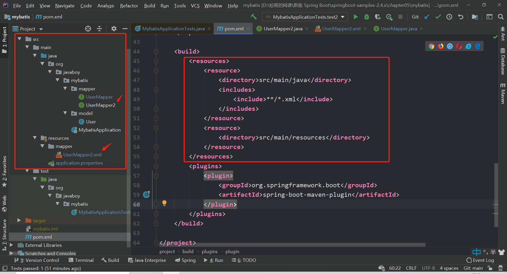
</div>

2. 也可以直接指定mapper在哪里，如下图

<div style="text-align:center">
  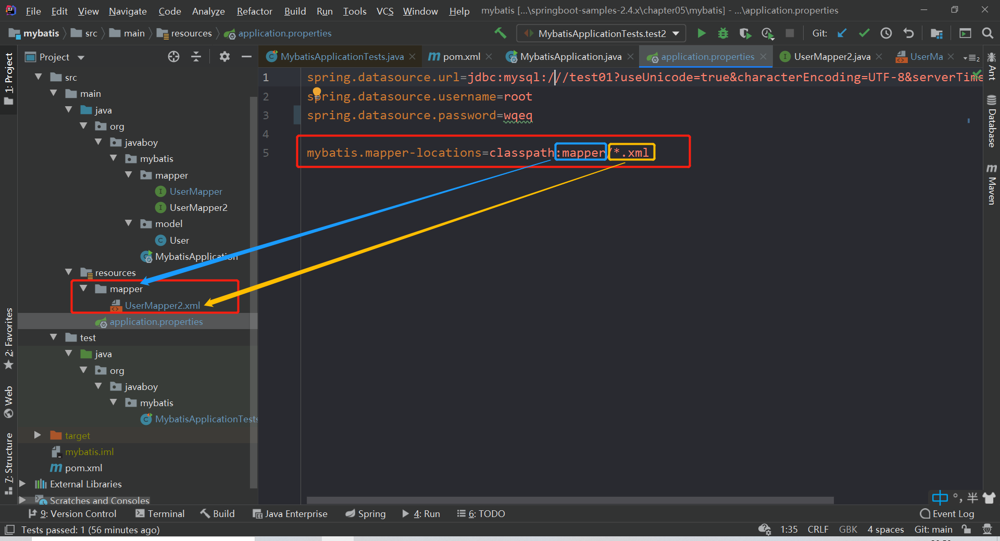
</div>

<br><br><br><br>

## Spring Boot 整合 MyBatis 多数据源

1. 在配置数据库的properties里配置数据库的连接信息

   ```properties
   spring.datasource.one.jdbcUrl=jdbc:mysql:///test01?useUnicode=true&characterEncoding=UTF-8&serverTimezone=Asia/Shanghai
   spring.datasource.one.username=root
   spring.datasource.one.password=wqeq
   
   spring.datasource.two.jdbcUrl=jdbc:mysql:///test02?useUnicode=true&characterEncoding=UTF-8&serverTimezone=Asia/Shanghai
   spring.datasource.two.username=root
   spring.datasource.two.password=wqeq
   ```

2. 在config包中的DataSourceConfig创建DataSource的实例【DataSourceConfig】

   ```java
   @Configuration
   public class DataSourceConfig {
       @Bean
       @ConfigurationProperties(prefix = "spring.datasource.one")
       DataSource dsOne() {
           return new HikariDataSource();
       }
       @Bean
       @ConfigurationProperties(prefix = "spring.datasource.two")
       DataSource dsTwo() {
           return new HikariDataSource();
       }
   }
   
   ```

3. 配置mybatis实例【MyBatisConfigOne 、MyBatisConfigTwo】

   ```java
   @Configuration
   @MapperScan(basePackages = "org.javaboy.mybatismulti.mapper1",sqlSessionFactoryRef = "sqlSessionFactory1",sqlSessionTemplateRef = "sqlSessionTemplate1")
   public class MyBatisConfigOne {
       @Autowired
       @Qualifier("dsOne")
       DataSource ds;
   
       @Bean
       SqlSessionFactory sqlSessionFactory1() {
           SqlSessionFactory sqlSessionFactory = null;
           try {
               SqlSessionFactoryBean bean = new SqlSessionFactoryBean();
               bean.setDataSource(ds);
               sqlSessionFactory = bean.getObject();
           } catch (Exception e) {
               e.printStackTrace();
           }
           return sqlSessionFactory;
       }
   
       @Bean
       SqlSessionTemplate sqlSessionTemplate1() {
           return new SqlSessionTemplate(sqlSessionFactory1());
       }
   }
   
   ```

4. mapper包下，【UserMapper1和UserMapper1.xml】【UserMapper2和UserMapper2.xml】

5. 综上↑，项目结构如图所示

<div style="text-align:center">
  
</div>

6. 测试代码

   ```java
   @SpringBootTest
   class MybatismultiApplicationTests {
   
       @Autowired
       UserMapper1 userMapper1;
       @Autowired
       UserMapper2 userMapper2;
       @Test
       void contextLoads() {
           System.out.println("userMapper1.getAllUsers() = " + userMapper1.getAllUsers());
           System.out.println("userMapper2.getAllUsers() = " + userMapper2.getAllUsers());
       }
   
   }
   ```

   

7. 测试结果

<div style="text-align:center">
  
</div>

<br><br><br><br>

## Spring Boot 整合 Spring Data Jpa

### 入门操作

1. 依赖

   ```xml
           <dependency>
               <groupId>org.springframework.boot</groupId>
               <artifactId>spring-boot-starter-data-jpa</artifactId>
           </dependency>
           <dependency>
               <groupId>org.springframework.boot</groupId>
               <artifactId>spring-boot-starter-web</artifactId>
           </dependency>
   
           <dependency>
               <groupId>mysql</groupId>
               <artifactId>mysql-connector-java</artifactId>
               <scope>runtime</scope>
           </dependency>
           <dependency>
               <groupId>org.springframework.boot</groupId>
               <artifactId>spring-boot-starter-test</artifactId>
               <scope>test</scope>
           </dependency>
   ```

2. 数据库基本配置

   ```properties
   spring.datasource.username=root
   spring.datasource.password=wqeq
   spring.datasource.url=jdbc:mysql:///test01?useUnicode=true&characterEncoding=UTF-8
   
   #jpa的平台
   spring.jpa.database=mysql
   #在控制台打印sql
   spring.jpa.show-sql=true
   #指定数据库平台
   spring.jpa.database-platform=mysql
   #如果对象变了，对应的表也要重新更新
   spring.jpa.hibernate.ddl-auto=update
   #指定数据库的方言为mysql57，5.7的版本就会默认选择InnoDB【是MySQL的数据库引擎之一】
   spring.jpa.properties.hibernate.dialect=org.hibernate.dialect.MySQL57Dialect
   ```
   
3. 定义实体类

   ```java
   
   @Entity(name = "t_book")//以后数据库上自动创建一个和java类对应的表||如果什么都不标记，默认使用类名作为表名
   public class Book {
       @Id//代表被注释的属性是主键
       @GeneratedValue(strategy = GenerationType.IDENTITY)//自动生成【自动增长型】
       private Long id;//默认属性名就是数据库里字段的名称
       @Column(name = "b_name")//重新指定数据库字段的名字
       private String name;
       private String author;
   
       @Override
       public String toString() {
           return "Book{" +
                   "id=" + id +
                   ", name='" + name + '\'' +
                   ", author='" + author + '\'' +
                   '}';
       }
   
       public Long getId() {
           return id;
       }
   
       public void setId(Long id) {
           this.id = id;
       }
   
       public String getName() {
           return name;
       }
   
       public void setName(String name) {
           this.name = name;
       }
   
       public String getAuthor() {
           return author;
       }
   
       public void setAuthor(String author) {
           this.author = author;
       }
   }
   
   ```

4. 运行启动类，查看数据库结果

<div style="text-align:center">
  
</div>

5. 操作表,在单元测试中测试

   - 添加/删除

     ```java
     
         @Autowired
         BookDao bookDao;
     
         @Test
         void contextLoads() {
             Book book = new Book();
             book.setName("三国演义");
             book.setAuthor("罗贯中");
             bookDao.save(book);//保存一条记录
         }
     
         @Test
         void test1() {
             List<Book> list = bookDao.findAll();
             System.out.println("list = " + list);
             Optional<Book> byId = bookDao.findById(2L);//查找id为2的
             System.out.println("byId = " + byId);
             bookDao.deleteById(1L);//删除id为1的
         }
        
     ```

   - 分页操作

     ```java
     @Test
     void test2() {
         //页码从 0 开始记，1 表示第二页
         PageRequest pageRequest = PageRequest.of(0, 3/*第一页，每页有三条记录*/, Sort.by(Sort.Order.asc("id")));
         Page<Book> page = bookDao.findAll(pageRequest);
         System.out.println("总记录数： " + page.getTotalElements());
         System.out.println("总页数 " + page.getTotalPages());
         System.out.println("查到的数据 " + page.getContent());
         System.out.println("每页的记录数 " + page.getSize());//每页我打算查询到多少条记录
         System.out.println("是否还有下一页 " + page.hasNext());
         System.out.println("是否还有上一页 " + page.hasPrevious());
         System.out.println("是否最后一页 " + page.isLast());
         System.out.println("是否第一页 " + page.isFirst());
         System.out.println("当前页码 " + page.getNumber());
         System.out.println("当前页的记录数 " + page.getNumberOfElements());//实际查询到多少条，比如最后一页查询到的就不是三条了
     }
     ```

   - 分页测试

<div style="text-align:center">
  
</div>

<br><br>

### 按方法命名规范

1. 按方法的命名规范来

   ```java
   public interface BookDao extends JpaRepository<Book,Long>/*JpaRepository这个类有两个泛型：1.到时候BookDao这个类要处理的实体类是谁
                                                                                           2.实体类定义的主键类型是什么
                                                              这堆东西会自动注入到spring容器中去                                              */ {
       List<Book> getBookByAuthorIs(String author);//方法名可以以find get read三个单词开始
                                                   //美其名曰：现在不用管数据库的东西，咱操作的就是对象
      
   }
   ```

2. 在单元测试中测试

   ```java
      @Test
       void test3() {
           List<Book> list = bookDao.getBookByAuthorIs("鲁迅");
           System.out.println("list = " + list);
       }
   
   ```

3. 结果

<div style="text-align:center">
  
</div>

4. 这里借用下松哥的博客 http://springboot.javaboy.org/2019/0407/springboot-jpa

<br><br>


### 自定义查询

当方法命名规范里的操作无法满足你的需求的时候，就需要自定义查询

1. 在dao包下的BookDao类

   ```java
    //nativeQuery代表使用原生的sql
       @Query(nativeQuery = true,value = "select * from t_book where id=(select max(id) from t_book)")
       Book maxIdBook();
   ```

2. 单元测试

   ```java
   @Test
   void test4() {
       System.out.println(bookDao.maxIdBook());
   }
   ```

3. 测试结果

<div style="text-align:center">
  
</div>

<br><br>

### 自定义更新

涉及到数据库的修改，要球必须要有事务 

1. dao包下的BookDao

   ```java
   @Query("update t_book set b_name=:name where id=:id")
       @Modifying//默认的sql是不支持更新操作的，如果想让它支持更新操作，就要加这个注解
       void updateBookById(String name, Long id);
   ```
   
2. service包下的BookService

   ```java
   @Service
   public class BookService {
       @Autowired
       BookDao bookDao;
       @Transactional//给它一个事务
       public void updateBookById(String name, Long id){
           bookDao.updateBookById(name, id);
       }
   }
   ```
   
3. 单元测试

   ```java
   @Autowired
   BookService bookService;
   @Test
   void test5() {
       bookService.updateBookById("123", 7L);
   }
   ```

4. 测试结果

<div style="text-align:center">
  
</div>


<br><br><br><br>

## Spring Data Jpa 多数据源

这方面比较简单是写起来又复杂，直接参考松哥的博客（关键是自己懒）

http://itboyhub.com/2021/01/25/spring-boot2-spring-data-jpa/

http://itboyhub.com/2021/01/25/spring-boot2-jpa/

http://itboyhub.com/2021/01/25/spring-boot2-multi-jpa/

<br><br><br><br><br><br>

# Spring Boot 整合 NoSQL

## Spring Boot 整合 Redis

1. 配置redis基本信息

   ```pro
   # redis 密码，没有的话可以不弄
   #spring.redis.password=123
   spring.redis.host=127.0.0.1
   spring.redis.port=6379
   ```

2. 依赖

   ```xml
   <dependency>
               <groupId>org.springframework.boot</groupId>
               <artifactId>spring-boot-starter-data-redis</artifactId>
           </dependency>
   ```

3. 实体类

   ```java
   public class User implements Serializable {//Serializable接口可以实现自动序列化
       private String username;
       private String address;
   
       @Override
       public String toString() {
           return "User{" +
                   "username='" + username + '\'' +
                   ", address='" + address + '\'' +
                   '}';
       }
   
       public String getUsername() {
           return username;
       }
   
       public void setUsername(String username) {
           this.username = username;
       }
   
       public String getAddress() {
           return address;
       }
   
       public void setAddress(String address) {
           this.address = address;
       }
   }
   
   ```

4. 单元测试代码

   ```java
   @SpringBootTest
   class RedisApplicationTests {
   
       @Autowired
       RedisTemplate redisTemplate;//键值对可以是对象，并会自动序列化
       @Autowired
       StringRedisTemplate stringRedisTemplate;//键值对只能是string
   
       @Test
       void contextLoads() {
           User user = new User();
           user.setUsername("javaboy");
           user.setAddress("www.javaboy.org");
           ValueOperations ops = redisTemplate.opsForValue();
           ops.set("u", user);
           User u = (User) ops.get("u");//拿到对象以后又自动帮我反序列化
           System.out.println("u = " + u);
       }
   
       @Test
       void test1() throws JsonProcessingException {
           ValueOperations<String, String> ops = stringRedisTemplate.opsForValue();
           User user = new User();
           user.setUsername("javaboy");
           user.setAddress("www.javaboy.org");
           ObjectMapper om = new ObjectMapper();
           String s = om.writeValueAsString(user);//将对象序列化成字符串，“s”
           ops.set("u1", s);
           String u1 = ops.get("u1");
           User user1 = om.readValue(u1, User.class);//反序列化成对象
           System.out.println("user1 = " + user1);
       }
   
   }
   
   ```

   

5. RedisTemplate测试结果，key的值也会进行序列化操作

<div style="text-align:center">
  
</div>

6. StringRedisTemplate测试结果，不会进行任何序列化操作

<div style="text-align:center">
  
</div>

<br><br><br><br>

## Spring Boot 整合 Redis的具体应用---session共享

1. 所需的依赖【redis、spring session】

   ```xml
    <dependencies>
           <dependency>
               <groupId>org.springframework.boot</groupId>
               <artifactId>spring-boot-starter-data-redis</artifactId>
           </dependency>
           <dependency>
               <groupId>org.springframework.boot</groupId>
               <artifactId>spring-boot-starter-web</artifactId>
           </dependency>
           <dependency>
               <groupId>org.springframework.session</groupId>
               <artifactId>spring-session-data-redis</artifactId>
           </dependency>
   
           <dependency>
               <groupId>org.springframework.boot</groupId>
               <artifactId>spring-boot-starter-test</artifactId>
               <scope>test</scope>
           </dependency>
       </dependencies>
   ```

2. redis基本信息的配置和之前一样

3. 代码，往session里面存数据以及读数据

   ```java
   @RestController
   public class HelloController {
       @Value("${server.port}")//注入项目的端口号
       Integer port;
   
       @GetMapping("/set")
       public String set(HttpSession session) {
           session.setAttribute("javaboy", "www.javaboy.org");
           return String.valueOf(port);
       }
   
       @GetMapping("/get")
       public String get(HttpSession session) {
           String javaboy = (String) session.getAttribute("javaboy");
           return javaboy + ":" + port;
       }
   }
   
   ```

4. 如果引入了redis和spring session的依赖，那么关于spring的操作会被自动的拦截下来，本来session会存在内存里面，现在不会了，会存在redis里面

5. 打成jar包，在不同的端口【8080/8081】测试

   `java -jar sessionshare-0.0.1-SNAPSHOT.jar --server.port=8080`

   `java -jar sessionshare-0.0.1-SNAPSHOT.jar --server.port=8081`

6. 测试结果
<div style="text-align:center">
  
</div>

<br><br><br><br>

## redis处理SpringBoot接口幂等性

1. 配置redis基本信息

2. 在token包下定义所设计到的redis操作

   1. 定义RedisService类，操作redis

      ```java
      @Service
      public class RedisService {
          @Autowired
          StringRedisTemplate stringRedisTemplate;//把redis注册进来
      
          public boolean setEx(String key, String value, Long expireTime) {
              boolean result = false;
              try {
                  ValueOperations<String, String> ops = stringRedisTemplate.opsForValue();//先拿到ops对象
                  ops.set(key,value);
                  stringRedisTemplate.expire(key, expireTime, TimeUnit.SECONDS);//设置过期时间
                  result = true;
              } catch (Exception e) {
                  e.printStackTrace();
              }
              return result;
          }
      
          public boolean exists(String key) {//判断key是否存在
              return stringRedisTemplate.hasKey(key);
          }
      
          public boolean remove(String key) {//移除，如果这次请求成功了就要把redis里面的token移出掉，
                                             // 这样的话下一个请求带着相同的token来，请求就不会被通过。
                                             //不被通过，所以要去重新获取一个token，这个过程就会避免一个接口被调用多次。
              if (exists(key)) {//判断key是否存在
                  return stringRedisTemplate.delete(key);
              }
              return false;
          }
      }
      ```

   2. 定义TokenService，设计到令牌的操作

      ```java
      @Service
      public class TokenService {
          @Autowired
          RedisService redisService;
      
          public String createToken() {//生成令牌
              String uuid = UUID.randomUUID().toString();
              redisService.setEx(uuid, uuid, 10000L);//10000秒，如果过期了token会自动的从redis里面移除掉
                                                              //有效期只有一次：一旦用过了，就失效了；或者没有用，时间到了也会失效
              return uuid;
          }
      
          public boolean checkToken(HttpServletRequest request) throws IdempotentException {//检查token，从请求里面尝试拿参数过来
              String token = request.getHeader("token");
              if (StringUtils.isEmpty(token)) {//如果是空的
                  token = request.getParameter("token");
                  if (StringUtils.isEmpty(token)) {//这里还是空的，证明请求过来的时候压根就没有带token
                      throw new IdempotentException("token 不存在");
                  }
              }
              //执行到这一步，证明是正常的，有token，看redis有没有token
              if (!redisService.exists(token)) {
                  throw new IdempotentException("重复操作！");
              }
              boolean remove = redisService.remove(token);
              if (!remove) {
                  throw new IdempotentException("重复操作！");
              }
              return true;//表示检查通过
          }
      }
      ```

   3. 在exceptiion包下定义名为IdempotentException的异常，上面的方法需要用到

      ```java
      public class IdempotentException extends Exception {
          public IdempotentException(String message) {
              super(message);
          }
      }
      ```

   4. 在注解anno包下，定义注解，到时候把这个注解加到方法上，哪个方法有这个注解，哪个方法上有这个注解，就要处理这个注解的幂等性问题。

      ```java
      @Target(ElementType.METHOD)//表示“被标注”的注解只能出现在方法上
      @Retention(RetentionPolicy.RUNTIME)//用来标注“被标注的注解”最终保存在哪里。
      public @interface AutoIdempotent {
      }
      
      ```

      **接下来就要对这个注解进行解析，注解的解析有两种方法：拦截器和AOP**

<br><br>

### 拦截器方法

1. 建一个拦截器的包interceptor，里面定义一个类IdempotentInterceptor，要继承HandlerInterceptor接口

   ```java
   @Component
   public class IdempotentInterceptor implements HandlerInterceptor {
       @Autowired
       TokenService tokenService;
       @Override
       public boolean preHandle(HttpServletRequest request, HttpServletResponse response, Object handler) throws Exception {
           if (!(handler instanceof HandlerMethod)) {
               return true;
           }
           Method method = ((HandlerMethod) handler).getMethod();//强转成HandlerMethod，再getMethod
                                                                 //这里的method，就是到时候controller层定义的method
                                                                 //而这个method会被@AutoIdempotent这个定义好的注解修饰
           AutoIdempotent idempotent = method.getAnnotation(AutoIdempotent.class);//获取注解
           if (idempotent != null) {//如果等于null，代表没有加@AutoIdempotent这个的注解
                                   // 如果不等于null,代表这个接口要进行幂等性的处理
               try {
                   return tokenService.checkToken(request);
               } catch (IdempotentException e) {
                   throw e;
               }
           }
           return true;
       }
   }
   ```

2. 配置cocnfig使拦截器生效

   ```java
   @Configuration
   public class WebMvcConfig implements WebMvcConfigurer {
       @Autowired
       IdempotentInterceptor idempotentInterceptor;
   
       @Override
       public void addInterceptors(InterceptorRegistry registry) {
           registry.addInterceptor(idempotentInterceptor).addPathPatterns("/**");
       }
   }
   
   ```

3. 在exceptiion包下定义一个全局异常处理器

   ```java
   @RestControllerAdvice
   public class GlobalException {
       @ExceptionHandler(IdempotentException.class)
       public String idempotentException(IdempotentException e) {
           return e.getMessage();
       }
   }
   ```

4. 定义Controller层的测试接口

   ```java
   @RestController
   public class HelloController {
       @Autowired
       TokenService tokenService;
   
       @GetMapping("/gettoken")//获取token的一个接口
       public String getToken() {
           return tokenService.createToken();
       }
   
       @PostMapping("/hello")//一般来讲get请求不需要处理幂等性，而post需要
       @AutoIdempotent//代表这个接口需要去处理幂等性
       public String hello() {
           return "hello";
       }
   
       @PostMapping("/hello2")
       public String hello2() {
           return "hello2";
       }
   }
   
   ```

5. 测试结果

   - 直接访问hello接口【这个接口被@AutoIdempotent注解注释了】

<div style="text-align:center">
  
</div>

   - 没有被注释过的接口

<div style="text-align:center">
  
</div>

   - 获取token

<div style="text-align:center">
  
</div>

   - 拿到token以后就可以去请求被@AutoIdempotent注释过的接口了，参数可以放到请求体里也可以放到请求头里

<div style="text-align:center">
  
</div>

   - 再次请求，因为token已经用过了，所以失败

<div style="text-align:center">
  
</div>

<br><br>

### AOP

与拦截器的方法相比，拦截器只能解析controller上的注解，但是方法上的不行

   1. 依赖

      ```xml
         <dependency>
                  <groupId>org.springframework.boot</groupId>
                  <artifactId>spring-boot-starter-aop</artifactId>
              </dependency>
      ```

   2. 代码实现

      ```java
      @Component
      @Aspect
      public class IdempotentAspect {
          @Autowired
          TokenService tokenService;
      
          @Pointcut("@annotation(org.javaboy.idempontent.anno.AutoIdempotent)")//谁加了@AutoIdempotent注解就拦截谁
          public void pc1() {
      
          }
      
          @Before("pc1()")
          public void before() throws IdempotentException {
              HttpServletRequest request = ((ServletRequestAttributes) RequestContextHolder.getRequestAttributes()).getRequest();//拿到当前的请求
              try {
                  tokenService.checkToken(request);
              } catch (IdempotentException e) {
                  throw e;
              }
          }
      }
      ```

   3. 测试方式和拦截器一致

<br><br><br><br>

# Spring Boot 构建 RESTful 风格接口

转载： 松哥：Spring Boot 中 10 行代码构建 RESTful 风格应用

 http://springboot.javaboy.org/2019/0606/springboot-restful

<br><br><br><br><br><br>

# SpringBoot缓存

## Spring Cache基本用法

*具体的注解用法可以参考：http://springboot.javaboy.org/2019/0416/springboot-redis*

1. 配置redis基本信息

   ```properties
   spring.redis.host=127.0.0.1
   spring.redis.port=6379
   ```

2. 创建实体类，因为User对象要缓存到redis里面去，所以要实现Serializable接口

   ```java
   public class User implements Serializable {
       private String username;
       private Long id;
   
       @Override
       public String toString() {
           return "User{" +
                   "username='" + username + '\'' +
                   ", id=" + id +
                   '}';
       }
   
       public String getUsername() {
           return username;
       }
   
       public void setUsername(String username) {
           this.username = username;
       }
   
       public Long getId() {
           return id;
       }
   
       public void setId(Long id) {
           this.id = id;
       }
   }
   ```

3. service包下的UserService

   ```java
   @Service
   public class UserService {
       @Cacheable(cacheNames = "c1")//标记在方法上，表示该方法的返回结果需要缓存，默认情况下，方法的参数将作为缓存的 key
       public User getUserById(Long id) {
           System.out.println("getUserById:" + id);
           User user = new User();
           user.setId(id);
           user.setUsername("javaboy");
           return user;
       }
   }
   ```

4. 单元测试

   ```java
   @SpringBootTest
   class CacheRedisApplicationTests {
       @Autowired
       UserService userService;
       @Test
       void contextLoads1() {
           for (int i = 0; i < 3; i++) {
               User u = userService.getUserById(98L);
               System.out.println("u = " + u);
           }
       }
   }
   ```

5. 测试,也就是说UserService中的方法只执行了一次，而数据就是从缓存中来的

<div style="text-align:center">
  
</div>

6. service包下的UserService

   ```java
   /**
    * 如果方法存在多个参数，那么参数共同作为缓存的key
    * @param id
    * @param username
    * @return
    */
   @Cacheable(cacheNames = "c1")//标记在方法上，表示该方法的返回结果需要缓存，默认情况下，方法的参数将作为缓存的 key
   public User getUserById2(Long id, String username) {
       System.out.println("getUserById2:" + id);
       User user = new User();
       user.setId(id);
       user.setUsername(username);
       return user;
   }
   ```

7. 单元测试

   ```java
   @Autowired
   UserService userService;
   @Test
   void contextLoads1() {
       User u1 = userService.getUserById2(98L,"张三");
       User u2 = userService.getUserById2(98L,"张三");
   }
   ```

8. 结果,如果方法存在多个参数，那么参数共同作为缓存的key

<div style="text-align:center">
  
</div>


<br><br><br><br>

## 自定义缓存key

1. MyKeyGenerator实现KeyGenerator接口

   ```java
   @Component
   public class MyKeyGenerator implements KeyGenerator {
       @Override
       public Object generate(Object target, Method method, Object... params) {
           String s = target.toString() + ":" + method.getName() + ":" + Arrays.toString(params);
           return s;
       }
   }
   ```

2. UserService类

   ```java
     @Cacheable(cacheNames = "c1",keyGenerator = "myKeyGenerator")//标记在方法上，表示该方法的返回结果需要缓存，默认情况下，方法的参数将作为缓存的 key
       public User getUserById3 (Long id,String username) {
           System.out.println("getUserById2:" + id);
           User user = new User();
           user.setId(id);
           user.setUsername(username);
           return user;
       }
   }
   ```

3. 单元测试

   ```java
   @Autowired
   UserService userService;
   
   @Test
   void contextLoads1() {
       User u1 = userService.getUserById3(98L,"张三");
       User u2 = userService.getUserById3(98L,"张三");
       System.out.println(u1);
       System.out.println(u2);
   
   }
   ```

4. 测试结果

<div style="text-align:center">
  
</div>

<br><br><br><br>


## 更新缓存

1. UserService类

   @CachePut //如果缓存不存在，则运行缓存，否则进行更新

   注意：key必须要保持一致，比如这里是#user.id 上面的是 id

   ```java
   
       @CachePut(cacheNames = "c1",key = "#user.id")
       public User updateUserById(User user){
           return user;
       }
   ```

2. 单元测试

   ```java
   @Test
       void contextLoads() {
           User u1 = userService.getUserById(99L);
            u1.setUsername("wangwu");
            userService.updateUserById(u1);
           User u2 = userService.getUserById(99L);
           System.out.println("u2 = " + u2);
       }
   ```

3. 测试结果

<div style="text-align:center">
  
</div>


<br><br><br><br>

## 清空缓存

1. UserService

   ```java
   @CacheEvict(cacheNames = "c1")
       public void deleteById(Long id){
           System.out.println("deleteById");
       }
   ```

2. 单元测试

   ```java
   @Test
   void contextLoads() {
       User u1 = userService.getUserById(100L);
       userService.deleteById(100L);
       userService.getUserById(100L);
   }
   ```

3. 测试结果

<div style="text-align:center">
  
</div>


<br><br><br><br>

## 其他操作

@CacheConfig可以配置到类上（不能放到方法上），所做的事情就是全局配置。

```java
@Service
@CacheConfig(cacheNames = "c1")
public class UserService {
```

所以下面的所有方法都不需要配置cacheNames了


<br><br><br><br><br><br>


# SpringBoot+WebSocket实现聊天室功能

## 群聊

1. 依赖

   ```xml
           <dependency>
               <groupId>org.springframework.boot</groupId>
               <artifactId>spring-boot-starter-web</artifactId>
           </dependency>
           <dependency>
               <groupId>org.springframework.boot</groupId>
               <artifactId>spring-boot-starter-websocket</artifactId>
           </dependency>
      
           <dependency>
               <groupId>org.webjars</groupId>
               <artifactId>sockjs-client</artifactId>
               <version>1.1.2</version>
           </dependency>
           <dependency>
               <groupId>org.webjars</groupId>
               <artifactId>stomp-websocket</artifactId>
               <version>2.3.3</version>
           </dependency>
           <dependency>
               <groupId>org.webjars</groupId>
               <artifactId>jquery</artifactId>
               <version>3.5.1</version>
           </dependency>
           <dependency>
               <groupId>org.webjars</groupId>
               <artifactId>webjars-locator-core</artifactId>
   <!--            <version>0.46</version>-->
           </dependency>
           <dependency>
               <groupId>org.springframework.boot</groupId>
               <artifactId>spring-boot-starter-test</artifactId>
               <scope>test</scope>
           </dependency>
   ```

2. 对WebSocket进行一个配置，config包下的WebSocketConfig

   ```java
   
   @Configuration
   @EnableWebSocketMessageBroker//开启WebSocket的消息代理
   public class WebSocketConfig implements WebSocketMessageBrokerConfigurer {//注册端点
       @Override
       public void registerStompEndpoints(StompEndpointRegistry registry) {
           registry.addEndpoint("/chat").setAllowedOrigins("http://localhost:8080").withSockJS();//withSockJS让他支持SockJS
           //↑定义了前缀为chat的endpoint，开启了对SockJS的支持，解决了浏览器对WebSock兼容性的问题
       }
   
       @Override
       public void configureMessageBroker(MessageBrokerRegistry registry) {//配置消息代理
           registry.enableSimpleBroker("/topic","/queue");//设置消息代理的前缀。如果到时候发送的消息前缀是topic的话，
                                                                           // 就会把消息转发给消息代理，
                                                                           // 然后消息代理再把消息广播到当前连接上来的所有客户端
   //        registry.setApplicationDestinationPrefixes("/app");//也可以不用它的消息代理，自己去转发消息。配置一个消息前缀：
   //                                                          通过前缀，区分出来被注解方法处理的消息。
                                                               
       }
   }
   ```

3. 先定义一个消息对象Message

   ```java
   public class Message {
       private String name;//是谁发出来的
       private String content;
   
       @Override
       public String toString() {
           return "Message{" +
                   "name='" + name + '\'' +
                   ", content='" + content + '\'' +
                   '}';
       }
   
       public String getName() {
           return name;
       }
   
       public void setName(String name) {
           this.name = name;
       }
   
       public String getContent() {
           return content;
       }
   
       public void setContent(String content) {
           this.content = content;
       }
   }
   ```

4. 在controller层的GreetingController下

   ```java
   @Controller
   public class GreetingController {
       @MessageMapping("/hello")
       @SendTo("/topic/greetings")//前段页面上会有一个/topic/greetings这样的监听地址，去监听这里发送的消息
       public Message greeting(Message message) {
           return message;
       }
   }
   ```

5. 编写前端代码

   ```html
   <!DOCTYPE html>
   <html lang="en">
   <head>
       <meta charset="UTF-8">
       <title>Title</title>
       <script src="/webjars/jquery/jquery.min.js"></script>
       <script src="/webjars/sockjs-client/sockjs.min.js"></script>
       <script src="/webjars/stomp-websocket/stomp.min.js"></script>
   </head>
   <body>
   <div>
       <label for="username">请输入用户名：</label>
       <input type="text" id="username" placeholder="用户名">
   </div>
   
   <div>
       <input type="button" value="连接" id="connect">
       <input type="button" value="断开连接" id="disconnet" disabled="disabled">
   </div>
   <div id="chat"></div>
   
   <div>
       <label for="content">请输入聊天内容</label>
       <input type="text" id="content" placeholder="聊天内容">
   </div>
   <input value="发送" type="button" id="send" disabled="disabled"></input>
   <script>//页面脚本
       var stompClient;
       $(function () {//都在页面加载完之后执行
           $("#connect").click(function () {//给connect这个按钮设置一个点击事件
               connect();
               $("#send").click(function () {//点击事件，把消息发送到服务端
                   stompClient.send("/hello",{},JSON.stringify({'name':$("#username").val(),'content':$("#content").val()}))
               })
               $("#disconnet").click(function () {
                   stompClient.disconnect();
                   setConnect(false);
               })
           })
       })
       function connect() {//定义一个叫connect的方法
           if (!$("#username").val()) {//获取username的value，如果没有获取到就return掉
               return;
           }
           /*如果输入用户名了，那就准备建立WebSocket连接*/
           var socketjs = new SockJS("/chat");//配置连接地址
           stompClient = Stomp.over(socketjs);
           stompClient.connect({},function (frame) {
               alert("以成功连接")
               setConnect(true);//当连接成功后，断开连接按钮取消禁用，而连接按钮禁用
               stompClient.subscribe("/topic/greetings"/*去订阅消息*/, function (greeting) {
                   var msgContent = JSON.parse(greeting.body);//返回来的就是一个序列化后的json，再通过JSON.parse转成json对象
                   console.log(msgContent);
                   $("#chat").append("<div>"+msgContent.name+":"+msgContent.content+"</div>");//找到id为chat的区域，往里面追加消息
               });
           })
       }
   
       function setConnect(connected) {//当连接成功后，断开连接按钮取消禁用，而连接按钮禁用
           $("#connect").prop("disabled", connected);
           $("#disconnet").prop("disabled", !connected);
           $("#send").prop("disabled", !connected);
       }
   </script>
   </body>
   </html>
   ```

6. 访问localhost:8080/chat.html

7. 测试结果

<div style="text-align:center">
  
</div>


## 私聊

1. 依赖，加入springsecurity依赖

   ```xml
   <dependency>
       <groupId>org.springframework.boot</groupId>
       <artifactId>spring-boot-starter-security</artifactId>
   </dependency>
   ```

2. WebSocketConfig

<div style="text-align:center">
  
</div>

3. 私聊的需要的实体类

   ```java
   public class Chat {
       private String to;//发个谁
       private String from;//谁发的
       private String content;//内容
   
       public String getTo() {
           return to;
       }
   
       public void setTo(String to) {
           this.to = to;
       }
   
       public String getFrom() {
           return from;
       }
   
       public void setFrom(String from) {
           this.from = from;
       }
   
       public String getContent() {
           return content;
       }
   
       public void setContent(String content) {
           this.content = content;
       }
   }
   ```


<br><br><br><br><br><br>

# Spring Boot 与消息中间件

## 用docker安装rabbitmq

<div style="text-align:center">
  
</div>

- 其中代码可以查看官网https://hub.docker.com/_/rabbitmq 

<div style="text-align:center">
  
</div>

- docker运行rabbitmq时端口的介绍

<div style="text-align:center">
  
</div>

- 测试

  - 管理端端口，账号密码都是guest

<div style="text-align:center">
  
</div>

如果是在虚拟机上安装，可以参考https://blog.csdn.net/qq_45502336/article/details/118699251

<br><br><br>

## SpringBoot整合RabbitMQ

1. 依赖

   ```xml
   <dependencies>
       <dependency>
           <groupId>org.springframework.boot</groupId>
           <artifactId>spring-boot-starter-amqp</artifactId>
       </dependency>
       <dependency>
           <groupId>org.springframework.boot</groupId>
           <artifactId>spring-boot-starter-web</artifactId>
       </dependency>
   
       <dependency>
           <groupId>org.springframework.boot</groupId>
           <artifactId>spring-boot-starter-test</artifactId>
           <scope>test</scope>
       </dependency>
   </dependencies>
   ```

2. application.properties配置

   ```properties
   spring.rabbitmq.host=8.142.93.194
   spring.rabbitmq.username=guest
   spring.rabbitmq.password=guest
   spring.rabbitmq.port=49156
   ```
   
   <br><br><br>

## 三种交换策略

### direct模式

- 配置

  ​      *如果用了 direct 模式，下面两个 bean 可以省略*

  ```java
  import org.springframework.amqp.core.Binding;
  import org.springframework.amqp.core.BindingBuilder;
  import org.springframework.amqp.core.DirectExchange;
  import org.springframework.amqp.core.Queue;
  import org.springframework.context.annotation.Bean;
  import org.springframework.context.annotation.Configuration;
  
  
  @Configuration
  public class DirectConfig {
  
      //消息队列
      @Bean
      Queue directQueue() {
          return new Queue("javaboy-queue");
      }
  
   
  
      /**
       * 直来直去的交换机
       * name:交换机的名字
       * durable:重启队列后是否有效
       * autoDelete：长期未使用是否自动删除
       * @return
       */
      @Bean
      DirectExchange directExchange() {
          return new DirectExchange("javaboy-direct", true, false);
      }
  
  
      /**
       * 相等于粘合剂，把队列和交换机绑定到一起
       * @return
       */
      @Bean
      Binding directBinding() {
          return BindingBuilder.bind(directQueue()).to(directExchange()).with("direct");
      }
  
  }
  
  ```

  <br>

- 消息接收

  ```java
  @Component
  public class DirectReceiver {
      @RabbitListener(queues = "javaboy-queue")//指定监听的队列是什么
      public void handler(String msg) {
          System.out.println("msg = " + msg);
      }
  }
  ```

- 单元测试

  ```java
  import org.junit.jupiter.api.Test;
  import org.springframework.amqp.core.Message;
  import org.springframework.amqp.core.MessageBuilder;
  import org.springframework.amqp.rabbit.core.RabbitTemplate;
  import org.springframework.beans.factory.annotation.Autowired;
  import org.springframework.boot.test.context.SpringBootTest;
  
  @SpringBootTest
  class
  AmqpApplicationTests {
  
      @Autowired
      RabbitTemplate rabbitTemplate;
      @Test
      void contextLoads() {
          rabbitTemplate.convertAndSend("javaboy-queue", "hello javaboy!");
      }
  }
  
  ```

<div style="text-align:center">
  
</div>

<br><br>

### fanout模式

- 配置

  ​     

  ```java
  import org.springframework.amqp.core.Binding;
  import org.springframework.amqp.core.BindingBuilder;
  import org.springframework.amqp.core.FanoutExchange;
  import org.springframework.amqp.core.Queue;
  import org.springframework.context.annotation.Bean;
  import org.springframework.context.annotation.Configuration;
  
  
  @Configuration
  public class FanoutConfig {
      @Bean
      Queue queueOne() {
          return new Queue("queue-one");
      }
  
      @Bean
      Queue queueTwo() {
          return new Queue("queue-two");
      }
  
      //fanout交换机
      @Bean
      FanoutExchange fanoutExchange() {
          return new FanoutExchange("javaboy-fanout", true, false);
      }
  
      @Bean
      Binding bindingOne() {
          return BindingBuilder.bind(queueOne()).to(fanoutExchange());
      }
      @Bean
      Binding bindingTwo() {
          return BindingBuilder.bind(queueTwo()).to(fanoutExchange());
      }
  }
  
  ```

  <br>

- 消息接收

  ```java
  
  @Component
  public class FanoutRecevier {
      @RabbitListener(queues = "queue-one")
      public void handler1(String msg) {
          System.out.println("handler1:msg = " + msg);
      }
  
      @RabbitListener(queues = "queue-two")
      public void handler2(String msg) {
          System.out.println("handler2:msg = " + msg);
      }
  }
  ```

  <br>

- 单元测试

  ```java
  import org.junit.jupiter.api.Test;
  import org.springframework.amqp.core.Message;
  import org.springframework.amqp.core.MessageBuilder;
  import org.springframework.amqp.rabbit.core.RabbitTemplate;
  import org.springframework.beans.factory.annotation.Autowired;
  import org.springframework.boot.test.context.SpringBootTest;
  
  @SpringBootTest
  class
  AmqpApplicationTests {
  
      @Autowired
      RabbitTemplate rabbitTemplate;
      @Test
      void contextLoads() {
          rabbitTemplate.convertAndSend("javaboy-queue", "hello javaboy!");
      }
  }
  
  ```

- 因为这次绑定的交换机。消息是往交换机上发，而这个交换机上又维系着两个消息队列，所以两个消息队列都可以收到消息

<div style="text-align:center">
  
</div>

<br><br>

### topic模式

- 配置

  这里粘合剂最后一个参数是“routingKey”非常的关键：一会消息的routingKey如果是xiaomi.xxx的话，那么就会被这个消息队列所接收到 

  ```java
  
  @Configuration
  public class TopicConfig {
      @Bean
      Queue xiaomi() {
          return new Queue("xiaomi");
      }
      @Bean
      Queue huawei() {
          return new Queue("huawei");
      }
      @Bean
      Queue phone() {
          return new Queue("phone");
      }
  
      @Bean
      TopicExchange topicExchange() {
          return new TopicExchange("javaboy-topic", true, false);
      }
  
      @Bean
      Binding xiaomiBinding() {
          return BindingBuilder.bind(xiaomi()).to(topicExchange()).with("xiaomi.#");
      }
  
      @Bean
      Binding huaweiBinding() {
          return BindingBuilder.bind(huawei()).to(topicExchange()).with("huawei.#");
      }
  
      @Bean
      Binding phoneBinding() {
          return BindingBuilder.bind(phone()).to(topicExchange()).with("#.phone.#");
      }
  
  }
  
  ```

  <br>

- 消息接收

  ```java
  @Component
  public class TopicReceiver {
      @RabbitListener(queues = "phone")
      public void handler1(String msg) {
          System.out.println("phone:msg = " + msg);
      }
      @RabbitListener(queues = "xiaomi")
      public void handler2(String msg) {
          System.out.println("xiaomi:msg = " + msg);
      }
      @RabbitListener(queues = "huawei")
      public void handler3(String msg) {
          System.out.println("huawei:msg = " + msg);
      }
  }
  
  ```

  <br>

- 单元测试

  ```java
  @SpringBootTest
  class
  AmqpApplicationTests {
  
      @Autowired
      RabbitTemplate rabbitTemplate;
      @Test
      void contextLoads() {
          rabbitTemplate.convertAndSend("javaboy-topic","xiaomi.news","小米新闻");
          rabbitTemplate.convertAndSend("javaboy-topic","xiaomi.phone","小米手机");
          Message nameMsg = MessageBuilder.withBody("hello javbaoy-name".getBytes()).setHeader("name", "javaboy").build();
      }
  }
  ```

- 因为这次绑定的交换机。消息是往交换机上发，而这个交换机上又维系着两个消息队列，所以两个消息队列都可以收到消息

<div style="text-align:center">
  
</div>


<br><br>

### header模式

- 配置 

  ```java
  
  @Configuration
  public class HeaderConfig {
      @Bean
      Queue queueAge() {
          return new Queue("queue-age");
      }
      @Bean
      Queue queueName() {
          return new Queue("queue-name");
      }
      @Bean
      HeadersExchange headersExchange() {
          return new HeadersExchange("javaboy-header", true, false);
      }
      @Bean
      Binding bindingAge() {
          Map<String, Object> map = new HashMap<>();
          map.put("age", 99);//head中必须有age，并且值为99
          return BindingBuilder.bind(queueAge()).to(headersExchange()).whereAny(map).match();
      }
  
      @Bean
      Binding bindingName() {
          return BindingBuilder.bind(queueName()).to(headersExchange()).where("name").exists();//只有存在name这个属性就行
      }
  }
  
  ```

  <br>

- 消息接收

  ```java
  
  @Component
  public class HeaderReceiver {
      @RabbitListener(queues = "queue-age")
      public void handler1(String msg) {
          System.out.println("queue-age:msg = " + msg);
      }
  
      @RabbitListener(queues = "queue-name")
      public void handler2(String msg) {
          System.out.println("queue-name:msg = " + msg);
      }
  }
  
  ```

  <br>

- 单元测试

  ```java
  
      @Autowired
      RabbitTemplate rabbitTemplate;
      @Test
      void contextLoads() {
  //        rabbitTemplate.convertAndSend("javaboy-queue", "hello javaboy!");
  //         rabbitTemplate.convertAndSend("javaboy-fanout", null, "歪比巴卜");
  //        rabbitTemplate.convertAndSend("javaboy-topic","xiaomi.news","小米新闻");
  //        rabbitTemplate.convertAndSend("javaboy-topic","xiaomi.phone","小米手机");
  //        Message nameMsg = MessageBuilder.withBody("hello javbaoy-name".getBytes()).setHeader("name", "javaboy").build();
          Message ageMsg = MessageBuilder.withBody("hello javbaoy-age".getBytes()).setHeader("age", 99).build();
  //        rabbitTemplate.send("javaboy-header",null,nameMsg);
          rabbitTemplate.send("javaboy-header",null,ageMsg);
      }
  
  }
  
  ```

- 测试结果

<div style="text-align:center">
  
</div>

<div style="text-align:center">
  
</div>


<br><br><br><br>

# Spring Boot企业级开发

## 邮件发送

提前准备：http://itboyhub.com/2021/01/25/java-mail/

### 发送简单邮件

- 依赖

  ```xml
     <dependency>
              <groupId>org.springframework.boot</groupId>
              <artifactId>spring-boot-starter-mail</artifactId>
          </dependency> 
  ```

- 配置

  ```properties
  spring.mail.host=smtp.qq.com
  spring.mail.port=465
  spring.mail.username=1473220685@qq.com
  spring.mail.password=zytnklxrvfrjfgfd
  spring.mail.default-encoding=utf-8
  #一个加密连接的工具类
  spring.mail.properties.mail.smtp.socketFactory.class=javax.net.ssl.SSLSocketFactory
  spring.mail.properties.mail.debug=true
  ```

- 测试

  ```java
  @Autowired
  JavaMailSender javaMailSender;
  
  @Test
  void contextLoads() {
      SimpleMailMessage simpMsg = new SimpleMailMessage();
      simpMsg.setFrom("1473220685@qq.com");
      simpMsg.setTo("1473220649@qq.com");
      simpMsg.setSentDate(new Date());
      simpMsg.setSubject("邮件主题-测试邮件");
      simpMsg.setText("邮件内容-测试邮件");
      javaMailSender.send(simpMsg);
  }
  ```


### 发送带附件的邮件

```java
@Test
void test1() throws MessagingException {
    File file = new File("E:\\photo\\微信图片_20220501212727.png");
    MimeMessage mimeMessage = javaMailSender.createMimeMessage();//创建对象【附件邮件的对象没法new 】
    MimeMessageHelper helper = new MimeMessageHelper(mimeMessage, true);//工具类，复合邮件
    helper.setFrom("1473220685@qq.com");
    helper.setTo("1741255713@qq.com");
    helper.setSentDate(new Date());
    helper.setSubject("邮件主题-测试邮件");
    helper.setText("邮件内容-测试邮件");
    helper.addAttachment(file.getName(), file);
    javaMailSender.send(mimeMessage);
}
```


### 发送带图片资源的邮件【了解，不怎么用】

```java
@Test
void test2() throws MessagingException {
    File file = new File("E:\\photo\\微信图片_20220501212727.png");
    MimeMessage mimeMessage = javaMailSender.createMimeMessage();
    MimeMessageHelper helper = new MimeMessageHelper(mimeMessage, true);
    helper.setFrom("1473220685@qq.com");
    helper.setTo("1473220649@qq.com");
    helper.setSentDate(new Date());
    helper.setSubject("邮件主题-测试邮件");
    helper.setText("<div>hello ，这是一封带图片资源的邮件。。。</div><div></div>", true);
    helper.addInline("p01", file);
    javaMailSender.send(mimeMessage);
}
```


### 使用freemarker/thymleaf做邮件模板

#### 准备工作

依赖：

```xml
<dependency>
            <groupId>org.springframework.boot</groupId>
            <artifactId>spring-boot-starter-freemarker</artifactId>
        </dependency>
        <dependency>
            <groupId>org.springframework.boot</groupId>
            <artifactId>spring-boot-starter-thymeleaf</artifactId>
        </dependency>
```


```java
package com.example.demo.model;


public class User {
    private String username;
    private Double salary;
    private String position;
    private String company;

   //get set方法省略
}

```


#### freemarker

resource/mail下的mail.ftl文件

```ftl
<div>欢迎 ${username} 加入 ${company} 大家庭，您的入职信息如下：</div>
<table border="1">
    <tr>
        <td>姓名</td>
        <td>${username}</td>
    </tr>
    <tr>
        <td>职位</td>
        <td>${position}</td>
    </tr>
    <tr>
        <td>薪水</td>
        <td>${salary}</td>
    </tr>
</table>
<div style="color: #ff0114;font-size: large">希望在未来的日子里携手奋进！</div>
```

```java
 @Test
    void test3() throws MessagingException, IOException, TemplateException {
        MimeMessage mimeMessage = javaMailSender.createMimeMessage();
        MimeMessageHelper helper = new MimeMessageHelper(mimeMessage, true);
        helper.setFrom("1473220685@qq.com");
        helper.setTo("1473220649@qq.com");
        helper.setSentDate(new Date());
        helper.setSubject("邮件主题-测试邮件");
        Configuration cfg = new Configuration(Configuration.VERSION_2_3_30);//freemarker的配置
        cfg.setClassLoaderForTemplateLoading(DemoApplication.class.getClassLoader(), "mail");//第一个参数是类加载器，第二个参数是模板的位置
        Template template = cfg.getTemplate("mail.ftl");//获取模板
        User user = new User();
        user.setCompany("xxx公司");
        user.setUsername("javaboy");
        user.setPosition("Java架构师");
        user.setSalary(999999.0);
        StringWriter out = new StringWriter();//输出流，就是ftl渲染之后的内容
        template.process(user, out);
        String text = out.toString();//toString里的就是邮件内容
        System.out.println("text = " + text);
        helper.setText(text, true);
        javaMailSender.send(mimeMessage);
    }
```

#### thymleaf

在templates文件夹下创建mail.html文件【默认的文件目录就是templates，放在其他地方还要再配置】

```html
<!DOCTYPE html>
<html lang="en" xmlns:th="http://www.thymeleaf.org">
<head>
    <meta charset="UTF-8">
    <title>Title</title>
</head>
<body>
<div>欢迎 <span th:text="${username}"></span> 加入 <span th:text="${company}"></span> 大家庭，您的入职信息如下：</div>
<table border="1">
    <tr>
        <td>姓名</td>
        <td th:text="${username}"></td>
    </tr>
    <tr>
        <td>职位</td>
        <td th:text="${position}"></td>
    </tr>
    <tr>
        <td>薪水</td>
        <td th:text="${salary}"></td>
    </tr>
</table>
<div>
    

</div>
<div style="color: #ff0114;font-size: large">希望在未来的日子里携手奋进！</div>
</body>
</html>
```


```java
//↓↓↓模板引擎↓↓↓ 注入进来就可以直接用了
    @Autowired
    TemplateEngine templateEngine;

    @Test
    void test4() throws MessagingException, IOException, TemplateException {
        MimeMessage mimeMessage = javaMailSender.createMimeMessage();
        MimeMessageHelper helper = new MimeMessageHelper(mimeMessage, true);
        helper.setFrom("1473220685@qq.com");
        helper.setTo("1473220649@qq.com");
        helper.setSentDate(new Date());
        helper.setSubject("邮件主题-测试邮件");
      /*  User user = new User();
        user.setCompany("xxx公司");
        user.setUsername("javaboy");
        user.setPosition("Java架构师");
        user.setSalary(999999.0);*/
        Context ctx = new Context();
        ctx.setVariable("username","javaboy");
        ctx.setVariable("position","Java工程师");
        ctx.setVariable("company","xxx集团");
        ctx.setVariable("salary", "999999");


        String text = templateEngine.process("mail.html", ctx);//用templateEngine把html渲染出来。
        System.out.println(text);
        // ↑↑↑第一个参数是模板名，第二个参数是一个上下文，因为没有给放对象的机会↑↑↑
        helper.setText(text, true);
        javaMailSender.send(mimeMessage);
    }
```


## 定时任务

### @Sccheduled


