# 基础

## 安装

```bash
#【可选】centos8配置yum源
cd /etc/yum.repos.d
rm -rf ./*
curl -o /etc/yum.repos.d/CentOS-Base.repo https://mirrors.aliyun.com/repo/Centos-8.repo 
yum -y clean all #清除所有文件
yum -y makecache #建立缓存
yum repolist  #查看yum仓库信息

# 移除旧版本docker
sudo yum remove docker \
                  docker-client \
                  docker-client-latest \
                  docker-common \
                  docker-latest \
                  docker-latest-logrotate \
                  docker-logrotate \
                  docker-engine

# 配置docker yum源。
sudo yum install -y yum-utils
sudo yum-config-manager \
--add-repo \
http://mirrors.aliyun.com/docker-ce/linux/centos/docker-ce.repo


# 安装 最新 docker
sudo yum install -y docker-ce docker-ce-cli containerd.io docker-buildx-plugin docker-compose-plugin

# 启动& 开机启动docker； enable + start 二合一
systemctl enable docker --now

#选【1】或者【2】或者【3】
# 配置加速【1】
sudo mkdir -p /etc/docker
sudo tee /etc/docker/daemon.json <<-'EOF'
{
  "registry-mirrors": ["https://mirror.ccs.tencentyun.com"]
}
EOF

# 配置加速【2】
sudo mkdir -p /etc/docker
sudo tee /etc/docker/daemon.json <<-'EOF'
{
  "registry-mirrors": ["https://mirror.ccs.tencentyun.com"]
}
EOF
sudo systemctl daemon-reload
sudo systemctl restart docker

# 配置加速【3】
sudo mkdir -p /etc/docker

sudo tee /etc/docker/daemon.json <<-'EOF'
{
    "registry-mirrors": [
        "https://do.nark.eu.org",
        "https://dc.j8.work",
        "https://docker.m.daocloud.io",
        "https://dockerproxy.com",
        "https://docker.mirrors.ustc.edu.cn",
        "https://docker.nju.edu.cn"
    ]
}
EOF

sudo systemctl daemon-reload
sudo systemctl restart docker

```

> 如何获取专属镜像加速地址

阿里云 - 容器Hub服务控制台：https://cr.console.aliyun.com/

<div style="text-align:center">
  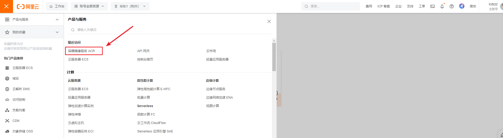
</div>

<div style="text-align:center">
  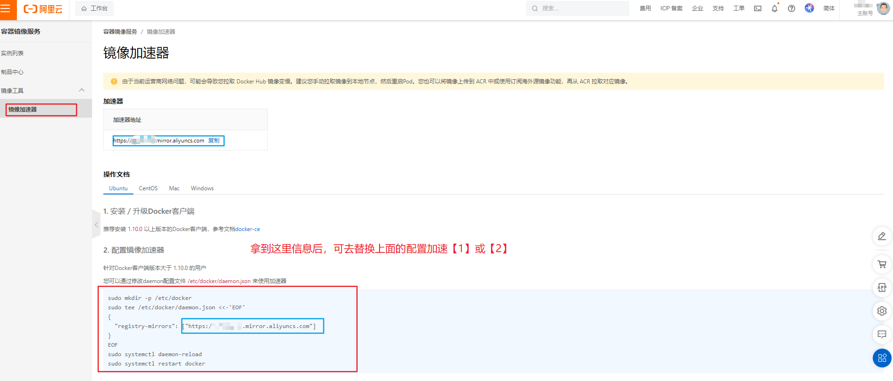
</div>

---


## 命令

以nginx起手开始学习

```bash
#查看运行中的容器
docker ps
#查看所有容器
docker ps -a
#搜索镜像
docker search nginx
#下载镜像
docker pull nginx
#下载指定版本镜像
docker pull nginx:1.26.0
#查看所有镜像
docker images
#删除指定id的镜像
docker rmi e784f4560448


#运行一个新容器
docker run nginx
#停止容器
docker stop keen_blackwell
#启动容器
docker start 592
#重启容器
docker restart 592
#查看容器资源占用情况
docker stats 592
#查看容器日志
docker logs 592
#删除指定容器
docker rm 592
#强制删除指定容器
docker rm -f 592
# 后台启动容器
docker run -d --name mynginx nginx
# 后台启动并暴露端口
docker run -d --name mynginx -p 80:80 nginx
# 进入容器内部
docker exec -it mynginx /bin/bash

# 提交容器变化打成一个新的镜像
docker commit -m "update index.html" mynginx mynginx:v1.0
# 保存镜像为指定文件
docker save -o mynginx.tar mynginx:v1.0
# 删除多个镜像
docker rmi bde7d154a67f 94543a6c1aef e784f4560448
# 加载镜像
docker load -i mynginx.tar 


# 登录 docker hub
docker login
# 重新给镜像打标签
docker tag mynginx:v1.0 leifengyang/mynginx:v1.0
# 推送镜像
docker push leifengyang/mynginx:v1.0
```

## 存储

删除容器时，目录挂载和卷映射里的文件都不会被删除

两种方式，注意区分：

- 目录挂载： `-v /app/nghtml:/usr/share/nginx/html`

- 卷映射：`-v ngconf:/etc/nginx`

  注：卷映射对应的位置统一放在`/var/lib/docker/volumes/<volume-name>`

  如此时就会放在/var/lib/docker/volumes/ngconf下

```bash
docker run -d -p 99:80 \
-v /app/nghtml:/usr/share/nginx/html \
-v ngconf:/etc/nginx \
--name app03 \
nginx

#查看所有卷
docker volume ls
#创建卷
docker volume create haha
#查看卷详情
docker volume inspect ngconf
```

## 网络

dokcer为每个容器分配唯一ip，使用容器ip+容器端口可以互相访问

通过以下命令可以查看

```bash
# linux查看网络
ip a
# 查看容器的细节
docker container inspect <container_name>
# 简写
docker inspect <container_name>
```

因为ip由于各种原因可能会变化，而docker0默认不支持主机域名

```bash
# 创建网络 docker network --help
docker network create mynet
# 运行时指定网络
docker run -d -p 88:80 --name app1 --network mynet nginx
docker run -d -p 99:80 --name app2 --network mynet nginx
# 可再查看下容器详情
docker inspect app1

# 注意，在加入网络时可以通过--alias给容器起别名
# 这样该网络内的其它容器可以用别名互相访问！
# mysql容器，指定别名为db，另外每一个容器都有一个别名是容器名
docker network connect hmall mysql --alias db
```

<div style="text-align:center">
  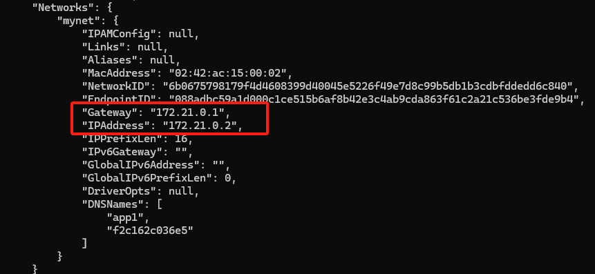
</div>

创建自定义网络，容器名就是稳定域名

```bash
# 在app1内部访问app2的80端口，此时不是暴露在外面的端口（99）
curl http://app2:80
```

### Redis主从同步集群

<div style="text-align:center">
  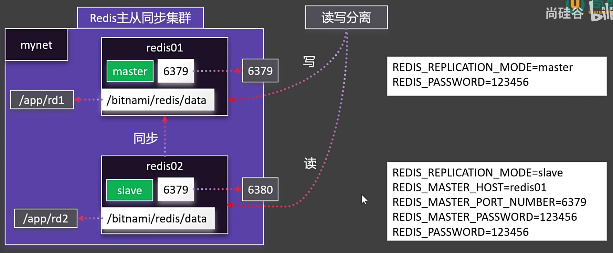
</div>

使用bitnami的redis镜像，这里的镜像不需要修改配置文件，只需要定义一些环境变量

[bitnami的dockerhub地址](https://hub.docker.com/r/bitnami/redis)

> redis单服务启动命令
>
> ```bash
> docker run --name redis -p 6379:6379 -d -e ALLOW_EMPTY_PASSWORD=yes bitnami/redis:latest
> ```

```bash
#自定义网络
docker network create mynet
#主节点
docker run -d -p 6379:6379 \
-v /app/rd1:/bitnami/redis/data \
-e REDIS_REPLICATION_MODE=master \
-e REDIS_PASSWORD=123456 \
--network mynet --name redis01 \
bitnami/redis

#从节点
docker run -d -p 6380:6379 \
-v /app/rd2:/bitnami/redis/data \
-e REDIS_REPLICATION_MODE=slave \
-e REDIS_MASTER_HOST=redis01 \
-e REDIS_MASTER_PORT_NUMBER=6379 \
-e REDIS_MASTER_PASSWORD=123456 \
-e REDIS_PASSWORD=123456 \
--network mynet --name redis02 \
bitnami/redis
```

### 启动Mysql

去官方文档寻找三大点：网络、 存储、 环境变量

<div style="text-align:center">
  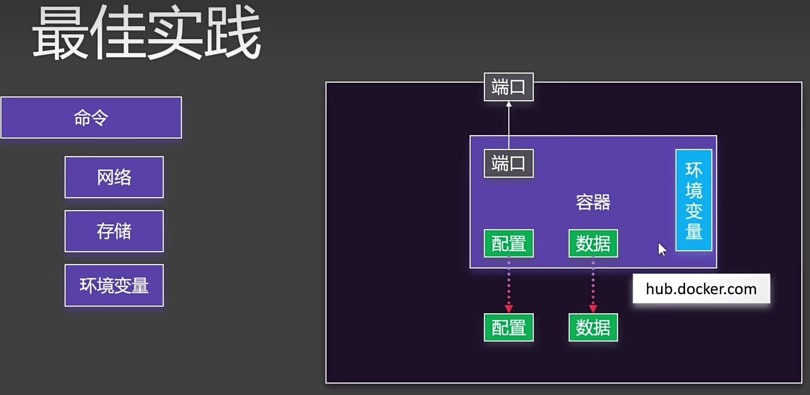
</div>

因为本地就有mysql，这里暴露的端口就不选3306了

```bash
docker run -d -p 3306:3306 \
-v /app/myconf:/etc/mysql/conf.d \
-v /app/mydata:/var/lib/mysql \
-e MYSQL_ROOT_PASSWORD=123456 \
mysql
```

### 启动PostgreSql

```bash
docker run -d \ -p 5432:5432 \ -v /mydata/postgres/pgdata:/var/lib/postgresql/data \ -e POSTGRES_PASSWORD=wqeq \ --name pgsql \ postgres
```

PostgreSQL 默认只监听 `localhost`，无法接受外部连接。

解决办法：

1. 修改 PostgreSQL 配置文件（容器中一般路径是 `/var/lib/postgresql/data/postgresql.conf`）

   ```bash
   listen_addresses = '*'
   ```

2. 修改 `pg_hba.conf` 文件，添加允许外部访问的规则：

   ```bash
   host all all 0.0.0.0/0 md5
   ```

3. 重启 PostgreSQL 容器:

   ```bash
   docker restart <container_id>
   ```

   


## Docker Compose

批量管理容器的工具

<div style="text-align:center">
  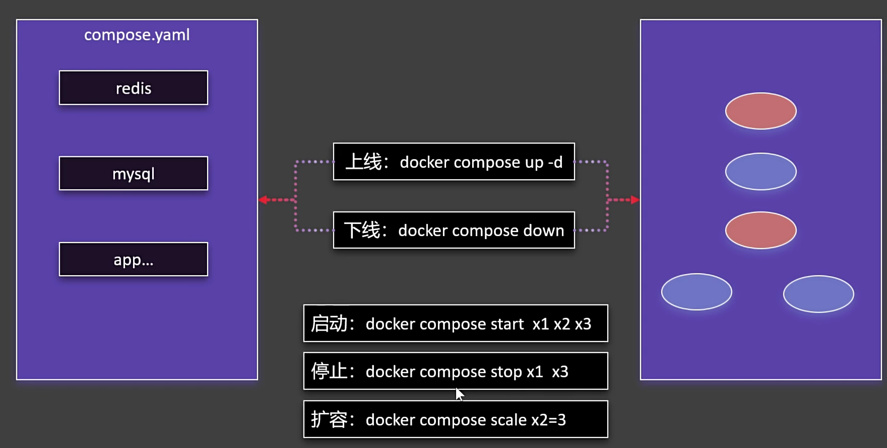
</div>

### 博客实践

<div style="text-align:center">
  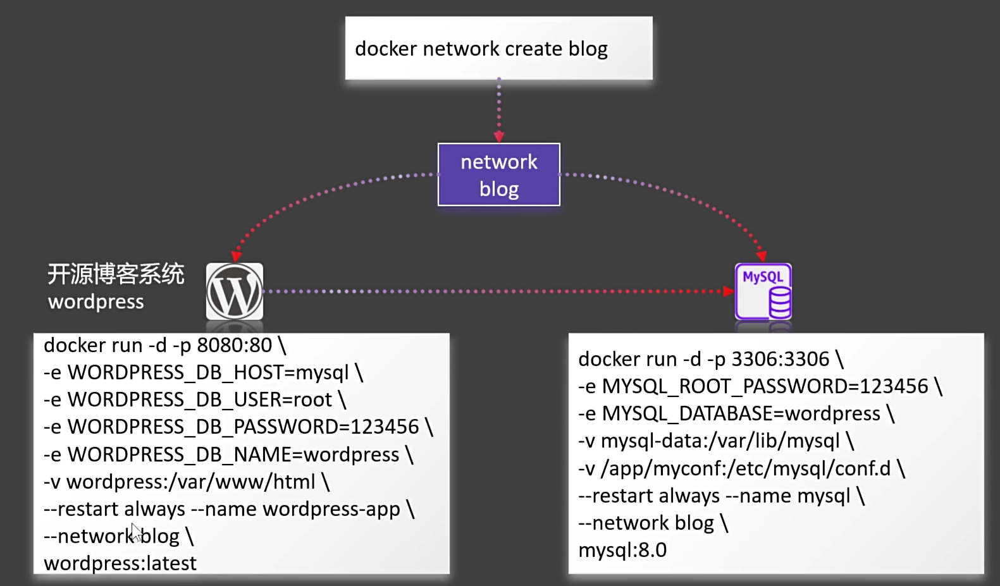
</div>

#### 命令式安装

```bash
#创建网络
docker network create blog

#启动mysql
docker run -d -p 3306:3306 \
-e MYSQL_ROOT_PASSWORD=123456 \
-e MYSQL_DATABASE=wordpress \
-v mysql-data:/var/lib/mysql \
-v /app/myconf:/etc/mysql/conf.d \
--restart always --name mysql \
--network blog \
mysql:8.0

#启动wordpress（开源博客系统）
docker run -d -p 8090:80 \
-e WORDPRESS_DB_HOST=mysql \
-e WORDPRESS_DB_USER=root \
-e WORDPRESS_DB_PASSWORD=123456 \
-e WORDPRESS_DB_NAME=wordpress \
-v wordpress:/var/www/html \
--restart always --name wordpress-app \
--network blog \
wordpress:latest
```

#### compose.yaml安装

[官方参考文档](https://docs.docker.com/compose/compose-file/)

<div style="text-align:center">
  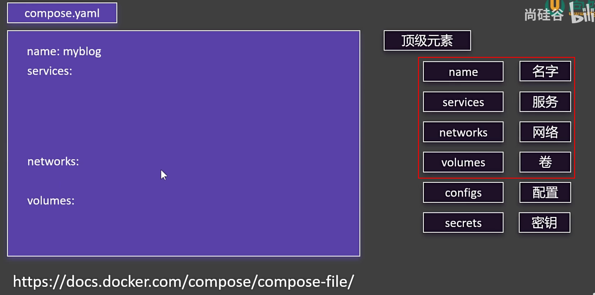
</div>

其实就是参考docker run时候的参数，再在参考文档里面去找对应的语法，对应如图

<div style="text-align:center">
  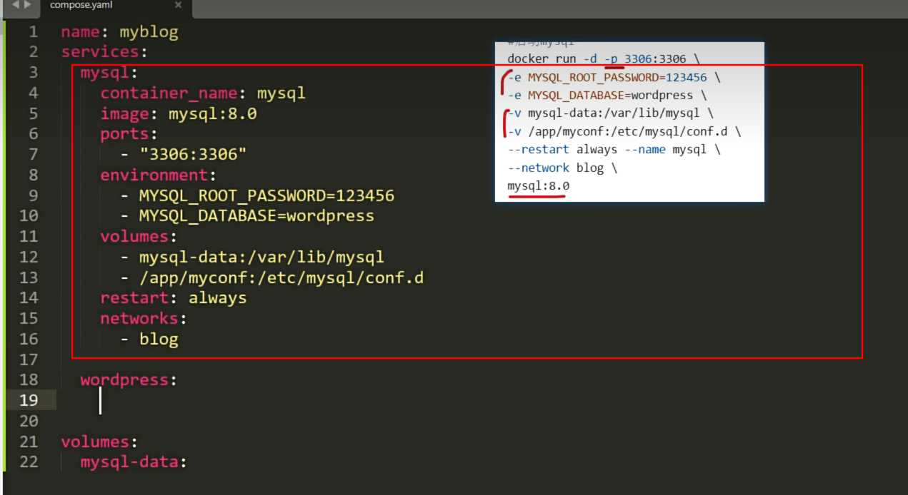
</div>

```yaml
services: 
  mysql:
    container_name: mysql
    image: mysql:8.0
    ports:
      - "3306:3306" #一个短横线代表一个数组里面的元素
    environment: # 数组写法
      - MYSQL_ROOT_PASSWORD=123456
      - MYSQL_DATABASE=wordpress
    volumes:
      - mysql-data:/var/lib/mysql
      - /app/myconf:/etc/mysql/conf.d
    restart: always
    networks:
      - blog

  wordpress:
    image: wordpress
    ports:
      - "8099:80"
    environment: # k-v写法
      WORDPRESS_DB_HOST: mysql
      WORDPRESS_DB_USER: root
      WORDPRESS_DB_PASSWORD: 123456
      WORDPRESS_DB_NAME: wordpress
    volumes:
      - wordpress:/var/www/html
    restart: always
    networks:
      - blog
    depends_on: #肯定是要mysql启动好了以后才能启动wordpress，所以是依赖mysql
      - mysql

volumes:
  mysql-data:
  wordpress:

networks: #声明网络
  blog:
```

启动：

```bash
# up:启动、上线；-d 以后台方式；文件名默认是compose.yaml，如果不是，就要-f指定
docker compose -f compose.yaml up -d
```

<u>"1"代表这个容器启动了一个</u>

<div style="text-align:center">
  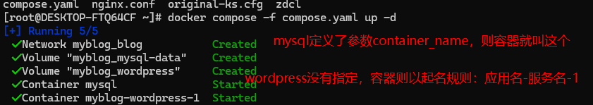
</div>


### 特性

- 增量更新

- - 修改 Docker Compose 文件。重新启动应用。只会触发修改项的重新启动。

- 数据不删

- - 默认就算down了容器，所有挂载的卷不会被移除。比较安全

```bash
# 增量更新，只更新compose.yaml中改过的部分
docker compose -f compose.yaml 
# down为下线；up为上线【不删除卷】
docker compose -f compose.yaml down
# 可 docker compose down --help
docker compose -f compose.yaml down --rmi all -v

#【可选】还可指定项目名称
docker compose -f compose.yaml -p myapp up -d

#查看项目以下的容器docker compose -p myapp ps
```

<div style="text-align:center">
  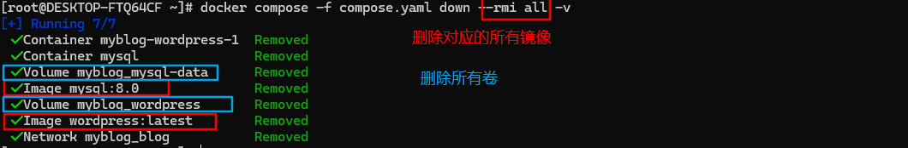
</div>


## Dockerfile

<div style="text-align:center">
  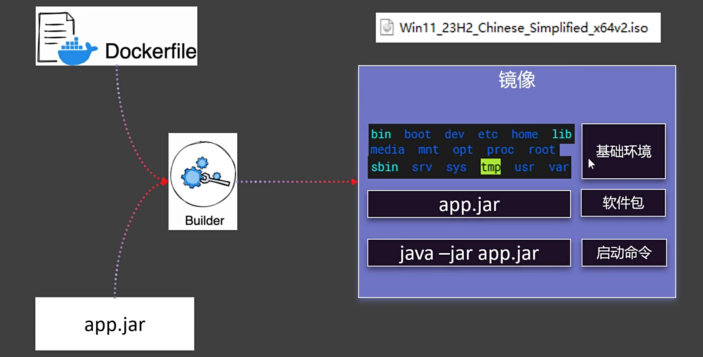
</div>

<div style="text-align:center">
  
</div>

| 常见指令   | 作用 |
| ---------- | ---- |
| FROM       |      |
| RUN        |      |
| CMD        |      |
| LABEL      |      |
| EXPOSE     |      |
| ENV        |      |
| ADD        |      |
| COPY       |      |
| ENTRYPOINT |      |
| VOLUME     |      |
| USER       |      |
| WORKDIR    |      |
| ARG        |      |

[官方参考文档](https://docs.docker.com/reference/dockerfile/)

```dockerfile
FROM openjdk:17

LABEL author=lcdzzz

COPY app.jar /app.jar

EXPOSE 8080

ENTRYPOINT ["java","-jar","/app.jar"] #每个空格会分隔数组里面的每个元素，等于 java -jar /app.jar
```

构建镜像

```bash
# -t指定镜像名字  .指定工作目录
docker build -f Dockerfile -t myjavaapp:v1.0 .
```

## Docker分层机制

<div style="text-align:center">
  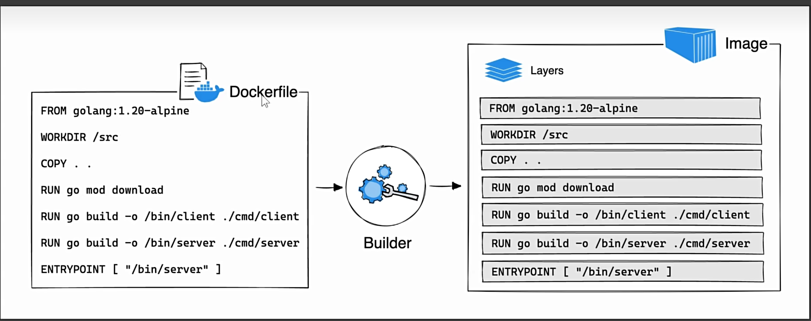
</div>

```bash
# 查看构建历史
docker image history [image_name]
# 查看镜像详情
docker image inspect nginx
```

<div style="text-align:center">
  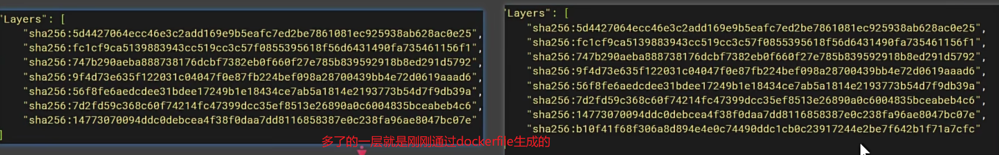
</div>


镜像和(多个)容器的关系如下，容器是在镜像基础之上的可读可写层，所以容器删除以后，这一层的东西也是不保存的。而镜像的基础数据还存在磁盘里。

<div style="text-align:center">
  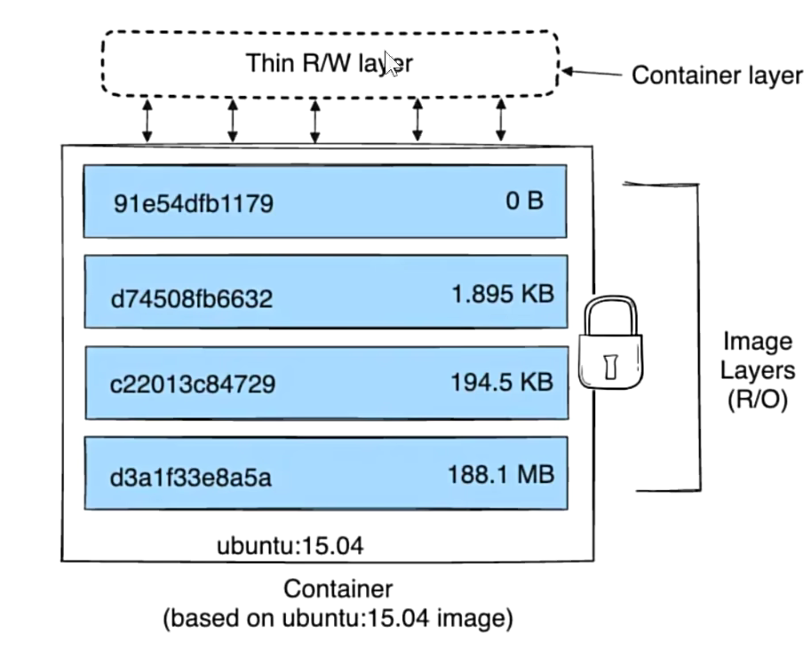
</div>

<div style="text-align:center">
  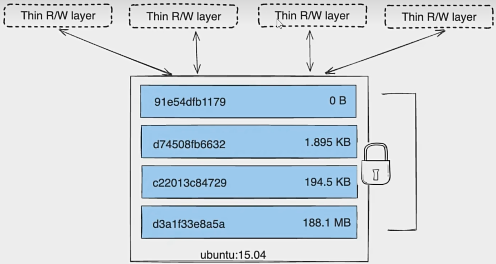
</div>

```bash
# -s,--size 陈列全部文件的大小
docker ps -s
```

<div style="text-align:center">
  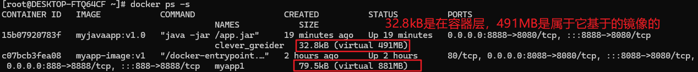
</div>


## 总结

<div style="text-align:center">
  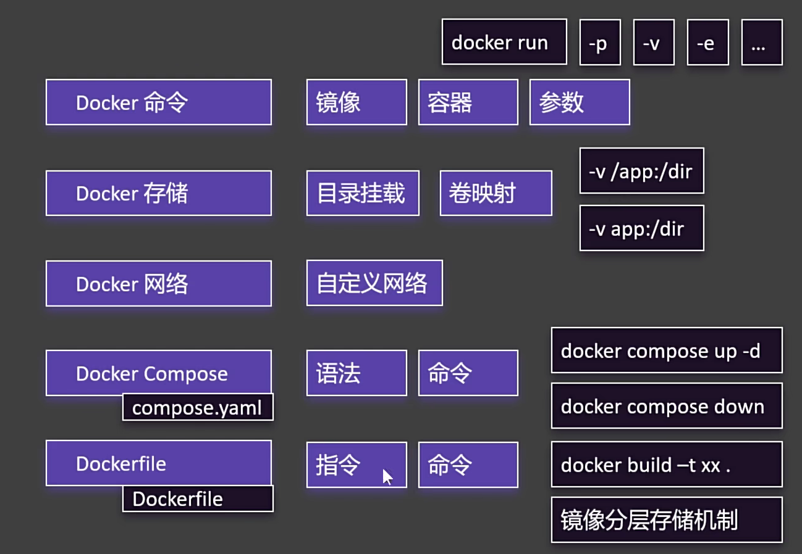
</div>


