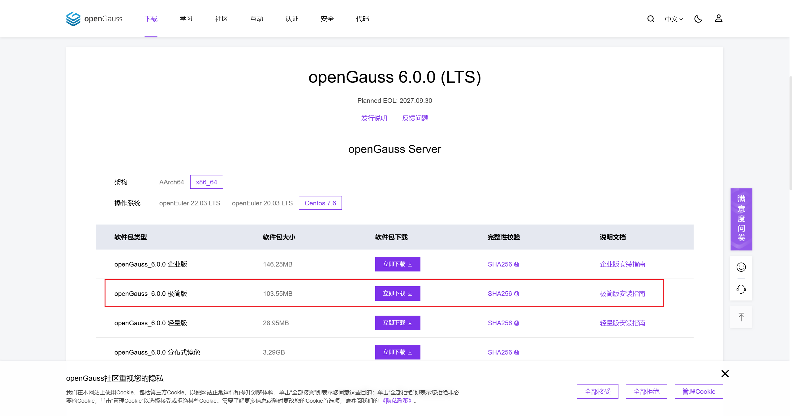

# 安装

[openGauss官网](https://opengauss.org/)

我们选择极简版

<div style="text-align:center">
  
</div>

由于有要求：

- 普通用户必须有数据库包解压路径、安装路径的读、写和执行操作权限，并且安装路径必须为空。
- 普通用户对下载的openGauss压缩包有执行权限。

因此我们直接useradd openGauss，在openGauss家目录下对tar.bz2进行解压

```bash
useradd openGauss

# 把openGauss-5.0.3-CentOS-64bit.tar.bz2 放在/home/openGauss下
tar -jxf openGauss-5.0.3-CentOS-64bit.tar.bz2 

cd /home/openGauss/simpleInstall
chmod +x ./install.sh

# 执行install.sh脚本安装openGauss
# -w：初始化数据库密码（gs_initdb指定），因安全需要，此项必须设置。
# -p：指定openGauss端口号，如不指定，默认为5432。
sh install.sh  -w "guadb@123" -p 5432 &&source ~/.bashrc
```

- 执行时，如果出现报错“the maximum number of SEMMNI is not correct, the current SEMMNI is xxx. Please check it.”，请使用有root权限的用户执行如下命令。

  可以直接切换成root

```bash
sysctl -w kernel.sem="250 85000 250 330" 
```

- 接着切换成openGauss用户，再执行一遍`sh install.sh  -w "guadb@123" -p 5432 &&source ~/.bashrc`
- 安装后，数据库目录安装路径/home/openGauss/data/single_node，其中/home/openGauss为解压包路径，data/single_node为新创建的数据库节点目录。


# 应用

基本命令

```bash
# 停止
gs_ctl stop -D /home/openGauss/data/single_node

# 启动
gs_ctl start -D /home/openGauss/data/single_node

# 进入命令行 
# d postgres：这个选项指定了要连接的数据库名称。在这个例子中，数据库名称是 postgres，这是 PostgreSQL 安装时默认创建的数据库之一。
gsql -d postgres -p 5432 
```


