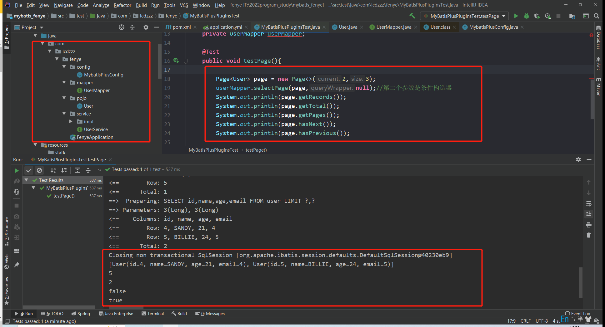

# 分页功能

## 配置和依赖

```yml
spring:
  datasource:
    driver-class-name: com.mysql.jdbc.Driver
    password: wqeq
    type: com.alibaba.druid.pool.DruidDataSource
    url: jdbc:mysql://localhost:3306/test08?useUnicode=true&characterEncoding=utf-8&serverTimezone=Asia/Shanghai
    username: root
mybatis-plus:
  configuration:
    log-impl: org.apache.ibatis.logging.stdout.StdOutImpl
```

> 注意：org.apache.ibatis.logging.stdout.StdOutImpl 是加入日志功能，可以返回sql语句供我们查看

maven依赖：

```xml
<!-- 引入mybatisPlus -->
<dependency>
    <groupId>com.baomidou</groupId>
    <artifactId>mybatis-plus-boot-starter</artifactId>
    <version>3.4.0</version>
</dependency>
<dependency>
    <groupId>com.baomidou</groupId>
    <artifactId>mybatis-plus-generator</artifactId>
    <version>3.4.0</version>
</dependency>
<!-- 引入mysql驱动包 -->
<dependency>
    <groupId>mysql</groupId>
    <artifactId>mysql-connector-java</artifactId>
    <version>5.1.27</version>
</dependency>
<!-- 引入Druid依赖，阿里巴巴所提供的数据源 -->
<dependency>
    <groupId>com.alibaba</groupId>
    <artifactId>druid</artifactId>
    <version>1.1.7</version>
</dependency>
<dependency>
    <groupId>org.projectlombok</groupId>
    <artifactId>lombok</artifactId>
    <version>1.18.0</version>
</dependency>
```


## 数据库和实体类

数据库：

```sql

SET FOREIGN_KEY_CHECKS=0;

-- ----------------------------
-- Table structure for `user`
-- ----------------------------
DROP TABLE IF EXISTS `user`;
CREATE TABLE `user` (
  `id` bigint(20) NOT NULL,
  `name` varchar(30) DEFAULT 'null',
  `age` varchar(50) DEFAULT 'null',
  `email` varchar(50) DEFAULT 'null',
  PRIMARY KEY (`id`)
) ENGINE=InnoDB DEFAULT CHARSET=latin1;

-- ----------------------------
-- Records of user
-- ----------------------------
INSERT INTO `user` VALUES ('1', 'jone', '18', '1');
INSERT INTO `user` VALUES ('2', 'jack', '20', '2');
INSERT INTO `user` VALUES ('3', 'TOM', '28', '3');
INSERT INTO `user` VALUES ('4', 'SANDY', '21', '4');
INSERT INTO `user` VALUES ('5', 'BILLIE', '24', '5');

```

实体类：

```java
package com.lcdzzz.fenye.pojo;

import lombok.*;

@Data
public class User {
   private Long id;
   private String name;
   private Integer age;
   private String email;

}
```

> 使用了lombok简化了实体类的编写

## 实现

config包下的MybatisPlusConfig

```java
@Configuration
@MapperScan("com.lcdzzz.fenye.mapper")
public class MybatisPlusConfig {
    /**
     * MybatisPlusInterceptor用来配置mybatisplus里面的插件
     * @return
     */
    @Bean
    public MybatisPlusInterceptor MybatisPlusInterceptor() {
        MybatisPlusInterceptor interceptor = new MybatisPlusInterceptor();
        interceptor.addInnerInterceptor(new PaginationInnerInterceptor(DbType.MYSQL));//在插件对象中添加一个内部插件
        return interceptor;
    }
}
```

mapper层UserMapper

```java
public interface UserMapper extends BaseMapper<User> {

}
```

## 测试

```java
@SpringBootTest
public class MyBatisPlusPluginsTest {
    @Autowired
    private UserMapper userMapper;

    @Test
    public void testPage(){
        Page<User> page = new Page<>(2,3);
        userMapper.selectPage(page,null);
        System.out.println(page.getRecords());
        System.out.println(page.getTotal());
        System.out.println(page.getPages());
        System.out.println(page.hasNext());
        System.out.println(page.hasPrevious());


    }
}
```

<div style="text-align:center">
  
</div>


# 代码生成器

## 依赖

```xml
	 <dependency>
            <groupId>org.springframework.boot</groupId>
            <artifactId>spring-boot-starter-web</artifactId>
        </dependency>

        <dependency>
            <groupId>org.springframework.boot</groupId>
            <artifactId>spring-boot-starter-test</artifactId>
            <scope>test</scope>
        </dependency>

        <!--mysql驱动-->
        <dependency>
            <groupId>mysql</groupId>
            <artifactId>mysql-connector-java</artifactId>
            <scope>runtime</scope>
        </dependency>

        <dependency>
            <groupId>com.baomidou</groupId>
            <artifactId>mybatis-plus-generator</artifactId>
            <version>3.5.1</version>
        </dependency>
        <dependency>
            <groupId>org.freemarker</groupId>
            <artifactId>freemarker</artifactId>
            <version>2.3.31</version>
        </dependency>

        <!--mybatis-plus启动器-->
        <dependency>
            <groupId>com.baomidou</groupId>
            <artifactId>mybatis-plus-boot-starter</artifactId>
            <version>3.5.1</version>
        </dependency>
```


## 实现

直接用test类

```java
package com.example.demo;


import com.baomidou.mybatisplus.generator.FastAutoGenerator;
import com.baomidou.mybatisplus.generator.config.OutputFile;
import com.baomidou.mybatisplus.generator.engine.FreemarkerTemplateEngine;

import java.util.Collections;


public class FastAutoGeneratorTest {

    public static void main(String[] args) {
        FastAutoGenerator.create("jdbc:mysql://127.0.0.1:3306/cec_equipment_tracking_system?characterEncoding=utf-8&userSSL=false", "root", "wqeq")
                .globalConfig(builder -> {
                    builder.author("lcdzzz") // 设置作者
                            //.enableSwagger() // 开启 swagger 模式
                            .fileOverride() // 覆盖已生成文件
                            .outputDir("D://mybatis_plus"); // 指定输出目录
                })
                .packageConfig(builder -> {
                    builder.parent("com.lcdzzz") // 设置父包名
                            .moduleName("mybatisplus") // 设置父包模块名
                            .pathInfo(Collections.singletonMap(OutputFile.mapperXml, "D://mybatis_plus")); // 设置mapperXml生成路径
                })
                .strategyConfig(builder -> {
                    builder.addInclude("deliver") // 设置需要生成的表名
                            .addInclude("equipment")
                            .addInclude("project")
                            .addInclude("quality")
                            .addTablePrefix("t_", "c_"); // 设置过滤表前缀
                })
                .templateEngine(new FreemarkerTemplateEngine()) // 使用Freemarker引擎模板，默认的是Velocity引擎模板
                .execute();
    }

}

```

# 代码生成器(24)

## 依赖

```xml
<dependency>
    <groupId>org.mybatis.spring.boot</groupId>
    <artifactId>mybatis-spring-boot-starter</artifactId>
    <version>2.2.2</version>
</dependency>
<dependency>
    <groupId>com.baomidou</groupId>
    <artifactId>mybatis-plus-generator</artifactId>
    <version>3.5.2</version>
</dependency>
<dependency>
    <groupId>com.baomidou</groupId>
    <artifactId>mybatis-plus-boot-starter</artifactId>
    <version>3.5.1</version>
</dependency>

<dependency>
    <groupId>mysql</groupId>
    <artifactId>mysql-connector-java</artifactId>
    <scope>runtime</scope>
</dependency>
<dependency>
            <groupId>org.freemarker</groupId>
            <artifactId>freemarker</artifactId>
            <version>2.3.28</version>
            <scope>compile</scope>
</dependency>
```

## 实现

```java
package io.github.lcdzzz;

import com.baomidou.mybatisplus.generator.FastAutoGenerator;
import com.baomidou.mybatisplus.generator.config.OutputFile;
import com.baomidou.mybatisplus.generator.config.rules.DbColumnType;
import com.baomidou.mybatisplus.generator.engine.FreemarkerTemplateEngine;
import org.junit.jupiter.api.Test;
import org.springframework.boot.test.context.SpringBootTest;

import java.util.Collections;

@SpringBootTest
class DataScopeApplicationTests {

    @Test
    void contextLoads() {
        FastAutoGenerator.create("jdbc:mysql://127.0.0.1:3306/test06?characterEncoding=utf-8&userSSL=false", "root", "wqeq")
                .globalConfig(builder -> {
                    builder.author("lcdzzz") // 设置作者
                            //.enableSwagger() // 开启 swagger 模式
                            .fileOverride() // 覆盖已生成文件
                            .outputDir("D://2024tienchinStudy//data_scope//src//main//java"); // 指定输出目录
                })
                .packageConfig(builder -> {
                    builder.parent("io.github.lcdzzz") // 设置父包名
//                            .moduleName("mybatisplus") // 设置父包模块名
                            .pathInfo(Collections.singletonMap(OutputFile.xml, "D://2024tienchinStudy//data_scope//src//main//resources//mapper")); // 设置mapperXml生成路径
                })
                .strategyConfig(builder -> {
                    builder.addInclude("sys_dept","sys_role","sys_user") // 设置需要生成的表名
                            .addTablePrefix("sys_"); // 设置过滤表前缀
                })
                .templateEngine(new FreemarkerTemplateEngine()) // 使用Freemarker引擎模板，默认的是Velocity引擎模板
                .execute();
    }

}
```

