# Redis


## Redis入门

### 启动

redis

1. redis的默认安装路径`/usr/local/bin`  ，注意：<u>usr目录不是user的缩写，是Unix Software Resource的缩写</u>

2. 通过指定的配置文件启动服务

<div style="text-align:center">
  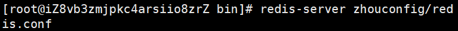
</div>

3. 使用redis-cli进行连接测试

   `redis-cli -h localhost -p 6379`

   h默认的是主机(localhost/127.0.0.1，可以省略

<div style="text-align:center">
  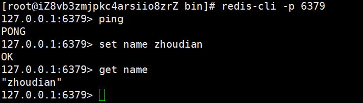
</div>

<div style="text-align:center">
  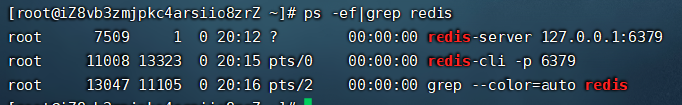
</div>

<div style="text-align:center">
  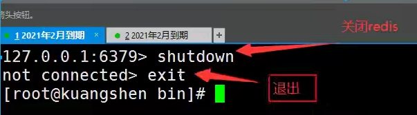
</div>

<div style="text-align:center">
  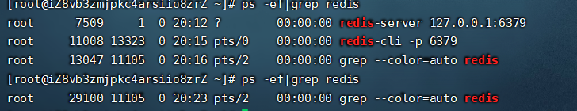
</div>

### 基础的知识

redis默认有16个数据库

默认使用第0个

可以使用select进行切换数据库

```bash
localhost:6379[3]> select 4 #切换数据库
OK
localhost:6379[4]> dbsize
(integer) 0

```

```bash
localhost:6379[3]> set name zhoudian
OK
localhost:6379[3]> get name 
"zhoudian"
localhost:6379[3]> keys *
1) "name"
localhost:6379[3]> 

```


清除当前数据库`flushdb`  清空全部`flushall`

```bash
localhost:6379[3]> flushdb
OK
localhost:6379[3]> keys *
(empty array)
```


## 五大数据类型

### Redis-key

```bash
127.0.0.1:6379> keys *  #查看所有的key
(empty array)
127.0.0.1:6379> set name zhoudian #	 set key
OK
127.0.0.1:6379> keys *
1) "name"
127.0.0.1:6379> set age 1
OK
127.0.0.1:6379> key *
(error) ERR unknown command `key`, with args beginning with: `*`, 
127.0.0.1:6379> keys*
(error) ERR unknown command `keys*`, with args beginning with: 
127.0.0.1:6379> keys *
1) "name"
2) "age"
127.0.0.1:6379> exists name  #判断当前的key是否存在
(integer) 1
127.0.0.1:6379> exists name1
(integer) 0
127.0.0.1:6379> move name 1  #把key为“name”的数据移动到数据库1中
(integer) 1
127.0.0.1:6379> keys *
1) "age"
127.0.0.1:6379> set name zhoudian
OK
127.0.0.1:6379> keys *
1) "name"
2) "age"
127.0.0.1:6379> get name
"zhoudian"
127.0.0.1:6379> expire name 10  #设置key的过期时间，单位是秒
(integer) 1
127.0.0.1:6379> ttl name
(integer) 5
127.0.0.1:6379> ttl name
(integer) 4
127.0.0.1:6379> ttl name
(integer) 3
127.0.0.1:6379> ttl name
(integer) 2
127.0.0.1:6379> ttl name
(integer) 1
127.0.0.1:6379> ttl name
(integer) 1
127.0.0.1:6379> ttl name
(integer) -2
127.0.0.1:6379> ttl name
(integer) -2

127.0.0.1:6379> expire name 10
(integer) 0
127.0.0.1:6379> get name
(nil)
127.0.0.1:6379> keys *
1) "age"
127.0.0.1:6379> type name
none
127.0.0.1:6379> type age  # 查看当前key的类型
string

```


### String （字符串）

```bash
############################################################################

127.0.0.1:6379> set key1 b1  #设置值
OK
127.0.0.1:6379> get key1     #获得值
"b1"
127.0.0.1:6379> keys *       #获得所以的key
1) "key1"
2) "age"
127.0.0.1:6379> del age      
(integer) 1
127.0.0.1:6379> keys *
1) "key1"
127.0.0.1:6379> exists key1  #判断某个key是否存在
(integer) 1
127.0.0.1:6379> append key1 "hello"  #追加字符串，如果key不存在，就相当于set key
(integer) 7
127.0.0.1:6379> get key1
"b1hello"
127.0.0.1:6379> strlen key1  #获取字符串长度
(integer) 7
127.0.0.1:6379> append key1 ",zhoudian"
(integer) 16
127.0.0.1:6379> strlen key1
(integer) 16
127.0.0.1:6379> get key1
"b1hello,zhoudian"
############################################################################
#i++
#步长 i+=
127.0.0.1:6379> set views 0  #初始浏览量为0
OK
127.0.0.1:6379> get views
"0"
127.0.0.1:6379> incr view    #自增1
(integer) 1
127.0.0.1:6379> incr view
(integer) 2
127.0.0.1:6379> get view
"2"
127.0.0.1:6379> decr view    #自减
(integer) 1
127.0.0.1:6379> decr view
(integer) 0
127.0.0.1:6379> decr view
(integer) -1
127.0.0.1:6379> incrby view 10
(integer) 9
127.0.0.1:6379> incrby view 10
(integer) 19
127.0.0.1:6379> decrby view 5
(integer) 14
############################################################################
#字符串范围range
127.0.0.1:6379> set key1 "hello,zhoudian"   #设置初始值
OK
127.0.0.1:6379> get key1
"hello,zhoudian"
127.0.0.1:6379> getrange key1 0 3   #截取字符串
"hell"
127.0.0.1:6379> getrange key1 0 -1  #获取全部的字符串，和get key是一样的
"hello,zhoudian"

#替换！
127.0.0.1:6379> set key2 abcdefg
OK
127.0.0.1:6379> get key2
"abcdefg"
127.0.0.1:6379> setrange key2 1 xx  #替换指定位置开始的字符串
(integer) 7
127.0.0.1:6379> get key2
"axxdefg"

############################################################################
#setex(set with expire)   #设置过期时间
#setnx(set if not exist)  #不存在在设置（在分布式锁中会常常使用）

127.0.0.1:6379> setex key3 30 "hello"  #设置key3的值为hello  30秒后过期
OK
127.0.0.1:6379> ttl key3
(integer) 18
127.0.0.1:6379> get key3
"hello"
127.0.0.1:6379> setnx mykey "redis"  #如果mykey 不存在，创建mykey
(integer) 1
127.0.0.1:6379> keys *
1) "view"
2) "key1"
3) "views"
4) "kye1"
5) "key2"
6) "mykey"
127.0.0.1:6379> ttl keys
(integer) -2
127.0.0.1:6379> setnx mykey "MongoDB"   #如果mykey存在，创建失败！
(integer) 0
127.0.0.1:6379> get mykey
"redis"

###########################################################################
mset
mget

127.0.0.1:6379> mset k1 v1 k2 v2 k3 v3  #  同时设置多个值
OK
127.0.0.1:6379> keys *
1) "k2"
2) "k1"
3) "k3"
127.0.0.1:6379> mget k1 k2 k3          #   同时获取多个值
1) "v1"
2) "v2"
3) "v3"
127.0.0.1:6379> msetnx k1 v1 k4 v4     #   msetnx 是一个原子性的操作，要么一起成功，要么一起失败
( integer) 0
127.0.0.1:6379> get k4
(nil)

#对象
set user:1 {name:zhangsan,age:3}  #设置一个user:1 对象 值为json字符来保存一个对象

#这里的key是一个巧妙的设计： user:{id}:{filed},如此设计在Redis中是完全ok了！
127.0.0.1:6379> mset user01:name lisi user02:age 22
OK
127.0.0.1:6379> mget user01:name user02:age
1) "lisi"
2) "22"

##########################################################################
getset #先get然后再set

127.0.0.1:6379> getset db redis  #如果不存在值，则返回nil
(nil)
127.0.0.1:6379> get db
"redis"
127.0.0.1:6379> getset db mongodb  #如果存在值，获取原来的值，并设置新的值
"redis"
127.0.0.1:6379> get db
"mongodb"


```

数据结构是相同的！

String 类似的使用常见，value除了我们的字符串还可以是数字！

- 计数器
- 统计多单位的数量
- 粉丝数
- 对象缓存存储

### List

基本数据类型，列表

在redis里面，我们可以把list完成，栈，队列，阻塞队列！

所有的list命令都是用l开头的

```bash
##########################################################################
127.0.0.1:6379> lpush list  #将一个值或多个值插入列表头部
(integer) 1
127.0.0.1:6379> lpush list two
(integer) 2
127.0.0.1:6379> lpush list three
(integer) 3
127.0.0.1:6379> lrange list 0 -1
1) "three"
2) "two"
3) "one"
127.0.0.1:6379> lrange list 0 1
1) "three"
2) "two"
127.0.0.1:6379> rpush list right  #将一个值或多个值插入列表尾部
(integer) 4
127.0.0.1:6379> lrange list 0 -1
1) "three"
2) "two"
3) "one"
4) "right"
##########################################################################
LPOP
RPOP
127.0.0.1:6379> lrange list 0 -1
1) "three" 
2) "two"
3) "one"
4) "right"
127.0.0.1:6379> lpop list   #移除list的第一个元素
"three"
127.0.0.1:6379> lrange list 0 -1
1) "two"
2) "one"
3) "right"
127.0.0.1:6379> rpop list   #移除list的最后一个元素
"right"
127.0.0.1:6379> lrange list 0 -1
1) "two"
2) "one"
##########################################################################
Lindex
127.0.0.1:6379> lrange list 0 -1
1) "two"
2) "one"
127.0.0.1:6379> lindex list 1  #通过下标获得list的某一个值
"one"
127.0.0.1:6379> lindex list 0
"two"
##########################################################################
Llen

127.0.0.1:6379> lpush list one
(integer) 1
127.0.0.1:6379> lpush list two
(integer) 2
127.0.0.1:6379> lpush list three
(integer) 3
127.0.0.1:6379> llen list
(integer) 3
##########################################################################
移除指定的值
取关 uid

Lrem
127.0.0.1:6379> lrange list 0 -1
1) "three"
2) "three"
3) "two"
4) "one"
127.0.0.1:6379> lrem list 1 one   #移除list集合中指定个数的value，精准匹配
(integer) 1
127.0.0.1:6379> lrange list 0 -1
1) "three"
2) "three"
3) "two"
127.0.0.1:6379> lrem list 1 three
(integer) 1
127.0.0.1:6379> lrange list 0 -1
1) "three"
2) "two"
127.0.0.1:6379> lpush list three
(integer) 3
127.0.0.1:6379> lrem list 2 three
(integer) 2
127.0.0.1:6379> lrange list 0 -1
1) "two"

##########################################################################
trim 修建：list截断！

127.0.0.1:6379> rpush mylist "hello"
(integer) 1
127.0.0.1:6379> rpush mylist "hello1"
(integer) 2
127.0.0.1:6379> rpush mylist "hello2"
(integer) 3
127.0.0.1:6379> rpush mylist "hello3"
(integer) 4
127.0.0.1:6379> ltrim mylist 1 2  #通过下标截取指定的长度，这个list已经改变了，截断了只剩下截取得元素
OK
127.0.0.1:6379> lrange mylist 0 -1
1) "hello1"
2) "hello2"

##########################################################################

rpoplpush #移除列表最后一个元素

127.0.0.1:6379> lrange mylist 0 -1
1) "hello1"
2) "hello2"
3) "hello3"
127.0.0.1:6379> rpoplpush mylist myotherlist  #移除列表的最后一个元素，将他移动到新的列表中
"hello3"
127.0.0.1:6379> lrange mylist 0 -1 
1) "hello1"
2) "hello2"
127.0.0.1:6379> lrange myotherlist 0 -1
1) "hello3"

##########################################################################

lset 将列表中指定下标的值替换成另外一个值，更新操作

127.0.0.1:6379> exists list  #判断这个列表是否存在
(integer) 0
127.0.0.1:6379> lset list 0 item  #如果不存在列表我们去更新就会报错
(error) ERR no such key
127.0.0.1:6379> lpush list value1
(integer) 1
127.0.0.1:6379> lrange list 0 0
1) "value1"
127.0.0.1:6379> lset list 0 item  #如果存在，更新当前下标的值
OK
127.0.0.1:6379> lrange list 0 0
1) "item"
127.0.0.1:6379> lset list 1 other  #如果不存在，就会报错
(error) ERR index out of range

##########################################################################
linset  #将某个具体的value插入到列表中某个元素的前面或者后面

127.0.0.1:6379> rpush mylist "hello"
(integer) 1
127.0.0.1:6379> rpush mylist "world"
(integer) 2
127.0.0.1:6379> linsert mylist before "world" "other"
(integer) 3
127.0.0.1:6379> lrange mylist 0 -1
1) "hello"
2) "other"
3) "world"
127.0.0.1:6379> linsert mylist after "other" "mew"
(integer) 4
127.0.0.1:6379> lrange mylist 0 -1
1) "hello"
2) "other"
3) "mew"
4) "world"

```

> 小结

- 他实际上是一个链表，before node after left right都可以插入值
- 如果key不存在，则创建新的链表
- 如果key存在，新增内容
- 如果移除了所有值，空链表，也代表不存在
- 在量变插入欧哲该冬至，效率最高，中间元素，相对来说效率会低一点

消息排队！消息队列（Lpush Rpop）  栈（Lpush，Lpop）

### Set

set的值是不能重读的！

```bash
##########################################################################
127.0.0.1:6379> sadd myset "hello"
(integer) 1
127.0.0.1:6379> sadd myset "zhoudian"
(integer) 1
127.0.0.1:6379> sadd myset nihaolcdzzz
(integer) 1
127.0.0.1:6379> smembers myset  #查看指定set的所有值  遍历
1) "hello"
2) "nihaolcdzzz"
3) "zhoudian"
127.0.0.1:6379> sismember myset hello  #判断某一个值是否在set集合中！
(integer) 1
127.0.0.1:6379> sismember myset world
(integer) 0

##########################################################################

127.0.0.1:6379> scard myset  #获取set集合中的内容元素个数
(integer) 3

##########################################################################
rem

127.0.0.1:6379> smembers myset  #移除set集合中的指定元素（删除）
1) "hello"
2) "nihaolcdzzz"
3) "zhoudian"
127.0.0.1:6379> srem myset hello
(integer) 1
127.0.0.1:6379> scard myset
(integer) 2
127.0.0.1:6379> smembers myset
1) "nihaolcdzzz"
2) "zhoudian"

##########################################################################
set 无序不重复集合

127.0.0.1:6379> srandmember myset
"zhoudian"
127.0.0.1:6379> srandmember myset
"zhoudian"
127.0.0.1:6379> srandmember myset
"nihaolcdzzz"
127.0.0.1:6379> srandmember myset 2 #随机抽选出指定个数的元素
1) "nihaolcdzzz"
2) "zhoudian"

##########################################################################
随记删除key
127.0.0.1:6379> smembers myset
1) "hello"
2) "nihaolcdzzz"
3) "zhoudian"
4) "world"
127.0.0.1:6379> spop myset  #随机删除
"nihaolcdzzz"
127.0.0.1:6379> spop myset
"zhoudian"

##########################################################################
将一个指定的值，移动到另一个set集合！
127.0.0.1:6379> sadd myset "hello'
Invalid argument(s)
127.0.0.1:6379> sadd myset "hello"
(integer) 1
127.0.0.1:6379> sadd myset world
(integer) 1
127.0.0.1:6379> sadd myset zhoudian
(integer) 1
127.0.0.1:6379> sadd myset2 set2
(integer) 1
127.0.0.1:6379> smove myset myset2 zhoudian
(integer) 1
127.0.0.1:6379> smembers myset
1) "hello"
2) "world"
127.0.0.1:6379> smembers myset2
1) "zhoudian"
2) "set2"
############################################################################
微博，B站，共同关注！（并集）
数字集合类
127.0.0.1:6379> sadd key1 a
(integer) 1
127.0.0.1:6379> sadd key1 b
(integer) 1
127.0.0.1:6379> sadd key1 c
(integer) 1
127.0.0.1:6379> sadd key2 c
(integer) 1
127.0.0.1:6379> sadd key2 d
(integer) 1
127.0.0.1:6379> sadd key2 e
(integer) 1
127.0.0.1:6379> sdiff key1 key2 #差集（key有
1) "a"
2) "b"

127.0.0.1:6379> SINTER key1 key2 #交集
1) "c"
127.0.0.1:6379> sunion key1 key2 #并集
2) "c"
3) "a"
4) "e"
5) "d"


```

微博，A用户将所有关注的人放在set集合中！将它的粉丝也放在一个集合中

共同关注，共同爱好，二度好友（共同好友）

### Hash（哈希）

Map集合，key-map！这时候这个值是一个map的集合！本质和String类型没有太大区别，还是一个简单的key-value！

set myhash field zhoudian

```bash
127.0.0.1:6379> hset myhash field1 zhoudian #set一个具体的key -value
(integer) 1
127.0.0.1:6379> hget myhash
(error) ERR wrong number of arguments for 'hget' command
127.0.0.1:6379> hget myhash field1
"zhoudian"
127.0.0.1:6379> hmset myhash field1 hello field2 world #set多个具体的key -value
OK
127.0.0.1:6379> hmget myhash field1 field2
1) "hello"
2) "world"
127.0.0.1:6379> hset myhash field1 zhoudian
(integer) 0
127.0.0.1:6379> hmget myhash field1 field2  #获取多个字段值（字段值）
1) "zhoudian"
2) "world"
127.0.0.1:6379> hgetall myhash  #获取全部的数据（遍历）【展示形式就是：key-value]
1) "field1"
2) "zhoudian"
3) "field2"
4) "world"

127.0.0.1:6379> hgetall myhash
1) "field1"
2) "zhoudian"
3) "field2"
4) "world"
127.0.0.1:6379> hdel myhash field1 #删除hash指定的key字段！对应的value值也没了
(integer) 1
127.0.0.1:6379> hgetall myhash
1) "field2"
2) "world"

############################################################################
hlen

127.0.0.1:6379> hdel myhash field1
(integer) 1
127.0.0.1:6379> hgetall myhash
1) "field2"
2) "world"
127.0.0.1:6379>  hlen myhash  #获取hash表的字段数量
(integer) 1

############################################################################
127.0.0.1:6379> hexists myhash field1 #获取hash中指定的字段是否存在
(integer) 0
127.0.0.1:6379> hexists myhash field2
(integer) 1

############################################################################
只获取所有field
只获取所有的value
127.0.0.1:6379> hkeys myhash  #只获取所有的field
1) "field2"
2) "field1"
127.0.0.1:6379> hvals myhash  #只获取所有的value
1) "world"
2) "zhoudian"

############################################################################
incr decr

127.0.0.1:6379> hset myhash field3 5   #指定增量
(integer) 1
127.0.0.1:6379> hincrby myhash field3 1
(integer) 6
127.0.0.1:6379> hincrby myhash field3 1
(integer) 7
127.0.0.1:6379> hincrby myhash field3 -1
(integer) 6
127.0.0.1:6379> hget myhash field3
"6"
127.0.0.1:6379> hsetnx myhash field4 hello #如果不存在则可以设置
(integer) 1
127.0.0.1:6379> hsetnx myhash field4 world #如果存在则不可以设置
(integer) 0

```

hash变更的数据 user name age，尤其是用户信息的保存更换，和经常变动的信息！hash更适合存对象，String更适合存储字符

```bash
127.0.0.1:6379> mset user1:name zhoudian user1:age 22
OK
127.0.0.1:6379> mget user1:name user1:age
1) "zhoudian"
2) "22"

127.0.0.1:6379> hset user1 name zhoudian age 22
(integer) 1
127.0.0.1:6379> hget user1 name
"zhoudian"
127.0.0.1:6379> hget user1 age
"22"
127.0.0.1:6379> hgetall user1
1) "name"
2) "zhoudian"
3) "age"
4) "22"
127.0.0.1:6379> hget user1 name age
(error) ERR wrong number of arguments for 'hget' command

```


### Zset（有序集合）

在set基础上，增加了一个值，`set k1 v1    zset k1 score1 v1`

```bash
127.0.0.1:6379> zadd myset 1 one  #添加一个值
(integer) 1
127.0.0.1:6379> zadd myset 2 two 3 three  #添加多个值
(integer) 2
127.0.0.1:6379> zrange myset 0 -1
1) "one"
2) "two"
3) "three"
############################################################################

排序实现
127.0.0.1:6379> zadd salary 2500 xiaohong  #添加三个用户
(integer) 1
127.0.0.1:6379> zadd salary 5000 zhangsan
(integer) 1
127.0.0.1:6379> zadd salary 500 zhoudian
(integer) 1

#ZRANGEBYSCORE key min max
127.0.0.1:6379> ZRANGEBYSCORE salary -inf +inf  #显示全部用户，从小到大排序（遍历，升序）
1) "zhoudian"
2) "xiaohong"
3) "zhangsan"
127.0.0.1:6379> zrevrange salary 0 -1  #从打到小排序（遍历，降序）
1) "zhangsan"
2) "zhoudian"
127.0.0.1:6379> ZRANGEBYSCORE salary -inf +inf withscores  #显示全部用户，从小到大排序（遍历）并且附带成绩"
2) "500"
3) "xiaohong"
4) "2500"
5) "zhangsan"
6) "5000"
127.0.0.1:6379> ZRANGEBYSCORE salary -inf 2500 withscores #显示工资小于等于2500员工的升序排序
1) "zhoudian"
2) "500"
3) "xiaohong"
4) "2500"
127.0.0.1:6379> zrevrange salary 0 -1 withscores  #降序
1) "zhangsan"
2) "5000"
3) "xiaohong"
4) "2500"
5) "zhoudian"
6) "500"
############################################################################
rem 删除
127.0.0.1:6379> zcard salary  #获取有序集合中的个数
(integer) 3
127.0.0.1:6379> zrem salary xiaohong  #移除有序集合中的指定元素
(integer) 1
127.0.0.1:6379> zcard salary
(integer) 2

############################################################################

127.0.0.1:6379> zadd myset 1 hello
(integer) 1
127.0.0.1:6379> zadd myset 2 world 3 zhoudian
(integer) 2
127.0.0.1:6379> zcount myset 1 3  #获取指定区间的成员变量
(integer) 3
127.0.0.1:6379> zcount myset 1 2
(integer) 2

```

案例思路： set排序 、存储班级成绩表 、工资表排序！

普通信息 1  ，重要信息 2  。带权进行判断！

排行榜引用实现，取TOP N测试！


## 三种特殊数据类型

### geospatial 地理位置

朋友的定位，附近的人，打车距离计算

Redis 的Geo仔redis3.2版本就退出了！这个功能可以推算地理位置的信息，两地之间的距离，方圆几里的人

可以查询一些测试数据：http://www.jsons.cn/lngcode/

只有6个命令

<div style="text-align:center">
  
</div>

官方文档：https://www.redis.net.cn/order/3685.html

>getadd

```bash
#getadd 添加地理位置
#规则：两级无法直接添加，我们一般会下载城市数据，直接通过java程序一次行导入
#有效经度从-180到180度
#有效纬度从-85.05112878度到85.05112878度	
#参数 key  值（纬度，经度，名称）
127.0.0.1:6379> geoadd china:city 116.40 39.90 beijing
(integer) 1
127.0.0.1:6379> geoadd china:city 121.47 31.23 shanghai
(integer) 1
127.0.0.1:6379> geoadd china:city 106.50 29.53 chongqing 114.05 22.52 shenzhen
(integer) 2
127.0.0.1:6379> geoadd china:city 120.16 30.24 hangzhou 108.96 34.26 xian
(integer) 2

```


>getpos

获得当前定位：一定是坐标值

```bash
127.0.0.1:6379> geopos china:city beijing  # 获取指定的城市的经度和纬度
1) 1) "116.39999896287918091"
   2) "39.90000009167092543"
127.0.0.1:6379> geopos china:city beijing chongqing
1) 1) "116.39999896287918091"
   2) "39.90000009167092543"
2) 1) "106.49999767541885376"
   2) "29.52999957900659211"


```


> geodist

两人之间的距离！

单位：

- m表示单位为米
- km====千米
- mi====英里
- ft====英尺

```bash
127.0.0.1:6379> geodist china:city beijing shanghai  #查看北京到上海的直线距离
"1067378.7564"
127.0.0.1:6379> geodist china:city beijing shanghai km
"1067.3788"
127.0.0.1:6379> geodist china:city beijing shanghai ft
"3501898.8071"

```


> georadius以给定的经纬度为中心，找出某一半径内的元素

我附近的人？（获取所有附近的人的地址，定位！）通过半径来查询

```bash
127.0.0.1:6379> georadius china:city 110 30 1000 km  #以110，30这个经纬度为中心，寻找方圆1000km内的城市
1) "chongqing"
2) "xian"
3) "shenzhen"
4) "hangzhou"
127.0.0.1:6379> georadius china:city 110 30 500 km
1) "chongqing"
2) "xian"
127.0.0.1:6379> georadius china:city 110 30 500 km withdist  #显示到中心位置的距离
1) 1) "chongqing"
   2) "341.9374"
2) 1) "xian"
   2) "483.8340"
127.0.0.1:6379> georadius china:city 110 30 500 km withcoord  #显示他人的定位信息（也是经度纬度）
1) 1) "chongqing"
   2) 1) "106.49999767541885376"
      2) "29.52999957900659211"
2) 1) "xian"
   2) 1) "108.96000176668167114"
      2) "34.25999964418929977"
127.0.0.1:6379> georadius china:city 110 30 500 km withcoord count 1  #筛选出指定的数量
1) 1) "chongqing"
   2) 1) "106.49999767541885376"
      2) "29.52999957900659211"
127.0.0.1:6379> georadius china:city 110 30 500 km withcoord count 2
1) 1) "chongqing"
   2) 1) "106.49999767541885376"
      2) "29.52999957900659211"
2) 1) "xian"
   2) 1) "108.96000176668167114"
      2) "34.25999964418929977"

```


>georadiusbymember

```bash
#找出位于指定元素周围的其他元素！

127.0.0.1:6379> GEORADIUSBYMEMBER china:city beijing 1000 km
1) "beijing"
2) "xian"
127.0.0.1:6379> GEORADIUSBYMEMBER china:city shanghai 400 km
1) "hangzhou"
2) "shanghai"

```


> geohash命令 - 返回一个或多个位置元素的geohash表示

该命令将返回11个字符的geohash！

```bash
#将二维的经纬度转换为一维的字符串，如果两个字符串越接近，则距离也就越接近
127.0.0.1:6379> geohash china:city beijing chongqing
1) "wx4fbxxfke0"
2) "wm5xzrybty0"


```


>GEO 底层是实现原理就是Zset！我们可以用Zset命令来操作geo！

```bash
#查看地图中全部的元素

127.0.0.1:6379> zrange china:city 0 -1
1) "chongqing"
2) "xian"
3) "shenzhen"
4) "hangzhou"
5) "shanghai"
6) "beijing"
127.0.0.1:6379> zrem china:city beijing
(integer) 1
127.0.0.1:6379> zrange china:city 0 -1
1) "chongqing"
2) "xian"
3) "shenzhen"
4) "hangzhou"
5) "shanghai"

```


### hyperloglog

> 什么是基数？

A{1,3,5,7,8,7}    B{1,3,5,7,8}

基数（不重复的元素） = 5  

> 简介

Redis2.8.9版本就更新了这个数据结构

Redis Hyperloglog 基数统计的算法

优点：占用的内存是固定的，2^64不同的元素的计数，只需要12KB内存，如果要从内存角度来比较的话Hypeloglog是首选！

**网页的UV(一个人访问一个网站多次，但是还是算作一个人！）**

传统的方式，用set保存用户的id，然后就可以统计set中的元素数量作为标准判断

这个方式如果保存大量的用户id，就会比较麻烦！我们的目的是基数，而不是保存用户id；

有0.81%的错误率，统计UV任务，这个是可以忽略不计的！


> 测试使用

```bash
127.0.0.1:6379> PFadd mykey a b c b e f g h  #创建第一组元素 mykey
(integer) 1
127.0.0.1:6379> pfcount mykey  #统计mykey元素的基数数量
(integer) 7
127.0.0.1:6379> pfadd mykey2 a v e f g a f g  #创建第二组元素mykey2
(integer) 1
127.0.0.1:6379> pfcount mykey2
(integer) 5
127.0.0.1:6379> pfmerge mykey3 mykey mykey2  合并两组取并集 mykey + mykey2 => mykey3
OK
127.0.0.1:6379> pfcount mykey3  #看并集的数量
(integer) 8

```


### Bitmap

> 位存储

统计疫情感染数，统计用户信息，活跃，不活跃！登录，不登录！打卡，365打卡！表示两个状态的，都可以使用Bitmaps

Bitmaps位图，数据结构！都是操作二进制位来进行记录，就只有0和1两个状态 

> 实例：使用bitmap来记录周一到周日的打卡！

```bash
127.0.0.1:6379> setbit sign 0 1
(integer) 0
127.0.0.1:6379> setbit sign 1 0
(integer) 0
127.0.0.1:6379> setbit sign 2 0
(integer) 0
127.0.0.1:6379> setbit sign 3 1
(integer) 0
127.0.0.1:6379> setbit sign 4 1
(integer) 0
127.0.0.1:6379> setbit sign 5 0
(integer) 0
127.0.0.1:6379> setbit sign 6 0  #录用打卡信息
(integer) 0
127.0.0.1:6379> getbit sign 3    #
(integer) 1
127.0.0.1:6379> getbit sign 6
(integer) 0
127.0.0.1:6379> bitcount sign  #统计这周打卡天数
(integer) 3

```


## 事务

Redis事务本质：一组命令的集合！一个事务中的所有命令都会被序列化，在事务执行过程中，会按照顺序执行！一次性、顺序性、排他性！执行一系列命令！

```
---------队列 set set set执行---------
```


==Redis事务没有隔离级别的概念==

所有的命令在事务中，并没有直接被执行！只有发起执行命令的之后才会执行！Exec

==Redis单条命令是保证原子性的，但是事务不保证原子性！==

redis的事务：

- 开启事务（multi）
- 命令入队（...）
- 执行事务（exec）

>正常执行事务！

```bash
127.0.0.1:6379> multi  #开启事务
OK
#命令入队
127.0.0.1:6379(TX)> set k1 v1
QUEUED
127.0.0.1:6379(TX)> set k2 v2
QUEUED
127.0.0.1:6379(TX)> get k2
QUEUED
127.0.0.1:6379(TX)> set k3 v3
QUEUED
127.0.0.1:6379(TX)> exec  #执行事务
1) OK
2) OK
3) "v2"
4) OK

```


> 放弃事务！  

```bash
127.0.0.1:6379> multi  #开启事务
OK
127.0.0.1:6379(TX)> set k1 v1
QUEUED
127.0.0.1:6379(TX)> set k2 v2
QUEUED
127.0.0.1:6379(TX)> set k4 v4
QUEUED
127.0.0.1:6379(TX)> discard  #取消事务
OK
127.0.0.1:6379> get k4  #事务队列中命令都不会被执行
(nil)  

```


>编译型异常（代码有问题！命令有错！），事务中的所有命令都不会被执行！

```bash
127.0.0.1:6379> multi
OK
127.0.0.1:6379(TX)> set k1 v1
QUEUED
127.0.0.1:6379(TX)> set k2 v2
QUEUED
127.0.0.1:6379(TX)> set k3 v3
QUEUED
127.0.0.1:6379(TX)> getset k3
(error) ERR wrong number of arguments for 'getset' command
127.0.0.1:6379(TX)> set k4 v4
QUEUED
127.0.0.1:6379(TX)> set k5 v5
QUEUED
127.0.0.1:6379(TX)> exec
(error) EXECABORT Transaction discarded because of previous errors.
127.0.0.1:6379> get k5
(nil)
```


> 运行时异常（1/0），如果事务队列中存在与发行，name执行命令的时候，其他命令是可以正常执行的，错误命令抛出异常！

```bash
127.0.0.1:6379> set k1 "v1"
OK
127.0.0.1:6379> multi
OK
127.0.0.1:6379(TX)> incr k1  #执行的时候失败
QUEUED
127.0.0.1:6379(TX)> set k2 v2
QUEUED
127.0.0.1:6379(TX)> set k3 v3
QUEUED
127.0.0.1:6379(TX)> get k3
QUEUED
127.0.0.1:6379(TX)> exec
1) (error) ERR value is not an integer or out of range #虽然第一条命令报错了，但是依旧正常执行成功！
2) OK
3) OK
4) "v3"
127.0.0.1:6379> get k2
"v2"
127.0.0.1:6379> get k3
"v3"
```


> 监控！ Watch

**悲观锁：**

- 很悲观，认为什么时候都会出问题，无论做什么都会加锁

**乐观锁：**

- 很乐观，认为什么时候都不会出问题，所以不会加锁！更新数据的时候去判断下，在此期间是否有人修改过这个数据
- 获取version
- 更新的时候比较version

> Redis的监视测试

正常执行成功！

```bash
127.0.0.1:6379> set money 100
OK
127.0.0.1:6379> set out 0
OK
127.0.0.1:6379> watch money  #监视 money对象
OK
127.0.0.1:6379> multi  #事务正常结束，数据期间没有发生变动，这个时候救护正常执行成功
OK
127.0.0.1:6379(TX)> decrby money 20
QUEUED
127.0.0.1:6379(TX)> incrby out 20
QUEUED
127.0.0.1:6379(TX)> exec
1) (integer) 80
2) (integer) 20

```


测试多线程修改值，使用watch可以当做redis的乐观锁操作！

```bash
127.0.0.1:6379> watch money   #监视 money 
OK
127.0.0.1:6379> multi
OK
127.0.0.1:6379(TX)> decrby money 10
QUEUED
127.0.0.1:6379(TX)> incrby out 10
QUEUED
127.0.0.1:6379(TX)>   #	执行之前，另外一个线程修改了我们的值，这个时候就会导致事务执行失败
(nil)

```

如果修改失败，获取最新的值就好

<div style="text-align:center">
  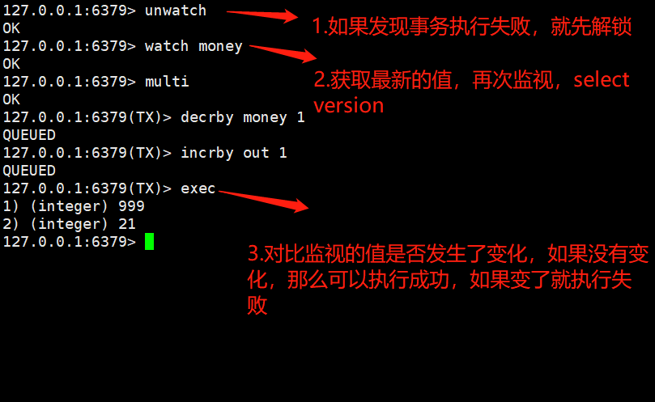
</div>


## Jedis

我们要使用java来操作Redis

>Jedis是Redis官方推荐的java连接开发工具！使用java操作Redis中间件！如果你要使用java操作redis，那么一定要对jedis十分的熟悉

> 测试

1、导入对应的依赖

```xml
  <!-- https://mvnrepository.com/artifact/redis.clients/jedis -->
        <dependency>
            <groupId>redis.clients</groupId>
            <artifactId>jedis</artifactId>
            <version>3.2.0</version>
        </dependency>

        <!--fastjson-->
        <dependency>
            <groupId>com.alibaba</groupId>
            <artifactId>fastjson</artifactId>
            <version>1.2.62</version>
        </dependency>
```


2、编码测试：

- 连接数据库
- 操作命令
- 断开连接！

```java
package com.lcdzzz;

import redis.clients.jedis.Jedis;

public class TestPing {
    public static void main(String[] args) {
        //new Jedis对象即可
        Jedis jedis = new Jedis("127.0.0.1",6379);
        //jedis 所有的命令就是我们之前学习的所有指令！
        System.out.println(jedis.ping());
    }
}


```


### 常用的API

String 

List

Set

Hash

Zset

<div style="text-align:center">
  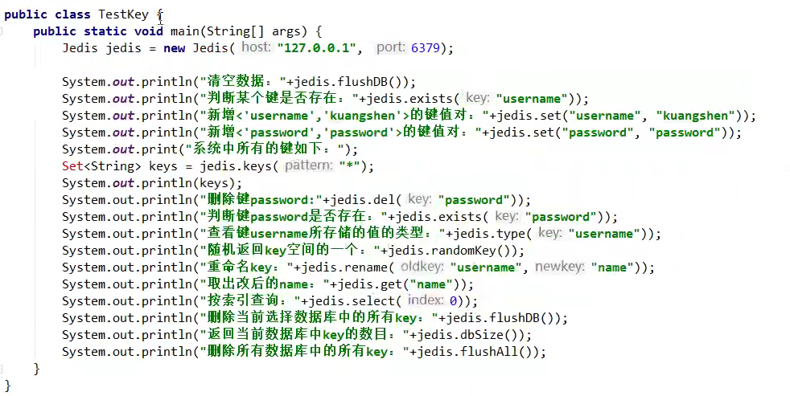
</div>

<div style="text-align:center">
  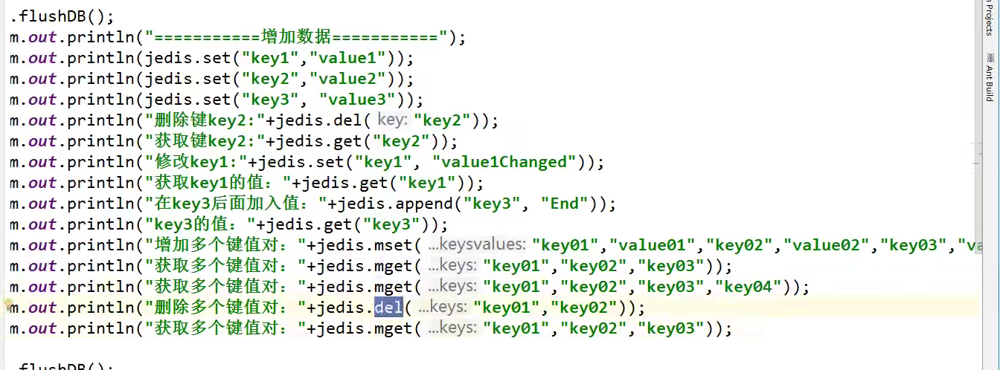
</div>

<div style="text-align:center">
  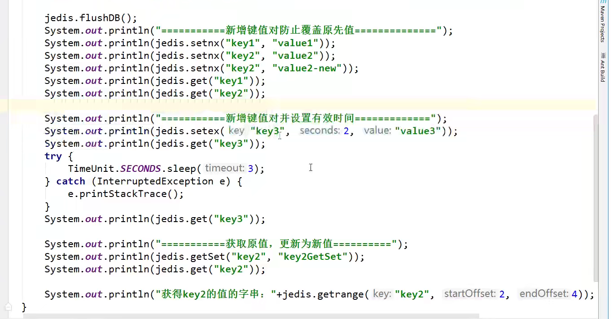
</div>

<div style="text-align:center">
  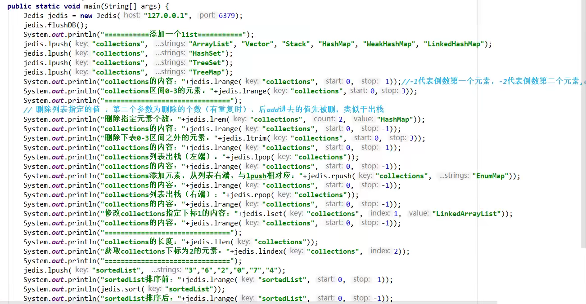
</div>

<div style="text-align:center">
  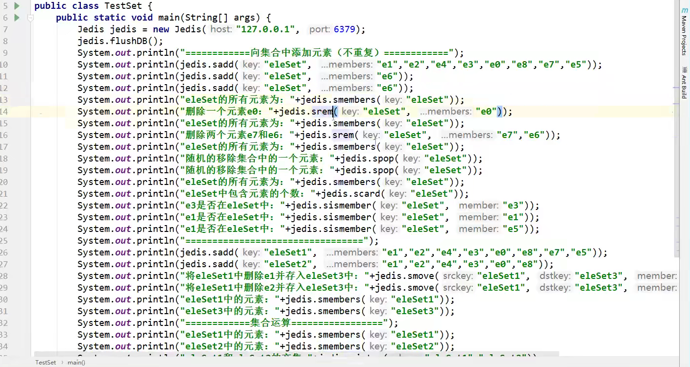
</div>

<div style="text-align:center">
  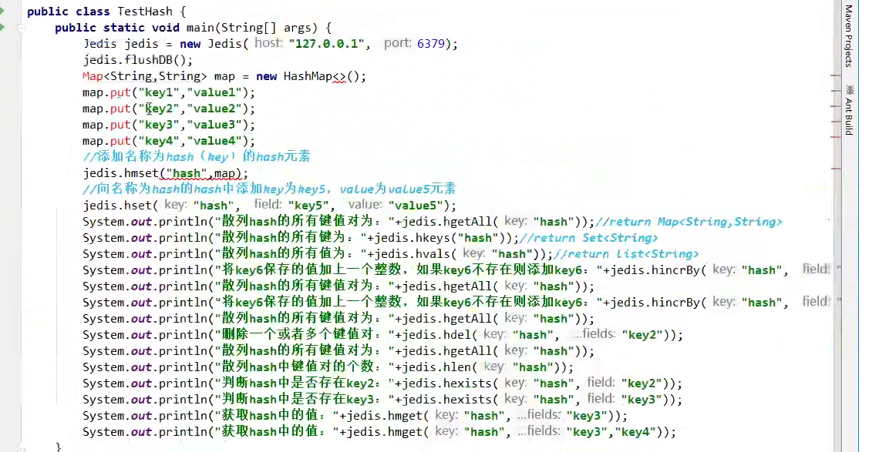
</div>

<div style="text-align:center">
  
</div>

## Springboot整合

SpringBoot操作数据：spring-daya jpa jdbc mongodb redis!

SpringData 也是和springboot齐名的项目！

说明：在springboot2.x之后，原来使用的jedis被替换成了lettuce？

jedis：采用的直连，多个线程操作的话，是不安全的，如果想要避免不安全的，使用jedis pool连接池更像BIO

lettuce：采用netty，实例可以在多个线程中进行共享，不存在线程不安全的情况！可以减少线程数据了！更像NIO

> 整合测试一下

1、导入依赖

```xml
<!--操作redis-->
		<dependency>
			<groupId>org.springframework.boot</groupId>
			<artifactId>spring-boot-starter-data-redis</artifactId>
		</dependency>
```


2、配置连接

```bash
spring.redis.host=127.0.0.1
spring.redis.port=6379
```

3、测试！

```java
package com.kuang;

import org.junit.jupiter.api.Test;
import org.springframework.beans.factory.annotation.Autowired;
import org.springframework.boot.test.context.SpringBootTest;
import org.springframework.data.redis.connection.RedisConnection;
import org.springframework.data.redis.core.RedisTemplate;

@SpringBootTest
class Redis02SpringbootApplicationTests {


	@Autowired
	private RedisTemplate redisTemplate;


	@Test
	void contextLoads() {
		//redisTemplate  操作不同的数据类型，api和指令是一样的
		//opsForValue 操作字符串，类似String
		//opsForList  操作List
		//opsForSet
		//opsForHash
		//opsForZSet
		//opsForGeo
		//opsForHyperLogLog

		//除了基本的操作，常用的方法都可以通过redisTemplate操作，比如事务，和基本的crud

		//获取redis的链接对象
		RedisConnection connection = redisTemplate.getConnectionFactory().getConnection();
		connection.flushDb();
		connection.flushAll();

		redisTemplate.opsForValue().set("mykey","zhoudianchenglongnihao");
		System.out.println(redisTemplate.opsForValue().get("mykey"));

	}

}

```


关于对象的保存

<div style="text-align:center">
  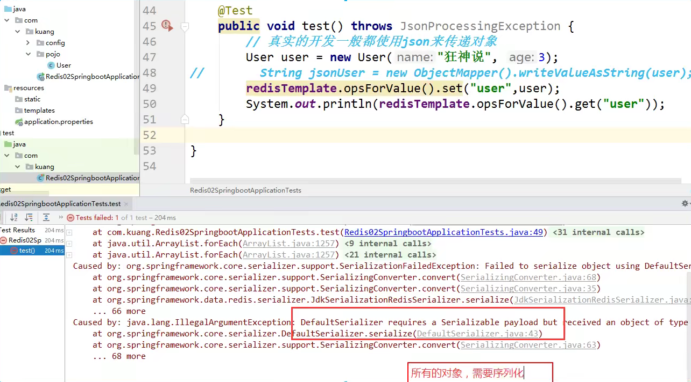
</div>


