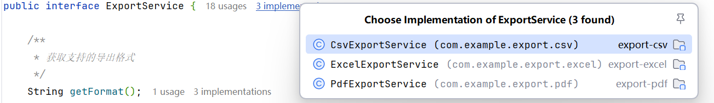

> 网络上优秀的SPI机制解析很多，会在文末推荐
>
> 这篇文章主要是介绍一下“<u>报表/数据导出格式扩展</u>”场景下的SPI机制应用。 强烈建议下载源码后阅读
>
> 代码地址：https://gitee.com/lcdzzz/spi-export-demo

# 介绍

SPI（Service Provider Interface）机制是Java提供的一种服务发现与动态加载的标准化方式。其核心思想是**“面向接口编程 + 策略模式 + 配置文件”**


简单来说，SPI定义了一个服务接口，而具体的实现则由第三方提供。程序通过**读取配置文件**来找到并加载这些实现，无需在代码中硬编码具体实现类。


## 工作原理

1. **定义接口**：服务方定义一个标准的接口。
2. **提供实现**：第三方（服务提供者）提供该接口的具体实现，并在其 `META-INF/services/`目录下创建一个以**接口全限定名**命名的文件。文件内容是该接口**具体实现类的全限定名**（每行一个）。
3. **加载服务**：服务方通过 `java.util.ServiceLoader`工具类来扫描、加载并实例化配置文件中声明的所有实现类。

## SPI 与 API 的核心区别

| 对比维度     | **API (Application Programming Interface)** | **SPI (Service Provider Interface)**             |
| ------------ | ------------------------------------------- | ------------------------------------------------ |
| **定义方**   | 实现方定义接口和实现，提供给调用方使用。    | 调用方定义接口，由实现方来提供具体实现。         |
| **控制权**   | 接口和实现的控制权在**实现方**。            | 接口的控制权在**调用方**，实现的控制权在第三方。 |
| **目的**     | 提供明确的功能，让开发者调用。              | 提供扩展点，让框架或平台能被定制和扩展。         |
| **关系方向** | 实现方 -> 调用方                            | 调用方 <- 实现方                                 |

> SPI是一种强大的解耦和扩展机制，它让程序的架构更加灵活，实现了“面向接口编程”和“开闭原则”，是许多优秀框架可扩展性的基石。


# 应用场景

## 报表/数据导出格式扩展

系统需要将数据导出为Excel、PDF、Word、CSV等多种格式。

- **SPI应用**：定义 `ExportService`接口。每种导出格式作为一个SPI实现。用户在前端选择“导出为PDF”时，后端根据格式参数，通过SPI找到对应的实现类执行导出。
- **优势**：方便地增加新的导出格式（如导出为图片），不会影响已有的导出功能。


## 实现

### 项目结构

```bash
spi-export-demo/
├── pom.xml                    # 主项目 POM 文件
├── export-api/                # 接口定义模块
│   └── src/main/java/com/example/export/
│       ├── ExportData.java    # 导出数据模型
│       └── spi/ExportService.java  # SPI 接口定义
├── export-excel/              # Excel 导出实现模块
├── export-pdf/                # PDF 导出实现模块
├── export-csv/                # CSV 导出实现模块
└── web-app/                   # Web 应用模块
    └── src/main/java/com/example/export/
        ├── ExportApplication.java  # Spring Boot 启动类
        ├── controller/ExportController.java  # REST 控制器
        └── factory/ExportServiceFactory.java  # 导出服务工厂
```


根据上面提到的SPI机制的实现原理，本项目的实现可以分为以下几步

### SPI机制实现步骤

#### 步骤1：定义接口

在 export-api 模块中，我们定义了标准的 ExportService 接口：

```java
/**
 * 导出服务SPI接口
 * 所有导出实现都必须实现此接口
 */
public interface ExportService {
    /**
     * 获取支持的导出格式
     */
    String getFormat();
    
    /**
     * 获取格式描述（用于前端展示）
     */
    String getDescription();
    
    /**
     * 执行导出
     * @param data 导出数据
     * @param outputStream 输出流
     */
    void export(ExportData data, OutputStream outputStream) throws Exception;
    
    /**
     * 支持的MIME类型
     */
    String getContentType();
    
    /**
     * 文件扩展名
     */
    String getFileExtension();
}
```

#### 步骤 2：提供实现
在各个导出模块中，我们提供了 ExportService 接口的具体实现：




**Excel导出实现**（其余同理）

```java
public class ExcelExportService implements ExportService {
    
    @Override
    public String getFormat() {
        return "excel";
    }
    
    @Override
    public String getDescription() {
        return "Microsoft Excel (.xlsx)";
    }
    
    @Override
    public String getContentType() {
        return "application/vnd.openxmlformats-officedocument.spreadsheetml.sheet";
    }
    
    @Override
    public String getFileExtension() {
        return "xlsx";
    }
    
    @Override
    public void export(ExportData data, OutputStream outputStream) throws Exception {...}
    
    private CellStyle createHeaderStyle(Workbook workbook) {...}
}
```


**创建 SPI 配置文件**

在每个导出模块的 `META-INF/services/` 目录下，我们创建了以**接口全限定名命名**的文件：

**Excel 模块配置文件** （其余同理）：

- 文件路径： `export-excel/src/main/resources/META-INF/services/com.example.export.spi.ExportService`
- 文件内容： `com.example.export.excel.ExcelExportService`


这些配置文件告诉 Java 运行时哪些类实现了 ExportService 接口。


#### 步骤 3：加载服务

在 `web-app` 模块中，我们通过 `ExportServiceFactory` 类使用 `ServiceLoader` 来加载所有实现：

```java

@Component
public class ExportServiceFactory {
    
    private final Map<String, ExportService> exportServiceMap = new HashMap<>();
    
    /**
     * 初始化时加载所有SPI实现
     */
    @PostConstruct
    public void init() {
        ServiceLoader<ExportService> loader = ServiceLoader.load(ExportService.class);
        
        for (ExportService service : loader) {
            String format = service.getFormat().toLowerCase();
            if (exportServiceMap.containsKey(format)) {
                // 可以记录日志，说明有重复实现
                System.err.println("警告：导出格式 " + format + " 有多个实现，使用 " + 
                    service.getClass().getName());
            }
            exportServiceMap.put(format, service);
        }
        
        System.out.println("加载的导出服务：" + exportServiceMap.keySet());
    }
    
    /**
     * 根据格式获取导出服务
     */
    public ExportService getExportService(String format) {
        ExportService service = exportServiceMap.get(format.toLowerCase());
        if (service == null) {
            throw new IllegalArgumentException("不支持的导出格式: " + format + 
                "，可用格式: " + getSupportedFormats());
        }
        return service;
    }
    
    /**
     * 获取所有支持的导出格式
     */
    public List<String> getSupportedFormats() {
        return new ArrayList<>(exportServiceMap.keySet());
    }
    
    /**
     * 获取格式描述信息（用于前端下拉框）
     */
    public Map<String, String> getFormatDescriptions() {
        Map<String, String> descriptions = new LinkedHashMap<>();
        exportServiceMap.forEach((format, service) -> {
            descriptions.put(format, service.getDescription());
        });
        return descriptions;
    }
}
```

当应用启动时， @PostConstruct 注解标记的 init() 方法会被执行：

1. 创建 `ServiceLoader<ExportService>` 实例

   调用 ServiceLoader.load(接口.class)

   1. **定位配置文件**：扫描类路径下所有 `META-INF/services/com.example.export.spi.ExportService`文件
   2. **读取实现类名**： 读取文件中每一行的全限定类名（如 `com.example.export.excel.ExcelExportService`）
   3. **延迟加载**： 创建 `ServiceLoader`实例，但**不立即**实例化实现类（懒加载）
   4. **提供服务**： 返回一个可迭代的 `ServiceLoader`对象，用于按需加载实现类

   底层机制流程图如下

   ```
   调用 ServiceLoader.load(接口.class)
           ↓
   扫描类路径下的 META-INF/services/接口全限定名 文件
           ↓
   读取文件中所有实现类的全限定名
           ↓
   为每个实现类创建 LazyClassPathLookupIterator
           ↓
   当调用 iterator().next() 或 for-each 循环时
           ↓
   通过反射 Class.forName() 加载类
           ↓
   调用无参构造器 newInstance() 创建实例
           ↓
   缓存实例，避免重复创建
           ↓
   返回实例给调用者
   ```

2. 遍历加载所有实现类

3. 将实现类缓存到 `exportServiceMap` 中，以格式名称为键

**运行时效果**

当应用启动时，控制台会输出：

```txt
加载的导出服务：[excel, pdf, csv]
```

这表明 SPI 机制成功加载了所有导出服务实现。


### 如何使用SPI服务

在 `ExportController` 中，我们通过 `ExportServiceFactory` 获取具体的导出服务：

```java
@RestController
@RequestMapping("/api/export")
public class ExportController {
    
    @Autowired
    private ExportServiceFactory exportServiceFactory;
    
    @PostMapping("/execute")
    public void exportData(
            @RequestParam String format,
            @RequestBody ExportRequest request,
            HttpServletResponse response) throws IOException {
        
        try {
            // 1. 获取对应的导出服务
            ExportService exportService = exportServiceFactory.getExportService(format);
            
            // 2. 后续操作省略
            
        } catch (Exception e) {
            // 错误处理...
        }
    }
    
    // 其他方法...
}
```


### 假如要扩展新的导出格式

要添加新的导出格式（如 Word），只需：

1. 创建新的 Maven 模块 export-word
2. 实现 ExportService 接口
3. 在 src/main/resources/META-INF/services/ 目录下创建配置文件
4. 在 web-app/pom.xml 中添加新模块的依赖

无需修改任何现有代码，新的导出格式会被自动加载。


> 参考资料： [Java SPI 机制详解 | JavaGuide](https://javaguide.cn/java/basis/spi.html)
>
> [Java常用机制--SPI机制详解一、什么是SPI机制 SPI（Service Provider Interface）， - 掘金](https://juejin.cn/post/7486483409084268595)
