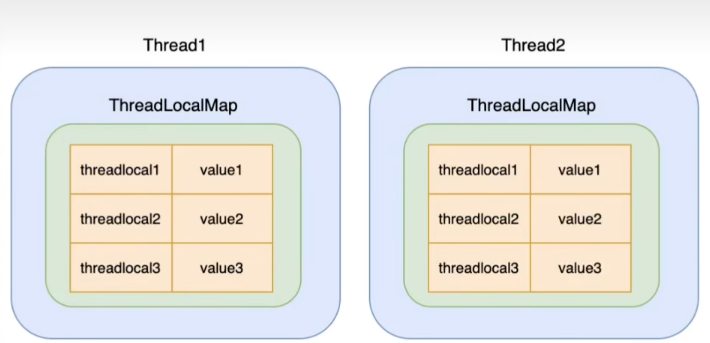
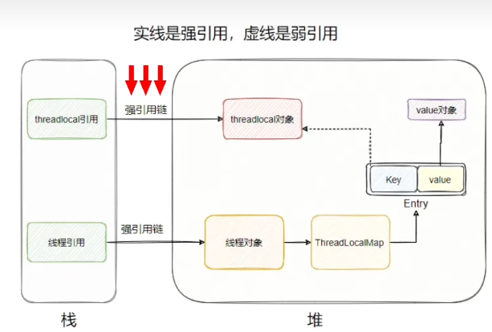

## ThreadLocal 是什么？

**`ThreadLocal` 不是“线程”，也不是“存储容器”，而是一个“访问代理”或“操作工具类”。**

可以把它理解为：

> 一个“钥匙生成器”+“存取接口”——它本身不存数据，但是可以帮我在线程专属的存储空间里面存取数据

关键点：

- `ThreadLocal` 每个实例代表一个独立的“**变量槽位**”
- 它通过 `set(value)` / `get()/remove()` 方法，操作当前线程内部的一个 **Map**（即 `ThreadLocalMap`）
- 所有数据**实际存储在 `Thread` 对象内部**，而不是 `ThreadLocal` 里


## ThreadLocal 和 ThreadLocalMap 的关系

它们的结构如下：

```txt
Thread
  └── ThreadLocal.ThreadLocalMap threadLocals（线程私有）
        └── Entry[] table（键值对数组）
              └── Entry extends WeakReference<ThreadLocal<?>>
                    ├── key: ThreadLocal 实例（弱引用）
                    └── value: 线程本地变量值
```

关系总结

|                  | 角色                                   | 所在位置                           |
| ---------------- | -------------------------------------- | ---------------------------------- |
| `ThreadLocal`    | **操作入口**，每个实例代表一个“变量名” | 全局（通常是 static）              |
| `ThreadLocalMap` | **真正的存储容器**，是一个自定义哈希表 | 属于 `Thread` 对象（每个线程一个） |
| `Thread`         | **宿主**，持有自己的 `ThreadLocalMap`  | JVM 线程                           |


## ThreadLocal结构

起初我以为ThreadLocal是一个大的map，线程当key变量当value。

实际上错了，因为那样ThreadLocal自己又变成共享变量了，还得加锁。

真正的实现是

每个线程内部都有一个`ThreadLocalMap`，key是`ThreadLocal`对象，value是线程独立数据

如下图



这样线程1和线程2去访问threadlocal1时，查找的都是自己的ThreadLocalMap


## 为什么能实现“线程隔离”

答： 每个线程都有自己的`ThreadLocalMap`，彼此完全独立。

在 **线程 A** 中调用 `userId.set("A")`，数据存入 **线程 A 的 map**；

在 **线程 B** 中调用 `userId.set("B")`，数据存入 **线程 B 的 map**。

他们操作的属于不同的内存区域，自然互补干扰。

**数据绑定到线程自身，而非共享全局变量。**


## 为什么能实现“线程内资源共享”

答：在一个线程中，所以代码（不管经历几层的方法调用），都能通过一个ThreadLocal实例，访问到当前线程map中对应的数据。

如`ThreadLocalDemo.java`中所示。


## 源码关键片段

### ThreadLocal.set()

```java
 public void set(T value) {
     Thread t = Thread.currentThread(); // 获取当前线程
     ThreadLocalMap map = getMap(t); // 获取线程的 ThreadLocalMap
     if (map != null)
         map.set(this, value); // 以 this (当前 ThreadLocal 实例) 为 key 存入
     else
         createMap(t, value);
 }
```

### `ThreadLocal.get()`

```java
public T get() {
    Thread t = Thread.currentThread();
    ThreadLocalMap map = getMap(t);
    if (map != null) {
        ThreadLocalMap.Entry e = map.getEntry(this); // 用 this 作 key 查找
        if (e != null) {
            @SuppressWarnings("unchecked")
            T result = (T)e.value;
            return result;
        }
    }
    return setInitialValue();
}
```


## 内存泄漏风险

> 内存泄漏
>
> (英语:memory leak)是计算机科学中的一种资源泄漏，主因是计算机程序的内存管理失当，因而失去对一段已分配内存空间的控制，程序继续占用已不再使用的内存空间，或是存储器所存储之对象无法透过执行代码而访问，令内存资源空耗。 -维基百科

先说结论：会

但是要注意：Java一般用来开发web，web一般用tomcat，所以大部分情况下业务是跑在tomcat线程池上的，所以ThreadLocal内存泄漏的问题要建立在线程会被复用的线程池场景。


### 源码分析

```java
static class ThreadLocalMap {

    static class Entry extends WeakReference<ThreadLocal<?>> {
        /** The value associated with this ThreadLocal. */
        Object value;
        Entry(ThreadLocal<?> k, Object v) {
            super(k); // 调用父类 WeakReference 的构造函数，k 是弱引用！
            value = v; // value 是普通引用（强引用）
        }
    }
    // 底层是一个 Entry 数组
    private Entry[] table;
}
```

- 因为Entry 继承自 `WeakReference`，所以Entry本身就是一个弱引用对象。

  entry对象通过弱引用关联当前的`threadLocal`对象，通过强引用value保存我们设置的值。

  此外，还有栈上的`threadLocal`引用指向堆中的`threadLocal`对象，这个引用是强引用

如下图



- 并且，如果有红色箭头指向的强引用存在的话，说明目前`threadlocal`是有用的，如果发生GC，`threadlocal`对象不会被清楚。但如果`threadlocal`是成员变量（也就是非静态）随着方法的执行完成，相应的栈帧也出栈了，此时，红色箭头指向的强引用链就没了。

  再后来，如果没有别的栈对`threadlocal`对象有引用的话，它对应的entry就没法再被访问到了，此时**内存泄漏**就发生了。

- 那如果`ThreadLocal`被定义成静态变量呢？

  照理说有静态变量的强引用在，因此`ThreadLocal`中的key弱引用不会被GC回收，所以不会有内存泄漏。

  但是这是不对的，一般情况下确实不会，但是类加载器是可以被卸载的，此时对应的类会被回收，于是强引用又没了...


不过ThreadLocal本身也对内存泄漏问题做了防范，我们以get方法作为切入

```java
public T get() {
    Thread t = Thread.currentThread();
    ThreadLocalMap map = getMap(t);
    if (map != null) {
        ThreadLocalMap.Entry e = map.getEntry(this); //⬇️
        if (e != null) {
            @SuppressWarnings("unchecked")
            T result = (T)e.value;
            return result;
        }
    }
    return setInitialValue();
}


private Entry getEntry(ThreadLocal<?> key) {
    int i = key.threadLocalHashCode & (table.length - 1);//从这里也可以看到，ThreadLocalMap是用线性探测法解决Hash冲突的，效率比较低。
    Entry e = table[i];
    if (e != null && e.get() == key)
        return e;
    else
        return getEntryAfterMiss(key, i, e); //⬇️
}

private Entry getEntryAfterMiss(ThreadLocal<?> key, int i, Entry e) {
    Entry[] tab = table;
    int len = tab.length;
    while (e != null) {
        ThreadLocal<?> k = e.get();
        if (k == key)
            return e;
        if (k == null)
            expungeStaleEntry(i); //将key为null的entry清理掉
        else
            i = nextIndex(i, len);
        e = tab[i];
    }
    return null;
}

```

以上虽然降低了内存泄漏的发生概率，但这其实就是把清理的开销，弄到了get和set上。万一get的时候清理的无用的entry特别多，那这次get相对而言就比较慢了。

并且，这个方法只能介绍内存泄漏的发生，因为这种清理是局部的，它是从触发清理的位置开始向右遍历，直到碰到第一个有效的entry，所以不是所有的entry都会被检查，万一运气就不好呢？


## 最佳实践

1. 不要滥用`ThreadLocal`

   普通参数不要用它，它适合存放线程独立信息如

   - 数据库链接
   - 用户上下文

2. 用完一定要`remove`，在`try-finally`里面清理

3. 把`ThreadLocal`定义成静态变量，使它全局可用，只分配一块内存


