# 环境准备

## 安装git

到 GitHub 的页面上下载 exe 安装文件并运行：

[安装包下载地址](https://gitforwindows.org/)

详细可看：[(6条消息) Git 详细安装教程（详解 Git 安装过程的每一个步骤）_mukes的博客-CSDN博客_git安装](https://blog.csdn.net/mukes/article/details/115693833)

<div style="text-align:center">
  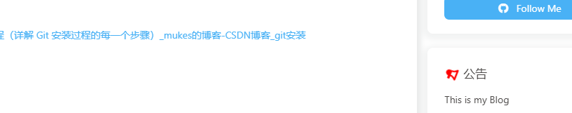
</div>

## 安装Nodejs

下载链接：[下载 | Node.js 中文网 (nodejs.cn)](http://nodejs.cn/download/)

<div style="text-align:center">
  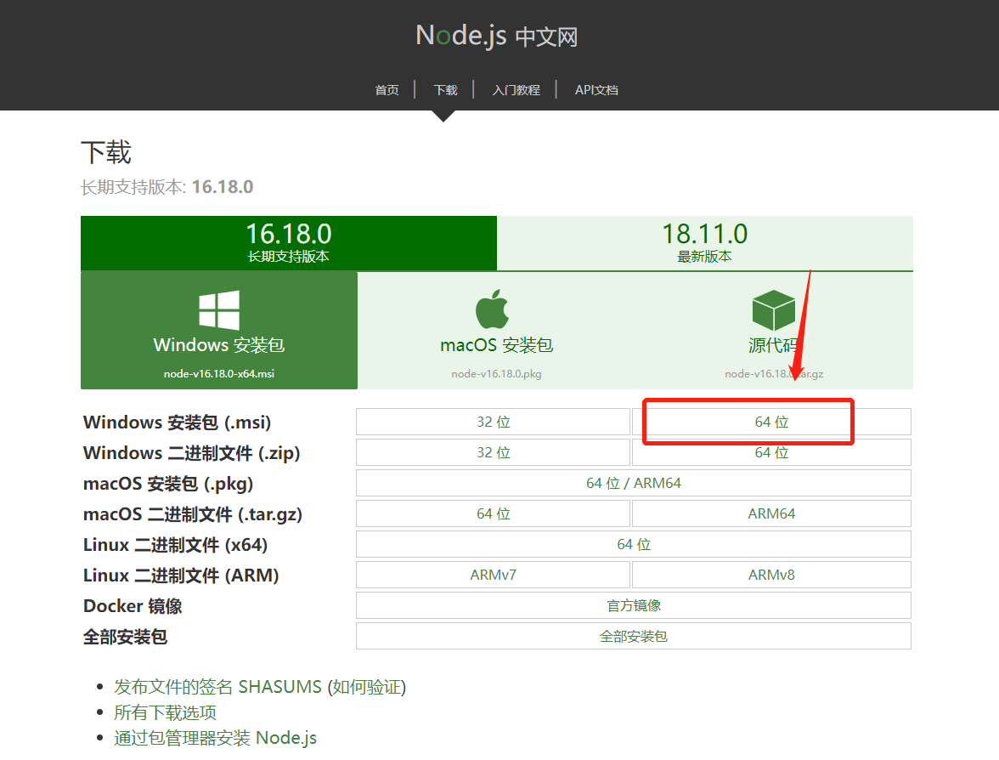
</div>

详细可看：[Node.js 安装配置 | 菜鸟教程 (runoob.com)](https://www.runoob.com/nodejs/nodejs-install-setup.html)

最后通过cmd 输入`node --version` 检测是否安装完成，只要有输出就行，不管版本号是多少

<div style="text-align:center">
  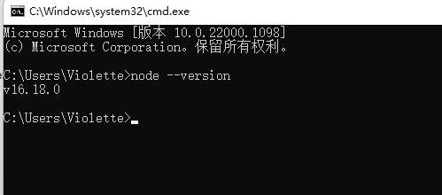
</div>

查看是否安装成功：

在桌面鼠标右键点击git bash here或者打开电脑CMD，依次输入以下指令

```java
node -v	#查看node版本
npm -v	#查看npm版本
```

<div style="text-align:center">
  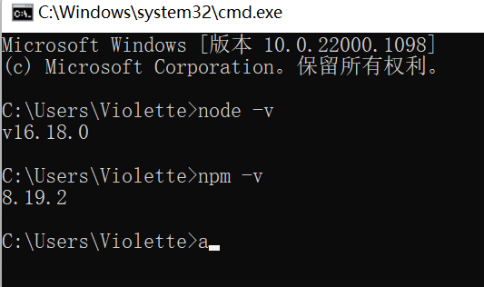
</div>

显示如上即成功

## 安装淘宝的cnpm 管理器

```bash
npm install -g cnpm --registry=http://registry.npm.taobao.org
```

由于国内的镜像源速度较慢，所以我们利用 npm 来安装 cnpm ，在命令行中输入`npm install -g cnpm --registry=https://registry.npm.taobao.org`然后回车（Enter），稍等一会便下载好了

查看cnpm版本

```bash
cnpm -v
```

<div style="text-align:center">
  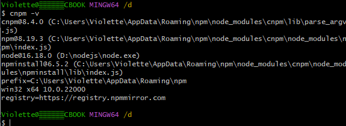
</div>

## 部署hexo框架

```bash
cnpm install -g hexo-cli #部署hexo框架
hexo -v	#查看hexo版本
```

<div style="text-align:center">
  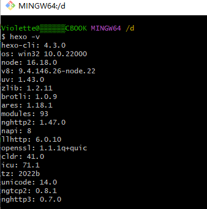
</div>

# 连接 Github

## 注册

使用邮箱注册 [GitHub](https://link.zhihu.com/?target=https%3A//github.com/) 账户，选择免费账户（Free），并完成邮件验证。

右键 -> Git Bash Here，**设置用户名和邮箱**：

```text
git config --global user.name "GitHub 用户名"
git config --global user.email "GitHub 邮箱"
```

## 创建 SSH 密匙：

输入 `ssh-keygen -t rsa -C "GitHub 邮箱"`，然后一路回车。

## 添加密匙：

进入 [C:\Users\用户名\.ssh] 目录（要勾选显示“隐藏的项目”），用记事本打开公钥 id_rsa.pub 文件并复制里面的内容。

登陆 GitHub ，进入 Settings 页面，选择左边栏的 SSH and GPG keys，点击 New SSH key。

Title 随便取个名字，粘贴复制的 id_rsa.pub 内容到 Key 中，点击 Add SSH key 完成添加。

<div style="text-align:center">
  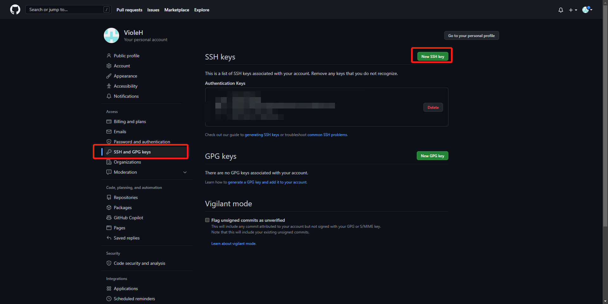
</div>

## 验证连接：

打开 Git Bash，输入 `ssh -T git@github.com` 出现 “Are you sure……”，输入 yes 回车确认。


<div style="text-align:center">
  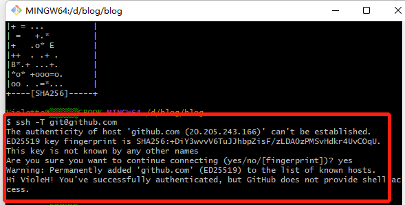
</div>

## 创建仓库

创建一个和用户名相同的仓库，后面加上`.github.io`，必须要同名，否则后面会出现404的情况

<div style="text-align:center">
  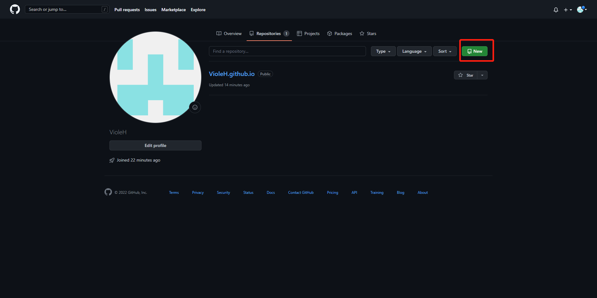
</div>

<div style="text-align:center">
  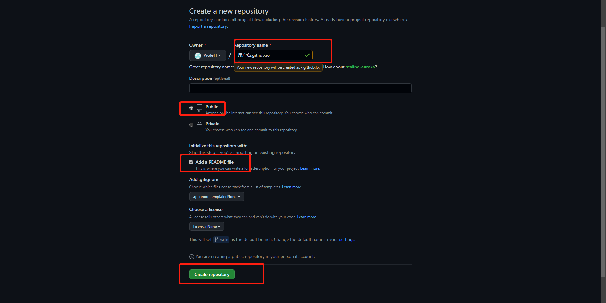
</div>

创建后默认自动启用 HTTPS，博客地址为：`https://用户名.github.io`


# 本地安装 Hexo 博客程序

新建一个文件夹用来存放 Hexo 的程序文件，如 Hexo-Blog。打开该文件夹，右键 -> Git Bash Here。

## 安装 Hexo

使用 npm 一键安装 Hexo 博客程序：

```bash
npm install -g hexo-cli
```

安装时间有点久（真的很慢！），界面也没任何反应，**耐心等待**

## Hexo 初始化和本地预览

**初始化并安装所需组件：**

```bash
hexo init      # 初始化
npm install    # 安装组件
```

完成后依次输入下面命令，**启动本地服务器进行预览**：

```bash
hexo g   # 生成页面
hexo s   # 启动预览
```

**访问** `http://localhost:4000`，出现 Hexo 默认页面，本地博客安装成功！

**Tips：**如果出现页面加载不出来，可能是端口被占用了。Ctrl+C 关闭服务器，运行 `hexo server -p 5000` 更改端口号后重试。

Hexo 博客文件夹目录结构如下：

<div style="text-align:center">
  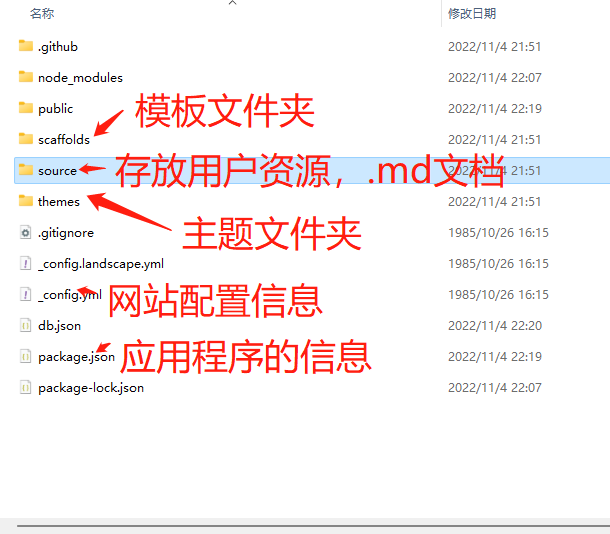
</div>


##  部署 Hexo 到 GitHub Pages

本地博客测试成功后，就是上传到 GitHub 进行部署，使其能够在网络上访问。

首先**安装 hexo-deployer-git**：

```bash
npm install hexo-deployer-git --save
```

然后**修改 _config.yml** 文件末尾的 Deployment 部分，修改成如下：

```yml
deploy:
  type: git
  repository: git@github.com:用户名/用户名.github.io.git
  branch: master
```

完成后运行 `hexo d` 将网站上传部署到 GitHub Pages。

<div style="text-align:center">
  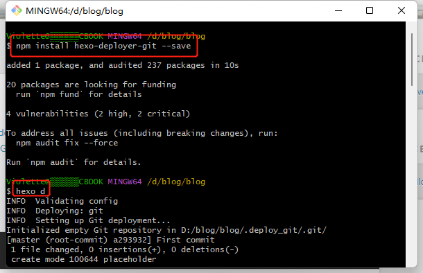
</div>

不过需要等一会，上传需要时间

过了一会再可以访问我们的 GitHub 域名 `https://用户名.github.io` 就可以看到 Hexo 网站了。

<div style="text-align:center">
  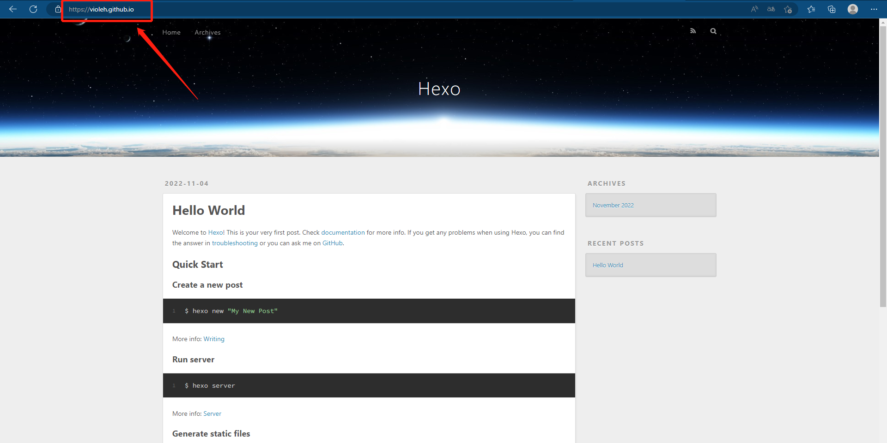
</div>

<br>

# 开始使用

## 发布文章

进入博客所在目录

右键打开 Git Bash Here，创建博文：

```bash
hexo new "My New Post"
```

然后 source 文件夹中的_posts文件夹会出现一个 My-New-Post.md 文件，就可以使用 Markdown 编辑器在该文件中撰写文章了。

也可以不使用命令,而自己去创建 .md 文件，只需在文件开头手动加入如下格式 Front-matter 即可，写完后运行 `hexo g` 和 `hexo d` 发布。

```md
---
title: Hello World # 标题
date: 2019/3/26 hh:mm:ss # 时间
categories: # 分类
- Diary
tags: # 标签
- PS3
- Games
---

摘要
<!--more-->
正文
```

<br>

写完后运行下面代码将文章渲染并部署到 GitHub Pages 上完成发布。

```bash
hexo g   # 生成页面
hexo s   # 启动本地服务器，用于预览主题。默认地址： http://localhost:4000/
hexo d   # 自动生成网站静态文件，并部署到设定的仓库。
```

<div style="text-align:center">
  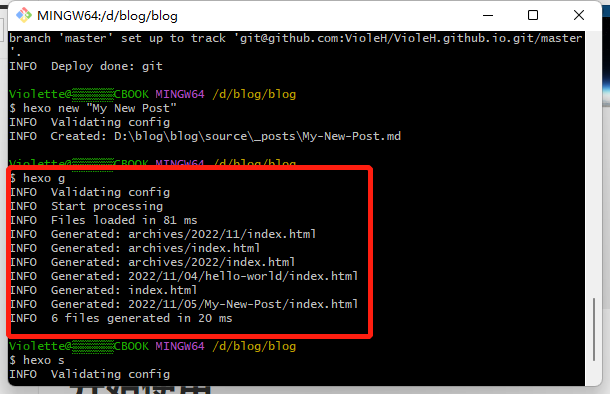
</div>

<div style="text-align:center">
  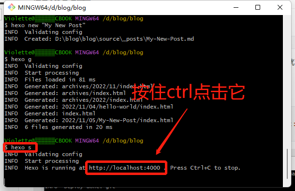
</div>

也可以直接在浏览器上输入地址：localhost:4000 。 ctrl+c 是退出

<div style="text-align:center">
  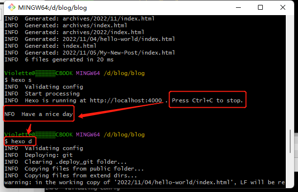
</div>

这时候再等一会（时间有长有短，基本上不会出问题，如果出了问题继续百度），然后访问用户名.github.io就可以访问自己的博客了

以下还有些hexo的常用命令

```bash
hexo new "name"       # 新建文章
hexo new page "name"  # 新建页面
hexo g                # 生成页面
hexo d                # 部署
hexo g -d             # 生成页面并部署
hexo s                # 本地预览
hexo clean            # 清除缓存和已生成的静态文件
hexo help             # 帮助
```

## 网站设置

包括网站名称、描述、作者、链接样式等，全部在网站目录下的 _config.yml 文件中，参考[官方文档](https://link.zhihu.com/?target=https%3A//hexo.io/zh-cn/docs/configuration)按需要编辑。

注意：冒号后要加一个空格！

## 更换主题

可以在 [Themes | Hexo](https://link.zhihu.com/?target=https%3A//hexo.io/themes/) 选择一个喜欢的主题，或者其他地方，各种各样的主题网上应有尽有，至于怎么安装，就自己去百度吧（有些坑亲自去踩了才有意思 /doge）


# 后续问题

## hexo d失败

```bash
Please make sure you have the correct access rights
and the repository exists.
FATAL {
  err: Error: Spawn failed
      at ChildProcess.<anonymous> (D:\work_space\blog\hexo\node_modules\.store\hexo-util@2.7.0\node_modules\hexo-util\lib\spawn.js:51:21)
      at ChildProcess.emit (node:events:518:28)
      at cp.emit (D:\work_space\blog\hexo\node_modules\.store\cross-spawn@7.0.6\node_modules\cross-spawn\lib\enoent.js:34:29)
      at ChildProcess._handle.onexit (node:internal/child_process:293:12) {
    code: 128
  }
} 

#提示检查访问权限和仓库是否存在
```

1. 确保`_config.yml`设置的仓库地址是正确的

2. 检查github或者gitee的SSH 密钥的配置、仓库的权限设置

3. 确保你的系统上安装了所有必要的依赖项，比如 Node.js 和 npm（或 yarn或cnpm）。此外，检查你的 Hexo 版本是否与其他依赖项兼容。

4. （可选）尝试运行 Hexo 命令时加上 `--debug` 标志，这可能会提供更多关于错误的详细信息

5. 检查用户名和邮箱：`git config user.name`和`git config user.email`

   ```bash
   $ ssh -T git@github.com
   # 主机认证
   The authenticity of host 'github.com (20.205.243.166)' can't be established. 
   # SSH 服务器（在这种情况下是 GitHub）提供了一个公钥指纹，用于验证其身份
   ED25519 key fingerprint is SHA256:+DiY3wvvV6TuJJhbpZisF/zLDA0zPMSvHdkr4UvCOqU.
   # SSH 服务器（在这种情况下是 GitHub）提供了一个公钥指纹，用于验证其身份
   This key is not known by any other names
   # SSH 客户端将服务器的公钥指纹添加到 ~/.ssh/known_hosts 文件中，这样在未来的连接尝试中，它就可以自动验证服务器的身份而不需要再次询问。	
   Are you sure you want to continue connecting (yes/no/[fingerprint])? yes
   Warning: Permanently added 'github.com' (ED25519) to the list of known hosts.
   # 最后，GitHub 确认了你的身份（通过 SSH 密钥），但告诉你它没有提供 shell 访问权限。
   # 这是正常的，因为 GitHub（和大多数代码托管平台）不允许通过 SSH 直接获得 shell 访问权限。它们只允许使用 SSH 进行 Git 操作，如克隆、拉取、推送等。
   Hi lcdzzz! You've successfully authenticated, but GitHub does not provide shell access.
   
   ```

以上，基本可以解决hexo d失效的问题（如长时间没有更新博客或者换了电脑）


## 上传图片

> 更新时间：20250731

网上有很多上传并显示图片的方法，我试过很多中，以下：

- 一种是`npm install hexo-asset-image --save` 安装插件，插件会将Markdown中的 `` 自动转换为HTML可识别的绝对路径，但这种有个很大的缺点就是本地无法正确显示图片，这个当我们不想通过联网或者hexo s去查看笔记的时候是非常不方便的。

- 还有一种是图床，需要去配置图工具，再等图床生成图片URL后，直接写入Markdown。

```markdown

```


但是以上都是需要安装插件或者工具的，全部使用过后，我选择最简单，兼容性最强的方法：**使用HTML标签**（若插件或路径转换失败）

```html
<div style="text-align:center">
  
</div>
```


### 案例

以前我引用图片是使用第一种方法，如下

```markdown

```

存在和文章同名的文件夹下。假如我这篇叫`hexo-博客安装教程-胎教级.md`,那么就有一个文件夹名为`hexo-博客安装教程-胎教级`存着名为`image-20221105123810384.png`的图片。

那么就转换成这样的html格式（这里建议直接使用）

```html
<div style="text-align:center">
  
</div>
```


### 转换脚本

由于在我转换成这个写法的时候我已经写了三四十篇的博客了，人为转换工程量极其庞大，于是有了下面这个脚本，复制并赋权即可食用。

windows用户不方便使用shell的话，可以看看这篇

[windowsのwsl安装centos](https://lcdzzz.github.io/2025/07/31/windows%E3%81%AEwsl%E5%AE%89%E8%A3%85centos/)

```bash
#!/bin/bash

# 检查参数是否提供
if [ $# -eq 0 ]; then
  echo "Usage: $0 file1.md [file2.md ...]"
  echo "示例: $0 GaussDB安装及应用.md AnotherDocument.md"
  exit 1
fi

# 处理每个文件
for filepath in "$@"; do
  # 检查文件是否存在
  if [ ! -f "$filepath" ]; then
    echo "警告: 跳过不存在的文件 '$filepath'"
    continue
  fi
  
  # 提取文件名（不含扩展名）作为图片前缀
  filename=$(basename -- "$filepath")
  prefix="${filename%.*}"
  
  # 创建临时文件
  tmpfile=$(mktemp)
  
  # 处理文件内容
  while IFS= read -r line; do
    # 检测图片语法 
    if [[ $line =~ \!\[([^\]]*)\]\(([^\)]+)\) ]]; then
      alt_text="${BASH_REMATCH[1]}"
      img_path="${BASH_REMATCH[2]}"
      
      # 输出转换后的HTML（保留完整前缀）
      echo "<div style=\"text-align:center\">"
      echo "  "
      echo "</div>"
    else
      # 非图片行保持不变
      echo "$line"
    fi
  done < "$filepath" > "$tmpfile"
  
  # 替换原文件
  mv "$tmpfile" "$filepath"
  echo "已处理: $filepath → 使用前缀: $prefix"
done

echo "转换完成! 共处理 $# 个文件"
```


使用方法

```bash
./convert_images.sh test.md 
./convert_images.sh *.md
```


