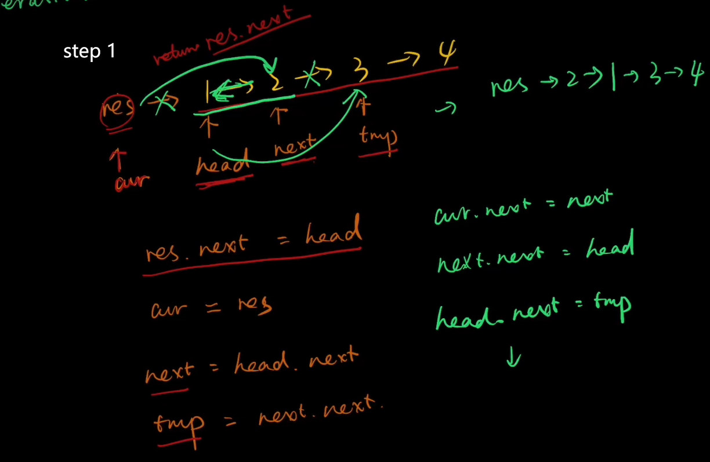
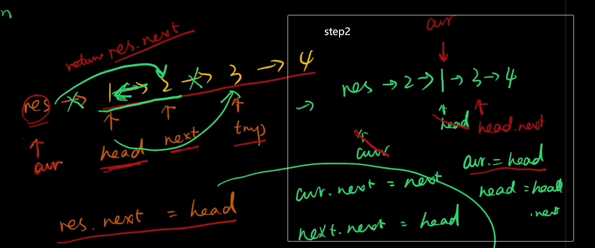
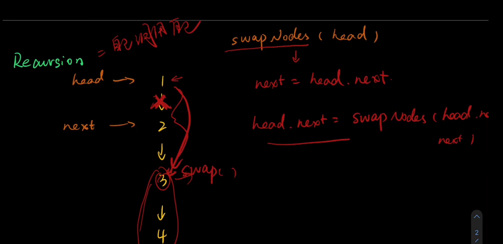
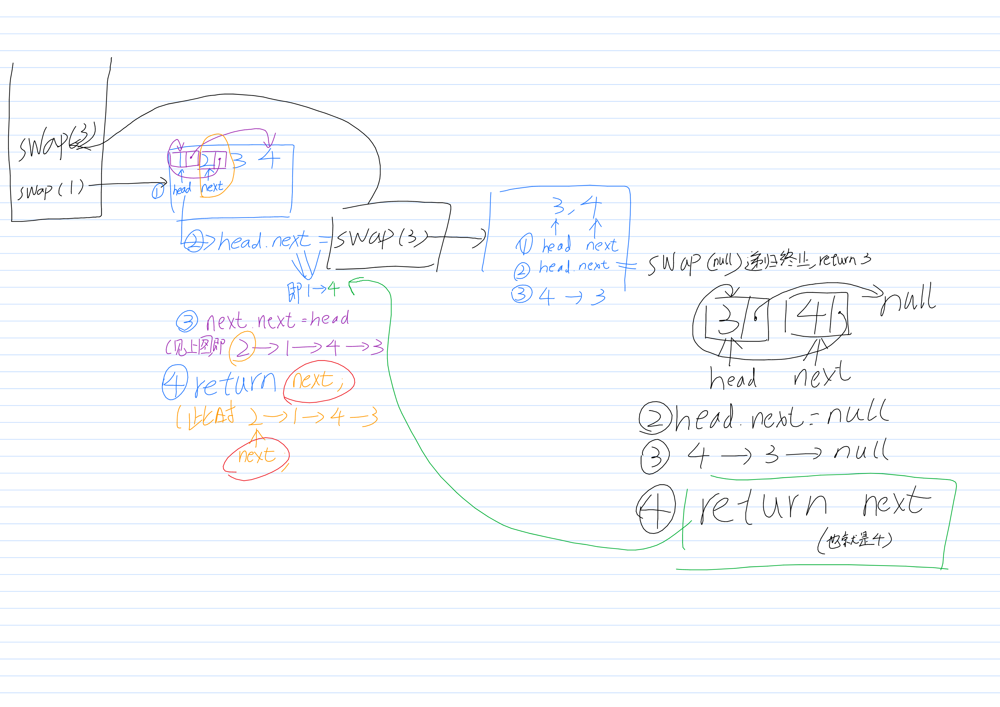
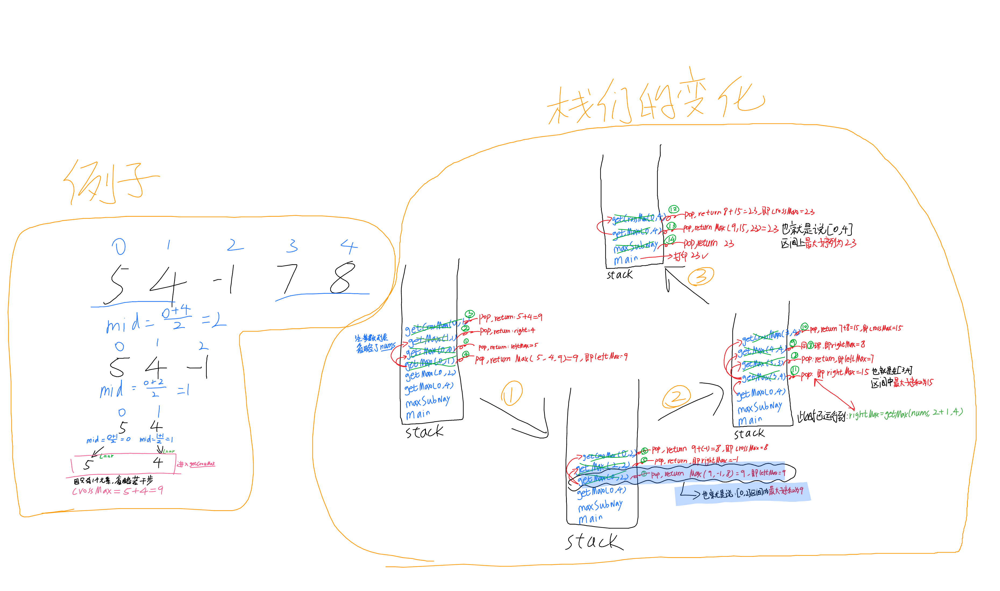

----

## 1

```java
import java.util.HashMap;

class Solution {
    public static void main(String[] args) {
        Solution solution = new Solution();
        int[] fnums = {3, 2, 4};
        int[] result = solution.twoSum(fnums, 6);
        for (int i = 0; i < result.length; i++) {
            System.out.println(result[i]);
        }
    }

    public int[] twoSum(int[] nums, int target) {
        int diff=0;
        HashMap<Integer, Integer> hashMap = new HashMap<>();
        for (int i = 0; i < nums.length; i++) {
            hashMap.put(nums[i],i);
        }
        for (int i = 0; i < nums.length; i++) {
            diff=target-nums[i];
            if (hashMap.containsKey(diff)&&hashMap.get(diff)!=i){
                int[] ints = new int[2];
                ints[0]=i;
                ints[1]=hashMap.get(diff);
                return ints;
            }
        }
        return new int[0];
    
    }
```

----

## 2

### 迭代法

```java
public class ListNode {
    int val;
    ListNode next;

    ListNode() {
    }

    ListNode(int val) {
        this.val = val;
    }

    ListNode(int val, ListNode next) {
        this.val = val;
        this.next = next;
    }
}

class Solution {
    public static void main(String[] args) {
        Solution solution = new Solution();
        ListNode l1 = new ListNode(
                2, new ListNode(
                4, new ListNode(
                3, null)));
        ListNode l2 = new ListNode(
                5, new ListNode(
                6, new ListNode(
                4, null)));

        ListNode listNode = solution.addTwoNumbers(l1, l2);
        while (listNode!=null){
            System.out.print(listNode.val+" ");
            listNode=listNode.next;
        }

    }

    public ListNode addTwoNumbers(ListNode l1, ListNode l2) {
        int cf = 0;//进位标志
        int total=0;
        ListNode result = new ListNode();//结果的头指针
        ListNode tempNode=result;
        while (l1 != null && l2 != null) {
            total=l1.val + l2.val + cf;
            tempNode.next=new ListNode((total) % 10);//当位数
            cf = (total) / 10;//进位
            l1=l1.next;
            l2=l2.next;
            tempNode=tempNode.next;
        }
        while (l1 != null ) {
            total=l1.val + cf;
            tempNode.next=new ListNode((total) % 10);//当位数
            cf = (total) / 10;//进位
            l1=l1.next;
            tempNode=tempNode.next;
        }
        while (l2 != null ) {
            total=l2.val + cf;
            tempNode.next=new ListNode((total) % 10);//当位数
            cf = (total) / 10;//进位
            l2=l2.next;
            tempNode=tempNode.next;
        }
        if (cf!=0){
            tempNode.next=new ListNode(cf);//当位数
        }
        return result.next;
    }
}


```

<br>

### 递归法

```java

    public ListNode addTwoNumbers(ListNode l1, ListNode l2) {
        int total;
        int cf;
        ListNode res = new ListNode();
        total = l1.val + l2.val;
        cf = total / 10;
        res = new ListNode(total % 10);
        if (l1.next != null || l2.next != null || cf != 0) {
            if (l1.next != null) {
                l1 = l1.next;
            } else {
                l1 = new ListNode(0);
            }
            if (l2.next != null) {
                l2 = l2.next;
            } else {
                l2 = new ListNode(0);
            }
            l1.val = l1.val + cf;//因为对于下一层递归来说，这里的cf是透明的，所以在进入递归之前需要先加进位
            res.next = addTwoNumbers(l1, l2);
        }
        return res;
    }
```

----

## 20

### 自己

| 执行用时分布               | 消耗内存分布               |
| -------------------------- | -------------------------- |
| 2ms                        | 40.23MB                    |
| 击败51.55%使用 Java 的用户 | 击败13.63%使用 Java 的用户 |

```java
import java.util.Stack;


class Solution {
    char l1='(';
    char r1=')';
    char l2='[';
    char r2=']';
    char l3='{';
    char r3='}';

    public boolean isValid(String s) {
        Stack<Character> stack = new Stack<>();
        boolean flag=true;
        char[] charcuray = s.toCharcuray();
        char temp;
        char tempBracket;
        int ll=0;
        int rr=0;
        int num=0;
        for (int i=0;i<charcuray.length;i++){
            temp=charcuray[i];
            if (temp==l1||temp==l2||temp==l3){
                stack.add(temp);
                ll++;
                num++;
            }
            if ((temp==')'||temp==']'||temp=='}')&&stack.isEmpty()){
                flag=false;
                return flag;
            }
            if (!stack.isEmpty()){
                if (temp==r1||temp==r2||temp==r3){
                    tempBracket=stack.pop();
                    rr++;
                    if (temp==']'){
                        if (tempBracket!='['){
                            flag=false;
                            return flag;
                        }else {
                            num--;
                        }
                    }
                    else if (temp==')'){
                        if (tempBracket!='('){
                            flag=false;
                            return flag;
                        }else {
                            num--;
                        }
                    }
                    else if (temp=='}'){
                        if (tempBracket!='{'){
                            flag=false;
                            return flag;
                        }else {
                            num--;
                        }
                    }
                }
            }


        }
        if (ll-rr!=0||num!=0){
            flag=false;
            return flag;
        }
        return flag;
    }

    public static void main(String[] args) {
        String s = "()";
        Solution solution = new Solution();
        System.out.println(solution.isValid(s));
    }
}


```

### 被优化

| 执行用时分布               | 消耗内存分布              |
| -------------------------- | ------------------------- |
| 1ms                        | 40.45MB                   |
| 击败98.64%使用 Java 的用户 | 击败9.24%使用 Java 的用户 |

```java
    public boolean isValid(String s) {
        if (s.length() == 0) {
            return true;
        }
        Stack<Character> stack = new Stack<>();
        for (char ch : s.toCharcuray()) {
            if (ch == '(' || ch == '[' || ch == '{') {
                stack.push(ch);
            } else {
                if (stack.isEmpty()) {
                    return false;
                } else {
                    char temp = stack.pop();
                    if (ch == ')') {
                        if (temp != '(') {
                            return false;
                        }
                    } else if (ch == ']') {
                        if (temp != '[') {
                            return false;
                        }
                    } else if (ch == '}') {
                        if (temp != '{') {
                            return false;
                        }
                    }
                }
            }
        }

        return stack.isEmpty()? true:false;
    }//抄的
```


----

## 21

```java
public class ListNode {
    int val;
    ListNode next;
    ListNode() {
    }
    ListNode(int val) {
        this.val = val;
    }
    ListNode(int val, ListNode next) {
        this.val = val;
        this.next = next;
    }
}
class Solution {
    public static void main(String[] args) {
        Solution solution = new Solution();
        // 示例链表1: 1 -> 3 -> 5
        ListNode list1 = new ListNode(1);
        list1.next = new ListNode(3);
        list1.next.next = new ListNode(5);

        // 示例链表2: 2 -> 4 -> 6
        ListNode list2 = new ListNode(2);
        list2.next = new ListNode(4);
        list2.next.next = new ListNode(6);
        ListNode result = solution.mergeTwoLists(list1, list2);

    }
    public ListNode mergeTwoLists(ListNode list1, ListNode list2) {
        // 创建一个哑节点作为合并后的链表的头节点
        ListNode dummy = new ListNode(0);
        ListNode current = dummy;
        while (list1!=null&&list2!=null){
            if (list1.val<list2.val){
                current.next=list1;
                list1=list1.next;
            }else {
                current.next=list2;
                list2=list2.next;
            }
            current=current.next;
        }
        if (list1!=null){
            current.next=list1;
        }else if (list2!=null){
            current.next=list2;
        }
        return dummy.next;
    }
}

```

----

## 22括号生成（回溯）

### 回溯法

```java
import java.util.curayList;
import java.util.List;

class Solution {
    public static void main(String[] args) {
        Solution solution = new Solution();
        List<String> strings = solution.generateParenthesis(2);
    }

    public List<String> generateParenthesis(int n) {
        List<String> result = new curayList<>();
        backtracking(n,result,0,0,"");

        return result;
    }
    void backtracking(int n,List<String> result,int left,int right,String str){
        if (right>left){
            return;
        }
        if (left==right&&right==n){
            result.add(str);
            return;
        }
        if (left<n){
            backtracking(n,result,left+1,right,str+"(");
        }
        if (right<n){
            backtracking(n,result,left,right+1,str+")");
        }
    }
}
```


----

## 24两两交换链表中的节点(链表交换)

### 迭代法iteration

<div style="text-align:center">
  
</div>

1. 把res->1的指针断了，<u>让cur指向2</u>                                           `cur.next=next`

2. 把 2->3的指针断了，并 <u>让next（原本指向2的指针）</u>指向1 `next.next=head`

3. 把head.next的指针断了，<u>让它指向temp</u>                              `head.next=temp`

4. 此时链表为  `res->2->1->3->4`

5. 接下来同理。

<div style="text-align:center">
  
</div>

6. ↑↑ 

    cur=head; 

    head=head.next

7. 然后 重复123步，得到链表`res->2->1->4->3`

```java
class Solution {
    /*
    *           res   ->  1   ->   2  ->  3   ->4
    *           cur      head    next    temp
    *
    * */
    public ListNode swapPairs(ListNode head) {
        if (head==null||head.next==null){
            return head;
        }
        ListNode res=new ListNode(0);
        res.next=head;//使res把链表串起来：res->1->2->3->4
        ListNode cur=res;//辅助指针
        while (cur.next!=null&&cur.next.next!=null){
            ListNode next=head.next;       //定义指针
            ListNode temp=head.next.next;  //定义指针
            cur.next=next;   //两两
            next.next=head;  //交
            head.next=temp;  //换
            cur=head;//虽然叫head，但是它指向的是1，此时1已经是第二个节点了（不算res）
            head=head.next;//把head指向3,下个循环解决的就是3->4的交换
        }

        return res.next;//返回的是res，因为cur已经滚到后面去了
    }
}
```

注：真实链表一直是以res起头的，即`res->1->2->3->4`==>`res->2->1->3->4`==>`res->2->1->4->3`。所以返回的是`res.next`而不是`cur.next`


### 递归法recursion

<div style="text-align:center">
  
</div>

1. 把1->2的指针切断，让1的next指向head.next.next。所以head.next就是递归自己即swapPairs(head.next.next);

      `ListNode next=head.next;`  (使得指针next对应2)
   `head.next=swapPairs(head.next.next);`

2. 注意，此时的next指针的next应该不指向3了（2->3的关联别切断了），并且应该指向1，即`next.next=head`

(具体请看图，如果看不懂就再画一次)。~~周某，我知道你第二次或许还是看不懂，所以干脆再画一遍吧，第一次能画出来，那第二次一定可以的。~~

<div style="text-align:center">
  
</div>

```java
class Solution {
    public ListNode swapPairs(ListNode head) {
        if (head==null||head.next==null){//递归终止条件
            return head;
        }
        ListNode next=head.next;
        head.next=swapPairs(head.next.next);
        next.next=head;
        return next;
    }
}
```

----

## 49. 字母异位词分组

### 排序法

```java

class Solution {
    public static void main(String[] args) {
        Solution solution = new Solution();
        String[] strings = new String[6];
        strings[0]="eat";
        strings[1]="tea";
        strings[2]="tan";
        strings[3]="ate";
        strings[4]="nat";
        strings[5]="bat";
        solution.groupAnagrams(strings);
    }
    public List<List<String>> groupAnagrams(String[] strs) {
        HashMap<String,ArrayList> result=new HashMap<>();
        for (String s:strs){
            char[] temp=s.toCharArray();
            Arrays.sort(temp);
            String key= Arrays.toString(temp);
            if (!result.containsKey(key)){
                result.put(key,new ArrayList<>());
            }
            result.get(key).add(s);
        }
        return new ArrayList(result.values());
    }
}
```


### 哈希法

```java

    public List<List<String>> groupAnagrams(String[] strs) {
        HashMap<String, ArrayList> result = new HashMap<>();
        for (String s : strs) {
            int[] count_table = new int[26];
            for (char c : s.toCharArray()) {
                count_table[c - 'a']++;
            }
            StringBuilder sb = new StringBuilder();
            for (int count : count_table) {
                sb.append("#");
                sb.append(count);
            }
            String key = sb.toString();
            if (!result.containsKey(key)) {
               result.put(key,new ArrayList<>());
            }
            result.get(key).add(s);
        }
        return new ArrayList(result.values());
    }
```

----

## 46全排列（回溯）

### 回溯法

```java

class Solution {
    public static void main(String[] args) {
        Solution solution = new Solution();

    }

    public List<List<Integer>> permute(int[] nums) {
        HashMap<Integer, Boolean> map = new HashMap<>();
        ArrayList<List<Integer>> result = new ArrayList<>();
        ArrayList<Integer> list = new ArrayList<>();
        for (int num : nums) {
            map.put(num, false);
        }
        backtracking(nums, result, map, list);

        return result;
    }

    void backtracking(int[] nums,List<List<Integer>> result,HashMap<Integer, Boolean> map,ArrayList<Integer> list ){
        if (nums.length==list.size()){
            result.add(List.copyOf(list));//防止引用传递
        }
        for (int num : nums) {
            if (!map.get(num)){
                list.add(num);
                map.put(num,true);
                backtracking(nums, result, map, list);
                list.remove(list.size()-1);
                map.put(num,false);
            }
        }
    }
}
```

----

## 53最大子数组和（分治&&动规）

### 分治法

#### 图示

<div style="text-align:center">
  
</div>

#### 代码

```java

class Solution {

    public static void main(String[] args) {
        Solution solution = new Solution();
        System.out.println(solution.maxSubArray(new int[]{5, 4, -1, 7, 8}));
    }

    public int maxSubArray(int[] nums) {
        return getMax(nums, 0, nums.length - 1);
    }

    int getMax(int[] nums, int left, int right) {
        int mid = 0;
        int leftMax = 0;
        int rightMax = 0;
        int crossMax = 0;
        if (left == right) {//分治法用了递归的思想，所以要有终止条件
            return nums[left];//分治到只有它自身为止
        }
        mid = left + (right - left) / 2;
        leftMax = getMax(nums, left, mid);
        rightMax = getMax(nums, mid + 1, right);
        crossMax = getCrossMax(nums, left, right);

        return Math.max(leftMax, Math.max(rightMax, crossMax));
    }

    int getCrossMax(int[] nums, int left, int right) {
        int mid = 0;
        int leftSum = 0;
        int leftMax = 0;
        int rightSum = 0;
        int rightMax = 0;
        mid = left + (right - left) / 2;
        leftSum = nums[mid];
        leftMax = nums[mid];
        for (int i = mid - 1; i >= left; i--) {
            leftSum = leftSum + nums[i];
            leftMax = Math.max(leftMax, leftSum);
        }
        rightSum = nums[mid + 1];
        rightMax = rightSum;
        
        for (int i = mid + 2; i <= right; i++) {
            rightSum = rightSum + nums[i];
            rightMax = Math.max(rightMax, rightSum);
        }
        return leftMax + rightMax;
    }
}
```


### 动规法

题解：https://leetcode.cn/problems/maximum-subarray/solutions/9058/dong-tai-gui-hua-fen-zhi-fa-python-dai-ma-java-dai/

```java
public int maxSubArray(int[] nums) {
    int[] dp = new int[nums.length];
    dp[0]=nums[0];
    int result=nums[0];
    for (int i = 1; i < nums.length; i++) {
        dp[i]=Math.max(dp[i-1]+nums[i],nums[i]);
        result=Math.max(result, dp[i]);
    }
    return result;
}
```


----

## 34. 在排序数组中查找元素的第一个和最后一个位置

虽然自己做出了，但是分析的方法有问题。以后先要分析可能遇见的各种情况，然后在针对可能出现的情况进行编写。

以下是没有想到的方面：

- 按照三种情况：target 在数组范围的右边或者左边、target 在数组范围中，且数组中不存在target、target 在数组范围中，且数组中存在target。

  分别编写找右边界和找左边界的函数。然后整合时在近一步验证

- 没有想到可以在一层循环中直接搞定元素第一次/最后一次出现的位置。对二分法的变式没有很好的掌握。

