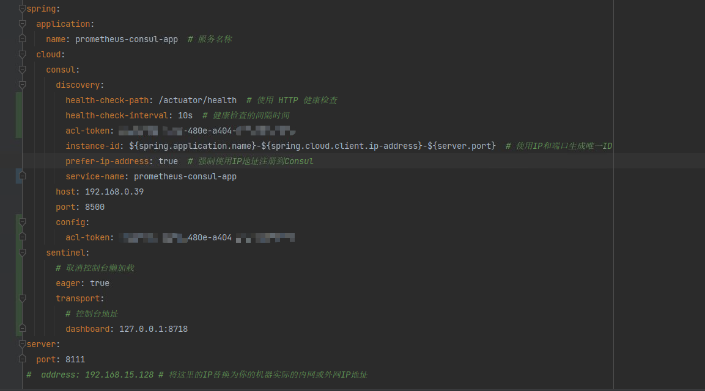

> 安装包地址：通过网盘分享的文件：
> 链接: https://pan.baidu.com/s/1iBSiZ4baGzf8KWlhdnDv0w?pwd=9i1u 提取码: 9i1u 
>
> 代码地址见文章末尾
>
> 虚拟机关闭防火墙：
>
> systemctl status firewalld
> systemctl stop firewalld
> systemctl disable firewalld

# Prometheus

启动脚本startup-prometheus

```shell
#!/bin/bash
cd `dirname $0`  # 替换为 Prometheus 的实际路径
BASE_DIR=`pwd`
echo `pwd`
# 定义 Prometheus 的路径
PROMETHEUS_PATH=$BASE_DIR/prometheus  # 替换为 Prometheus 的实际路径
PID_FILE=$BASE_DIR/prometheus.pid  # 存储进程 ID 的文件
LOG_FILE=$BASE_DIR/logs/prometheus.log  # 日志文件
CONFIG_FILE=$BASE_DIR/prometheus.yml  # Prometheus 配置文件路径
DATA_DIR=$BASE_DIR/data  # Prometheus 数据目录

# 检查是否已经在运行
if [ -f "$PID_FILE" ] && kill -0 $(cat "$PID_FILE") 2>/dev/null; then
    echo "Prometheus is already running."
else
    echo "Starting Prometheus..."
    nohup $PROMETHEUS_PATH --config.file=$CONFIG_FILE --storage.tsdb.path=$DATA_DIR > $LOG_FILE 2>&1 &  # 后台运行
    echo $! > "$PID_FILE"  # 将进程 ID 写入文件
    echo "Prometheus started with PID $(cat "$PID_FILE")."
fi

```

终止脚本shundown-prometheus

```shell
#!/bin/bash
cd `dirname $0`  # 替换为 Prometheus 的实际路径
BASE_DIR=`pwd`
PID_FILE=$BASE_DIR/prometheus.pid  # 存储进程 ID 的文件

# 检查 PID 文件是否存在
if [ -f "$PID_FILE" ]; then
    PID=$(cat "$PID_FILE")
    if kill -0 "$PID" 2>/dev/null; then
        echo "Stopping Prometheus..."
        kill "$PID"
        rm -f "$PID_FILE"  # 删除 PID 文件
        echo "Prometheus stopped."
    else
        echo "Prometheus is not running."
        rm -f "$PID_FILE"  # 删除 PID 文件
    fi
else
    echo "Prometheus is not running."
fi

```

# consul

```bash
# 下载 Consul
wget https://releases.hashicorp.com/consul/1.17.2/consul_1.17.2_linux_amd64.zip

# 解压
unzip consul_1.17.2_linux_amd64.zip

# 移动到 /usr/local/bin 目录
sudo mv consul /usr/local/bin/

# 验证安装
consul version

# 启动 Consul
consul agent -dev

#在云服务器上启动了consul，但是访问不了8500端口，这里需要在服务器启动的时候，加上-client的指定

./consul agent -dev #这是最开始启动的命令 只能本机访问

#当使用下面命令的时候就可以其他机器进行访问了：

./consul agent -dev -client 0.0.0.0 -ui #外部机器就可以访问

```

## 待被发现的java程序的要求

application.yml

```yml
management:
  endpoints:
    web:
      exposure:
        include: health,info,prometheus
  metrics:
    export:
      prometheus:
        enabled: true

spring:
  application:
    name: prometheus-consul-app  # 服务名称
  cloud:
    consul:
      discovery:
        instance-id: ${spring.application.name}-${spring.cloud.client.ip-address}-${server.port}  # 使用IP和端口生成唯一ID
        prefer-ip-address: true  # 强制使用IP地址注册到Consul
        heartbeat:
          enabled: true
        service-name: ${spring.application.name}
      host: 192.168.15.128
      port: 8500
server:
  port: 8111
#  address: 192.168.15.128 # 将这里的IP替换为你的机器实际的内网或外网IP地址
```

主程序

```java
//@EnableDiscoveryClient 自springboot2.7x以后就不用了
@EnableDiscoveryClient
@SpringBootApplication
public class PrometheusMonitoringDemoApplication {

    public static void main(String[] args) {
        SpringApplication.run(PrometheusMonitoringDemoApplication.class, args);
    }

}
```

pom.xml

```xml
<?xml version="1.0" encoding="UTF-8"?>
<project xmlns="http://maven.apache.org/POM/4.0.0" xmlns:xsi="http://www.w3.org/2001/XMLSchema-instance"
         xsi:schemaLocation="http://maven.apache.org/POM/4.0.0 https://maven.apache.org/xsd/maven-4.0.0.xsd">
    <modelVersion>4.0.0</modelVersion>
    <parent>
        <groupId>org.springframework.boot</groupId>
        <artifactId>spring-boot-starter-parent</artifactId>
        <version>2.7.4</version>
        <relativePath/> 
    </parent>
    <groupId>org.example</groupId>
    <artifactId>prometheus-monitoring-demo</artifactId>
    <version>0.0.1-SNAPSHOT</version>
    <name>prometheus-monitoring-demo</name>
    <description>prometheus-monitoring-demo</description>

    <properties>
         <!-- springboot和springcloud有兼容要求、springboot和micrometer有兼容要求-->
        <java.version>1.8</java.version>
        <micrometer.version>1.9.5</micrometer.version>
        <spring-boot.version>2.7.4</spring-boot.version>
        <spring-cloud.version>2021.0.5</spring-cloud.version>
    </properties>

    <dependencyManagement>
        <dependencies>
            <dependency>
                <groupId>org.springframework.cloud</groupId>
                <artifactId>spring-cloud-dependencies</artifactId>
                <version>${spring-cloud.version}</version>
                <type>pom</type>
                <scope>import</scope>
            </dependency>
        </dependencies>
    </dependencyManagement>

    <dependencies>
        <dependency>
            <groupId>org.springframework.boot</groupId>
            <artifactId>spring-boot-starter-web</artifactId>
        </dependency>
         <!-- 为应用程序提供了暴露管理端点的功能，这些端点包括健康检查、性能监控和指标。-->
        <dependency>
            <groupId>org.springframework.boot</groupId>
            <artifactId>spring-boot-starter-actuator</artifactId>
        </dependency>
         <!-- 让应用程序通过 Micrometer 收集并格式化度量指标，以 Prometheus 可理解的方式暴露给 Prometheus。。-->
        <dependency>
            <groupId>io.micrometer</groupId>
            <artifactId>micrometer-registry-prometheus</artifactId>
            <version>${micrometer.version}</version>
        </dependency>
         <!-- 让Spring Boot应用程序可以通过 Consul 服务发现机制来进行注册和发现服务。-->
         <dependency>
            <groupId>org.springframework.cloud</groupId>
            <artifactId>spring-cloud-starter-consul-discovery</artifactId>
        </dependency>
    </dependencies>

    <build>
        <plugins>
            <plugin>
                <groupId>org.springframework.boot</groupId>
                <artifactId>spring-boot-maven-plugin</artifactId>
            </plugin>
        </plugins>
    </build>
</project>
```

## prometheus配置

prometheus.yml

```yml
global:
  scrape_interval: 5s  # 默认抓取间隔

scrape_configs:
  - job_name: 'prometheus-consul-app'
    consul_sd_configs:
      - server: '192.168.15.128:8500'
        services: ['prometheus-consul-app']
    metrics_path: '/actuator/prometheus'  # Spring Boot 默认的 Prometheus 指标路径
```


## consul启动终止脚本

startup-consul.sh

```shell
#!/bin/bash 
cd `dirname $0` # 替换为 consul 的实际路径
BASE_DIR=`pwd`
# 定义 Consul 的路径
CONSUL_PATH=$BASE_DIR/consul  # 替换为 consul 的实际路径
PID_FILE=$BASE_DIR/consul.pid  # 存储进程 ID 的文件
LOG_FILE=$BASE_DIR/logs/consul.log  # 日志文件
DATA_FILE=$BASE_DIR/data
CONFIG_FILE=$BASE_DIR/consul.hcl 
# 检查是否已经在运行
if [ -f "$PID_FILE" ] && kill -0 $(cat "$PID_FILE") 2>/dev/null; then
    echo "Consul is already running."
else
    echo "Starting Consul..."
    nohup $CONSUL_PATH agent -dev -data-dir=$DATA_FILE -config-file=$CONFIG_FILE -client 0.0.0.0 -ui > $LOG_FILE 2>&1 &  # 后台运行，# 此行如若不需要流控熔断功能可把【-config-file=$CONFIG_FILE 】去掉
    echo $! > "$PID_FILE"  # 将进程 ID 写入文件
    echo "Consul started with PID $(cat "$PID_FILE")."
fi
```

shutdown-consul.sh

```shell
#!/bin/bash
cd `dirname $0`  # 替换为 consul 的实际路径
BASE_DIR=`pwd`
PID_FILE=$BASE_DIR/consul.pid  # 存储进程 ID 的文件

# 检查 PID 文件是否存在
if [ -f "$PID_FILE" ]; then
    PID=$(cat "$PID_FILE")
    if kill -0 "$PID" 2>/dev/null; then
        echo "Stopping Consul..."
        kill "$PID"
        rm -f "$PID_FILE"  # 删除 PID 文件
        echo "Consul stopped."
    else
        echo "Consul is not running."
        rm -f "$PID_FILE"  # 删除 PID 文件
    fi
else
    echo "Consul is not running."
fi

```


# Prometheus黑盒测试

```bash
wget https://github.com/prometheus/blackbox_exporter/releases/download/v0.23.0/blackbox_exporter-0.23.
0.linux-amd64.tar.gz
tar -xvf blackbox_exporter-0.23.0.linux-amd64.tar.gz
cd blackbox_exporter-0.23.0.linux-amd64
./blackbox_exporter

#Blackbox Exporter 将在默认的 9115 端口上运行。
```


需要在 Prometheus 的配置文件 `prometheus.yml` 中添加 Blackbox Exporter 的配置，以监控指定的 IP 和端口。


在 `prometheus.yml` 中，添加一个新的 `scrape_configs` 来配置 Prometheus 通过 Blackbox Exporter 进行 TCP 探测：

```yml
- job_name: 'tcp_probes'
    metrics_path: /probe  # 使用 Blackbox Exporter 的探测路径
    params:
      module: [tcp_connect]  # 指定使用 TCP 连接探测模块

    static_configs:
          # 添加更多要监控的服务地址
      - targets: ['localhost:9115']  # 本地运行的 Blackbox Exporter
    relabel_configs:
      - source_labels: [__address__]
        target_label: __param_target
```


通过请求`http://localhost:9115/probe?target=111.229.25.127:6379&module=tcp_connect`

会获得

```
# HELP probe_dns_lookup_time_seconds Returns the time taken for probe dns lookup in seconds
# TYPE probe_dns_lookup_time_seconds gauge
probe_dns_lookup_time_seconds 1.0149e-05
# HELP probe_duration_seconds Returns how long the probe took to complete in seconds
# TYPE probe_duration_seconds gauge
probe_duration_seconds 0.029551479
# HELP probe_failed_due_to_regex Indicates if probe failed due to regex
# TYPE probe_failed_due_to_regex gauge
probe_failed_due_to_regex 0
# HELP probe_ip_addr_hash Specifies the hash of IP address. It's useful to detect if the IP address changes.
# TYPE probe_ip_addr_hash gauge
probe_ip_addr_hash 3.600422005e+09
# HELP probe_ip_protocol Specifies whether probe ip protocol is IP4 or IP6
# TYPE probe_ip_protocol gauge
probe_ip_protocol 4
# HELP probe_success Displays whether or not the probe was a success
# TYPE probe_success gauge
probe_success 1
```

**成功状态**：`probe_success` 的值为 `1`，表明被监控的服务可达且正常运行。

**探测时间**：`probe_duration_seconds` 和 `probe_dns_lookup_time_seconds` 的值都相对较小，表示响应时间快，这通常是健康服务的标志。

**无正则错误**：`probe_failed_due_to_regex` 的值为 `0`，表明探测没有因正则表达式问题而失败。


## java实现

```java
package com.example.demo.blackboxexporter;

import java.io.BufferedReader;
import java.io.IOException;
import java.io.InputStreamReader;
import java.net.HttpURLConnection;
import java.net.URL;

public class BlackboxProbe {
    private static final String PROBE_URL_TEMPLATE = "http://172.26.160.119:9115/probe?module=tcp_connect&target=%s";

    public static void main(String[] args) {
        try {
            // 发起 HTTP GET 请求
            String target = "111.229.25.127:3306";
            String probeUrl = String.format(PROBE_URL_TEMPLATE, target);
            HttpURLConnection connection = (HttpURLConnection) new URL(probeUrl).openConnection();
            connection.setRequestMethod("GET");

            // 处理响应
            BufferedReader in = new BufferedReader(new InputStreamReader(connection.getInputStream()));
            String inputLine;
            StringBuilder response = new StringBuilder();

            while ((inputLine = in.readLine()) != null) {
                response.append(inputLine).append("\n");
            }
            in.close();

            // 解析 Prometheus 格式的响应
            String[] lines = response.toString().split("\n");
            int probeSuccess = -1;
            double probeDuration = -1;

            for (String line : lines) {
                if (line.startsWith("probe_success")) {
                    probeSuccess = Integer.parseInt(line.split(" ")[1]);
                } else if (line.startsWith("probe_duration_seconds")) {
                    probeDuration = Double.parseDouble(line.split(" ")[1]);
                }
            }

            // 输出结果
            System.out.println("probe_success: " + probeSuccess);
            System.out.println("probe_duration_seconds: " + probeDuration);
        } catch (IOException e) {
            e.printStackTrace();
        }
    }
}

```


## blackbox_exporter启动终止脚本

startup-blackbox_exporter.sh

```shell
#!/bin/bash 
cd `dirname $0`/blackbox_exporter-0.23.0.linux-amd64
BASE_DIR=`pwd`
# 定义 blackbox_exporter 的路径
BLACKBOX_EXPORTER_PATH=$BASE_DIR/blackbox_exporter  # 替换为 blackbox_exporter 的实际路径
PID_FILE=$BASE_DIR/blackbox_exporter.pid  # 存储进程 ID 的文件

# 检查是否已经在运行
if [ -f "$PID_FILE" ] && kill -0 $(cat "$PID_FILE") 2>/dev/null; then
    echo "blackbox_exporter is already running."
else
    echo "Starting blackbox_exporter..."
    nohup $BLACKBOX_EXPORTER_PATH > $BASE_DIR/../logs/blackbox_exporter.log 2>&1 &  # 后台运行
    echo $! > "$PID_FILE"  # 将进程 ID 写入文件
    echo "blackbox_exporter started with PID $(cat "$PID_FILE")."
fi

```

shutdown-blackbox_exporter.sh

```shell
#!/bin/bash
cd `dirname $0`/blackbox_exporter-0.23.0.linux-amd64
BASE_DIR=`pwd`
PID_FILE=$BASE_DIR/blackbox_exporter.pid  # 存储进程 ID 的文件

# 检查 PID 文件是否存在
if [ -f "$PID_FILE" ]; then
    PID=$(cat "$PID_FILE")
    if kill -0 "$PID" 2>/dev/null; then
        echo "Stopping blackbox_exporter..."
        kill "$PID"
        rm -f "$PID_FILE"  # 删除 PID 文件
        echo "blackbox_exporter stopped."
    else
        echo "blackbox_exporter is not running."
        rm -f "$PID_FILE"  # 删除 PID 文件
    fi
else
    echo "blackbox_exporter is not running."
fi

```


# 流控和熔断

## 借鉴sentinel的参数设计

## consul配置

### 启用consul的ACL

1. 修改consul的配置文件consul.hcl

   ```hcl
   acl {
     enabled = true  # 启用访问控制列表
     default_policy = "deny"  # 默认策略为拒绝
     enable_token_persistence = true  # 启用令牌持久性
     tokens {
       master = "1a2b3c4d-5678-90ab-cdef-1234567890ab"  # 主令牌,可由JAVA工具类UUID.randomUUID().toString();生成
     }
   }
   ```

2. 重启consul（脚本在上）

3. 执行`consul acl list`

   如果 ACL 系统启用了，你会看到相关的 ACL 配置信息。如果仍然出现错误，说明 ACL 可能没有正确启用，需检查日志或配置文件。


### Prometheus配置修改

```yml
global:
  scrape_interval: 5s  # 默认抓取间隔

scrape_configs:
  - job_name: 'prometheus-consul-app'
    consul_sd_configs:
      - server: '192.168.15.128:8500'
        services: ['prometheus-consul-app-demo']
        token: '1a2b3c4d-5678-90ab-cdef-1234567890ab'
    metrics_path: '/actuator/prometheus'  # Spring Boot 默认的 Prometheus 指标路径
```

### java程序的配置

```yml
management:
  endpoints:
    web:
      exposure:
        include: health,info,prometheus
  metrics:
    export:
      prometheus:
        enabled: true

spring:
  application:
    name: prometheus-consul-app  # 服务名称
  cloud:
    consul:
      discovery:
        health-check-path: /actuator/health  # 使用 HTTP 健康检查
        health-check-interval: 10s  # 健康检查的间隔时间
        acl-token: 1a2b3c4d-5678-90ab-cdef-1234567890ab
        instance-id: ${spring.application.name}-${spring.cloud.client.ip-address}-${server.port}  # 使用IP和端口生成唯一ID
        prefer-ip-address: true  # 强制使用IP地址注册到Consul
        service-name: prometheus-consul-app-demo
      host: 192.168.15.128
      port: 8500
      config:
      	acl-token: 1a2b3c4d-5678-90ab-cdef-1234567890ab
	sentinel:
	  eager: true
	  transport:
		dashboard: 127.0.0.1:8718
server:
  port: 8111
#  address: 192.168.15.128 # 将这里的IP替换为你的机器实际的内网或外网IP地址
```

如图

<div style="text-align:center">
  
</div>


> 被监控的java程序示例：https://gitee.com/lcdzzz/prometheus-consul-demo
>
> 获取监控指标的java程序示例：https://gitee.com/lcdzzz/client


