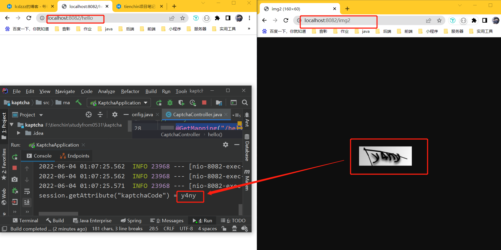
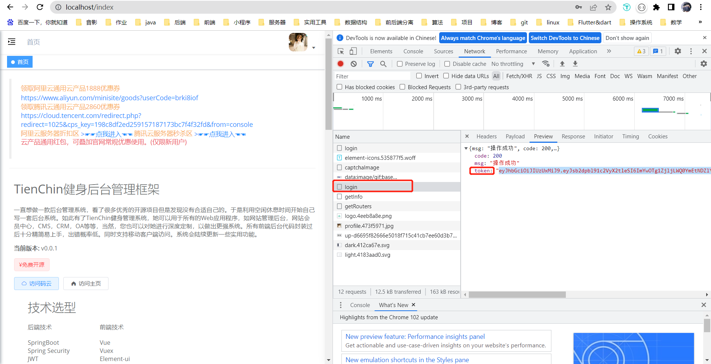
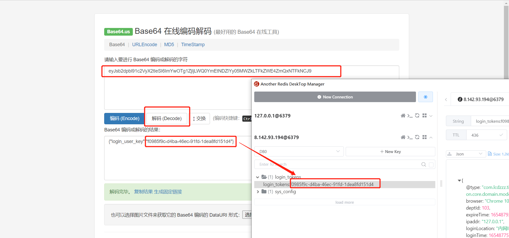
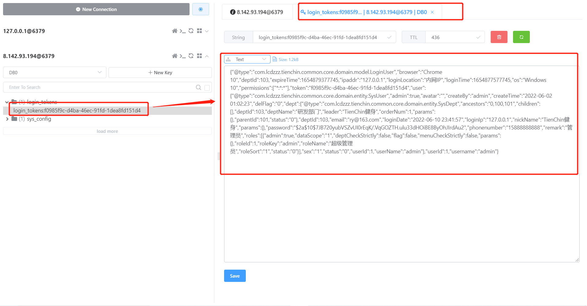
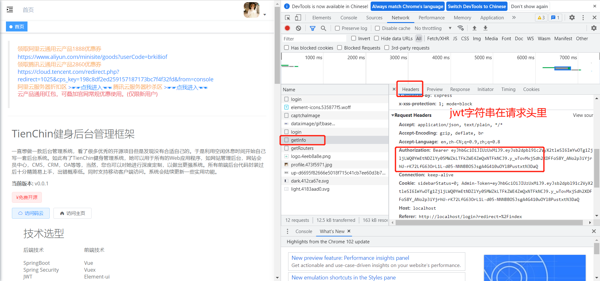

项目结构：多模块（不是微服务）

整体思路：

- 依赖链最底层：common，提供了公用的工具，定义了统一的controller，BaseEntity实体类公共对象，以及其他的操作工具
- common的上一层：framework，主要是配置类，在这里配置了系统的一些东西，例如security aop 数据源的配置等等
- 剩下的对应了三个的功能模块
  - system：系统管理，相等于具体的业务。比如系统管理中的用户管理，角色管理，菜单管理等等，包括系统监控什么的，都是写在system里面的
  - generator：代码生成
  - quartz：定时任务
- ui：前端项目
- admin：项目唯一的统一入口，controller都是在这里写的，上面的common等，都会被admin所依赖，这里的controller会调用对应的service

# 登录

验证码响应结果分析：

Base64字符串转图片：https://tool.jisuapi.com/base642pic.html

验证码生成接口分析：

url：`localhost/dev-api/captchaImage`

AjaxResult是一个封装的返回工具类


## 验证码配置分析

### 使用github上的kaptcha开源工具

导入maven依赖

```xml
<dependency>
            <groupId>com.github.penggle</groupId>
            <artifactId>kaptcha</artifactId>
            <version>2.3.2</version>
</dependency>
```

接下来只要提供一个CaptchaConfig就行

再在里面提供一个bean

```java
package com.lcdzzz.kaptcha;

import com.google.code.kaptcha.impl.DefaultKaptcha;
import com.google.code.kaptcha.util.Config;
import org.springframework.context.annotation.Bean;
import org.springframework.context.annotation.Configuration;

import java.util.Properties;

import static com.google.code.kaptcha.Constants.*;

@Configuration
public class CaptchaConfig {
    @Bean(name = "captchaProducer")
    public DefaultKaptcha getKaptchaBean() {
        DefaultKaptcha defaultKaptcha = new DefaultKaptcha();
        Properties properties = new Properties();
        // 是否有边框 默认为true 我们可以自己设置yes，no
        properties.setProperty(KAPTCHA_BORDER, "yes");
        // 验证码文本字符颜色 默认为Color.BLACK
        properties.setProperty(KAPTCHA_TEXTPRODUCER_FONT_COLOR, "black");
        // 验证码图片宽度 默认为200
        properties.setProperty(KAPTCHA_IMAGE_WIDTH, "160");
        // 验证码图片高度 默认为50
        properties.setProperty(KAPTCHA_IMAGE_HEIGHT, "60");
        // 验证码文本字符大小 默认为40
        properties.setProperty(KAPTCHA_TEXTPRODUCER_FONT_SIZE, "38");
        // KAPTCHA_SESSION_KEY
        //将来生成验证码时，自动将验证码文本存入session中
        properties.setProperty(KAPTCHA_SESSION_CONFIG_KEY, "kaptchaCode");
        // 验证码文本字符长度 默认为5
        properties.setProperty(KAPTCHA_TEXTPRODUCER_CHAR_LENGTH, "4");
        // 验证码文本字体样式 默认为new Font("Arial", 1, fontSize), new Font("Courier", 1, fontSize)
        properties.setProperty(KAPTCHA_TEXTPRODUCER_FONT_NAMES, "Arial,Courier");
        // 图片样式 水纹com.google.code.kaptcha.impl.WaterRipple 鱼眼com.google.code.kaptcha.impl.FishEyeGimpy 阴影com.google.code.kaptcha.impl.ShadowGimpy
        properties.setProperty(KAPTCHA_OBSCURIFICATOR_IMPL, "com.google.code.kaptcha.impl.ShadowGimpy");
        Config config = new Config(properties);
        defaultKaptcha.setConfig(config);
        return defaultKaptcha;
    }
}

```

搞一个图片返回的controller

```java

@RestController
public class CaptchaController {
    @Autowired
    DefaultKaptcha defaultKaptcha;
    @GetMapping("/img")
    public void captchaImg(HttpServletResponse reps) throws IOException {
        //生成验证码的文本
        String text = defaultKaptcha.createText();

        //基于这个文本去生成一个图片对象。把这个文本作为参数传进去，它会绘制一个验证码图片出来
        BufferedImage image = defaultKaptcha.createImage(text);

        ImageIO.write(image,"jpg",reps.getOutputStream());
    }
}

```

接下里我们访问localhost:8082/img

就会生成图片。

**BUT!!!其实这个验证码工具，自己提供了个servlet，其实我们不需要自己写，直接用它提供的servlet**

怎么用呢？

注册一个bean,原先的bean就不使用了

```java
 @Bean
    ServletRegistrationBean<HttpServlet> captchaServlet(){
        ServletRegistrationBean<HttpServlet> bean = new ServletRegistrationBean<>();
        bean.setServlet(new KaptchaServlet());
        bean.addUrlMappings("/img2");
        Properties properties = new Properties();
        // 是否有边框 默认为true 我们可以自己设置yes，no
        properties.setProperty(KAPTCHA_BORDER, "yes");
        // 验证码文本字符颜色 默认为Color.BLACK
        properties.setProperty(KAPTCHA_TEXTPRODUCER_FONT_COLOR, "black");
        // 验证码图片宽度 默认为200
        properties.setProperty(KAPTCHA_IMAGE_WIDTH, "160");
        // 验证码图片高度 默认为50
        properties.setProperty(KAPTCHA_IMAGE_HEIGHT, "60");
        // 验证码文本字符大小 默认为40
        properties.setProperty(KAPTCHA_TEXTPRODUCER_FONT_SIZE, "38");
        // KAPTCHA_SESSION_KEY
        //将来生成验证码时，自动将验证码文本存入session中
        properties.setProperty(KAPTCHA_SESSION_CONFIG_KEY, "kaptchaCode");
        // 验证码文本字符长度 默认为5
        properties.setProperty(KAPTCHA_TEXTPRODUCER_CHAR_LENGTH, "4");
        // 验证码文本字体样式 默认为new Font("Arial", 1, fontSize), new Font("Courier", 1, fontSize)
        properties.setProperty(KAPTCHA_TEXTPRODUCER_FONT_NAMES, "Arial,Courier");
        // 图片样式 水纹com.google.code.kaptcha.impl.WaterRipple 鱼眼com.google.code.kaptcha.impl.FishEyeGimpy 阴影com.google.code.kaptcha.impl.ShadowGimpy
        properties.setProperty(KAPTCHA_OBSCURIFICATOR_IMPL, "com.google.code.kaptcha.impl.ShadowGimpy");

        bean.setInitParameters(new HashMap<>((Map)properties));
        return bean;
    }
```


只有当：使用这个工具提供的验证码接口， `properties.setProperty(KAPTCHA_SESSION_CONFIG_KEY, "kaptchaCode");`这个配置才是有效的

此时，只有hello一个接口：

```java
@GetMapping("/hello")
    public void hello(HttpSession session){
        System.out.println("session.getAttribute(\"kaptchaCode\") = " + session.getAttribute("kaptchaCode"));
    }
```

结果：

<div style="text-align:center">
  
</div>

**=======总结=======**=

`properties.setProperty(KAPTCHA_SESSION_CONFIG_KEY, "kaptchaCode");`

- 如果想用Kaptcha本身提供的servlet来生成验证码的话，它就会自动把验证码文本存入session中
- 但如果是自己写的接口，比如最开始的方法，那么文本就需要自己手动去存入session中了


### tienchin项目本身

回归项目本身，其实`properties.setProperty(KAPTCHA_SESSION_CONFIG_KEY, "kaptchaCode");`这行配置没必要，不需要

为什么呢？

- 生成验证码接口是我们自己写的
- tienchin项目本身没有用session
- 所以tienchin中Captconfig中的bean，最终目的就是生成字符串/数学运算的验证码


数学运算方面有意思的是这行代码,意思是验证码文本生成器是：`KaptchaTextCreator`

```java
// 验证码文本生成器
        properties.setProperty(KAPTCHA_TEXTPRODUCER_IMPL, "com.lcdzzz.tienchin.framework.config.KaptchaTextCreator");

```


## 登录

### 流程分析

1. 登录核心：

   SysLoginService类下的login方法中的

   ```bash
   // 该方法会去调用UserDetailsServiceImpl.loadUserByUsername
   // 这句话的意思就是去执行登录
   authentication = authenticationManager
                       .authenticate(new UsernamePasswordAuthenticationToken(username, password));
      
   ```

   

2. 登录成功后生成一个jwt字符串,`return tokenService.createToken(loginUser);`从这里点进createToken查看

3. ```java
   public String createToken(LoginUser loginUser) {
           String token = IdUtils.fastUUID();
           loginUser.setToken(token);
           setUserAgent(loginUser);
           refreshToken(loginUser);//所谓的刷新，就是存入到redis里面去
   
           Map<String, Object> claims = new HashMap<>();
           claims.put(Constants.LOGIN_USER_KEY, token);
           return createToken(claims);
       }
   ```

4. 点进上面的refreshToken

   ```java
       /**
        * 刷新令牌有效期
        *
        * @param loginUser 登录信息
        */
       public void refreshToken(LoginUser loginUser) {
           loginUser.setLoginTime(System.currentTimeMillis());
           loginUser.setExpireTime(loginUser.getLoginTime() + expireTime * MILLIS_MINUTE);
           // 根据uuid将loginUser缓存
           String userKey = getTokenKey(loginUser.getToken());
           redisCache.setCacheObject(userKey, loginUser, expireTime, TimeUnit.MINUTES);
       }
   ```

   

5. 暂且不考虑jwt原先的作用（例如无状态登录），其实这里的jwt作用已经“变形了”，实际上又变成了httpsession的作用，【虽然没有用session，但其实用户信息已经存入到redis里面了】

6. 所谓的jwt，其实返回的仅仅只是uuid【相当于sessionid】，以后来回都传uuid

7. 以后发送请求时，都会携带jwt字符串

8. 登录成功后，f12查看token

<div style="text-align:center">
  
</div>

   这个token是一个jwt字符串，而jwt字符串是分为了三部分【都是用base64编码】,如下

   ```txt
   eyJhbGciOiJIUzUxMiJ9 //指定算法名字
   .eyJsb2dpbl91c2VyX2tleSI6ImYwOTg1ZjljLWQ0YmEtNDZlYy05MWZkLTFkZWE4ZmQxNTFkNCJ9 //核心信息==>json对象
   .y_wTovMxjSdh2XDFFoS8Y_ANo2p3iYjrhU-rK72LfG63OrL1L-d05-NNNBBOSJsgA4G410uOYl8PustxtN3DaQ
   ```

   

9. 使用base64解码工具【https://base64.us/】查看内容

<div style="text-align:center">
  
</div>


### 流程分析总结

*综上，登录流程就是：登录成功后，返回一个jwt字符串，以后每次发送请求都会携带它。jwt字符串分为三部分，第一部分是算法，第二部分是核心信息，核心信息里面只有一个uuid。*

*同时，它把用户信息存入redis里面中【登录信息，管理员，名字，leader，部门等等，都存在redis里面】，如图【左边相等于id，右边则是信息】*

<div style="text-align:center">
  
</div>

- 以后每次访问接口时，都要带上jwt字符串

<div style="text-align:center">
  
</div>

- 所谓的jwt说白了就像用session时的jsessionid一样。只不过jsessionid是浏览器自动携带，而现在是自己手动加上jwt参数的

- 每次请求都需要校验参数，而这个是在哪里校验的呢？


### jwt校验

核心部分就是framework.security.filter下的JwtAuthenticationTokenFilter

```java
 @Override
    protected void doFilterInternal(HttpServletRequest request, HttpServletResponse response, FilterChain chain)
            throws ServletException, IOException {
        LoginUser loginUser = tokenService.getLoginUser(request); //根据请求，来获取登录用户
        if (StringUtils.isNotNull(loginUser) && /*这玩意为null，代表没有登录*/StringUtils.isNull(SecurityUtils.getAuthentication())) {
            //令牌续签
            tokenService.verifyToken(loginUser);//验证用户，看看有没有过期
            //构建一个UsernamePasswordAuthenticationToken存放用户信息，然后存入SecurityContextHolder
            UsernamePasswordAuthenticationToken authenticationToken = new UsernamePasswordAuthenticationToken(loginUser, null, loginUser.getAuthorities());
            authenticationToken.setDetails(new WebAuthenticationDetailsSource().buildDetails(request));
            SecurityContextHolder.getContext().setAuthentication(authenticationToken);
            //此时SecurityContextHolder就有了用信息
            //这样以后【接下来层级的过滤器，就不需要从请求头里获取用户信息了】
            //当当前请求完毕时，SecurityContextHolder里的用户信息会被清楚掉。当下个请求来了，再周而复始，走来时路
        }
        chain.doFilter(request, response);
    }
```

*每次请求的时候，都带上jwt，然后拿着jwt，去redis里面查看用户信息，，然后存到SecurityContextHolder里面去*


### springsecurity登录配置分析

详见framework.config下的SecurityConfig类，以后准备再看看springsecurity


# 自定义动态数据源

## 思路分析

1. 自定义一个注解@DataSource,将来可以将该注解加service层在方法或者类上面，表示方法或者类中的所有方法都使用某一个数据源
2. 对于第一步，如果某个方法上面有@DataSource注解，那么就将该方法需要使用的数据源名称存入ThreadLocal。
3. 自定义切面，在切面中解析@DataSource注解的时候，将@DataSource注解所标记的数据源存入到ThreadLocal中。
4. 最后，当Mapper执行的时候，需要DataSource，他会自动去AbstractRoutingDataSource类中查找需要的数据源，我们只需要在AbstractRoutingDataSource中返回ThreadLocal中的值

综上：用@DataSource注解，在一个方法或者一个类上面，去标注你想使用哪个数据源。然后将来在这个AOP(切面)里面解析这个注解，把想使用的数据源的名字找出来，存在ThreadLocal里面去。当以后真正需要用的时候，人家会自动的从AbstractRoutingDataSource里面去查找需要的数据源。

所以，我们要做的就是：重写（自己写一个类继承）AbstractRoutingDataSource，然后在它的方法里面去返回ThreadLocal里边所存储的数据源的名字。最后它会根据名字找到对应的数据源


详细可见：[自定义动态数据源](https://lcdzzz.github.io/2022/06/18/zi-ding-yi-duo-shu-ju-yuan/)


# 自定义限流注解

详见：[自定义限流注解](https://lcdzzz.github.io/2024/01/28/zi-ding-yi-xian-liu-zhu-jie/)

