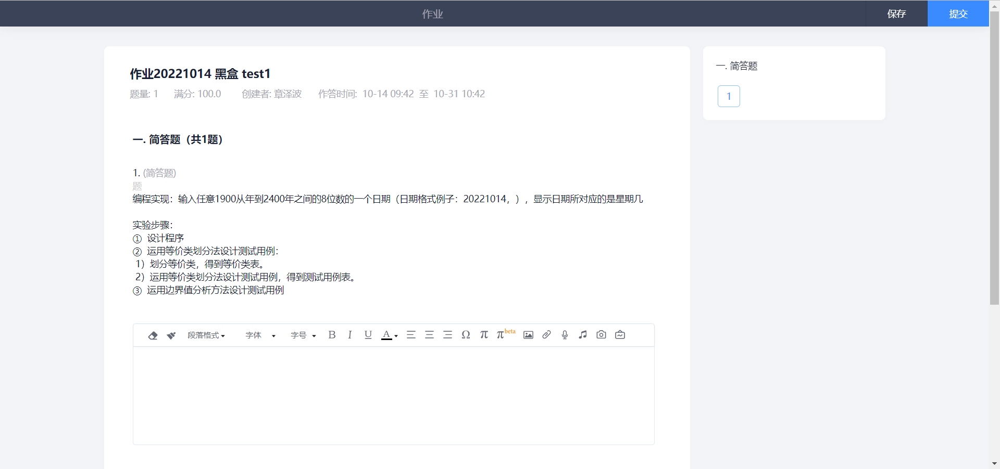
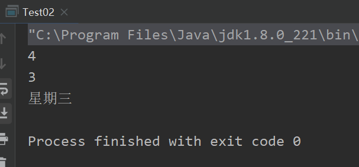
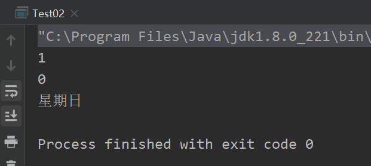
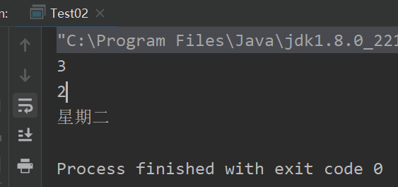
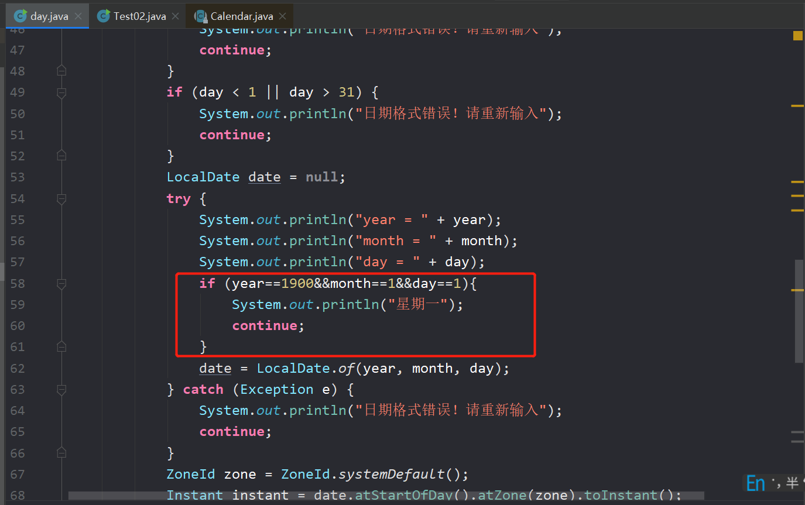

> 这篇文章废话比较多，想看bug和本人的逆天操作的话，可以直接去看“解决办法”和“结论”部分

# 起源

一切的一切都起源于软测这一道看似无比简单的题

<div style="text-align:center">
  
</div>

简单来说就是输出20221019这样的格式，然后输出是星期几


# 错误的代码

这是我最开始写的错误的代码

```java
import java.util.*;

public class day {

    public static void main(String[] args) {
        Scanner in = new Scanner(System.in);
        while (in.hasNext()) {
            System.out.println("输入任意1900从年到2400年之间的8位数的一个日期（日期格式例子：20221014）");
            String next = in.next();
            char[] chars = next.toCharArray();
            String tempYear = "";
            String tempMonth = "";
            String tempDay = "";
            for (int i = 0; i < 4; i++) {
                tempYear = tempYear + chars[i];
            }
            for (int i = 4; i < 6; i++) {
                tempMonth = tempMonth + chars[i];
            }
            for (int i = 6; i < 8; i++) {
                tempDay = tempDay + chars[i];
            }
            int year = Integer.parseInt(tempYear);
            int month = Integer.parseInt(tempMonth);
            int day = Integer.parseInt(tempDay);
//        System.out.println(year+" "+month+" "+day+" ");
            if (year < 1900 || year > 2400) {
                System.out.println("日期格式错误！");
                continue;
            }
            if (month < 1 || month > 12) {
                System.out.println("日期格式错误！");
                continue;
            }
            if (day < 1 || day > 31) {
                System.out.println("日期格式错误！");
                continue;
            }

            int leapYear = 0;
            int commonYear = 0;
            for (int i = 1900; i < year; i++) {
                    if (year % 4 == 0 && year % 100 != 0 || year % 400 == 0) {
                        leapYear++;
                    } else
                        commonYear++;
            }
            int counts = 0;
            counts = counts + leapYear * 366;
            counts = counts + commonYear * 365;
            switch (month){
                case 12:
                    counts+=30;
                case 11:
                    counts+=31;
                case 10:
                    counts+=30;
                case 9:
                    counts += 31;
                case 8:
                    counts += 31;
                case 7:
                    counts += 30;
                case 6:
                    counts += 31;
                case 5:
                    counts += 30;
                case 4:
                    counts += 31;
                case 3:
                    //sumDays += 28;
                    //判断year是否是闰年
                    if((year%4==0&&year%100!=0)||year%400==0){
                        counts+=29;
                    }else{
                        counts+=28;
                    }
                case 2:
                    counts+=31;
                case 1:
                    counts+=day;
            }

            System.out.println("counts = " + counts);
            int temp = counts % 7;
            if (temp == 0) {
                System.out.println("星期日");
            }
            if (temp == 1) {
                System.out.println("星期一");
            }
            if (temp == 2) {
                System.out.println("星期二");
            }
            if (temp == 3) {
                System.out.println("星期三");
            }
            if (temp == 4) {
                System.out.println("星期四");
            }
            if (temp == 5) {
                System.out.println("星期五");
            }
            if (temp == 6) {
                System.out.println("星期六");
            }
        }

    }
}
```

> 因为要考虑的错误输入，所以代码看起来非常的冗余
>
> 不知道为什么会错，求发现问题的大佬联系qq1473220685，请喝奶茶

口头描述下遇到的bug吧，19000101往后几年，基本上没什么问题的，但是时间跨度一大，就出问题了。

# 解决办法

于是就干脆去网上找到现成的工具类了

下面是更改后的代码，这边写的简介明了点

## 代码

```java

public class Test02 {
    public static void main(String[] args) {
        LocalDate date = LocalDate.of(2022,10,19);
        ZoneId zone = ZoneId.systemDefault();
        Instant instant = date.atStartOfDay().atZone(zone).toInstant();
        java.util.Date da = Date.from(instant);

        String weekDayString = getWeek(da);
        System.out.println(weekDayString);
    }

    public static String getWeek(Date date){
        String[] weeks = {"星期日","星期一","星期二","星期三","星期四","星期五","星期六"};
        Calendar cal = Calendar.getInstance();
        cal.setTime(date);
        int i = cal.get(Calendar.DAY_OF_WEEK);
        System.out.println(i);
        int week_index = i - 1;
        System.out.println(week_index);
        if(week_index<0){
            week_index = 0;
        }
        return weeks[week_index];
    }


}

```

## 输出

<div style="text-align:center">
  
</div>


## bug描述

看起来没什么毛病对不对？

但是换个测试用例，那就出问题了

### 代码

```java

public class Test02 {
    public static void main(String[] args) {
        LocalDate date = LocalDate.of(1900,1,1);
        ZoneId zone = ZoneId.systemDefault();
        Instant instant = date.atStartOfDay().atZone(zone).toInstant();
        java.util.Date da = Date.from(instant);

        String weekDayString = getWeek(da);
        System.out.println(weekDayString);
    }

    public static String getWeek(Date date){
        String[] weeks = {"星期日","星期一","星期二","星期三","星期四","星期五","星期六"};
        Calendar cal = Calendar.getInstance();
        cal.setTime(date);
        int i = cal.get(Calendar.DAY_OF_WEEK);
        System.out.println(i);
        int week_index = i - 1;
        System.out.println(week_index);
        if(week_index<0){
            week_index = 0;
        }
        return weeks[week_index];
    }

}

```

### 输出

<div style="text-align:center">
  
</div>

1900的1月1日，怎么可能是周日呢？明明是周一啊

### 再测试

我们再试试1900年1月2日的输出时什么

**代码**

```java

public class Test02 {
    public static void main(String[] args) {
        LocalDate date = LocalDate.of(1900,1,2);
        ZoneId zone = ZoneId.systemDefault();
        Instant instant = date.atStartOfDay().atZone(zone).toInstant();
        java.util.Date da = Date.from(instant);

        String weekDayString = getWeek(da);
        System.out.println(weekDayString);
    }

    public static String getWeek(Date date){
        String[] weeks = {"星期日","星期一","星期二","星期三","星期四","星期五","星期六"};
        Calendar cal = Calendar.getInstance();
        cal.setTime(date);
        int i = cal.get(Calendar.DAY_OF_WEEK);
        System.out.println(i);
        int week_index = i - 1;
        System.out.println(week_index);
        if(week_index<0){
            week_index = 0;
        }
        return weeks[week_index];
    }


}

```

**输出**

<div style="text-align:center">
  
</div>

<div style="text-align:center">
  
</div>

# 结论

综上，我认为这是Calendar类本身的bug。当然这个bug问题也不大，毕竟也没什么正常的需求需要去看19000101是星期几吧？

但本着“你就说有没有解决吧”的精神，我还是给这坨代码用if给救了回来.....

<div style="text-align:center">
  
</div>


# 最终代码

```java
import java.time.Instant;
import java.time.LocalDate;
import java.time.ZoneId;
import java.util.*;

public class day {

    public static void main(String[] args) {
        Scanner in = new Scanner(System.in);
        System.out.println("输入任意1900从年到2400年之间的8位数的一个日期（日期格式例子：20221014）");

        while (in.hasNext()) {
            String next = in.next();
            int i1 = 0;
            try {
                i1 = Integer.parseInt(next);
            } catch (NumberFormatException e) {
                System.out.println("日期格式错误！请重新输入");
                continue;
            }
            if (19000000 > i1 || i1 > 24000000) {
                System.out.println("日期格式错误！请重新输入");
                continue;
            }
            char[] chars = next.toCharArray();
            String tempYear = "";
            String tempMonth = "";
            String tempDay = "";
            for (int i = 0; i < 4; i++) {
                tempYear = tempYear + chars[i];
            }
            for (int i = 4; i < 6; i++) {
                tempMonth = tempMonth + chars[i];
            }
            for (int i = 6; i < 8; i++) {
                tempDay = tempDay + chars[i];
            }
            int year = Integer.parseInt(tempYear);
            int month = Integer.parseInt(tempMonth);
            int day = Integer.parseInt(tempDay);
            if (year < 1900 || year > 2400) {
                System.out.println("日期格式错误！请重新输入");
                continue;
            }
            if (month < 1 || month > 12) {
                System.out.println("日期格式错误！请重新输入");
                continue;
            }
            if (day < 1 || day > 31) {
                System.out.println("日期格式错误！请重新输入");
                continue;
            }
            LocalDate date = null;
            try {
                System.out.println("year = " + year);
                System.out.println("month = " + month);
                System.out.println("day = " + day);
                if (year==1900&&month==1&&day==1){
                    System.out.println("星期一");
                    continue;
                }
                date = LocalDate.of(year, month, day);
            } catch (Exception e) {
                System.out.println("日期格式错误！请重新输入");
                continue;
            }
            ZoneId zone = ZoneId.systemDefault();
            Instant instant = date.atStartOfDay().atZone(zone).toInstant();
            java.util.Date da = Date.from(instant);
            String week = getWeek(da);
            System.out.println(week);


        }
    }

    public static String getWeek(Date date) {
        String[] weeks = {"星期日", "星期一", "星期二", "星期三", "星期四", "星期五", "星期六"};
        Calendar cal = Calendar.getInstance();
        cal.setTime(date);
        int week_index = cal.get(Calendar.DAY_OF_WEEK) - 1;
        System.out.println(week_index);
        if (week_index < 0) {
            week_index = 0;
        }
        return weeks[week_index];
    }
}


```


