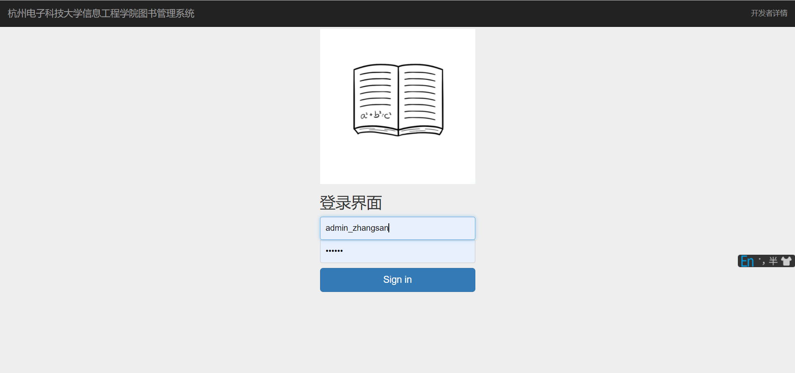
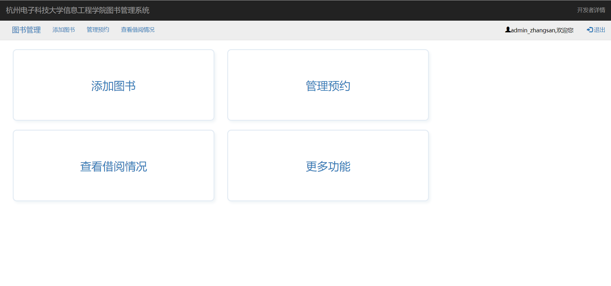
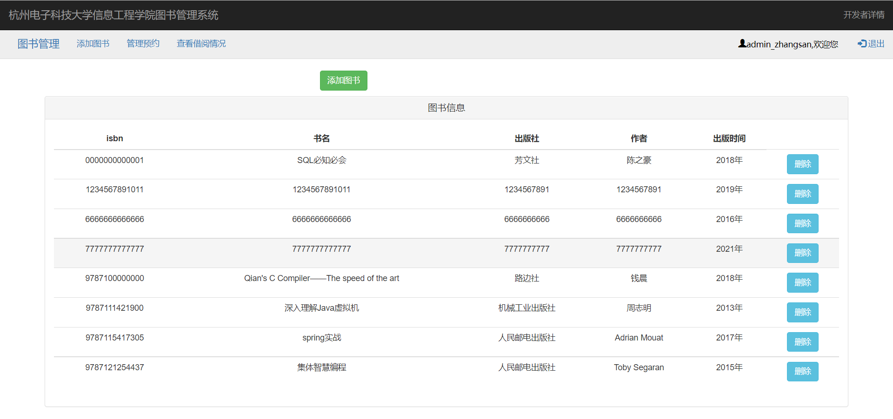
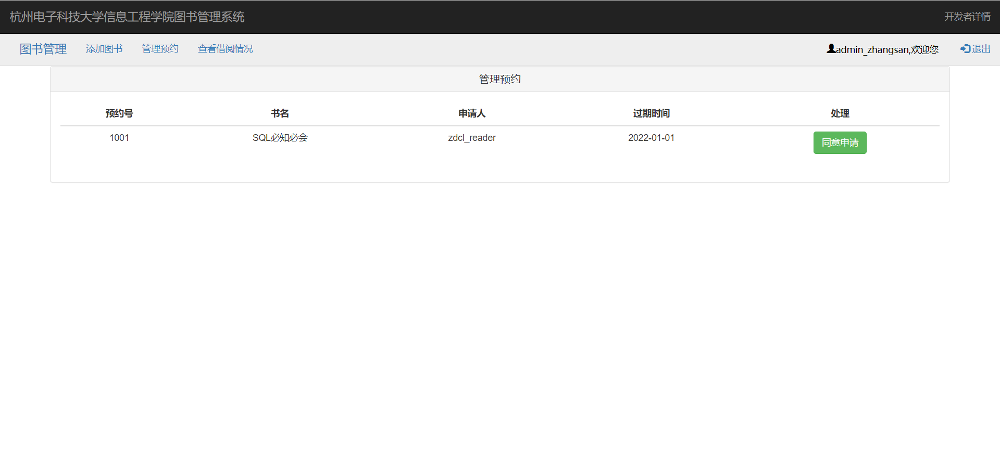
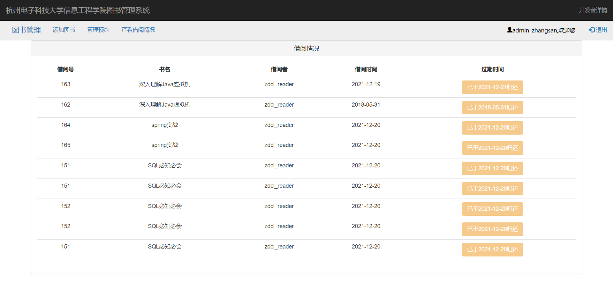
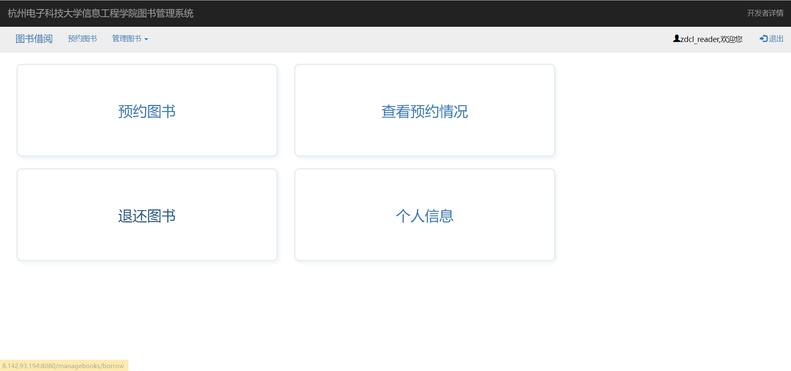
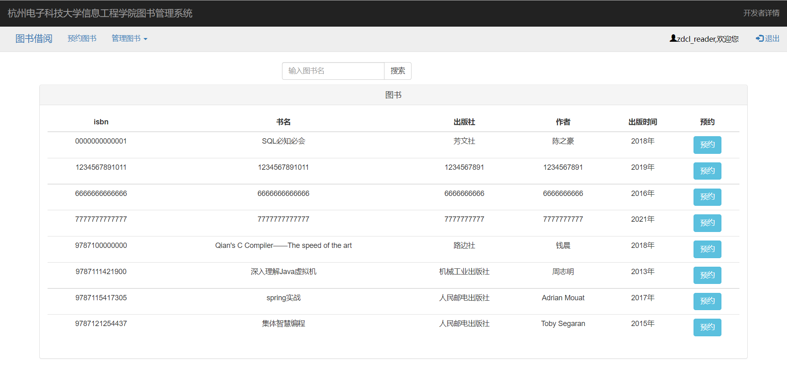
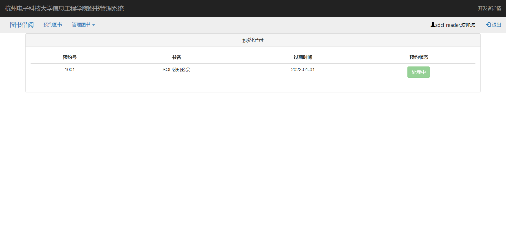
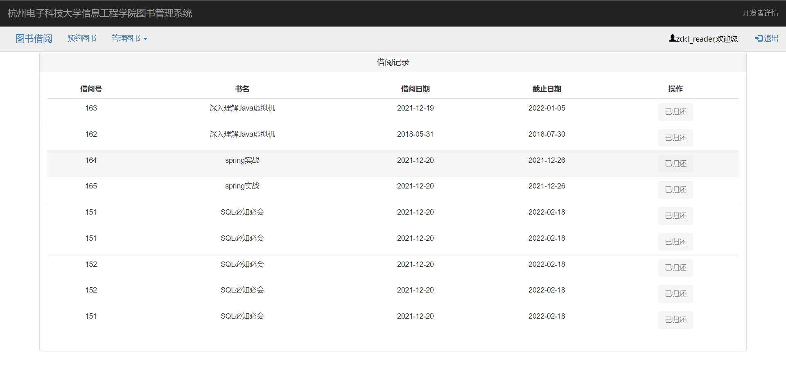
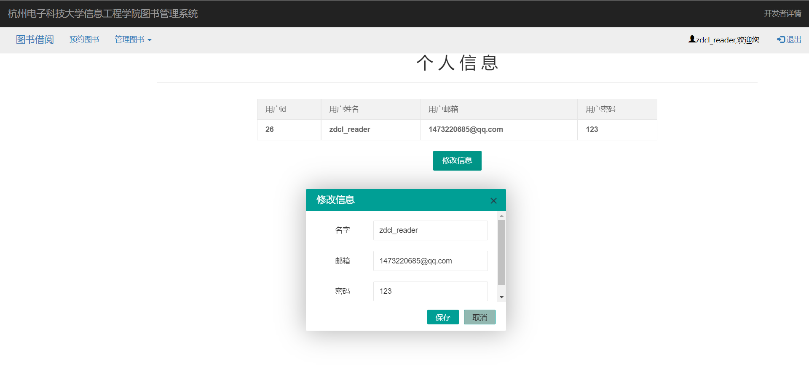

# 图书管理系统介绍

## 简介

项目地址：https://github.com/lcdzzz/springboot-library

对于github项目：https://github.com/jacklightChen/ManageBooks  的改造，这是原项目地址。

一个基于SpringBoot+Thymeleaf渲染的图书管理系统
功能:

- 用户: a.预约图书 b.查看预约记录 c.还书 d.查看个人信息以及修改个人信息
- 管理员: a.添加图书 b.处理预约(借书) c.查看借阅记录
  另:
  1.当用户过了还书日期仍旧未还书时会发邮件通知（原）
  2.当有书被还时发邮件通知预约书的用户到图书馆进行借书（原）

在学习这个项目的过程中发现原项目的提供的sql文件并不完整，于是花了一些时间去完善了表结构，存储过程以及视图。

## 适用人群

适合刚接触springboot不久的同学使用，因为几乎对每行代码都写上了注释，阅读起来会更舒适

## 使用技术

|   后端   | ...                         |
| :------: | :-------------------------- |
| 核心框架 | spring、springboot、mybatis |
|  连接池  | Alibaba Druid               |

|        前端        | ...                  |
| :----------------: | :------------------- |
| 核心框架(轻量简洁) | BootStrap、Thymeleaf |

界面入口:  localhost:8080 
管理员用户名: admin_zhangsan 密码: 123456 (manager表) 
普通用户名: zdcl_reader 密码: 123 (reader表) 

## 项目演示

- 登录界面

  

- 管理员页面

  

- 添加图书

  

- 管理预约

  

- 查看借阅情况

  

- 借阅者界面

  

- 预约图书

  

- 查看预约情况

  

- 退还图书

  

- 查看个人信息、修改个人信息

  

