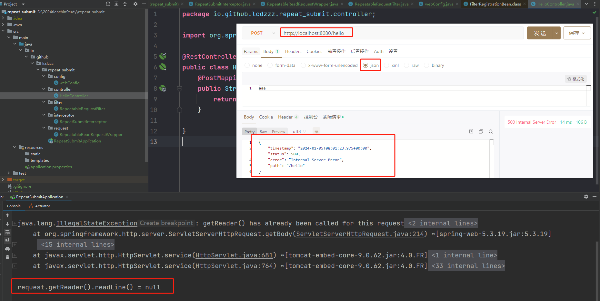
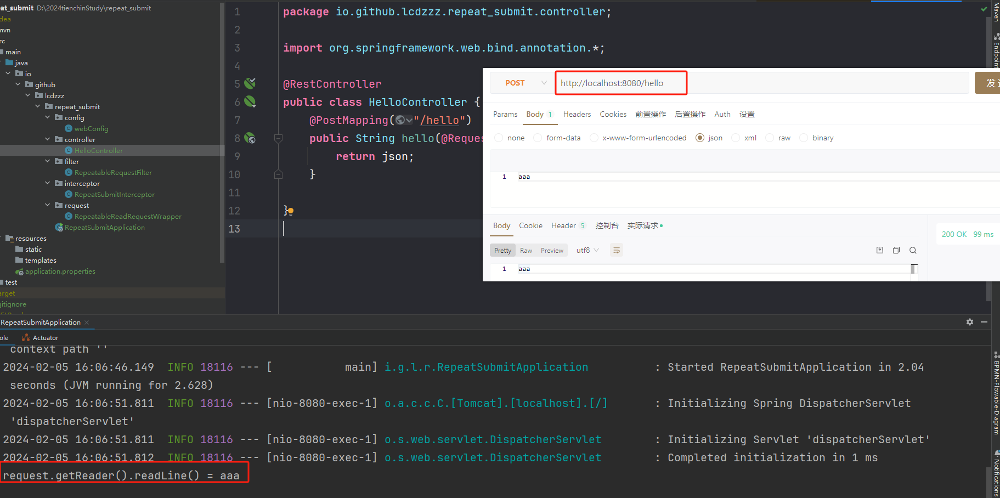
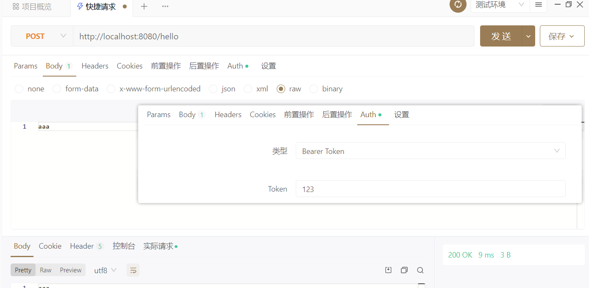
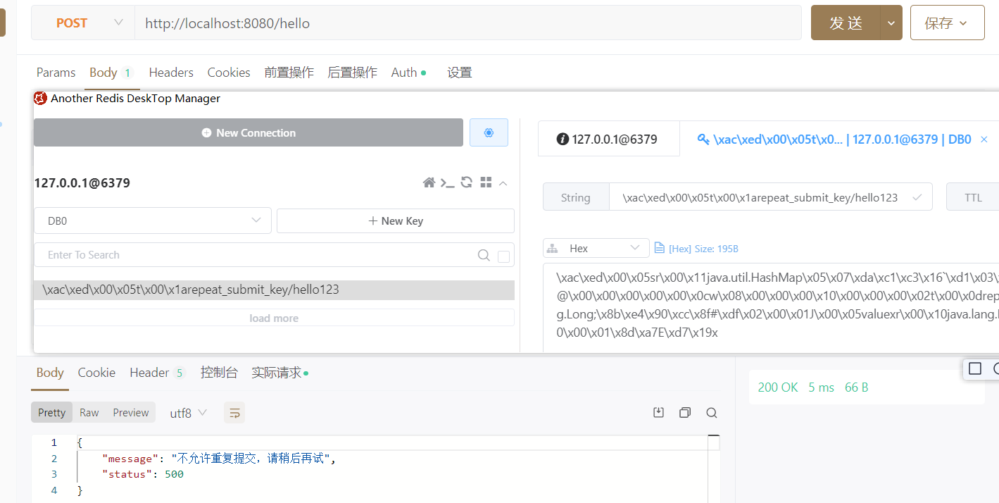

> [代码地址](https://gitee.com/lcdzzz/repeat_submit)
>
> 
>
> ruoyi脚手架是通过参数去判断：
>
> 1. 把请求缓存起来到redis里面去【请求地址、请求参数...】
> 2. 比如：请求地址和请求参数都是一样的话，10秒只能就拒绝重复提交
>
> 但这个方法存在一个问题：如果请求的参数是json，一旦我提取出来，将来在接口里面就提取不到了，所以我们先要把这个问题解决掉


**所需依赖：**springweb、redis、aop

```xml
<dependencies>
    <dependency>
        <groupId>org.springframework.boot</groupId>
        <artifactId>spring-boot-starter-data-redis</artifactId>
    </dependency>
    <dependency>
        <groupId>org.springframework.boot</groupId>
        <artifactId>spring-boot-starter-web</artifactId>
    </dependency>
    <dependency>
        <groupId>org.springframework.boot</groupId>
        <artifactId>spring-boot-starter-aop</artifactId>
    </dependency>

    <dependency>
        <groupId>org.springframework.boot</groupId>
        <artifactId>spring-boot-starter-test</artifactId>
        <scope>test</scope>
    </dependency>
</dependencies>
```


# 请求参数格式问题

## io流（json）可能产生的问题复现

`io/github/lcdzzz/repeat_submit/interceptor/RepeatSubmitInterceptor.java`

```java

import org.springframework.stereotype.Component;
import org.springframework.web.servlet.HandlerInterceptor;
import org.springframework.web.servlet.ModelAndView;

import javax.servlet.http.HttpServletRequest;
import javax.servlet.http.HttpServletResponse;

@Component
public class RepeatSubmitInterceptor implements HandlerInterceptor {
    @Override
    public boolean preHandle(HttpServletRequest request, HttpServletResponse response, Object handler) throws Exception {
        System.out.println("request.getReader().readLine() = " + request.getReader().readLine());
        return true;
    }

    @Override
    public void postHandle(HttpServletRequest request, HttpServletResponse response, Object handler, ModelAndView modelAndView) throws Exception {
        HandlerInterceptor.super.postHandle(request, response, handler, modelAndView);
    }

    @Override
    public void afterCompletion(HttpServletRequest request, HttpServletResponse response, Object handler, Exception ex) throws Exception {
        HandlerInterceptor.super.afterCompletion(request, response, handler, ex);
    }
}
```

`io/github/lcdzzz/repeat_submit/config/webConfig.java`

```java
import io.github.lcdzzz.repeat_submit.interceptor.RepeatSubmitInterceptor;
import org.springframework.beans.factory.annotation.Autowired;
import org.springframework.context.annotation.Configuration;
import org.springframework.web.servlet.config.annotation.InterceptorRegistry;
import org.springframework.web.servlet.config.annotation.WebMvcConfigurer;

@Configuration
public class webConfig implements WebMvcConfigurer {
    @Autowired
    RepeatSubmitInterceptor repeatSubmitInterceptor;

    @Override
    public void addInterceptors(InterceptorRegistry registry) {
        registry.addInterceptor(repeatSubmitInterceptor).addPathPatterns("/**");
    }
}
```

`io/github/lcdzzz/repeat_submit/controller/HelloController.java`

```java
import org.springframework.web.bind.annotation.GetMapping;
import org.springframework.web.bind.annotation.RequestBody;
import org.springframework.web.bind.annotation.RestController;

@RestController
public class HelloController {
    @PostMapping("/hello")
    public String hello(@RequestBody String json){//@RequestBody底层也是通过io流实现的
        return json;
    }

}
```


**【注】**访问/hello时首先会被拦截器拦截，拦截器里面的`request.getReader().readLine()`与接口中的`@RequestBody`都是通过io流实现的，然而io流使用过一次以后数据就不存在了。所以会出现报错。

<div style="text-align:center">
  
</div>

----

## 问题解决

**解决思路：**用装饰者模式将HttpServletRequest重新处理一下

### RepeatableReadRequestWrapper 类

这个类是一个继承自 `HttpServletRequestWrapper` 的包装类。主要作用是：

1. 在构造函数中，读取请求的输入流，并将其保存在 `bytes` 数组中。
2. 重写 `getReader()` 和 `getInputStream()` 方法，返回一个新的 `BufferedReader` 和 `ServletInputStream` 实例，这两者都是用 `bytes` 数组来构造的。

实际上，这个类的目的是允许请求的输入流（请求体）能够被多次读取，因为默认情况下，Servlet的输入流只能读取一次。


`io/github/lcdzzz/repeat_submit/request/RepeatableReadRequestWrapper.java`

```java

import javax.servlet.ReadListener;
import javax.servlet.ServletInputStream;
import javax.servlet.http.HttpServletRequest;
import javax.servlet.http.HttpServletRequestWrapper;
import javax.servlet.http.HttpServletResponse;
import java.io.*;

public class RepeatableReadRequestWrapper extends HttpServletRequestWrapper {
    private final byte[] bytes;//把从io流拿出来的
    public RepeatableReadRequestWrapper(HttpServletRequest request, HttpServletResponse response) throws IOException {
        super(request);
        request.setCharacterEncoding("UTF-8");
        response.setCharacterEncoding("UTF-8");
        bytes=request.getReader().readLine().getBytes();
    }

    @Override
    public BufferedReader getReader() throws IOException {
        return new BufferedReader((new InputStreamReader(getInputStream())));
    }

    @Override
    public ServletInputStream getInputStream() throws IOException {
        ByteArrayInputStream bais = new ByteArrayInputStream(bytes);
        return new ServletInputStream() {
            @Override
            public boolean isFinished() {
                return false;
            }

            @Override
            public boolean isReady() {
                return false;
            }

            @Override
            public void setReadListener(ReadListener readListener) {

            }

            @Override
            public int read() throws IOException {
                return bais.read();
            }
            @Override
            public int available() throws IOException {//整个数据的长度
                return bytes.length;
            }
        };


    }
}

```


### RepeatableRequestFilter 类

这个类是一个实现了 `Filter` 接口的过滤器。主要作用是：

1. 检查请求的 `Content-Type` 是否以 "application/json" 开头，如果是，就创建一个 `RepeatableReadRequestWrapper` 对象，并替换原始的 `HttpServletRequest`，以允许请求体的多次读取。
2. 继续执行过滤器链，将请求和响应传递给下一个过滤器或目标 Servlet。

这个过滤器的作用是在请求为 JSON 格式时，将原始的请求对象替换为具有多次读取能力的包装类，从而防止在处理请求时由于读取请求体而导致的问题。


`io/github/lcdzzz/repeat_submit/filter/RepeatableRequestFilter.java`

```java
import io.github.lcdzzz.repeat_submit.request.RepeatableReadRequestWrapper;
import org.springframework.util.StringUtils;
import javax.servlet.*;
import javax.servlet.http.HttpServletRequest;
import javax.servlet.http.HttpServletResponse;
import java.io.IOException;

public class RepeatableRequestFilter implements Filter {
    @Override
    public void doFilter(ServletRequest servletRequest, ServletResponse servletResponse, FilterChain filterChain) throws IOException, ServletException {
        HttpServletRequest request = (HttpServletRequest) servletRequest;
        //这通常用于在处理 HTTP 请求时，判断请求的数据格式是否为 JSON 格式
        if (StringUtils.startsWithIgnoreCase(request.getContentType(),"application/json")){//StringUtils.startsWithIgnoreCase()以某个前缀开始的
            RepeatableReadRequestWrapper requestWrapper = new RepeatableReadRequestWrapper(request, (HttpServletResponse) servletResponse);
            filterChain.doFilter(requestWrapper,servletResponse);//也就是说如果请求时json格式的，那就来个偷梁换柱，换成装饰者模式处理之后的请求。使她可以重复读
            return;
        }
        filterChain.doFilter(servletRequest,servletResponse);
    }
}
```


### webConfig 类

这个类是一个Spring Boot的配置类，实现了 `WebMvcConfigurer` 接口。主要作用是：

1. 注册一个自定义的拦截器 `RepeatSubmitInterceptor`，该拦截器用于防止表单重复提交。
2. 注册一个自定义的过滤器 `RepeatableRequestFilter`，该过滤器用于处理重复请求。这里通过 `FilterRegistrationBean` 配置了过滤器的注册。

`io/github/lcdzzz/repeat_submit/config/webConfig.java`

```java
import io.github.lcdzzz.repeat_submit.filter.RepeatableRequestFilter;
import io.github.lcdzzz.repeat_submit.interceptor.RepeatSubmitInterceptor;
import org.springframework.beans.factory.annotation.Autowired;
import org.springframework.boot.web.servlet.FilterRegistrationBean;
import org.springframework.context.annotation.Bean;
import org.springframework.context.annotation.Configuration;
import org.springframework.web.servlet.config.annotation.InterceptorRegistry;
import org.springframework.web.servlet.config.annotation.WebMvcConfigurer;
@Configuration//声明这是一个配置类，Spring会在启动时加载并处理它。
public class webConfig implements WebMvcConfigurer {//实现了 WebMvcConfigurer 接口，用于配置Spring MVC。
    @Autowired
    RepeatSubmitInterceptor repeatSubmitInterceptor;//使用Spring的依赖注入，注入一个 RepeatSubmitInterceptor 的实例。这个拦截器是用于防止表单重复提交的自定义拦截器。

    @Override
    public void addInterceptors(InterceptorRegistry registry) {
        //重写 addInterceptors 方法，向拦截器注册表中添加自定义的拦截器。这里注册了 RepeatSubmitInterceptor，并指定了拦截路径为 "/**"，即拦截所有请求。
        registry.addInterceptor(repeatSubmitInterceptor).addPathPatterns("/**");
    }

    
    //声明一个Bean，该Bean是 FilterRegistrationBean 类型的，用于注册过滤器。在这里，注册了一个 RepeatableRequestFilter 过滤器，并设置其拦截路径为 "/*"，即拦截所有请求。这个过滤器可能是用于处理重复请求的自定义过滤器。
    @Bean
    FilterRegistrationBean<RepeatableRequestFilter> repeatableRequestFilterFilterRegistrationBean(){
        FilterRegistrationBean<RepeatableRequestFilter> bean = new FilterRegistrationBean<>();
        bean.setFilter(new RepeatableRequestFilter());
        bean.addUrlPatterns("/*");//拦截所有请求
        return bean;
    }
}
```

**综合来看，这三段代码一起实现了一个防止重复提交的机制，在请求为 JSON 格式时，通过替换请求对象的方式，允许请求体的多次读取。同时，通过拦截器和过滤器的配置，使这个机制能够在整个应用中生效。**


<div style="text-align:center">
  
</div>

<u>过滤器先执行，拦截器后执行</u>。因为拦截器是servlet调用的，过滤器比servlet先执行。<u>所以顺序应该是在过滤器中先把请求的格式切换过来。</u>

### 对应ruoyi/tienchin的实现

`tienchin-common/src/main/java/com/lcdzzz/common/filter/RepeatedlyRequestWrapper.java`===`io/github/lcdzzz/repeat_submit/request/RepeatableReadRequestWrapper.java`

`tienchin-common/src/main/java/com/lcdzzz/common/filter/RepeatableFilter.java`===`io/github/lcdzzz/repeat_submit/filter/RepeatableRequestFilter.java`

`tienchin-framework/src/main/java/com/lcdzzz/framework/config/FilterConfig.java`===`io/github/lcdzzz/repeat_submit/config/webConfig.java`

----

# 防止重复提交

思路：把【你是谁、请求地址、请求参数...】存到redis里面去。

## 定义注解

```java
@Target(ElementType.METHOD)
@Retention(RetentionPolicy.RUNTIME)
public @interface RepeatSubmit {
    /**
     * 两个请求之间的间隔时间
     * @return
     */
    int interval() default 5000;
    /**
     * 重复提交时的提示文本
     * @return
     */
    String message() default "不允许重复提交，请稍后再试";
}
```

## redis工具类

```java
@Component
public class RedisCahe {
    @Autowired
    RedisTemplate redisTemplate;

    public <T> void setRedisTemplate(final String key, final T value, Integer timeout, final TimeUnit timeUnit){
        /**
         * opsForValue() 方法，你可以获取一个用于操作字符串值的操作对象。然后，调用 set() 方法，将指定的键与值关联起来。
         */
        redisTemplate.opsForValue().set(key,value,timeout,timeUnit);
    }

    public <T> T getCacheObject(final String key){
        ValueOperations<String,T> valueOperations = redisTemplate.opsForValue();
        return valueOperations.get(key);
    }
}
```

## 配置注解

之前配置注解都是用aop的，这次试一试在拦截器地方配置

**HandlerMethod**： <u>会把我每定义的一个接口方法封装成一个对象</u>。就是接口方法的各种信息【说属于哪个类的，方法泛型是什么，方法地址，方法参数，返回值...】又被分装成一个新的类，就叫HandlerMethod。

如果所有的像这样的接口方法，最终都会被封装成HandlerMethod。

```java
@PostMapping("/hello")
public String hello(@RequestBody String json){//@RequestBody底层也是通过io流实现的
    return json;
}
```


### RepeatSubmitInterceptor

代码：

```java

@Component
public class RepeatSubmitInterceptor implements HandlerInterceptor {
    public static final String REPEAT_PARAMS = "repeat_params";
    public static final String REPEAT_TIME = "repeat_time";
    public static final String REPEAT_SUBMIT_KEY = "repeat_submit_key";
    public static final String HEADER = "Authorization";
    @Autowired
    RedisCahe redisCahe;
    @Override
    public boolean preHandle(HttpServletRequest request, HttpServletResponse response, Object handler) throws Exception {
        if (handler instanceof HandlerMethod) {
            HandlerMethod handlerMethod = (HandlerMethod) handler;
            Method method = handlerMethod.getMethod();
            RepeatSubmit repeatSubmit = method.getAnnotation(RepeatSubmit.class);
            if (repeatSubmit != null) {//说明method上有这个注解，所以要请求校验判断是否重复
                if (isRepeatSubmit(request, repeatSubmit)) {//判断是否是重复提交
                    Map<String, Object> map = new HashMap<>();
                    map.put("status", 500);
                    map.put("message", repeatSubmit.message());
                    response.setContentType("application/json;charset=utf-8");
                    response.getWriter().write(new ObjectMapper().writeValueAsString(map));
                    return false;//拦截下来了
                }
            }
        }
        return true;
    }

    private boolean isRepeatSubmit(HttpServletRequest request, RepeatSubmit repeatSubmit) {
        String nowParams = "";//请求参数字符串
        if (request instanceof RepeatableReadRequestWrapper) {
            try {
                nowParams = ((RepeatableReadRequestWrapper) request).getReader().readLine();
            } catch (IOException e) {
                e.printStackTrace();
            }
        }
        //否则说明请求参数是key-value 格式的
        if (StringUtils.isEmpty(nowParams)) {
            try {
                nowParams = new ObjectMapper().writeValueAsString(request.getParameterMap());
            } catch (JsonProcessingException e) {
                throw new RuntimeException(e);
            }
        }
        Map<String, Object> nowDataMap = new HashMap<>();
        nowDataMap.put(REPEAT_PARAMS, nowParams);
        nowDataMap.put(REPEAT_TIME, System.currentTimeMillis());
        String requestURI = request.getRequestURI();
        String header = request.getHeader(HEADER);//用来提取出用户是谁
        String cacheKey = REPEAT_SUBMIT_KEY + requestURI + header.replace("Bearer ", "");
        Object cacheObject = redisCahe.getCacheObject(cacheKey);
        if (cacheObject != null) {
            Map<String, Object> map = (Map<String, Object>) cacheObject;
            if (compareParams(map, nowDataMap) && compareTime(map, nowDataMap, repeatSubmit.interval())) {
                return true;
            }
        }
        redisCahe.setRedisTemplate(cacheKey, nowDataMap, repeatSubmit.interval(), TimeUnit.MILLISECONDS);
        return false;
    }

    /**
     * 判断是否重复提交，返回true就代表是重复提交
     *
     * @param map
     * @param nowDataMap
     * @param interval
     * @return
     */
    private boolean compareTime(Map<String, Object> map, Map<String, Object> nowDataMap, int interval) {
        Long time1 = (Long) map.get(REPEAT_TIME);//redis里的时间
        Long time2 = (Long) nowDataMap.get(REPEAT_TIME);//现在的时间
        if ((time2 - time1) < interval) {
            return true;
        }
        return false;
    }

    //比较参数是否一样
    private boolean compareParams(Map<String, Object> map, Map<String, Object> nowDataMap) {
        String nowParams = (String) nowDataMap.get(REPEAT_PARAMS);
        String dataParams = (String) map.get(REPEAT_PARAMS);
        return nowParams.equals(dataParams);

    }

    @Override
    public void postHandle(HttpServletRequest request, HttpServletResponse response, Object handler, ModelAndView modelAndView) throws Exception {
        HandlerInterceptor.super.postHandle(request, response, handler, modelAndView);
    }

    @Override
    public void afterCompletion(HttpServletRequest request, HttpServletResponse response, Object handler, Exception ex) throws Exception {
        HandlerInterceptor.super.afterCompletion(request, response, handler, ex);
    }
}
```

**解释：**

这段代码是一个<u>拦截器（Interceptor）</u>中的一个方法

具体来说，这个方法用于在处理请求之前检查<u>是否存在重复提交</u>。它接收三个参数：

1. `HttpServletRequest request`：表示 HTTP 请求的对象，包含了客户端发送的请求信息。
2. `HttpServletResponse response`：表示 HTTP 响应的对象，用于向客户端发送响应信息。
3. `Object handler`：表示<u>处理请求的处理器对象。</u>

该方法<u>首先</u>判断`handler`是否是`HandlerMethod`类型的实例，这是因为处理请求的方法通常是通过`HandlerMethod`来表示的。如果是，则获取对应的方法对象`Method`。

<u>接着</u>，通过`method.getAnnotation(RepeatSubmit.class)`获取该方法上是否标注了`RepeatSubmit`注解。如果存在该注解，说明该方法需要进行重复提交的校验。

<u>然后</u>，调用`isRepeatSubmit(request, repeatSubmit)`方法来<u>判断当前请求是否是重复提交</u>。如果是重复提交，则返回一个错误响应，其中包括状态码和消息，并设置响应内容类型为 JSON 格式。

<u>最后</u>，如果不需要拦截该请求（即不是重复提交），则返回`true`，表示允许继续执行后续的请求处理；如果需要拦截该请求（即是重复提交），则返回`false`，表示不允许继续执行后续的请求处理。


## 测试

在/hello接口上添加`@RepeatSubmit(interval = 10000)`，表示两个请求之间的间隔时间是10秒

<div style="text-align:center">
  
</div>

<div style="text-align:center">
  
</div>


# 对标ruoyi

拦截器：`com/lcdzzz/framework/interceptor`

 【问题】若是两个不一样的人来请求一个接口，同样有可能被拦截下来，但这其实是不合理的
	但是在ruoyi这个项目里面是没关系的，因为它肯定有Header。

