---

title: 如何使用Docker，安装java调试环境的docker
date: 2022-04-11 15:00:15
tags:
	- 大学
cover: https://bkimg.cdn.bcebos.com/pic/f703738da977391281957edbf0198618377ae2dd?x-bce-process=image/watermark,image_d2F0ZXIvYmFpa2UxODA=,g_7,xp_5,yp_5/format,f_auto
---

## Docker的安装

1. **查看系统的内核**

   ```shell
   [roo@www ~]$ uname -r
   3.10.0-1160.59.1.el7.x86_64
   
   ```

<div style="text-align:center">
  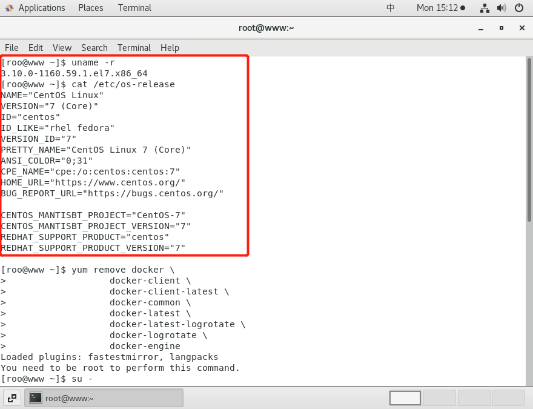
</div>

   <br><br>

2. **查看系统配置**

   ```shell
   cat /etc/os-release
   ```

<div style="text-align:center">
  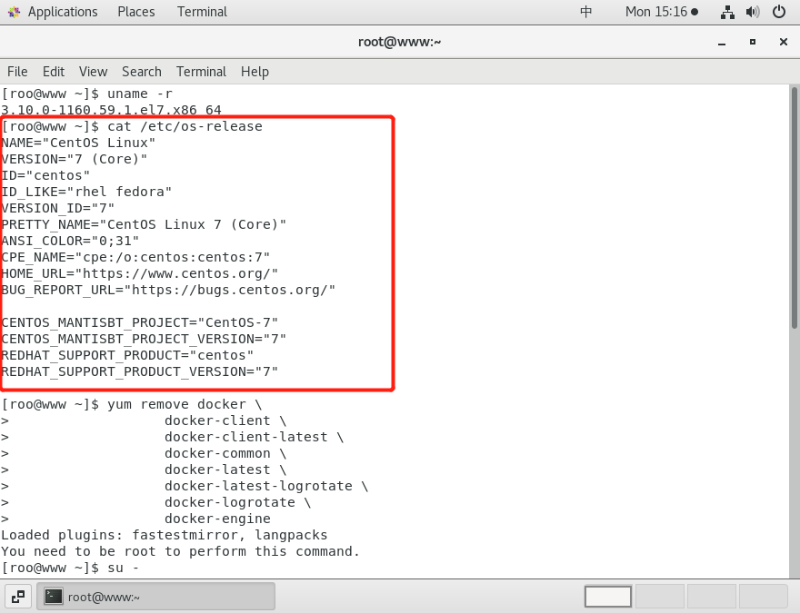
</div>

   <br><br>

3. **卸载旧的版本**

   ```shell
   [root@www ~]# yum remove docker \
                      docker-client \
                      docker-client-latest \
                      docker-common \
                      docker-latest \
                      docker-latest-logrotate \
                      docker-logrotate \
                      docker-engine
   
   ```

<div style="text-align:center">
  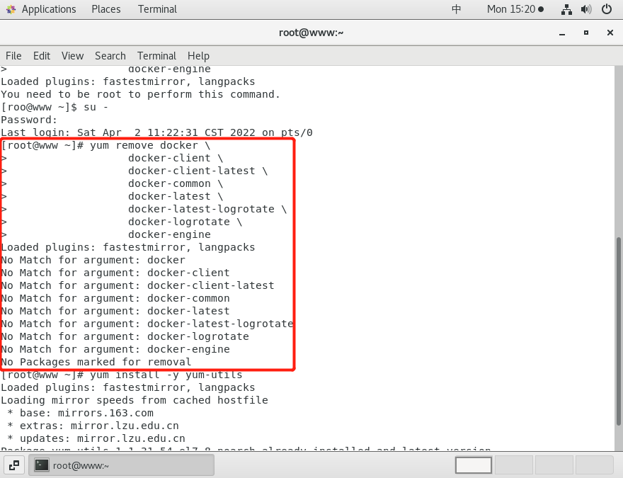
</div>

   <br><br>

4. **下载需要的安装包**

   ```shell
   yum install -y yum-utils
   ```

<div style="text-align:center">
  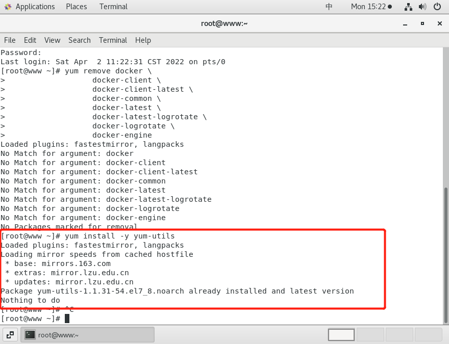
</div>

   <br><br>

5. **设置镜像的仓库**

   ```shell
   yum-config-manager \
       --add-repo \
       https://download.docker.com/linux/centos/docker-ce.repo  #国外的地址
       
       # 设置阿里云的Docker镜像仓库
   yum-config-manager \
       --add-repo \
       https://mirrors.aliyun.com/docker-ce/linux/centos/docker-ce.repo  #国内的地址
   
   ```

<div style="text-align:center">
  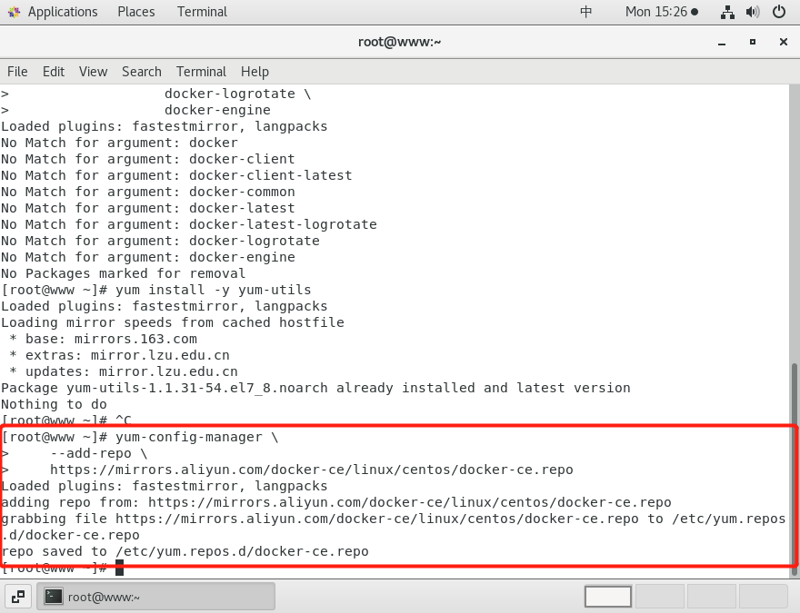
</div>

   <br><br>

6. **更新yum软件包索引**

   ```shell
   yum makecache fast
   ```

<div style="text-align:center">
  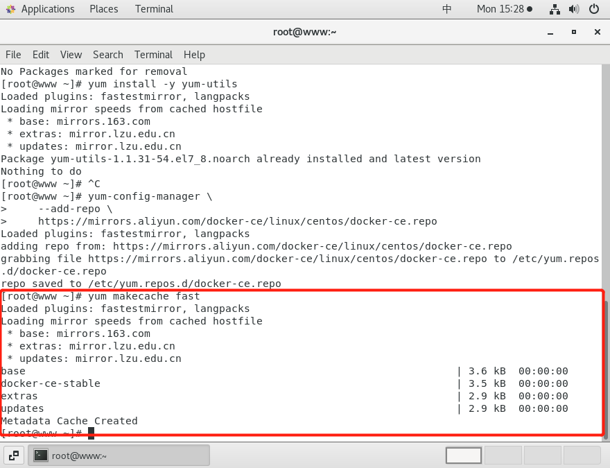
</div>

   <br><br>

7. **安装docker相关的配置**

   docker-ce 是社区版，docker-ee 企业版

   ```shell
   yum install docker-ce docker-ce-cli containerd.io
   ```

<div style="text-align:center">
  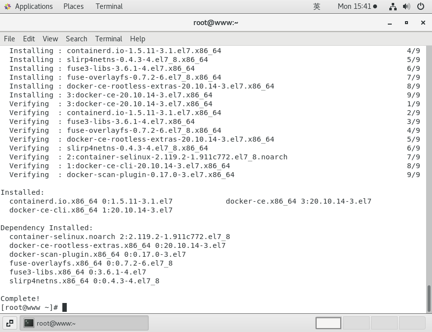
</div>

   出现了completed即安装成功

   <br><br>

8. **启动Docker**

   ```shell
   systemctl start docker
   # 查看当前版本号，是否启动成功
   docker version
   # 设置开机自启动
   systemctl enable docker
   ```

<div style="text-align:center">
  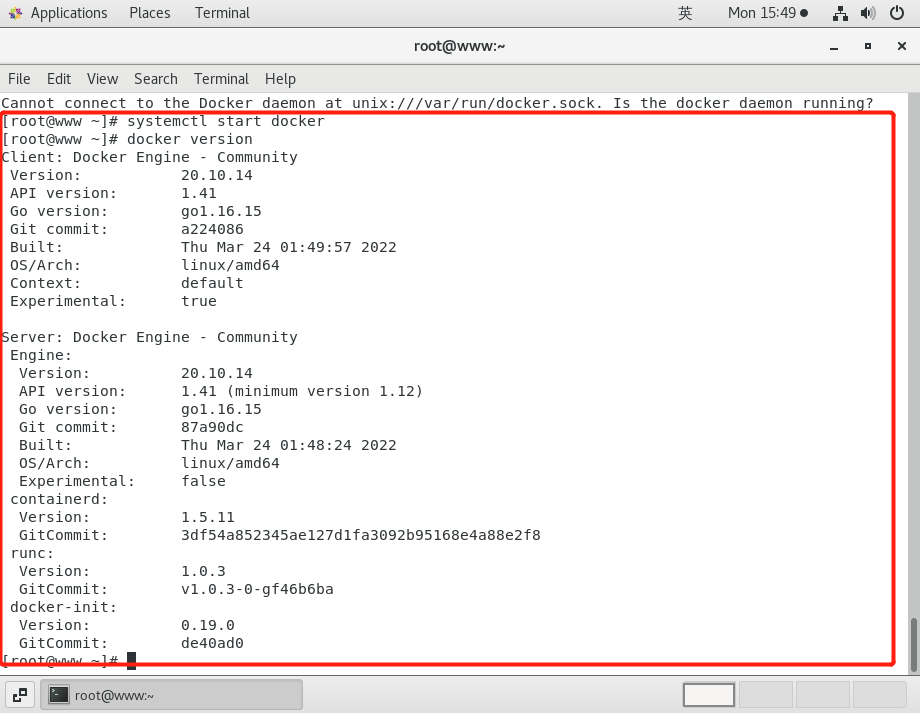
</div>

9. hello-world

   ```shell
   [root@www ~]# docker run hello-world
   ```

<div style="text-align:center">
  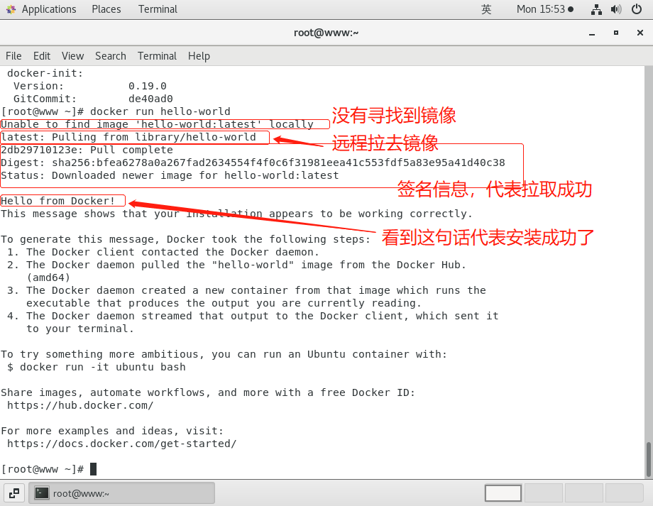
</div>

10. 查看一下下载的这个hello-world镜像

    ```shell
    [root@www ~]# docker images
    REPOSITORY    TAG       IMAGE ID       CREATED        SIZE
    hello-world   latest    feb5d9fea6a5   6 months ago   13.3kB
    
    ```


<br><br><br><br>

## 构建自己的centos

1. **在/home目录下创建一个dockerfile目录，到时候所有东西就放这儿**

   ```shell
   [root@www /]# cd /home
   [root@www home]# ls
   ceshi  docker-test-volume  hziee  mysql  roo
   [root@www home]# mkdir dockerfile
   [root@www home]# ls
   ceshi  dockerfile  docker-test-volume  hziee  mysql  roo
   [root@www home]# cd dockerfile/
   [root@www dockerfile]# 
   
   ```

<div style="text-align:center">
  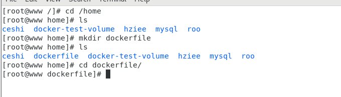
</div>

   <br><br>

2. **创建一个名为mydockerfile-centos的文件，在里面编写DockerFile的指令**

   ```shell
   [root@www dockerfile]# vim mydockerfile-centos
   ```

   <br><br>

3. **编写dockerfile的配置文件**

   cat 指令表示查看mydockerfile-centos这个文件里面的内容，所以返回值就是配置文件的内容

   ```shell
   [root@www dockerfile]# vim mydockerfile-centos 
   [root@www dockerfile]# cat mydockerfile-centos 
   FROM centos:7
   MAINTAINER lcdzzz<1473220685@qq.com>
   
   ENV MYPATH /usr/local
   WORKDIR $MYPATH
   
   RUN yum -y install vim
   RUN yum -y install net-tools
   
   EXPOSE 80
   
   CMD echo $MYPATH
   CMD echo "---end---"
   CMD /bin/bash
   
   
   ```

   <br><br>

4. **通过这个文件构建镜像**

   ```shell
   #↓↓↓运行这个命令↓↓↓，注意有 “.”
   #命令 docker build -f dockerfile文件路径 -t 镜像名:[tag]
   docker build -f mydockerfile-centos -t mycentos:0.1 .
   ```

<div style="text-align:center">
  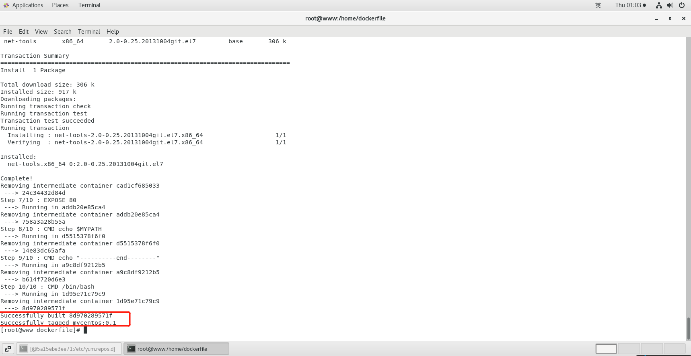
</div>

   显示successfully代表成功

5. **对比原生的centos**

<div style="text-align:center">
  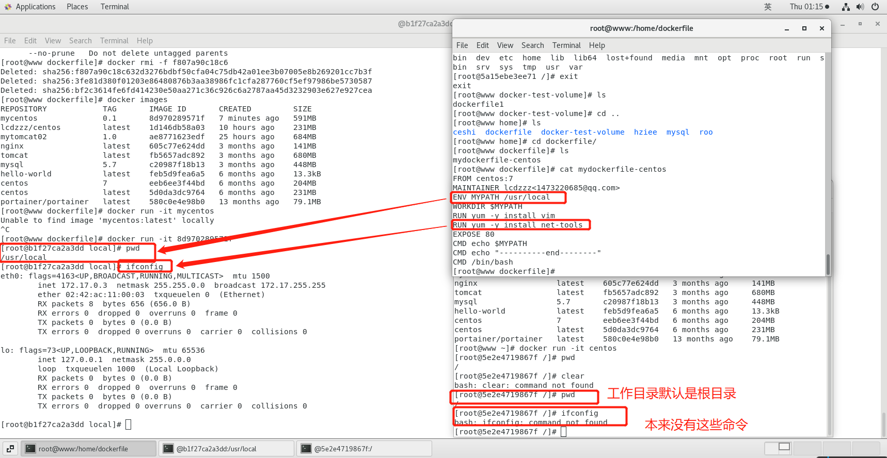
</div>

6. **我们可以列出本地进行的变更历史 docker history 镜像id**

<div style="text-align:center">
  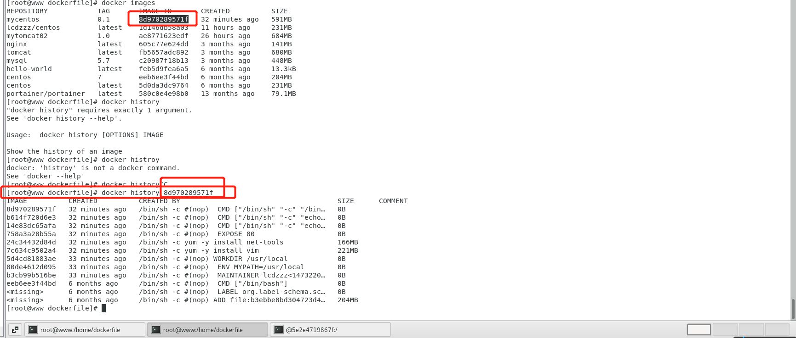
</div>

<br><br><br><br>

## Dockerfile制作tomcat镜像

1. 准备镜像文件tomcat压缩包，jdk压缩包

<div style="text-align:center">
  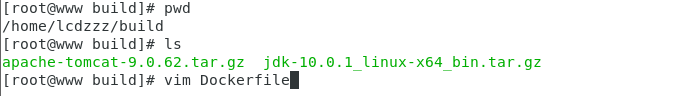
</div>

   <br><br>

2. 编写dockerfile文件，官方命名`Dockerfile`,build会自动寻找这个文件，就不需要 -f 去指定了

   ```shell
   FROM centos:7
   MAINTAINER lcdzzz<1473220685@qq.com>
   
   COPY readme.txt /usr/local/readme.txt
   
   ADD jdk-10.0.1_linux-x64_bin.tar.gz /usr/local/
   ADD apache-tomcat-9.0.62.tar.gz /usr/local/
   
   RUN yum -y install vim
   
   ENV MYPATH /usr/local
   
   WORKDIR $MYPATH
   
   ENV JAVA_HOME=/usr/local/jdk-10.0.1
   ENV CLASSPATH $JAVA_HOME/lib/dt.jar:$JAVA_HOME/lib/tools.jar
   ENV CATALINA_HOME /usr/local/apache-tomcat-9.0.62
   ENV CATALINA_BASE /usr/local/apache-tomcat-9.0.62
   ENV PATH $PATH:$JAVA_HOME/bin:$CATALINA_HOME/lib:$CATALINA_HOME/bin
   
   EXPOSE 8080
   
   CMD /usr/local/apache-tomcat-9.0.62/bin/startup.sh && tail -F /usr/local/apache-tomcat-9.0.62/bin/logs/catalina.out
   
   ```
   

<br><br>

3. 构建镜像,前面说了，build会自动寻找文件，所以不需要指定

   ```shell
   #docker build -t diytomcat .
   docker build -t diytomcat .
   ```

   显示successfully代表成功

<div style="text-align:center">
  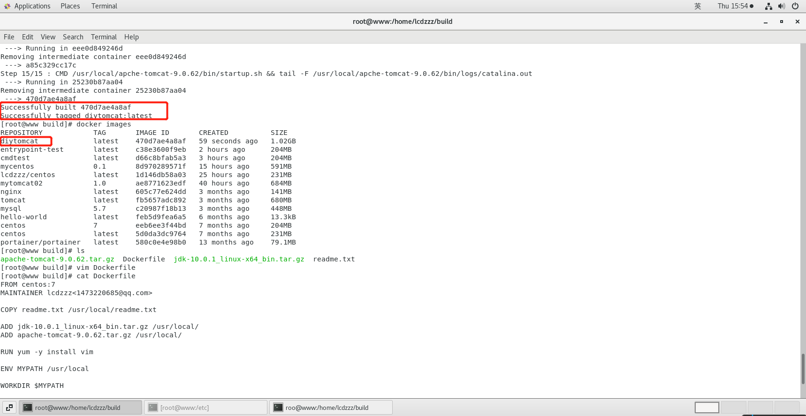
</div>

   <br><br>

4. 运行镜像

   ```shell
   docker run -d -p 9090:8080 --name lcdzzztomcat -v /home/lcdzzz/build/test:/usr/local/apache-tomcat-9.0.62/webapps/test -v /home/lcdzzz/build/tomcatlogs/:/usr/local/apache-tomcat-9.0.62/logs diytomcat
   ```

<div style="text-align:center">
  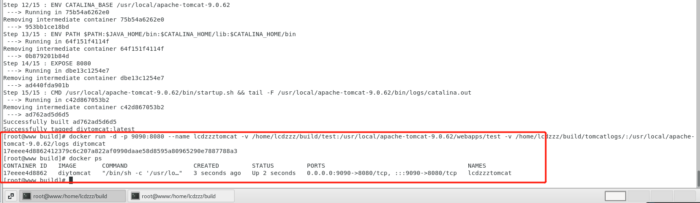
</div>

   <br><br>

5. 进入容器

   ```shell
   docker exec -it 1d24f83eec24c5 /bin/bash
   ```

   <br><br>

6. 访问测试,在宿主机上测试，不是在容器里

   ```shell
   curl localhost:9090
   ```

   <br><br>

7. 发布项目（由于做了卷挂载，我们直接在本地编写项目就可以发布了）

   ```xml
   <?xml version="1.0" encoding="UTF-8"?>
   <web-app 
   	xmlns="http://java.sun.com/xml/ns/javaee"
       xmlns:xsi="http://www.w3.org/2001/XMLSchema-instance"
   	xsi:schemaLocation="http://java.sun.com/xml/ns/javaee 
   						http://java.sun.com/xml/ns/javaee/web-app_2_5.xsd" 
   	version="2.5">
   </web-app>
   
   ```

<div style="text-align:center">
  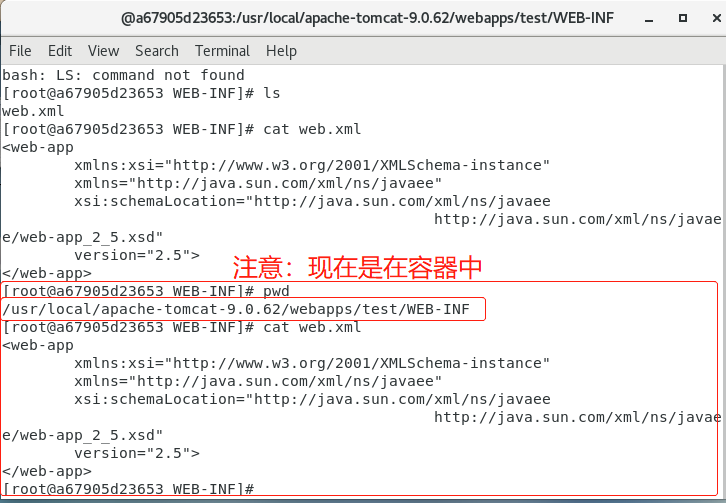
</div>

   <br>

   ```jsp
   <%@ page language="java" contentType="text/html; charset=UTF-8"
       pageEncoding="UTF-8"%>
   <!DOCTYPE html>
   <html>
   <head>
   <meta charset="utf-8">
   <title>hello.lcdzzz</title>
   </head>
   <body>
   Hello World!<br/>
   <%
   System.out.println("---my test web logs---");
   %>
   </body>
   </html>
   ```

<div style="text-align:center">
  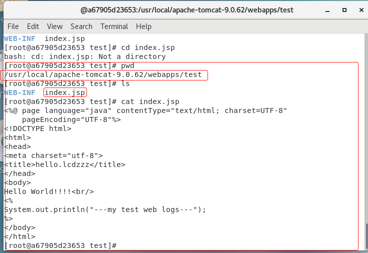
</div>

   <br><br>

8. 项目部署成功，直接访问就ok

   先通过 `ifconfig` 查看虚拟机的ip地址

<div style="text-align:center">
  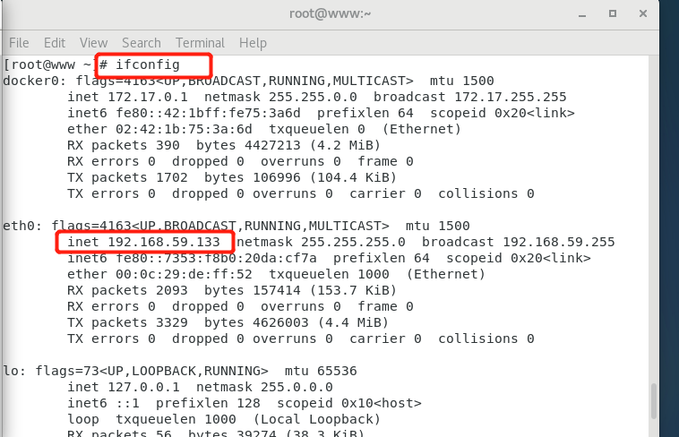
</div>

   访问

<div style="text-align:center">
  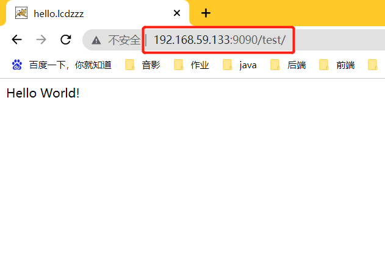
</div>

<br><br><br><br>

## 总结

- 通过<u>dockerfile</u>来构建Docker镜像

<div style="text-align:center">
  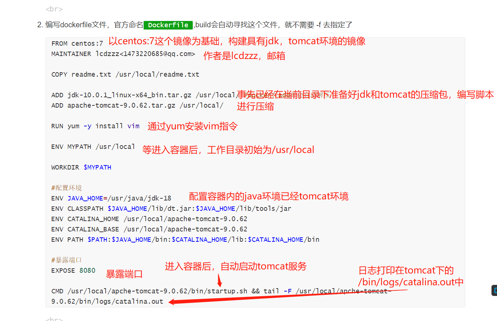
</div>

  <br>

- 通过

  `docker build -t diytomcat .`命令生成镜像

  <br>

- 然后运行，进入容器

  <br>

- 由于做了卷挂载，我们直接在本地编写项目就可以发布了

<div style="text-align:center">
  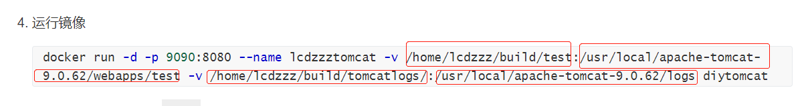
</div>

  意思是容器中的/usr/local/apache-tomcat-9.0.62/webapps/test下的文件会和宿主机（也就是虚拟机）的/home/lcdzzz/build/test的文件同步，对应的日志文件也同理

  <br>

- 所以，如果要调试程序，在运行起容器以后，只需要在本地编写代码就可以发布项目了，如下图所示

  日志的话会出现在主机下的 /home/lcdzzz/build/tomcatlogs下的catalina.out当中
  
<div style="text-align:center">
  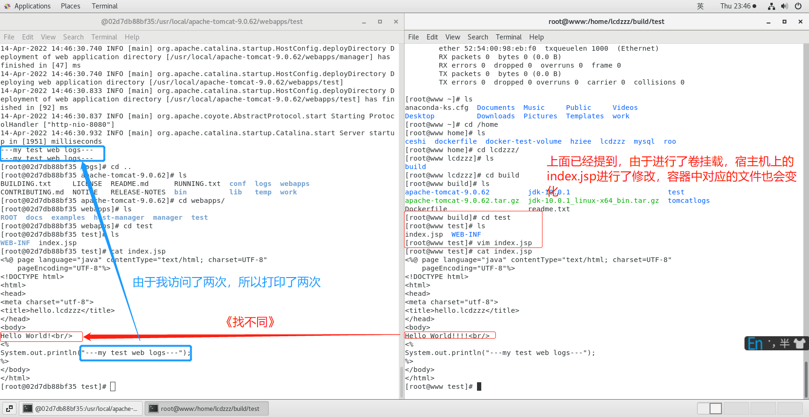
</div>


