# 工作流workflow

## 状态机解决流程问题


工作流：一个可以处理复杂情况的状态机

> 例如，员工请假这个流程，首先员工请假提交申请，假设有项目经理进行审批，审批有两种结果：通过或者拒绝。

实现上面这个需求：

1. 创建一张请假表，表中有员工id，请假的天数，请假的理由，项目经理的id，请假的状态status
2. 当员工请假的时候，就自动向这张表中添加记录
3. 然后，当项目经理登录到OA的时候，就来这张表查询自己需要的请假申请，查到之后，可以选择批准或者拒绝
4. 接下来，员工登录之后，就可以查到自己的请假申请的审批结果

在这样的实现思路中，请假的流程我们是通过status这个字段控制的。例如：

- status 0 代表待审批
- 1 代表审批通过
- 2 代表拒绝

 

上面这个例子，status就是状态码，通过这个子弹的值来控制流程的状态，这个方式我们可以称之为使用状态机来解决流程问题，但是这种思路只能解决非常简单的流程问题。


### 一些复杂的流程

#### 报销审批的流程

<div style="text-align:center">
  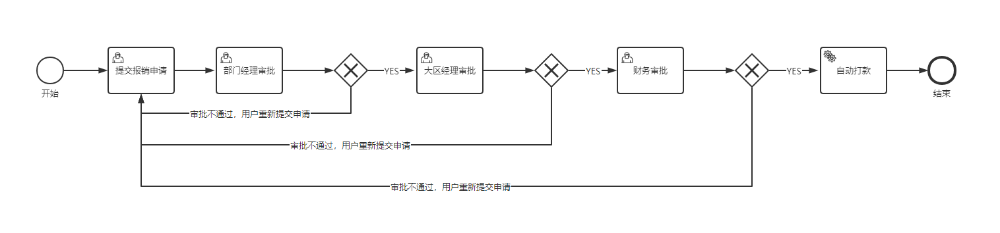
</div>


在这个流程中，已经没法使用status去描述这个报销走到哪一步了。如果非要用status，namestatus可能会有很多个取值 。

<br><br>

#### 笔记本电脑生产流程

<div style="text-align:center">
  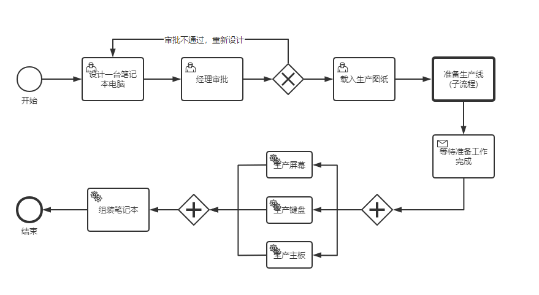
</div>

这个流程中不仅有串行任务还有并行任务,虽然技术上来说也能实现，但是如果用status字段去描述，实现起来会非常非常复杂。


## 三大工作流


- Activiti:

  侧重于云，即更靠拢spring cloud、docker、k8s等。

- Camunada:

  在这三个驻留的流程引擎这中，它是最轻量级的，如果我们的系统，当用户使用的过程中，需要动态的绘制流程图，那么可以使用它。这是一个小巧的工具，可以非常方便的嵌入到我们自己的系统中。它还提供了一个bpmn.js的工具，可以非常方便的实现流程图的绘制。

- Flowable:

  > 它目前的核心思路还是做一个功能非法从完善的流程引擎工具。除了常用的最最基本的工作流之外，Flowable还提供了很多扩展点。


## 流程图

工作流执行的基础是流程图

一个完整的流程，要干嘛，先得画出来一个完整的流程图

上卖弄介绍了三种不同的工作流，那么三种不同的流程图绘制的方式是否一样？

其实，流程图的绘制，有一套统一的标准：**BPMN**（Business Process Model And Notation）,中文译为**业务流程模型和标记法**。

BPMN 就是一套图形化表示发，用图形来绘制、梳理业务流程模型。就是说，BPMN其实是一个非常古老的流程图规范，Activiti、Camunada、Flowable都是支持这个规范的，所以，无论使用哪一个流程图，都可以依照BPMN去绘制流程图。

虽然BPMN大家都支持，但是，在具体的使用细节上，不同的流程引擎还是有差别的。


## BPMN流程图怎么画

<div style="text-align:center">
  
</div>

从上图中，大致上可以归类出，流程分为：

- 事件
- 连线
- 任务
- 网关

### **事件**

开始事件、结束时间等等。

<div style="text-align:center">
  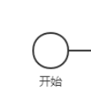
</div>

这是我们上面用到的时间，实际上，还有很多其他类型的事件。

<div style="text-align:center">
  
</div>


### **连线**

<div style="text-align:center">
  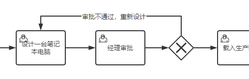
</div>

连接各个不同元素之间的线条，就是连线。

注意：线条之上，可能会有条件。例如，在互斥网关上，满足一定条件，流程图就继续往下走；不满足条件，流程图就回到之前的某一个位置。


### **任务**

在上面的流程图，所有的矩形，都是任务，但是任务还有许多细分。

- 用户任务

  需要人工参与才能完成的工作建模。

<div style="text-align:center">
  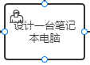
</div>

- 服务任务

  机器自动完成的事情，例如用户请假，经理审批通过后，想通过企业微信给用户发送一个通知，告诉他请假通过。这样的任务，就可以使用服务任务。

  就是当流程走到这一步的时候，自动调用一个javabean，或者某一个远程服务去完成通知的发送，这是自动完成的，不需要人工介入。

<div style="text-align:center">
  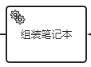
</div>

- 活动

  活动可以算是一个特殊的任务。活动之中，往往可以在活动中，调用另外一个流程使只作为当前流程的子流程去执行。活动一般又可以继续细分为用户活动、脚本活动等等。。。

<div style="text-align:center">
  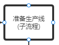
</div>


- 接受任务

  这个接受任务中，其实不需要做什么额外的事情，流程到这一步就自动停下来了，需要人工去助理一把，去推动流程继续向下走


<div style="text-align:center">
  
</div>

- 发送任务

  将消息发送给外部的参与者。

<div style="text-align:center">
  
</div>

- 脚本任务

  一个自动化的活动，当流程执行到脚本任务的时候， 自动执行相应的脚本。

<div style="text-align:center">
  
</div>

- 业务规则任务

  BPMN2.0中引入的用来对接业务规则的引擎，业务规则主要用于同步执行一个或者多个规则。

<div style="text-align:center">
  
</div>

> 虽然这里分类比较多，但实际上，任务主要分两种：
>
> 1. 用户任务：需要用户介入的任务。
> 2. 服务任务：机器自动完成的任务。发送、接受、脚本等等任务，都是服务任务的细分。

<br>

### 网关

- 互斥网关

  可以有多个入口，但只有一个有效出口。

<div style="text-align:center">
  
</div>

- 并行网关 

  并行网关一般是成对出现的，当有并行操作的时候，可以使用并行网关。

<div style="text-align:center">
  
</div>

- 相容网关

  这种网关可能会存在多个有效的出口。

<div style="text-align:center">
  
</div>

- 事件网关

  通过中间事件驱动的网关。当等待的事件触发之后，才会触发决策。

<div style="text-align:center">
  
</div>

<br><br>


# 流程图绘制

IDEA 中有一个流程绘制插件 `flowable-bpmn-visualizer`

其他的绘制工具：

1. flowable-ui 这是官方提供的一个 flowable 的工具，里边有很多功能，包括画流程图。
2. bpmn.js 这个工具是 Camunda 提供的，可以嵌入到我们当前的项目中，利用这个 bpmn.js 可以开发一个流程绘制工具。原生的 bpmn.js 画出来的流程图只能在 Camunda 中使用，但是经过改造之后，就可以在 flowable 中使用了。


### flowable-bpmn-visualizer

插件安装：

<div style="text-align:center">
  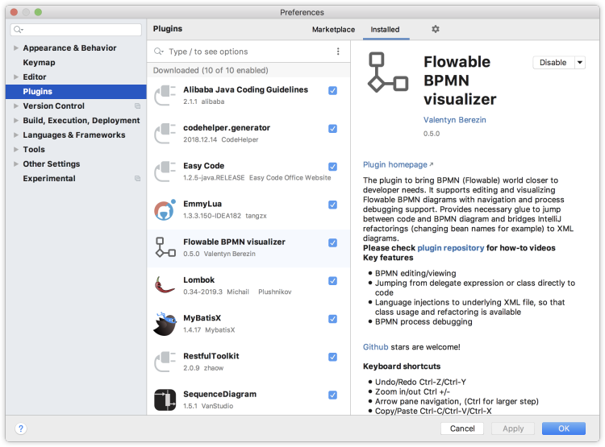
</div>

<br>

装好之后重启 IDEA 即可。

在 IDEA 中，当我们安装了这个插件之后，新建文件文件的时候，就有相应的选项：

<div style="text-align:center">
  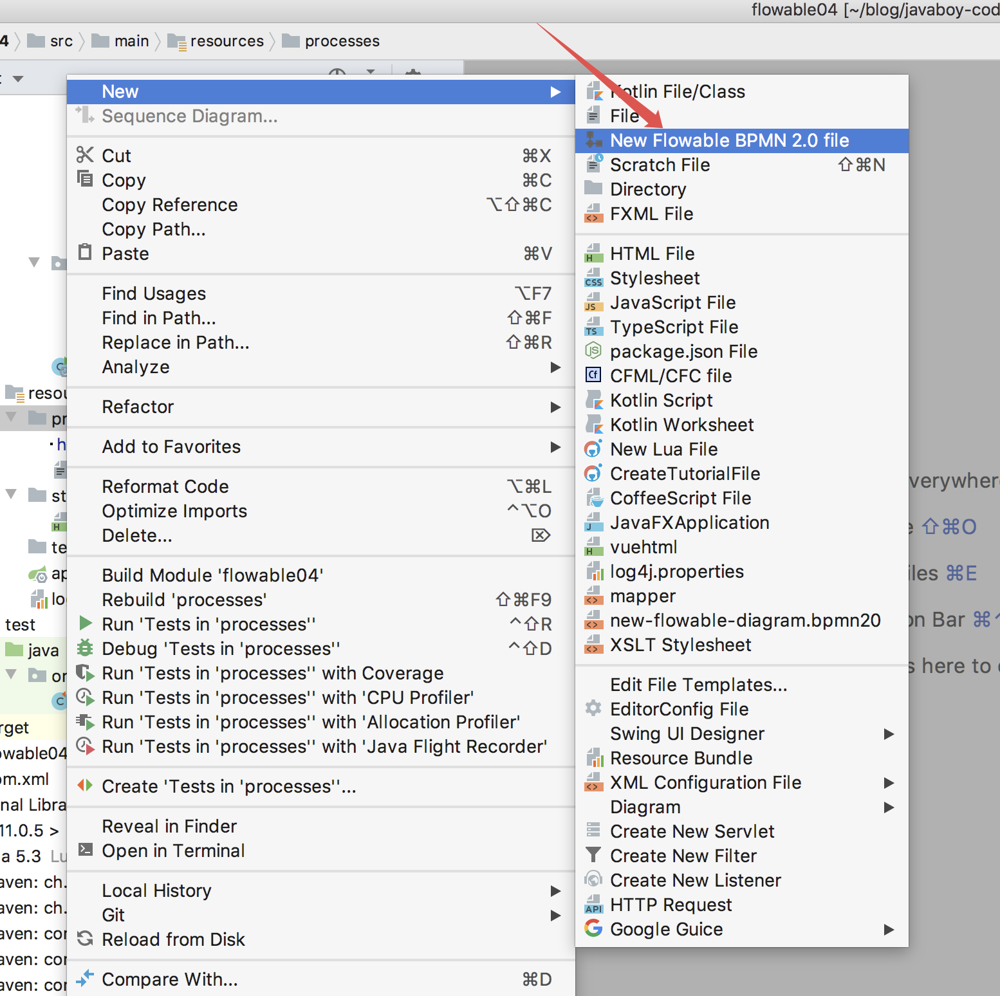
</div>

<br>

选择这个就可以新建一个流程图了。

<div style="text-align:center">
  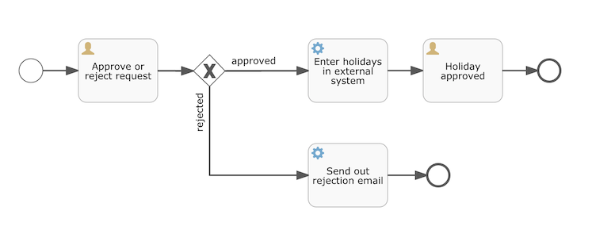
</div>

<br>

绘制关键节点：

<div style="text-align:center">
  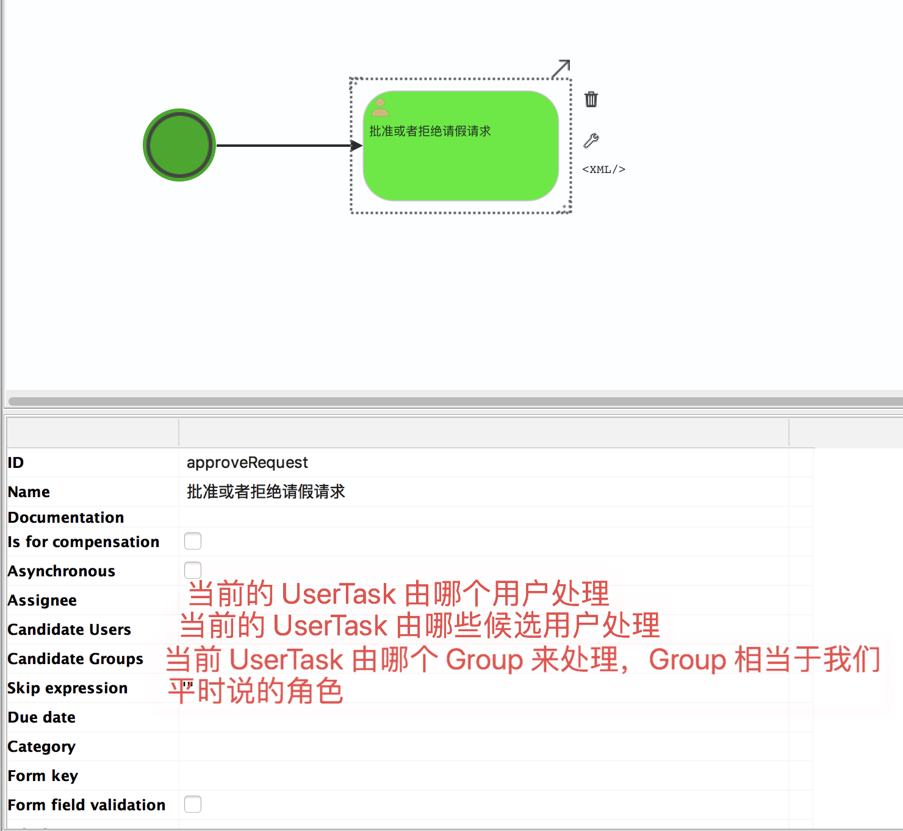
</div>

<br>

注意，这里如果是传递变量需要用 ${} 表达式

<div style="text-align:center">
  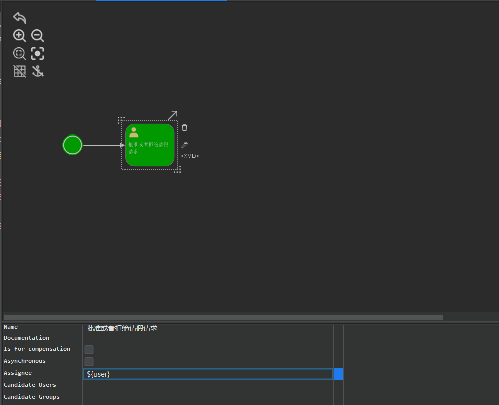
</div>

<br>

如果是字符串，直接写即可，例如，这个节点由一个名为 javaboy 的用户来处理，那么写法如下：

<div style="text-align:center">
  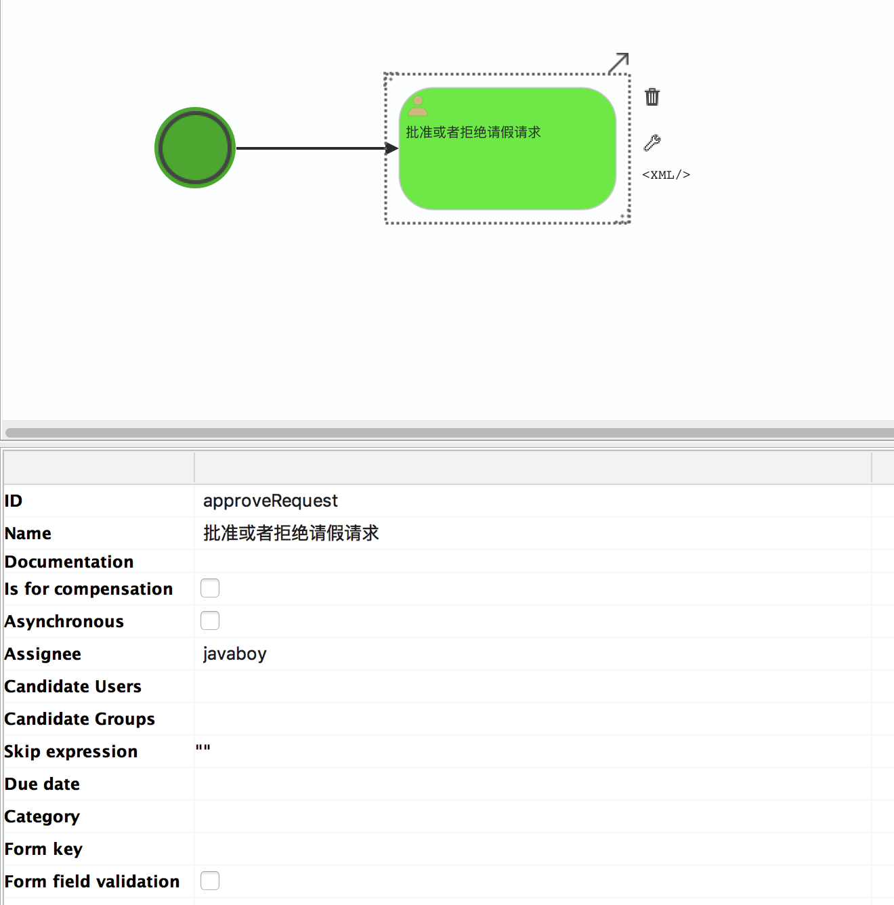
</div>

<br>

注意，从排他性网关出来的线条中，有一个 Condition expression，这个表示这个线条执行的条件。以下图为例，具体来说，就是当用户在审批的时候，本质上其实就是传递一个变量，变量值为 true 或者 false。下图中的 `${approve}`表示这个变量的名字为 approve。

<div style="text-align:center">
  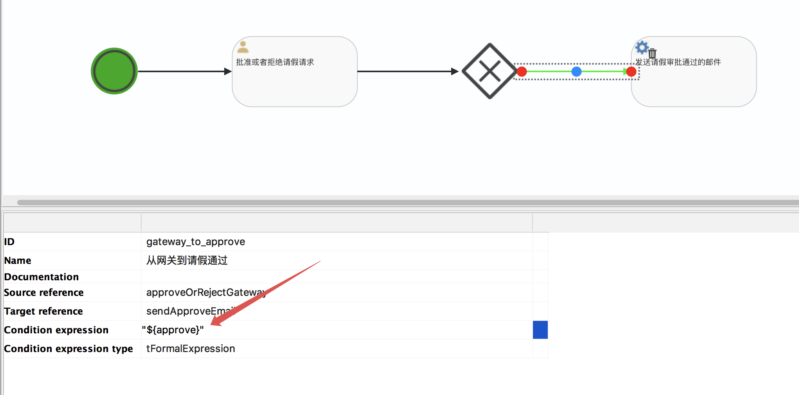
</div>

<br>

然后再来看发邮件的服务：

齿轮表示这是一个服务任务，也就是系统自动完成的，系统自动完成的方式有很多种，其中一种是提前将自己的业务逻辑在 Java 类中写好，然后这里配置一下类的完整路径即可。

<div style="text-align:center">
  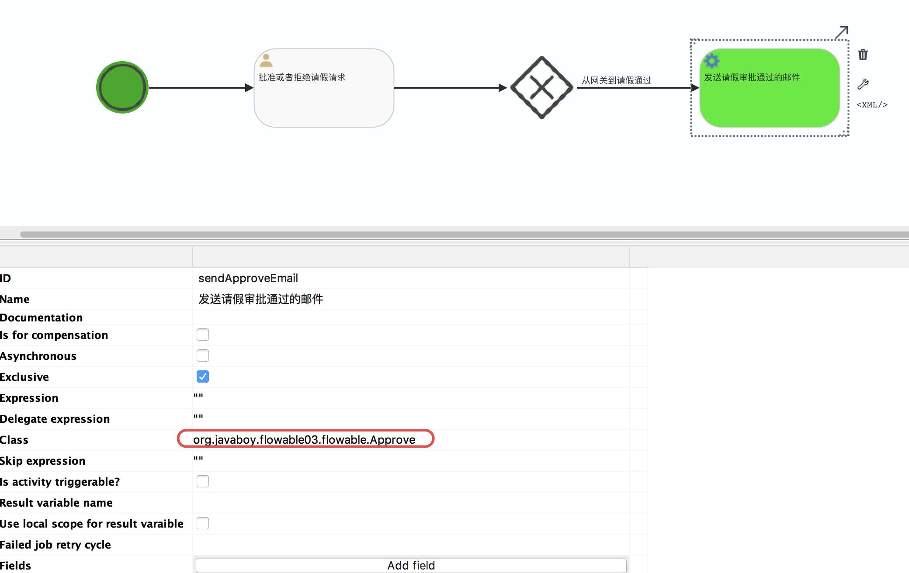
</div>

<br>

下图表示的是从网关出来之后，approve 变量如果为 false，那么就进入到请求被拒绝的服务中。

<div style="text-align:center">
  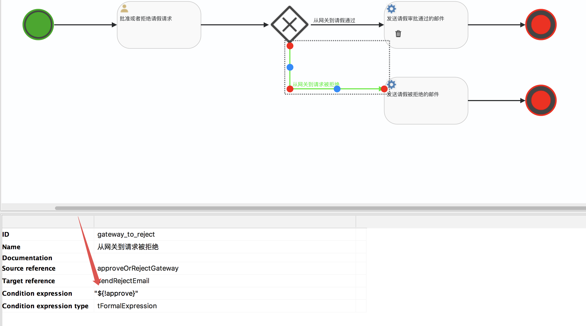
</div>

<br><br>

### flowable-ui 

这个是 Flowable 官方推荐的一个流程引擎辅助工具。

#### 安装

有两种方式：

官方提供的是一个 war 包，这个虽然是一个 war 包，但是除了将之扔到 Tomcat 中去运行之外，也可以直接执行 java -jar xxx.war 这个命令去启动这个 war 包。

war 下载地址：https://github.com/flowable/flowable-engine/releases/download/flowable-6.7.2/flowable-6.7.2.zip.   这个 zip 包下载之后，里边有一个 wars 文件夹，里边包含了 flowable-ui 的 war 包。然后，就像启动 Spring Boot 一样，直接启动这个 war 包即可：

文件位置：

<div style="text-align:center">
  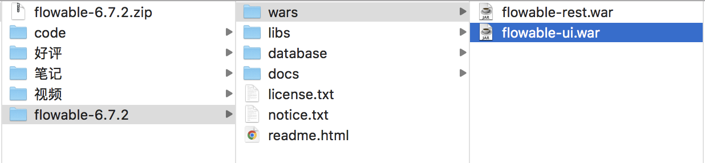
</div>

启动命令：

```shell
java -jar flowable-ui.war
```

<div style="text-align:center">
  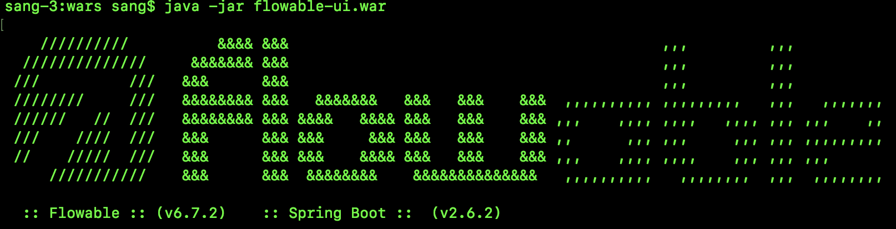
</div>

启动之后，默认的端口号是 8080。

启动之后，浏览器输入 http://localhost:8080/flowable-ui/idm/#/login.   如果看到如下页面，表示启动成功：

<div style="text-align:center">
  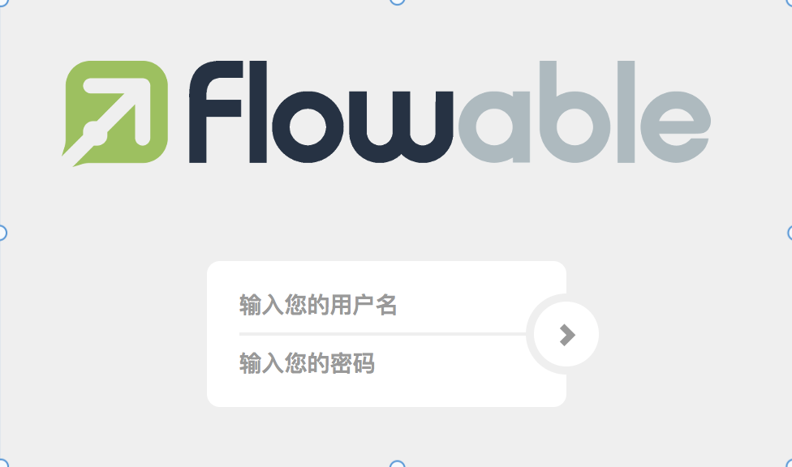
</div>

<br>


另外，我们也可以使用 docker 来安装，命令如下：

```shell
docker run -p 8086:8080 -d  flowable/flowable-ui
```

<div style="text-align:center">
  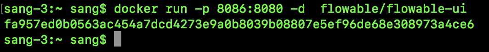
</div>


最后访问http://localhost:8086/flowable-ui

<br>

#### 登录

默认的登录用户名是 admin，默认的登录密码是 test。

看到如下页面，表示登录成功。

<div style="text-align:center">
  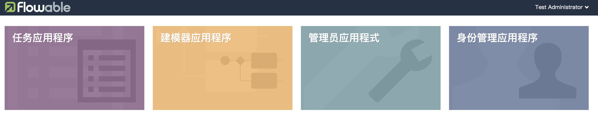
</div>

<br>

#### 功能模块

flowable-ui 是完整的 flowable 体验 DEMO，而不仅仅只是一个流程图的绘制工具。所以它里边不仅可以画流程图，还可以运行流程图，既然能够运行流程图，那么就需要身份管理。

1. 任务应用程序：我们绘制好的流程图，可以直接将之发布到一个应用中，然后在这里进行部署，这个模块其实就是这些部署的应用程序。
2. 建模器应用程序：这个专门用来画流程图的。
3. 管理员应用程序：这个主要用来管理应用，一些具有管理员权限的用户，可以通过这个功能模块去查询 BPMN、DMN、FORM 等等信息。
4. 身份管理应用程序：这个功能模块，为所有的 flowable-ui 应用程序提供一个单点登录功能，并且还可以为这些用户设置用户组、用户权限等。


#### 身份管理应用程序

创建用户流程：

<div style="text-align:center">
  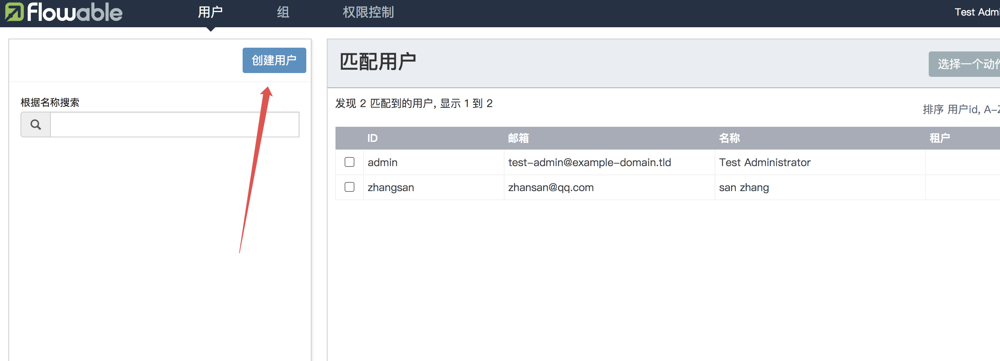
</div>

填入用户的基本信息，点击保存按钮，就可以完成用户的创建了。

<div style="text-align:center">
  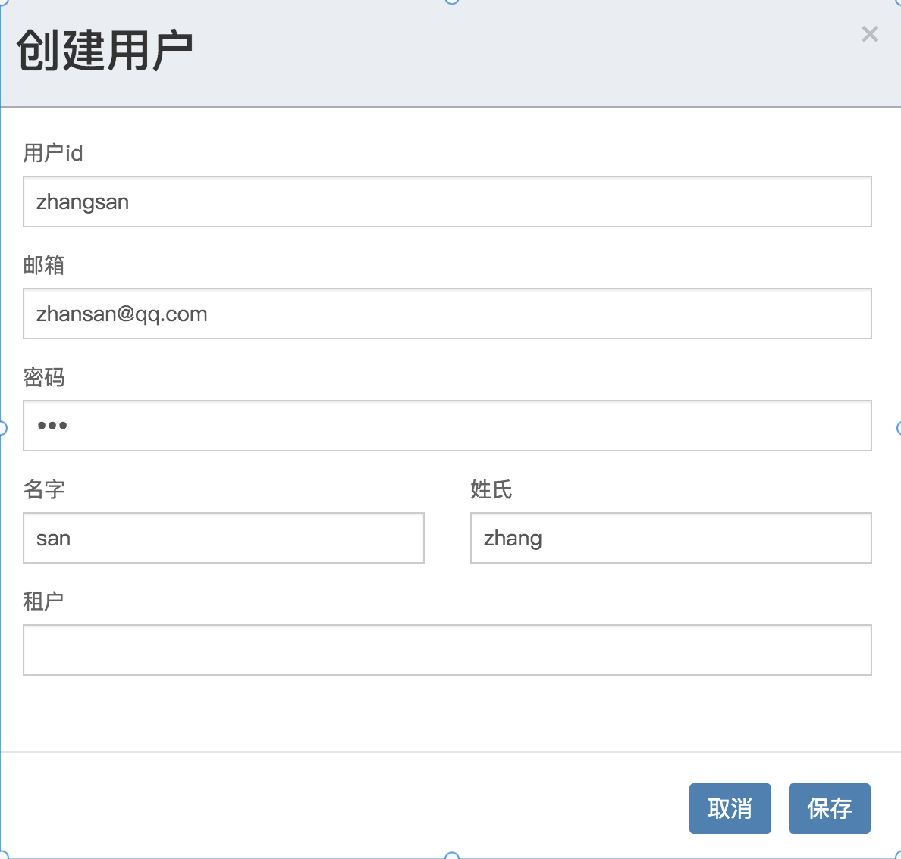
</div>

新建的用户不属于任何用户组，所以这个新建的用户是没有权限的，我们现在就可以使用这个新建的用户登录，但是登录成功后，看不到任何功能模块。

用户创建成功之后，可以点击上面的用户组功能，创建用户组：

<div style="text-align:center">
  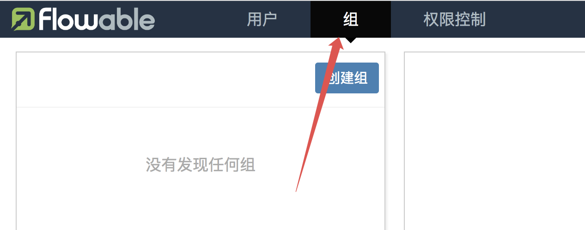
</div>

将来我们在画流程图的时候，可以设置某一个 UserTask 由某一个用户组来处理，这个用户组中的所有用户，将来都可以处理这个 UserTask。

组创建成功之后，可以为这个组添加用户：

<div style="text-align:center">
  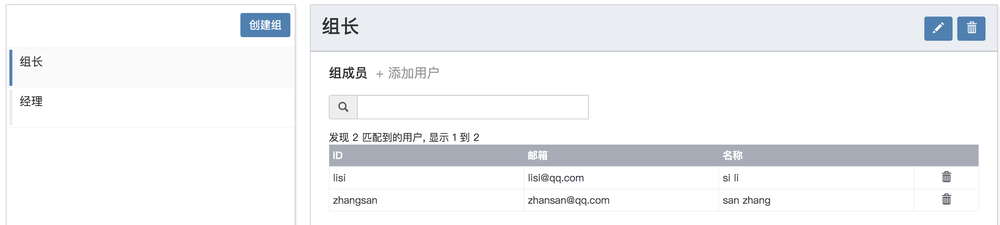
</div>

最后，我们可以在权限控制中，为用户或者用户组添加相应的权限。

<div style="text-align:center">
  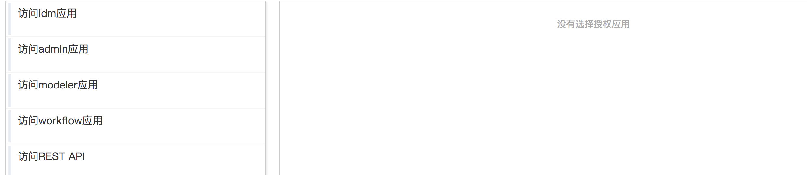
</div>

- 访问 idm 应用：访问功能4.
- 访问 admin 应用：访问功能3。
- 访问 modeler 应用：访问功能2.
- 访问 workflow 应用：访问功能1.
- 访问 REST API：访问 REST API 接口的。


<br>

#### 管理员应用程序

<div style="text-align:center">
  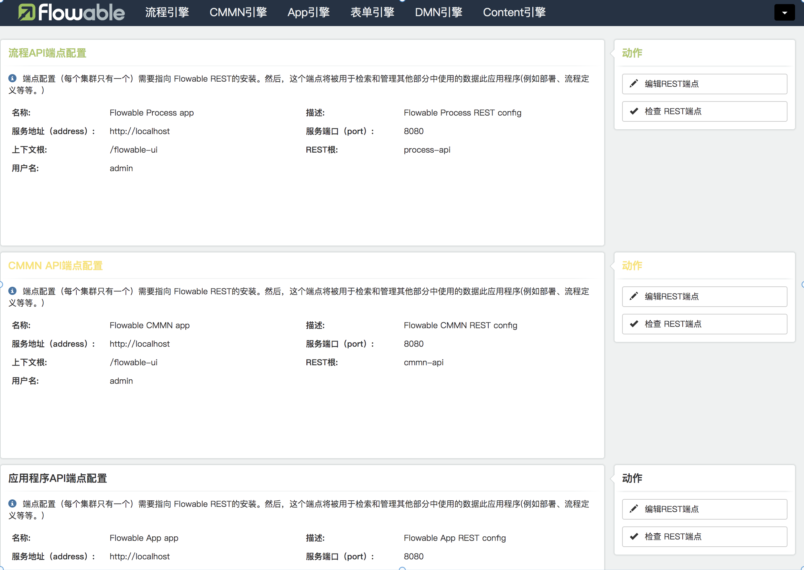
</div>


<br>

#### 建模器应用程序

核心功能，主要就是画流程图。

绘制一个报销流程图，大致流程：

1. 启动一个流程。
2. 执行一个用户任务，这个用户任务交给流程的启动人去执行。这个用户任务中，填入报销材料，例如用户名、金额、用途。
3. 系统自动判断一下/或者人工判断报销金额是否大于 1000。
4. 如果报销金额小于等于 1000，那么这个报销任务交给 组长审批：

1. 1. 组长审批通过，则流程结束。
   2. 组长审批不通过，则流程回到第 2 步，用户重新去填写报销资料。

1. 如果报销金额大于 1000，那么这个报销任务先交给经理审批：

1. 1. 经理审批通过，则交给 CEO 审批：

1. 1. 1. CEO 审批通过，流程结束。
      2. CEO 审批不通过，流程回到步骤 2 中。

1. 1. 经理审批不通过，则流程回到步骤 2 中。

##### 绘制流程

首先创建一个流程：

<div style="text-align:center">
  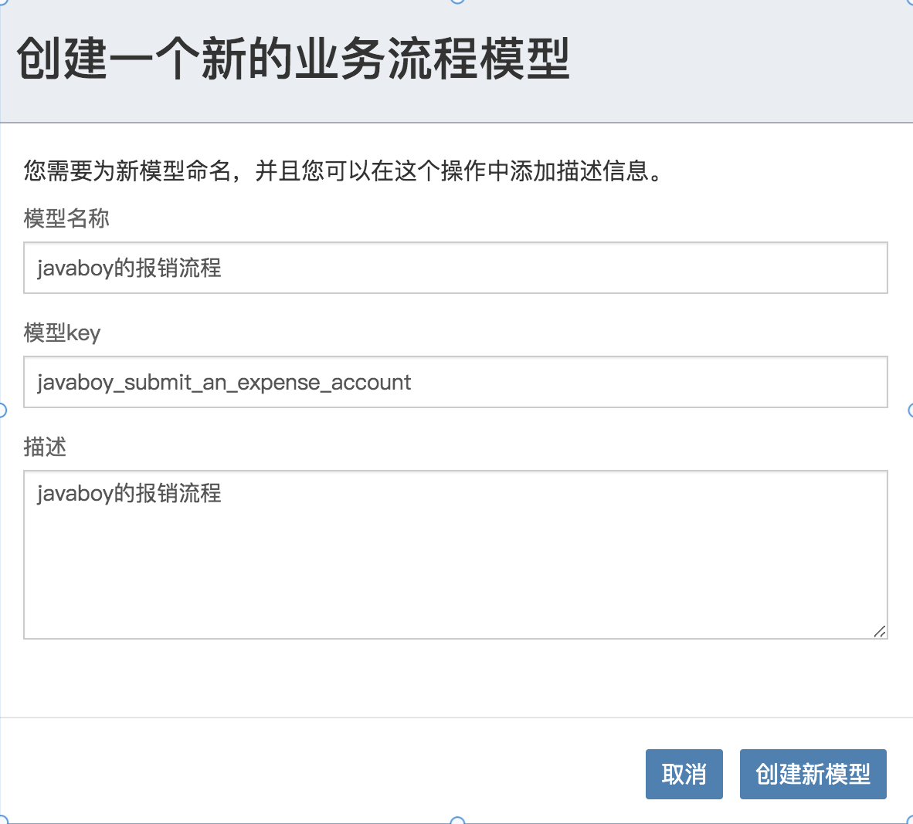
</div>

**注意，模型的 key 在当前应用中必须是唯一的，将来我们通过 Java 代码去操作这个模型的时候，就是通过模型 key 去识别这个模型。**

绘制出来的流程图：

<div style="text-align:center">
  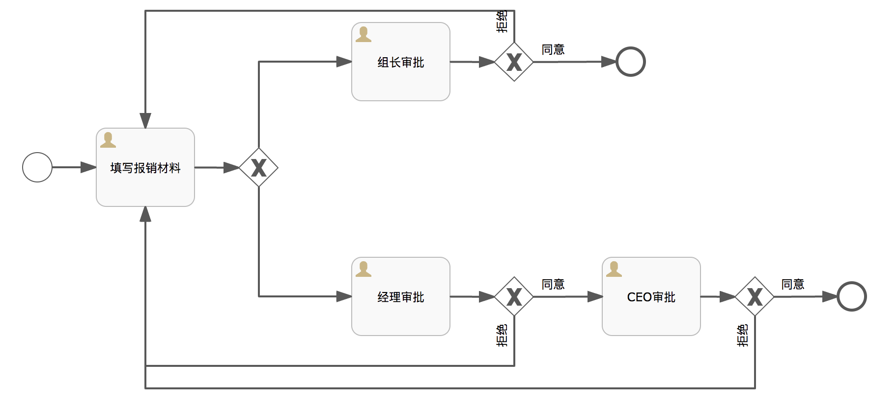
</div>

**注意，在一个流程图中，开始节点必须有且只有一个，结束节点可以有多个。**

##### 表单问题

在流程中，传递流程参数有两种方式：

- 流程变量。
- 表单。

这两种方式都可以传递参数，区别在于，流程变量是零散的，而表单是整的。

对于通过表单传递的参数，我们也可以按照流程变量的方式去访问单个的表单参数，例如在上面的流程图中，我们有 `${money <= 1000}`，这里的 money 实际上是表单中的参数，但是我们可以直接通过 $ 表达式去访问。还有如 `${managers_approve_or_reject_radio_button=="拒绝"}`，也是直接访问表单中的变量。

##### 任务处理人

对于一个 UserTask 而言，任务处理人有四种：

<div style="text-align:center">
  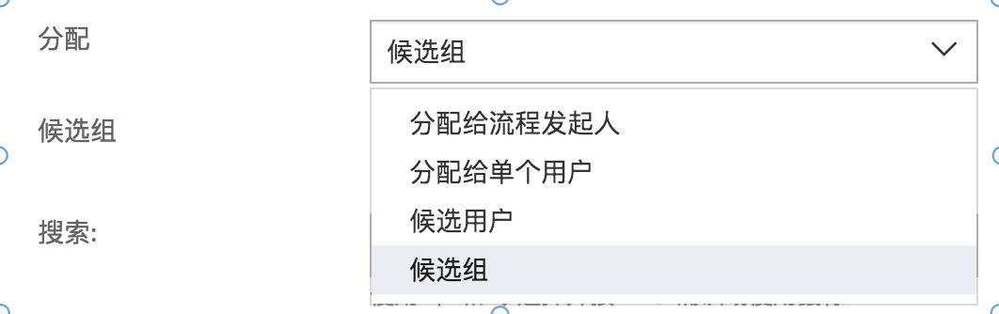
</div>

- 流程发起人，由流程的启动人/发起人来处理这个流程。
- 单个用户，直接指定某一个具体的用户来处理这个流程，注意这里只能指定一个用户，并且这个用户将来在处理任务的时候，不需要认领，直接就可以处理。
- 候选用户：可以同时指定多个用户来处理这个 UserTask，将来用户在处理的时候，需要先认领（Claim）任务，然后才能处理。
- 候选组：可以同时指定多个用户组来处理这个 UserTask，这个处理的时候，也需要先认领，再处理。

##### 基本概念

- 流程定义（ProcessDefinition）：我们绘制的流程图、流程的 XML 文件，就是我们的流程定义。
- 流程（ProcessInstance）：一个启动了流程实例就是一个流程，流程可以是已经执行完毕的，也可以是正在执行中的。流程的定义相当于是一个类，而流程则相当于是一个对象。
- 任务（Task）：一个 ProcessInstance 中，需要具体处理的节点就是一个任务。


<br>

#### 任务应用程序

在 flowable-ui 中，绘制好的流程图，可以直接部署称为一个 App。


# Flowable 源码编译

源码地址：https://github.com/flowable/flowable-engine
编译的步骤：
1clone 代码： git clone git@github.com:flowable/flowable-engine.gi

2切换分支 git checkout -b origin/6.7.2切换到 6.7.2 这个版本。

先来看下源码的目录结构：

- LICENSE：开源协议
- README.md：flowable 介绍文档。
- distro：主要是保存了不同环境下的信息。
- docker：将 flowable 构建成 docker 镜像的脚本。
- docs：flowable 的文档。
- ide-settings：这是如果想在 Eclipse 或者 IDEA 中快速使用 flowable 时候的配置。
- k8s：flowable 支持 k8s 的一些脚本和配置。
- modules：flowable 中所有的核心功能代码都在这个里边。
- pom.xml：maven 的坐标文件。

- qa：提供了很多各种各样的配置模版，例如如果我们需要在传统的 SSM 中配置 flowable，配置文件可以直接参考 qa 中的，但是我们现在主要是 Spring Boot 开发，在 Spring Boot 中，基本上用不到 qa 中的配置模版。
- scripts：这个目录下放了常用的脚本文件。
- tooling：这个目录中列出来了单元测试的模版。

项目编译要点：

1. 用 IDEA 打开项目。在 IDEA 中，直接 open 源码即可，不需要 Import Project。

2. 由于 IDEA 无法识别出所有的 Maven 工程，查看是否识别出来 Maven 工程的方式：（pom.xml 文件是蓝色的，或者工程名加粗了），如果有 IDEA 未识别出来的 Maven 工程，都需要挨个手动添加，添加方式就是打开项目的 pom.xml 文件，右键单击，选择 Add as Maven Project。
3. 对于 Maven 工程，IDEA 会自动去下载所需要的依赖，但是由于这里需要下载的依赖比较多，所以下载的时候比较费时间，耐心等一下。最终也有可能会下载失败：i：先去本地 Maven 仓库，搜索以 .lastupdated结尾的文件，并删除。

<div style="text-align:center">
  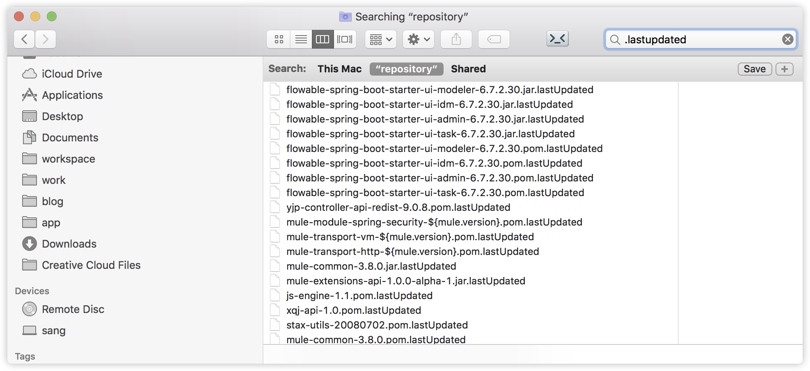
</div>
   2. 然后再去项目中，重新导入依赖。
<div style="text-align:center">
  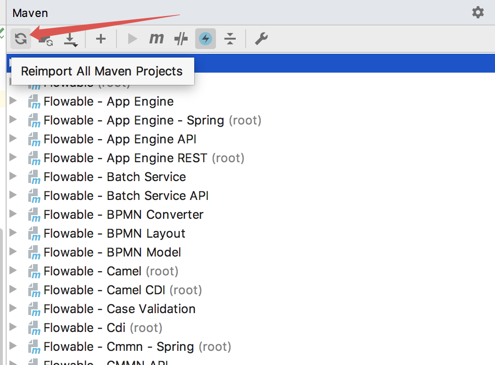
</div>

ii：如果前面步骤不管用，那么就去 settings.xml 文件中，修改远程仓库地址，切换为 阿里云或者华为云等提供的镜像站，**然后再重新导入。**

```xml
  <mirrors>
    <!-- mirror
     | Specifies a repository mirror site to use instead of a given repository. The repository that
     | this mirror serves has an ID that matches the mirrorOf element of this mirror. IDs are used
     | for inheritance and direct lookup purposes, and must be unique across the set of mirrors.
     |
    <mirror>
      <id>mirrorId</id>
      <mirrorOf>repositoryId</mirrorOf>
      <name>Human Readable Name for this Mirror.</name>
      <url>http://my.repository.com/repo/path</url>
    </mirror>
     -->
      <mirror>
      <id>alimaven</id>
      <name>aliyun maven</name>
      <url>http://maven.aliyun.com/nexus/content/groups/public/</url>
      <mirrorOf>central</mirrorOf>        
    </mirror>
  </mirrors>
```


### H2 数据库

1. Java 编写的数据库。
2. 可以基于内存来使用。
3. 也可以基于文件，基于文件，类似于移动端的 Sqlite。


# 简单使用

依赖

除去springboot的一些基本依赖外，还要有mysql驱动

```xml
 <dependency>
            <groupId>mysql</groupId>
            <artifactId>mysql-connector-java</artifactId>
            <scope>runtime</scope>
        </dependency> 
<dependency>
            <groupId>org.flowable</groupId>
            <artifactId>flowable-spring-boot-starter</artifactId>
            <version>6.7.2</version>
        </dependency>
```


配置

```properties
spring.datasource.username=root
spring.datasource.password=wqeq
spring.datasource.url=jdbc:mysql:///flowable_idm?serverTimezone=Asia/Shanghai&userSSL=false&nullCatalogMeansCurrent=true
server.port=8081
logging.level.org.flowable=debug
```


## 用户操作

事先准备号service类和log

```java
 /**
     * IdentityService 专门负责和用户相关的操作，例如添加、删除、修改用户和用户组等
     */
    @Autowired
    IdentityService identityService;
    private static final Logger logger = LoggerFactory.getLogger(FlowableIdmApplicationTests.class);
```


### 增

```java
 @Test
    void test01() {
        //创建一个用户对象
        UserEntityImpl user = new UserEntityImpl();
        user.setId("lcdzzz");
        user.setDisplayName("隆成");
        user.setEmail("1473220685@qq.com");
        user.setFirstName("mou");
        user.setLastName("zhou");
        user.setPassword("wqeq");
        //注意：如果是添加用户，一定要加revision属性为0，表示当前用户是一个新的用户 而不是更新的用户
        // flowable的用户表使用了乐观锁，而Revision字段其实就是配合乐观锁使用的
        user.setRevision(0);
        //保存一个用户
        //这里是有两方面的功能
        //1. 如果用户已经存在则更新
        //2. 如果用户不存在则添加
        identityService.saveUser(user);

    }
```


### 改

```java
/**
 * 更新用户信息
 * <p>
 * saveUser方法可以用来更新用户信息，但是不可以用来更新密码
 * 每更新一次，数据库的reversion会自增1
 */
@Test
void contextLoads() {
    UserEntityImpl user = new UserEntityImpl();
    user.setId("lcdzzz");
    user.setDisplayName("隆成典周");
    user.setEmail("6666@qq.com");
    //注意 修改的时候 需要确保reversion的版本号和数据库的版本号保持一致
    user.setRevision(2);
    identityService.saveUser(user);

}
```

 <br>

但是每次user.setRevision(2);是写死的，所以我们可以这么写

```java
@Test
void Test02() {
    User lcdzzz = identityService.createUserQuery().userId("lcdzzz").singleResult();
    lcdzzz.setEmail("123321@qq.com");
    identityService.saveUser(lcdzzz);
}
```

<br>

上面的方法无法连着密码一起更新，所以可以`updateUserPassword`

```java
@Test
void Test03() {
    User lcdzzz = identityService.createUserQuery().userId("lcdzzz").singleResult();
    lcdzzz.setEmail("123321@qq.com");
    lcdzzz.setPassword("888");
    //修改用户密码需要调用updateUserPassword这个方法，而且这个方法也能修改用户的其他属性
    identityService.updateUserPassword(lcdzzz);
}
```

<br><br>

### 删

```java
@Test
void Test04() {
    identityService.deleteUser("lcdzzz");
}
```


### 查

```java
@Test
void Test07() {
    List<User> email = identityService.createNativeUserQuery().sql("select * from ACT_ID_USER where EMAIL_=#{email}").parameter("email", "javaboy@qq.com").list();
    email.stream().forEach(i -> logger.info("id:{};display:{}", i.getId(), i.getDisplayName()));

}
@Test
void Test06() {
    //根据id排序，并查询所有用户
    List<User> list = identityService.createUserQuery().orderByUserId().desc().list();
    list.stream().forEach(i -> logger.info("id:{};display:{}", i.getId(), i.getDisplayName()));
}

@Test
void Test05() {
    List<User> list = identityService.createUserQuery().userDisplayName("%zhang%").list();
    list.stream().forEach(i -> logger.info("id:{};display:{}", i.getId(), i.getDisplayName()));
}
```


## 用户组操作

### 增

```java
/**
 *
 * 用户组操作的表是ACT_ID_GROUP
 *
 * 具体执行的SQL
 *
 * inserting: org.flowable.idm.engine.impl.persistence.entity.GroupEntityImpl@7bd694a5
 * ==>  Preparing: insert into ACT_ID_GROUP (ID_, REV_, NAME_, TYPE_) values ( ?, 1, ?, ? )
 * ==> Parameters: leader(String),  组长(String), null
 * <==    Updates: 1
 */
@Test
void Test08() {
    //添加用户组
    GroupEntityImpl g =new GroupEntityImpl();
    g.setName(" 组长");
    g.setId("leader");
    //和用户一样 组的信息也使用了乐观锁 所以记得加revision
    g.setRevision(0);
    identityService.saveGroup(g);

}
```


### 删

```java
/**
 * 根据 ID删除一个group
 *
 * 对应SQL
 *
 *  ==>  Preparing: delete from ACT_ID_MEMBERSHIP where GROUP_ID_ = ?
 *  ==> Parameters: leader(String)
 *  <==    Updates: 0
 *  ==>  Preparing: delete from ACT_ID_GROUP where ID_ = ? and REV_ = ?
 *  ==> Parameters: leader(String), 1(Integer)
 *  <==    Updates: 1
 *
 *  为什么有两个删除sql？
 *
 *  ACT_ID_MEMBERSHIP表保存的是 用户id和组id之间的关联关系。所以当删除一个用户组的时候，所以需要先删除组中的用户
 *
 *  第二个就是删除具体的用户组
 */
@Test
void Test09() {
   identityService.deleteGroup("leader");
}
```


### 改

就是给用户组添加用户

```java
 /**
     * 给用户组添加用户
     *
     * 对应的sql语句
     *
     * inserting: org.flowable.idm.engine.impl.persistence.entity.MembershipEntityImpl@5bba9949
     * ==>  Preparing: insert into ACT_ID_MEMBERSHIP (USER_ID_, GROUP_ID_) values ( ?, ? )
     * ==> Parameters: zhangsan(String), leader(String)
     * <==    Updates: 1
     */
    @Test
    void Test10() {
        String groupId="leader";
        String userId="zhangsan";
        //添加用户和用户之间的关联关系
        //注意 表的底层使用了外键 所以这里需要确保传递的参数都是真实存在的
        identityService.createMembership(userId,groupId);
    }
```

<br>

修改用户组：将managers这个用户的name改成CEO

```java
 /**
     * 修改用户组：将managers这个用户的name改成CEO
     * <p>
     * 跟之前user的更新一样，更新之前先查询，否则revision可能不对，会导致更新失败
     * <p>
     * sql语句：
     * ==>  Preparing: update ACT_ID_GROUP SET REV_ = ?, NAME_ = ?, TYPE_ = ? where ID_ = ? and
     * ==> Parameters: 2(Integer), CEO(String), null, managers(String), 1(Integer)
     * <==    Updates: 1
     * <p>
     * 这个sql中 我们可以看出乐观锁的具体使用方式，先查出来一个Group，revision为1 然后更新的时候将revision设置为2 ，
     * 但是在更新条件中，revision还是使用1
     * 这样我们更新的时候 就可以确保我们更新之前 这条记录没有被人更新过（如果被人更新过，则这条记录的revision就变成2了，本次更新就会失败）
     */
    @Test
    void Test11() {
        //注意：更新之前先查询，因为上了乐观锁
        Group managers = identityService.createGroupQuery().groupId("managers").singleResult();
        managers.setName("CEO");
        identityService.saveGroup(managers);
    }
```

<br>

### 查

查询用户组：根据用户组名称去查询，注意的是，用户组名称不唯一

```java
/**
 * 查询用户组：根据用户组名称去查询，注意的是，用户组名称不唯一
 * <p>
 * 对应的SQL如下：
 * <p>
 * ==>  Preparing: SELECT RES.* from ACT_ID_GROUP RES WHERE RES.NAME_ = ? order by RES.ID_ asc
 * ==> Parameters: CEO(String)
 * <==      Total: 1
 */
@Test
void Test12() {
    List<Group> ceo = identityService.createGroupQuery().groupName("CEO").list();
    for (Group group : ceo) {
        logger.info("id:{},name:{}", group.getId(), group.getName());
    }
}
```

<br>

按照用户组的用户去查询  这个需要多表联合查询  下面案例  查询包含zhangsan这个用户的用户组

```java
/**
     * 按照用户组的用户去查询  这个需要多表联合查询  下面案例  查询包含zhangsan这个用户的用户组
     * <p>
     * 对应SQL
     * <p>
     * ==> Preparing: SELECT RES.* from ACT_ID_GROUP RES WHERE exists(select 1 from ACT_ID_MEMBERSHIP M where M.GROUP_ID_ = RES.ID_ and M.USER_ID_ = ?) order by RES.ID_ asc
     * ==> Parameters: zhangsan(String)
     * <==       Total: 1
     */
    @Test
    void Test13() {
        List<Group> list = identityService.createGroupQuery().groupMember("zhangsan").list();
        for (Group group : list) {
            logger.info("id:{},name:{}", group.getId(), group.getName());
        }
    }
```

<br>

自定义查询SQL

```java
/**
     * 自定义查询SQL
     */
    @Test
    void Test14() {
        /**
         * ==>  Preparing: select * from ACT_ID_PROPERTY
         * ==> Parameters:
         * <==      Total: 1
         */
        List<Group> list = identityService.createNativeGroupQuery().sql("SELECT RES.* from ACT_ID_GROUP RES WHERE exists(select 1 from ACT_ID_MEMBERSHIP M where M.GROUP_ID_ = RES.ID_ and M.USER_ID_ = #{userId}) order by RES.ID_ asc").
                parameter("userId", "zhangsan").list();
        for (Group group : list) {
            logger.info("id:{},name:{}", group.getId(), group.getName());

        }
    }

```

<br>

查询系统信息或表信息等

```java
@Test
    void Test15() {
        //查询系统信息 本质上是查询ACT_ID_PROPERTY
        Map<String, String> properties = idmManagementService.getProperties();
        Set<String> key = properties.keySet();
        for (String s : key) {
            logger.info("key:{};value:{}",s,properties.get(s));
        }

        //查询实体类对应的表名称
        String tableName = idmManagementService.getTableName(Group.class);
        logger.info("tableName:{}",tableName);
        //获取表的详细信息
        TableMetaData tableMetaData = idmManagementService.getTableMetaData(tableName);
        logger.info("列名{}",tableMetaData.getColumnNames());
        logger.info("列的类型{}",tableMetaData.getColumnTypes());
        logger.info("表名{}",tableMetaData.getColumnTypes());
    }
```

<br><br><br>

# 流程定义与流程实例

1. 流程定义
   在使用 flowable 的时候，我们首先需要画一个流程图，要在我们的代码中使用流程图，就必须先把流程图部署到项目中。加载到系统中的流程图，就是流程定义：ProcessDefinition。
2. 流程实例
   我们启动的每一个具体的流程，就是一个流程实例 ProcessInstance。
   ProcessDefinition 相当于 Java 中的类，ProcessInstance 则相当于根据这个类创建出来的对象。

在 Flowable 中，所有跟流程部署相关的表，都是以 ACT_RE_前缀开始的。


## 流程定义 ProcessDefinition

### 自动部署

在 Spring Boot 中，凡是放在 resources/processes 目录下的流程文件，默认情况下，都会被自动部署。

创建 Spring Boot 项目，添加 flowable 依赖，并配置 application.properties：

```properties
spring.datasource.username=root
spring.datasource.password=wqeq
spring.datasource.url=jdbc:mysql:///flowable_process?serverTimezone=Asia/Shanghai&useSSL=false&nullCatalogMeansCurrent=true

logging.level.org.flowable=debug
```

任意绘制一个流程图，放到 resources/processes 目录下：

<div style="text-align:center">
  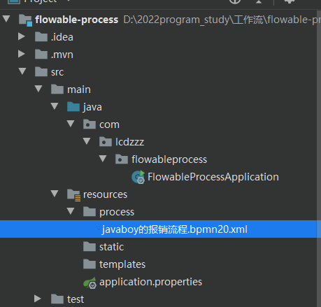
</div>

<br>

启动 Spring Boot 项目，启动之后，这个流程就被自动部署了。

`ACT_RE_DEPLOYMENT`和 `ACT_RE_PROCDEF`分别保存了流程定义相关的信息。`ACT_GE_BYTEARRAY`表则保存了刚刚定义的流程的 XML 文件以及根据这个 XML 文件所自动生成的流程图。

三张表的关系：

- `ACT_RE_DEPLOYMENT`和 `ACT_RE_PROCDEF`是一对一的关系。
- `ACT_RE_DEPLOYMENT`和`ACT_GE_BYTEARRAY`是一对多的关系，一个流程部署 ID 对应两条`ACT_GE_BYTEARRAY`表中的记录（默认）。

流程 部署好之后，如果想要修改，可以直接修改，修改之后，流程会自动升级（数据库中的记录会自动更新）。

举个例子：

> 假设我们现在修改了流程定义的名字，然后重新启动 Spring Boot 项目，那么 `ACT_RE_DEPLOYMENT` 表中会增加一条部署记录，同时 `ACT_RE_PROCDEF` 表也会增加一条新的流程定义信息，新的流程信息中，该变的字段会自动变，同时版本号 `VERSION_`会自增 1。`ACT_GE_BYTEARRAY` 表中也会新增两条记录，和最新的版本号的定义相对应。


**注意：流程图的更新，主要是以流程定义的 id 为依据，如果流程定义的内容发生变化，但是流程 id 没有变，则流程定义升级；如果流程图定义的 id 发生变化，则直接重新部署新的流程。**

<br>

在流程的定义中，XML 文件中的 `targetNamespace`属性，其实就是流程的分类定义：

```xml
<definitions xmlns="http://www.omg.org/spec/BPMN/20100524/MODEL" xmlns:xsi="http://www.w3.org/2001/XMLSchema-instance" xmlns:xsd="http://www.w3.org/2001/XMLSchema" xmlns:flowable="http://flowable.org/bpmn" xmlns:bpmndi="http://www.omg.org/spec/BPMN/20100524/DI" xmlns:omgdc="http://www.omg.org/spec/DD/20100524/DC" xmlns:omgdi="http://www.omg.org/spec/DD/20100524/DI" typeLanguage="http://www.w3.org/2001/XMLSchema" expressionLanguage="http://www.w3.org/1999/XPath" targetNamespace="http://www.flowable.org/processdef" exporter="Flowable Open Source Modeler" exporterVersion="6.7.2">
  <process id="javaboy_submit_an_expense_account2" name="javaboy的报销流程2" isExecutable="true">
    <documentation>javaboy的报销流程</documentation>
    <startEvent id="startEvent1" flowable:formFieldValidation="true"></startEvent>
    <userTask id="sid-71C33AD7-E892-4037-AFBB-464957E41378" name="填写报销材料" flowable:assignee="$INITIATOR" flowable:formKey="submit_an_expense_account" flowable:formFieldValidation="true">
      <extensionElements>
        <modeler:activiti-idm-initiator xmlns:modeler="http://flowable.org/modeler"><![CDATA[true]]></modeler:activiti-idm-initiator>
      </extensionElements>
    </userTask>
```

如果想要修改流程定义的分类，直接修改该属性即可。

Spring Boot 中，关于流程定义的几个重要属性：

```properties
# 是否在项目启动的时候，自动去检查流程定义目录下是否有对应的流程定义文件，如果这个属性为 true（默认既此），就表示去检查，否则不检查（意味着不会自动部署流程）
flowable.check-process-definitions=true
# 设置流程定义文件的位置，默认位置就是 classpath*:/processes/
flowable.process-definition-location-prefix=classpath*:/javaboy/
# 这个是指定流程定义 XML 文件的后缀，默认后缀有两个：**.bpmn20.xml,**.bpmn
flowable.process-definition-location-suffixes=**.bpmn20.xml,**.bpmn
```


### 手动部署

#### 手动部署

项目启动成功之后，再去部署流程。

首先，定义一个返回实体类model

```java
/**
省略有参构造 无参构造函数 和getset方法
*/
public class RespBean {
    private Integer status;
    private String msg;
    private Object data;

    public static RespBean ok(String msg,Object data){
        return new RespBean(200,msg,data);
    }
    public static RespBean ok(String msg){
        return new RespBean(200,msg,null);
    }

    public static RespBean error(String msg,Object data){
        return new RespBean(500,msg,data);
    }
    public static RespBean error(String msg){
        return new RespBean(500,msg,null);
    }
```


手动部署流程接口如下：

```java
/**
 * 这个是我自定义的流程部署接口
 */
@RestController
public class ProcessDeployController {
    //RepositoryService 这个实体类可以用来操作 ACT_RE_XXX 这种表
    @Autowired
    RepositoryService repositoryService;

    /**
     * 这个就是我的流程部署接口，流程部署将来要上传一个文件，这个文件就是流程的 XML 文件
     *
     * @param file
     * @return
     */
    @PostMapping("/deploy")
    public RespBean deploy(MultipartFile file) throws IOException {
        DeploymentBuilder deploymentBuilder = repositoryService
                //开始流程部署的构建
                .createDeployment()
                .name("JAVABOY的工作流")//ACT_RE_DEPLOYMENT 表中的 NAME_ 属性
                .category("我的流程分类")//ACT_RE_DEPLOYMENT 表中的 CATEGORY_ 属性
                .key("我的自定义的工作流的 KEY")//ACT_RE_DEPLOYMENT 表中的 KEY_ 属性
                //也可以用这个方法代替 addInputStream，但是注意，这个需要我们自己先去解析 IO 流程，将 XML 文件解析为一个字符串，然后就可以调用这个方法进行部署了
//                .addString()
                //设置文件的输入流程，将来通过这个输入流自动去读取 XML 文件
                .addInputStream(file.getOriginalFilename(), file.getInputStream());
        //完成项目的部署
        Deployment deployment = deploymentBuilder.deploy();
        return RespBean.ok("部署成功", deployment.getId());
    }

    @PostMapping("/deploy2")
    public RespBean deploy2(MultipartFile file) throws IOException {
        ByteArrayOutputStream baos = new ByteArrayOutputStream();
        int len;
        byte[] buf = new byte[1024];
        InputStream is = file.getInputStream();
        while ((len = is.read(buf)) != -1) {
            baos.write(buf, 0, len);
        }
        is.close();
        DeploymentBuilder deploymentBuilder = repositoryService
                //开始流程部署的构建
                .createDeployment()
                .name("JAVABOY的工作流")//ACT_RE_DEPLOYMENT 表中的 NAME_ 属性
                .category("我的流程分类")//ACT_RE_DEPLOYMENT 表中的 CATEGORY_ 属性
                .key("我的自定义的工作流的 KEY")//ACT_RE_DEPLOYMENT 表中的 KEY_ 属性
                //也可以用这个方法代替 addInputStream，但是注意，这个需要我们自己先去解析 IO 流程，将 XML 文件解析为一个字符串，然后就可以调用这个方法进行部署了
//                .addString()
                //设置文件的输入流程，将来通过这个输入流自动去读取 XML 文件
//                .addInputStream(file.getOriginalFilename(), file.getInputStream());
                //注意这里需要设置资源名称，这个资源名称不能随意取值，建议最好和文件名保持一致
                .addBytes(file.getOriginalFilename(), baos.toByteArray());
        //完成项目的部署
        Deployment deployment = deploymentBuilder.deploy();
        return RespBean.ok("部署成功", deployment.getId());
    }
}
```

<br>

#### 查询流程定义

查询所有的流程定义：

```java
@SpringBootTest
public class ActReTest {
    @Autowired
    RepositoryService repositoryService;
    private static final Logger logger = LoggerFactory.getLogger(ActReTest.class);

    /**
     * 查询流程定义
     *
     * 对应的 SQL 如下：
     *
     * : ==>  Preparing: SELECT RES.* from ACT_RE_PROCDEF RES order by RES.ID_ asc
     * : ==> Parameters:
     * : <==      Total: 2
     */
    @Test
    void test01() {
        //查询所有定义的流程
        List<ProcessDefinition> list = repositoryService.createProcessDefinitionQuery().list();
        for (ProcessDefinition pd : list) {
            logger.info("id:{},name:{},version:{},category:{}",pd.getId(),pd.getName(),pd.getVersion(),pd.getCategory());
        }
    }
}
```

<br>

查询所有流程的最新版本：

```java
/**
 * 查询所有流程的最新版本
 * 
 * 对应的 SQL：
 * 
 * : ==>  Preparing: SELECT RES.* from ACT_RE_PROCDEF RES WHERE RES.VERSION_ = (select max(VERSION_) from ACT_RE_PROCDEF where KEY_ = RES.KEY_ and ( (TENANT_ID_ IS NOT NULL and TENANT_ID_ = RES.TENANT_ID_) or (TENANT_ID_ IS NULL and RES.TENANT_ID_ IS NULL) ) ) order by RES.ID_ asc
 * : ==> Parameters: 
 * : <==      Total: 1
 */
@Test
void test02() {
    List<ProcessDefinition> list = repositoryService.createProcessDefinitionQuery()
            //设置查询流程定义的最新版本
            .latestVersion()
            .list();
    for (ProcessDefinition pd : list) {
        logger.info("id:{},name:{},version:{},category:{}",pd.getId(),pd.getName(),pd.getVersion(),pd.getCategory());
    }
}


```
<br>

根据流程定义的 key 去查询

```java
/**
 * 根据流程定义的 key 去查询
 * 
 * : ==>  Preparing: SELECT RES.* from ACT_RE_PROCDEF RES WHERE RES.KEY_ = ? order by RES.VERSION_ desc
 * : ==> Parameters: javaboy_submit_an_expense_account(String)
 * : <==      Total: 2
 * 
 */
@Test
void test03() {
    List<ProcessDefinition> list = repositoryService.createProcessDefinitionQuery()
            //根据流程定义的 XML 文件中的 id 去查询一个流程，注意，XML 文件中的 id 对应 ACT_RE_PROCDEF 表中的 KEY_
            .processDefinitionKey("javaboy_submit_an_expense_account")
            //按照版本号排序
            .orderByProcessDefinitionVersion()
            .desc()
            .list();
    for (ProcessDefinition pd : list) {
        logger.info("id:{},name:{},version:{},category:{}",pd.getId(),pd.getName(),pd.getVersion(),pd.getCategory());
    }
}
```

<br>

自定义查询

```java
/**
 * 根据流程定义的 key 去查询
 */
@Test
void test04() {
    List<ProcessDefinition> list = repositoryService.createNativeProcessDefinitionQuery()
            .sql("SELECT RES.* from ACT_RE_PROCDEF RES WHERE RES.KEY_ = #{key} order by RES.VERSION_ desc")
            .parameter("key","javaboy_submit_an_expense_account")
            .list();
    for (ProcessDefinition pd : list) {
        logger.info("id:{},name:{},version:{},category:{}",pd.getId(),pd.getName(),pd.getVersion(),pd.getCategory());
    }
}
```

#### 查询流程部署

```java
/**
 * 查询流程部署信息，本质上就是查询 ACT_RE_DEPLOYMENT 表
 *
 * : ==>  Preparing: SELECT RES.* from ACT_RE_DEPLOYMENT RES order by RES.ID_ asc
 * : ==> Parameters: 
 * : <==      Total: 2
 */
@Test
void test05() {
    List<Deployment> list = repositoryService.createDeploymentQuery().list();
    for (Deployment d : list) {
        logger.info("id:{},category:{},,name:{},key:{}",d.getId(),d.getCategory(),d.getName(),d.getKey());
    }
}
```

<br>

根据流程部署的分类名称去查询：

```java
/**
 * 根据流程部署的分类，去查询流程部署信息
 * 
 * : ==>  Preparing: SELECT RES.* from ACT_RE_DEPLOYMENT RES WHERE RES.CATEGORY_ = ? order by RES.ID_ asc
 * : ==> Parameters: 我的流程分类(String)
 * : <==      Total: 2
 * 
 */
@Test
void test06() {
    List<Deployment> list = repositoryService.createDeploymentQuery()
            //根据流程部署的分类去查询
            .deploymentCategory("我的流程分类")
            .list();
    for (Deployment d : list) {
        logger.info("id:{},category:{},,name:{},key:{}",d.getId(),d.getCategory(),d.getName(),d.getKey());
    }
}
```

<br>

根据流程部署信息，查询流程定义信息：

```java
/**
 * 根据流程部署的 ID 去查询流程定义
 * 
 * : ==>  Preparing: SELECT RES.* from ACT_RE_DEPLOYMENT RES order by RES.ID_ asc
 * : ==> Parameters: 
 * : <==      Total: 2
 * : Flushing dbSqlSession
 * : flush summary: 0 insert, 0 update, 0 delete.
 * : now executing flush...
 * : --- DeploymentQueryImpl finished --------------------------------------------------------
 * : --- starting ProcessDefinitionQueryImpl --------------------------------------------------------
 * : Running command with propagation REQUIRED
 * : Operation class org.flowable.engine.impl.interceptor.CommandInvoker$1 added to agenda
 * : Executing operation class org.flowable.engine.impl.interceptor.CommandInvoker$1
 * : ==>  Preparing: SELECT RES.* from ACT_RE_PROCDEF RES WHERE RES.DEPLOYMENT_ID_ = ? order by RES.ID_ asc
 * : ==> Parameters: 9a5d421d-3c95-11ed-99f7-acde48001122(String)
 * : <==      Total: 1
 * : Flushing dbSqlSession
 * : flush summary: 0 insert, 0 update, 0 delete.
 * : now executing flush...
 * : --- ProcessDefinitionQueryImpl finished --------------------------------------------------------
 * : id:9b09aec0-3c95-11ed-99f7-acde48001122,name:javaboy的报销流程,version:1,category:http://www.flowable.org/processdef
 * : --- starting ProcessDefinitionQueryImpl --------------------------------------------------------
 * : Running command with propagation REQUIRED
 * : Operation class org.flowable.engine.impl.interceptor.CommandInvoker$1 added to agenda
 * : Executing operation class org.flowable.engine.impl.interceptor.CommandInvoker$1
 * : ==>  Preparing: SELECT RES.* from ACT_RE_PROCDEF RES WHERE RES.DEPLOYMENT_ID_ = ? order by RES.ID_ asc
 * : ==> Parameters: a31bea4a-3c96-11ed-9ebe-acde48001122(String)
 * : <==      Total: 1
 * : Flushing dbSqlSession
 * : flush summary: 0 insert, 0 update, 0 delete.
 * : now executing flush...
 * : --- ProcessDefinitionQueryImpl finished --------------------------------------------------------
 * : id:a3d7e74d-3c96-11ed-9ebe-acde48001122,name:javaboy的报销流程666,version:2,category:http://www.flowable.org/processdef
 * 
 */
@Test
void test07() {
    List<Deployment> list = repositoryService.createDeploymentQuery().list();
    for (Deployment d : list) {
        List<ProcessDefinition> list1 = repositoryService.createProcessDefinitionQuery().deploymentId(d.getId()).list();
        for (ProcessDefinition pd : list1) {
            logger.info("id:{},name:{},version:{},category:{}", pd.getId(), pd.getName(), pd.getVersion(), pd.getCategory());
        }
    }
}
```

<br>

自定义流程部署查询 SQL：

```java
/**
 * 也可以自定义流程部署的查询 SQL
 */
@Test
void test08() {
    List<Deployment> list = repositoryService.createNativeDeploymentQuery()
            .sql("SELECT RES.* from ACT_RE_DEPLOYMENT RES WHERE RES.CATEGORY_ = #{category} order by RES.ID_ asc")
            .parameter("category","我的流程分类")
            .list();
    for (Deployment d : list) {
        logger.info("id:{},category:{},,name:{},key:{}",d.getId(),d.getCategory(),d.getName(),d.getKey());
    }
}
```

<br><br>


#### 流程定义删除

这个删除操作，涉及到流程定义的表，都会被删除掉。

```java
/**
 * 删除一个流程部署
 */
@Test
void test09() {
    List<Deployment> list = repositoryService.createDeploymentQuery().list();
    for (Deployment deployment : list) {
        repositoryService.deleteDeployment(deployment.getId());
    }
}
```

<br><br>

## 流程实例 Process Instance

两个概念：

1. 流程实例：ProcessInstance：通过流程定义启动的一个流程，这个启动后的流程就是流程实例，这个表示一个流程从开始到结束的最大流程分支，**在一个流程中，只存在一个流程实例（执行实例可能有多个）**，前面说的流程定义相当于是 Java 类，这里的流程实例相当于是 Java 对象。
2. 执行实例：Execution：简单来说，在一个流程中，开始节点和结束节点是流程实例，其余节点是执行实例。从类的继承关系来说，ProcessInstance 实际上是 Execution 的子类，所以，流程实例可以算是执行实例的一种特殊情况。

1. 1. 如果一个流程图中，只有一条线，那么一般来说，流程实例和执行实例就不同。
   2. 如果一个流程图中，包含多条线，那么每一条线就是一个执行实例。

### 启动流程

启动流程方式如下：

```java
@SpringBootTest
public class ActRuTest {

    //跟流程运行相关的操作，都在这个 Bean 中，在 Spring Boot 中，该 Bean 已经配置好，可以直接使用
    @Autowired
    RuntimeService runtimeService;
    private static final Logger logger = LoggerFactory.getLogger(ActRuTest.class);

    @Test
    void test01() {
        //设置流程的发起人
        Authentication.setAuthenticatedUserId("wangwu");
        //这个流程定义的 key 实际上就是流程 XML 文件中的流程 id
        String processDefinitionKey = "leave";
        //流程启动成功之后，可以获取到一个流程实例
        ProcessInstance pi = runtimeService.startProcessInstanceByKey(processDefinitionKey);
        logger.info("definitionId:{},id:{},name:{}", pi.getProcessDefinitionId(), pi.getId(), pi.getName());
        //也可以通过流程定义的 id 去启动一个流程，但是需要注意，流程定义的 id 需要自己去查询，这个 id 并不是 XML 文件中定义的流程 ID
//        String processDefinitionId = "";
//        runtimeService.startProcessInstanceById(processDefinitionId);
    }
}
```

<br>

当一个流程启动成功后，我们首先去查看 `ACT_RU_EXECUTION`表，该表中保存了所有的流程执行实例信息，包括启动节点以及其他的任务节点信息都保存在这个表中。同时，如果这个节点，还是一个 UserTask，那么这个节点的信息还会保存在 `ACT_RU_TASK`表中（该表用来保存 UserTask）。

另外还有 `ACT_RU_ACTINST`表中，会保存流程活动的执行情况。

当然，无论哪张表，只要流程执行结束，`ACT_RU_`相关的表中的数据都会被删除。

**另外一种启动方式**

```java

@SpringBootTest
public class ActRuTest {

    //跟流程运行相关的操作，都在这个 Bean 中，在 Spring Boot 中，该 Bean 已经配置好，可以直接使用
    @Autowired
    RuntimeService runtimeService;
    private static final Logger logger = LoggerFactory.getLogger(ActRuTest.class);


    @Autowired
    IdentityService identityService;

    @Autowired
    RepositoryService repositoryService;
    /**
     * 另外一种流程启动的例子和流程发起人设置的例子
     */
    @Test
    void test02() {
        //设置流程的发起人
        identityService.setAuthenticatedUserId("wangwu");
        //查询最新版本的 leave 流程的定义信息
        ProcessDefinition pd = repositoryService.createProcessDefinitionQuery().processDefinitionKey("leave").latestVersion().singleResult();
        //也可以通过流程定义的 id 去启动一个流程，但是需要注意，流程定义的 id 需要自己去查询，这个 id 并不是 XML 文件中定义的流程 ID
        ProcessInstance pi = runtimeService.startProcessInstanceById(pd.getId());
        logger.info("definitionId:{},id:{},name:{}", pi.getProcessDefinitionId(), pi.getId(), pi.getName());
    }


```

<br>

接下来，根据用户名去查询每一个用户需要处理的流程，并处理：

```java
/**
 * 查询 wangwu 需要执行的任务，并处理
 *
 * 查询 wangwu 需要处理的任务，对应的 SQL：
 *
 * : ==>  Preparing: SELECT RES.* from ACT_RU_TASK RES WHERE RES.ASSIGNEE_ = ? order by RES.ID_ asc
 * : ==> Parameters: wangwu(String)
 * : <==      Total: 1
 *
 * wangwu 去处理任务：
 *
 * 首先去 ACT_RU_TASK 表中添加一条记录，这个新的记录，就是主管审批。
 * 然后从 ACT_RU_TASK 表中删除掉之前的需要 wangwu 完成的记录。
 *
 * 上面这两个操作是在同一个事务中完成的。
 *
 */
@Test
void test03() {
    List<Task> list = taskService.createTaskQuery().taskAssignee("javaboy").list();
    for (Task task : list) {
        logger.info("id:{},assignee:{},name:{}",task.getId(),task.getAssignee(),task.getName());
        //王五完成自己的任务
        taskService.complete(task.getId());
    }
}
```

<br>

### 查看流程是否结束

查的是ACT_RU_EXECUTION表的PROC_INST_ID属性

```java
/**
 * 查询一个流程是否执行结束
 * 如果 ACT_RU_EXECUTION 表中，由于关于这个流程的记录，说明这个流程还在执行中
 * 如果 ACT_RU_EXECUTION 表中，没有关于这个流程的记录，说明这个流程已经执行结束了
 *
 * 注意，虽然我们是去 ACT_RU_EXECUTION 表中查询，且该表中同一个流程实例 ID 对应了多条记录，但是大家注意，这里查询到的其实还是一个流程实例。
 *
 */
@Test
void test04() {
    String processId = "cc189d50-3cac-11ed-8459-acde48001122";
    ProcessInstance pi = runtimeService.createProcessInstanceQuery().processInstanceId(processId).singleResult();
    if (pi == null) {
        logger.info("流程执行结束");
    }else{
        logger.info("流程正在执行中");
    }
}
```

<br>

### 查看运行的活动节点

就是当前这个流程，走到哪一步了

```java
/**
 * 查看运行活动节点，本质上其实就是查看 ACT_RU_EXECUTION 表
 */
@Test
void test05() {
    List<Execution> executions = runtimeService.createExecutionQuery().list();
    for (Execution execution : executions) {
        //查询某一个执行实例的活动节点
        List<String> activeActivityIds = runtimeService.getActiveActivityIds(execution.getId());
        for (String activeActivityId : activeActivityIds) {
            //这里拿到的其实就是 ACT_RU_EXECUTION 表中的 ACT_ID_ 字段
            logger.info("activeActivityId:{}", activeActivityId);
        }
    }
}
```


<br>

### 删除流程实例

```java
/**
 * 
 * 删除一个正在执行的流程，注意这个只会删除正在执行的流程实例信息，并不会删除历史流程信息（历史信息被更新）。
 * 
 * : ==>  Preparing: delete from ACT_RU_VARIABLE where EXECUTION_ID_ = ?
 * : ==> Parameters: 87df7272-3cad-11ed-9026-acde48001122(String)
 * : <==    Updates: 1
 * : ==>  Preparing: delete from ACT_RU_IDENTITYLINK where PROC_INST_ID_ = ?
 * : ==> Parameters: 87df7272-3cad-11ed-9026-acde48001122(String)
 * : <==    Updates: 2
 * : ==>  Preparing: delete from ACT_RU_TASK where ID_ = ? and REV_ = ?
 * : ==> Parameters: 87e4c9a9-3cad-11ed-9026-acde48001122(String), 1(Integer)
 * : <==    Updates: 1
 * : ==>  Preparing: delete from ACT_RU_TASK where EXECUTION_ID_ = ?
 * : ==> Parameters: 87df7272-3cad-11ed-9026-acde48001122(String)
 * : <==    Updates: 0
 * : ==>  Preparing: delete from ACT_RU_ACTINST where PROC_INST_ID_ = ?
 * : ==> Parameters: 87df7272-3cad-11ed-9026-acde48001122(String)
 * : <==    Updates: 3
 * : ==>  Preparing: delete from ACT_RU_ACTINST where PROC_INST_ID_ = ?
 * : ==> Parameters: 87df7272-3cad-11ed-9026-acde48001122(String)
 * : <==    Updates: 0
 * : ==>  Preparing: delete from ACT_RU_EXECUTION where ID_ = ? and REV_ = ?
 * : ==> Parameters: 87e035c5-3cad-11ed-9026-acde48001122(String), 2(Integer)
 * : <==    Updates: 1
 * : ==>  Preparing: delete from ACT_RU_EXECUTION where ID_ = ? and REV_ = ?
 * : ==> Parameters: 87df7272-3cad-11ed-9026-acde48001122(String), 2(Integer)
 * : <==    Updates: 1
 */
@Test
void test06() {
    String processInstanceId = "87df7272-3cad-11ed-9026-acde48001122";
    String deleteReason = "想删除了";
    runtimeService.deleteProcessInstance(processInstanceId, deleteReason);
}
```


<br><br>


## 流程的挂起和恢复 


1. 流程定义的挂起和恢复。
2. 流程实例的挂起和恢复。
### 流程定义 

查看流程定义是否挂起：

act_re_procdef表中的SUSPENSION_STATE_字段

```java
/**
 * 查看一个已经定义好的流程，是否是一个挂起状态
 *
 * 挂起的流程定义，是无法开启一个流程实例的
 *
 */
@Test
void test10() {
    //查询所有的流程定义
    List<ProcessDefinition> list = repositoryService.createProcessDefinitionQuery().list();
    for (ProcessDefinition pd : list) {
        //根据流程定义的 id 判断一个流程定义是否挂起
        boolean processDefinitionSuspended = repositoryService.isProcessDefinitionSuspended(pd.getId());
        if (processDefinitionSuspended) {
            logger.info("流程定义 {} 已经挂起", pd.getId());
        }else {
            logger.info("流程定义 {} 没有挂起", pd.getId());
        }
    }
}
```

<br>

挂起一个流程定义：

```java

/**
 * 挂起一个流程定义
 *
 * 挂起的流程定义，是无法启动一个流程实例的
 *
 * 执行的 SQL 如下：
 *
 *
 : ==>  Preparing: update ACT_RE_PROCDEF SET REV_ = ?, SUSPENSION_STATE_ = ? where ID_ = ? and REV_ = ?
 : ==> Parameters: 2(Integer), 2(Integer), leave:1:48375905-43e2-11ed-ba47-acde48001122(String), 1(Integer)
 : <==    Updates: 1
 所以，挂起一个流程定义，本质上，其实就是修改 ACT_RE_PROCDEF 表中，对应的记录的 SUSPENSION_STATE_ 字段的状态值为 2
 *
 */
@Test
void test11() {
    List<ProcessDefinition> list = repositoryService.createProcessDefinitionQuery().list();
    for (ProcessDefinition pd : list) {
        //根据流程定义的 id 挂起一个流程定义
        repositoryService.suspendProcessDefinitionById(pd.getId());
        logger.info("{} 流程定义已经挂起",pd.getId());
    }
}
```

<br>

对于一个已经挂起的流程定义，是无法据此启动一个流程实例的，强行启动，会抛出如下错误：

```java
org.flowable.common.engine.api.FlowableException: Cannot start process instance. Process definition javaboy的请假流程图666 (id = leave:1:f1f2c354-4ed6-11ed-a142-6e6a7761cc27) is suspended
```

<br>

激活一个已经挂起的流程定义：

```java

/**
 * 激活一个已经挂起的流程定义
 * 
 * : ==>  Preparing: update ACT_RE_PROCDEF SET REV_ = ?, SUSPENSION_STATE_ = ? where ID_ = ? and REV_ = ?
 * : ==> Parameters: 3(Integer), 1(Integer), leave:1:48375905-43e2-11ed-ba47-acde48001122(String), 2(Integer)
 * : <==    Updates: 1
 * 
 * 激活一个流程定义，本质上，其实就是将 ACT_RE_PROCDEF 表中相应记录的 SUSPENSION_STATE_ 字段的值改为 1
 * 
 */
@Test
void test12() {
    List<ProcessDefinition> list = repositoryService.createProcessDefinitionQuery().list();
    for (ProcessDefinition pd : list) {
        repositoryService.activateProcessDefinitionById(pd.getId());
        logger.info("{} 流程定义已经被激活", pd.getId());
    }
}
```

<br>

### 流程实例

挂起一个流程实例：

```java
/**
 * 挂起一个流程实例
 * <p>
 * 对于一个挂起的流程实例，我们是无法执行相应的 Task 的
 *
 * 流程实例的挂起，最终也会挂起流程定义
 *
 * 一个被挂起的流程实例：
 * 1。 流程实例本身被挂起
 * 2。 流程的 Task 被挂起。
 * 
 * : ==>  Preparing: update ACT_RU_EXECUTION SET REV_ = ?, SUSPENSION_STATE_ = ? where ID_ = ? and REV_ = ?
 * : ==> Parameters: 2(Integer), 2(Integer), dd7000f0-43e5-11ed-bbdc-acde48001122(String), 1(Integer)
 * : <==    Updates: 1
 * : updating: Execution[ id 'dd709d33-43e5-11ed-bbdc-acde48001122' ] - activity 'sid-2F900F54-E047-40AC-A09C-71181386A6C1' - parent 'dd7000f0-43e5-11ed-bbdc-acde4800112
 * : ==>  Preparing: update ACT_RU_EXECUTION SET REV_ = ?, SUSPENSION_STATE_ = ? where ID_ = ? and REV_ = ?
 * : ==> Parameters: 2(Integer), 2(Integer), dd709d33-43e5-11ed-bbdc-acde48001122(String), 1(Integer)
 * : <==    Updates: 1
 * : updating: Task[id=dd746dc7-43e5-11ed-bbdc-acde48001122, name=提交请假申请]
 * : ==>  Preparing: update ACT_RU_TASK SET REV_ = ?, SUSPENSION_STATE_ = ? where ID_= ? and REV_ = ?
 * : ==> Parameters: 2(Integer), 2(Integer), dd746dc7-43e5-11ed-bbdc-acde48001122(String), 1(Integer)
 * : <==    Updates: 1
 * : updating: ProcessDefinitionEntity[leave:1:cc46d851-43e5-11ed-bdc3-acde48001122]
 * : ==>  Preparing: update ACT_RE_PROCDEF SET REV_ = ?, SUSPENSION_STATE_ = ? where ID_ = ? and REV_ = ?
 * : ==> Parameters: 2(Integer), 2(Integer), leave:1:cc46d851-43e5-11ed-bdc3-acde48001122(String), 1(Integer)
 * : <==    Updates: 1
 * 
 * 流程实例的挂起，一共涉及到三张表，分别是 ACT_RU_EXECUTION（流程实例被挂起）、ACT_RU_TASK（流程的 Task 被挂起） 以及 ACT_RE_PROCDEF（流程定义被挂起）
 *
 */
@Test
void test07() {
    //查询所有的流程定义
    List<ProcessDefinition> list = repositoryService.createProcessDefinitionQuery().list();
    for (ProcessDefinition pd : list) {
        //1. 流程定义的 ID
        //2. 是否挂起这个流程定义所对应的流程实例
        //3。这是挂起的时间，null 表示立即挂起，也可以给一个具体的时间，表示到期之后才会被挂起。
        repositoryService.suspendProcessDefinitionById(pd.getId(), true, null);
    }
}
```

<br>

对于一个挂起的流程实例，是无法执行其 Task 的，如果强行执行，报错信息如下：

```java
org.flowable.common.engine.api.FlowableException: Cannot complete a suspended task
```

激活一个已经挂起的流程：

```java

/**
 * 激活一个挂起的流程实例
 *
 * 激活就是挂起的一个反向操作：
 *
 * 激活，也会涉及到三张表，分别是：ACT_RU_EXECUTION、ACT_RU_TASK 以及 ACT_RE_PROCDEF
 *
 * 挂起是将这三张表中的 SUSPENSION_STATE_ 字段，由 1 改为 2
 * 激活就是将这三张表中的 SUSPENSION_STATE_ 由 2 改为 1
 * 
 *
 : ==>  Preparing: update ACT_RE_PROCDEF SET REV_ = ?, SUSPENSION_STATE_ = ? where ID_ = ? and REV_ = ?
 : ==> Parameters: 3(Integer), 1(Integer), leave:1:cc46d851-43e5-11ed-bdc3-acde48001122(String), 2(Integer)
 : <==    Updates: 1
 : updating: ProcessInstance[dd7000f0-43e5-11ed-bbdc-acde48001122]
 : ==>  Preparing: update ACT_RU_EXECUTION SET REV_ = ?, SUSPENSION_STATE_ = ? where ID_ = ? and REV_ = ?
 : ==> Parameters: 3(Integer), 1(Integer), dd7000f0-43e5-11ed-bbdc-acde48001122(String), 2(Integer)
 : <==    Updates: 1
 : updating: Execution[ id 'dd709d33-43e5-11ed-bbdc-acde48001122' ] - activity 'sid-2F900F54-E047-40AC-A09C-71181386A6C1' - parent 'dd7000f0-43e5-11ed-bbdc-acde48001122'
 : ==>  Preparing: update ACT_RU_EXECUTION SET REV_ = ?, SUSPENSION_STATE_ = ? where ID_ = ? and REV_ = ?
 : ==> Parameters: 3(Integer), 1(Integer), dd709d33-43e5-11ed-bbdc-acde48001122(String), 2(Integer)
 : <==    Updates: 1
 : updating: Task[id=dd746dc7-43e5-11ed-bbdc-acde48001122, name=提交请假申请]
 : ==>  Preparing: update ACT_RU_TASK SET REV_ = ?, SUSPENSION_STATE_ = ? where ID_= ? and REV_ = ?
 : ==> Parameters: 3(Integer), 1(Integer), dd746dc7-43e5-11ed-bbdc-acde48001122(String), 2(Integer)
 : <==    Updates: 1
 *
 */
@Test
void test08() {
    List<ProcessDefinition> list = repositoryService.createProcessDefinitionQuery().list();
    for (ProcessDefinition pd : list) {
        repositoryService.activateProcessDefinitionById(pd.getId(), true, null);
    }
}
```

<br>

## DataObject

这个用来设置流程的一些全局的属性。

这个东西，本质上就是给流程设置一些全局属性。我们可以在绘制流程图的时候进行设置，设置时候，记得不要选择任何流程节点。

<div style="text-align:center">
  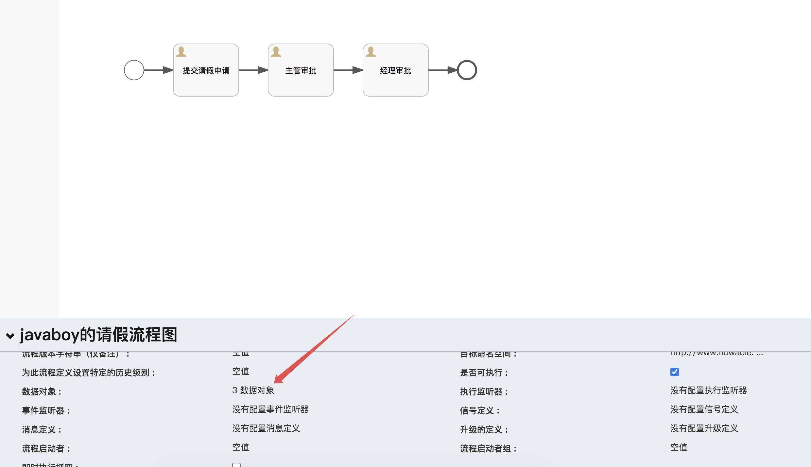
</div>

<div style="text-align:center">
  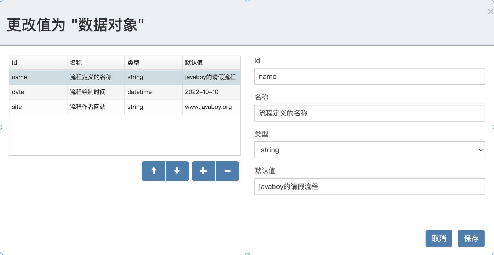
</div>

生成的 XML 文件如下：

```xml
  <process id="leave" name="javaboy的请假流程图" isExecutable="true">
    <documentation>javaboy的请假流程图</documentation>
    <dataObject id="name" name="流程定义的名称" itemSubjectRef="xsd:string">
      <extensionElements>
        <flowable:value>javaboy的请假流程</flowable:value>
      </extensionElements>
    </dataObject>
    <dataObject id="date" name="流程绘制时间" itemSubjectRef="xsd:datetime">
      <extensionElements>
        <flowable:value>2022-10-10T00:00:00</flowable:value>
      </extensionElements>
    </dataObject>
    <dataObject id="site" name="流程作者网站" itemSubjectRef="xsd:string">
      <extensionElements>
        <flowable:value>www.javaboy.org</flowable:value>
      </extensionElements>
    </dataObject>
    <startEvent id="startEvent1" flowable:initiator="INITIATOR" flowable:formFieldValidation="true"></startEvent>
    <userTask id="sid-2F900F54-E047-40AC-A09C-71181386A6C1" name="提交请假申请" flowable:assignee="$INITIATOR" flowable:formFieldValidation="true">
      <extensionElements>
        <modeler:activiti-idm-initiator xmlns:modeler="http://flowable.org/modeler"><![CDATA[true]]></modeler:activiti-idm-initiator>
      </extensionElements>
    </userTask>
    <sequenceFlow id="sid-5173B338-945D-4266-8FF6-1CEAA4BC9BDF" sourceRef="startEvent1" targetRef="sid-2F900F54-E047-40AC-A09C-71181386A6C1"></sequenceFlow>
    <userTask id="sid-745B2D5D-599B-42E6-98F4-78833C81B6E9" name="主管审批" flowable:assignee="zhangsan" flowable:formFieldValidation="true">
      <extensionElements>
        <modeler:initiator-can-complete xmlns:modeler="http://flowable.org/modeler"><![CDATA[false]]></modeler:initiator-can-complete>
      </extensionElements>
    </userTask>
    <sequenceFlow id="sid-09948146-3573-4F5C-875B-2ECF03BBAB9B" sourceRef="sid-2F900F54-E047-40AC-A09C-71181386A6C1" targetRef="sid-745B2D5D-599B-42E6-98F4-78833C81B6E9"></sequenceFlow>
    <userTask id="sid-9462F815-6A53-4E32-879F-5E030C003790" name="经理审批" flowable:assignee="javaboy" flowable:formFieldValidation="true">
      <extensionElements>
        <modeler:initiator-can-complete xmlns:modeler="http://flowable.org/modeler"><![CDATA[false]]></modeler:initiator-can-complete>
      </extensionElements>
    </userTask>
    <sequenceFlow id="sid-9BA1715D-77DD-4B9A-A9DB-549A0284BDAF" sourceRef="sid-745B2D5D-599B-42E6-98F4-78833C81B6E9" targetRef="sid-9462F815-6A53-4E32-879F-5E030C003790"></sequenceFlow>
    <endEvent id="sid-B8B67E20-8935-4645-9959-A1B51795AFAC"></endEvent>
    <sequenceFlow id="sid-9058115E-EB5B-4238-ADB6-A89B8979A31E" sourceRef="sid-9462F815-6A53-4E32-879F-5E030C003790" targetRef="sid-B8B67E20-8935-4645-9959-A1B51795AFAC"></sequenceFlow>
  </process>
```

dataObject 这个节点是属于 process 的，而不是属于某一个具体的节点，因此，这里的 dataObject 可以理解为一个全局的属性。

> 由于默认识别的流程图的 XML 文件，后缀是 `bpmn20.xml` 或者是 `bpmn`，所以，如果我们重复下载的流程文件名，可能会不满足要求，这里注意，需要自行修改一下。

当流程启动成功之后，dataObject 中的数据，实际上是保存在 `ACT_RU_VARIABLE`表中的。

<div style="text-align:center">
  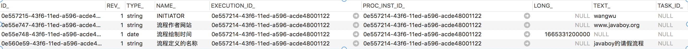
</div>

我们一开始设置的流程启动人的数据，也是记录在这个表中的。

查询流程的 dataObject 数据：

```java
/**
 * 查询一个流程的所有 DataObject 对象
 */
@Test
void test10() {
    List<Execution> list = runtimeService.createExecutionQuery().list();
    for (Execution execution : list) {
        Map<String, DataObject> dataObjects = runtimeService.getDataObjects(execution.getId());
        Set<String> keySet = dataObjects.keySet();
        for (String key : keySet) {
            DataObject data = dataObjects.get(key);
            logger.info("id:{},name:{},value:{},type:{}",data.getId(),data.getName(),data.getValue(),data.getType());
        }
    }
}
/**
 * 流程执行实例，在一个流程中，查询 DataObject 的数据
 *
 * : ==>  Preparing: select * from ACT_RU_VARIABLE WHERE EXECUTION_ID_ = ? AND TASK_ID_ is null AND NAME_ = ?
 * : ==> Parameters: 0e557214-43f6-11ed-a596-acde48001122(String), 流程作者网站(String)
 * : <==      Total: 1
 *
 * 查询某一个具体的 dataObject 对象
 *
 */
@Test
void test09() {
    DataObject data = runtimeService.getDataObject("0e557214-43f6-11ed-a596-acde48001122", "流程作者网站");
    logger.info("id:{},name:{},value:{},type:{}",data.getId(),data.getName(),data.getValue(),data.getType());
}
```

注意，当一个流程执行完毕后，`ACT_RU_VARIABLE` 表中，dataObject 的数据会被清除掉。

<br><br>


##  Flowable 中的租户

- tenant

假如我们有 A、B、C、D 四个子系统，现在四个子系统都需要部署一个名为 leave 的流程，那么如何区分这个流程呢？通过租户 Tenant 可以解决。

> 如果我们在部署一个流程定义的时候，使用到了租户 ID，那么流程启动的时候，也必须指定租户 ID。

当我们部署一个流程定义的时候，可以通过如下方式指定这个流程的租户 ID：

```java
/**
 * 这个就是我的流程部署接口，流程部署将来要上传一个文件，这个文件就是流程的 XML 文件
 *
 * @param file
 * @param tenantId 这个是租户 id，用来区分这个流程是属于哪一个租户的
 * @return
 */
@PostMapping("/deploy")
public RespBean deploy(MultipartFile file,String tenantId) throws IOException {
    DeploymentBuilder deploymentBuilder = repositoryService
            //开始流程部署的构建
            .createDeployment()
            .name("JAVABOY的工作流")//ACT_RE_DEPLOYMENT 表中的 NAME_ 属性
            .category("我的流程分类")//ACT_RE_DEPLOYMENT 表中的 CATEGORY_ 属性
            .key("我的自定义的工作流的 KEY")//ACT_RE_DEPLOYMENT 表中的 KEY_ 属性
            .tenantId(tenantId)
            //也可以用这个方法代替 addInputStream，但是注意，这个需要我们自己先去解析 IO 流程，将 XML 文件解析为一个字符串，然后就可以调用这个方法进行部署了
              .addString()
            //设置文件的输入流程，将来通过这个输入流自动去读取 XML 文件
            .addInputStream(file.getOriginalFilename(), file.getInputStream());
    //完成项目的部署
    Deployment deployment = deploymentBuilder.deploy();
    return RespBean.ok("部署成功", deployment.getId());
}
```

部署成功之后，在 ACT_RE_PROCDEF 表中，可以看到 TENANT_ID_ 字段的具体值：

<div style="text-align:center">
  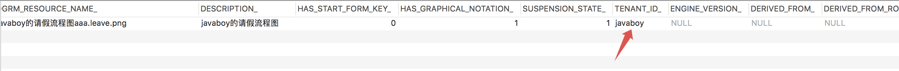
</div>

<br>

一个流程在定义的时候，如果指定了租户 ID，那么启动的时候，也必须指定租户 ID。

如果在启动流程的时候，没有指定租户 ID，强行启动，会抛出如下错误：

<div style="text-align:center">
  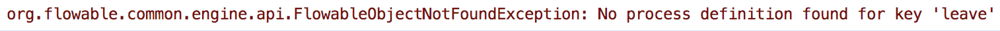
</div>

启动一个带租户 ID 的流程，应该按照如下方式来启动；

```java
/**
 * 启动参数中，携带租户 ID
 */
@Test
void test11() {
    //设置流程的发起人
    Authentication.setAuthenticatedUserId("wangwu");
    //这个流程定义的 key 实际上就是流程 XML 文件中的流程 id
    String processDefinitionKey = "leave";
    //流程启动成功之后，可以获取到一个流程实例
    ProcessInstance pi = runtimeService.startProcessInstanceByKeyAndTenantId(processDefinitionKey,"javaboy");
    logger.info("definitionId:{},id:{},name:{}", pi.getProcessDefinitionId(), pi.getId(), pi.getName());
}
```

<br>

对于带有租户 ID 的流程，在执行具体的 Task 的时候，是不需要指定租户 ID 的。

但是在 `ACT_RU_TASK`表中，存在 `TENANT_ID_`字段，这个字段表示这个 Task 所属的租户。所以，虽然我们执行 Task 不需要租户 ID，但是，我们可以利用租户 ID 去查询一个 Task。

```java
/**
 * 根据租户 ID 查询一个 Task
 * 
 * : ==>  Preparing: SELECT RES.* from ACT_RU_TASK RES WHERE RES.TENANT_ID_ = ? order by RES.ID_ asc
 * : ==> Parameters: javaboy(String)
 * : <==      Total: 1
 *
 */
@Test
void test12() {
    List<Task> list = taskService.createTaskQuery().taskTenantId("javaboy").list();
    for (Task task : list) {
        logger.info("name:{},assignee:{}",task.getName(),task.getAssignee());
    }
}
```

<br><br>

# 流程任务

 ReceiveTask

这个就是一个接收任务，任务到达这个节点之后，一般来说，不需要额外做什么事情，但是需要用户手动 trigger 一下。

如果一个需要等待的任务，可以自动判断各种条件是否成熟，则可以通过并行网关去处理，但是如果无法自动判断，则需要通过 ReceiveTask 去处理，所以 ReceiveTask 就是让流程停在某一个节点上，然后人工判断一下流程是否继续往下走。

<div style="text-align:center">
  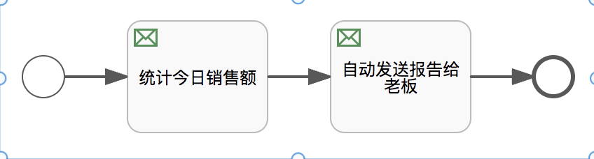
</div>

这种带信封图标的任务，就是一个 ReceiveTask，不同于 UserTask，这种 ReceiveTask 是不需要设置处理人的。

绘制好流程图之后，部署并启动。

启动代码：

```java
@Test
void test01() {
    ProcessInstance pi = runtimeService.startProcessInstanceByKeyAndTenantId("ReceiveTaskDemo", "javaboy");
    logger.info("id:{},name:{}", pi.getId(), pi.getName());
}
```

启动成功之后，流程就会停在 统计今日销售额 这个节点上，然后执行如下代码，流程进入到下一个节点：

```java
@Test
void test02() {
    List<Execution> list = runtimeService.createExecutionQuery().activityId("统计今日销售额节点 ID").list();
    for (Execution execution : list) {
        //触发一个 ReceiveTask 继续向下执行，但是这里需要的参数是一个
        runtimeService.trigger(execution.getId());
    }
}
```

**ps**: 统计今日销售额节点 ID要在导出的xml文件里面copy

<div style="text-align:center">
  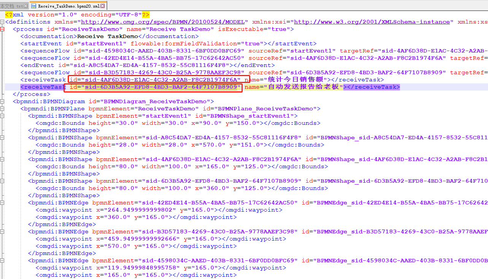
</div>

再继续，执行最后一个节点：

```java
@Test
void test02() {
    List<Execution> list = runtimeService.createExecutionQuery().activityId("发送报告给老板的节点 ID").list();
    for (Execution execution : list) {
        //触发一个 ReceiveTask 继续向下执行，但是这里需要的参数是一个
        runtimeService.trigger(execution.getId());
    }
}
```

**注意，**ReceiveTask 是不进 `ACT_RU_TASK` 表的，它默认被记录在 `ACT_RU_EXECUTION`表和 `ACT_RU_ACTINST`表中。


## UserTask

这个就是用户任务，是 Flowable 中使用最多的一种任务类型，流程走到这个节点的时候，需要用户手动处理，然后才会继续向下走。

### 设置单个用户

这种 UserTask，指定它的处理人，有四种不同的方式。

#### 直接指定具体用户
<div style="text-align:center">
  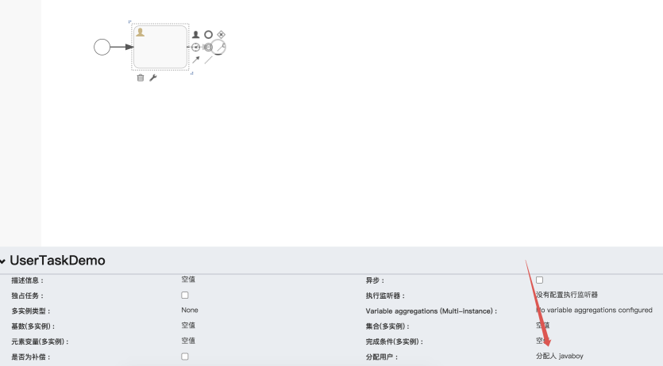
</div>

然后启动流程：

```java
@Test
void test01() {
    ProcessInstance pi = runtimeService.startProcessInstanceByKey("UserTaskDemo");
    logger.info("id:{},name:{}", pi.getId(), pi.getName());
}
```

流程启动成功之后，就自动进入到用户审批这个节点了，需要用户处理的 UserTask 都保存在 `ACT_RU_TASK`表中。


<div style="text-align:center">
  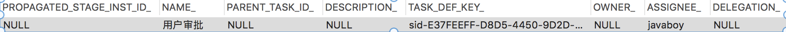
</div>

接下来，查询某一个用户需要处理的 Task：

```java
/**
 * 查询某一个用户需要处理的任务
 *
 * 这个查询对应的 SQL：
 *
 * SELECT RES.* from ACT_RU_TASK RES WHERE RES.ASSIGNEE_ = ? order by RES.ID_ asc
 */
@Test
void test02() {
    List<Task> list = taskService.createTaskQuery().taskAssignee("javaboy").list();
    for (Task task : list) {
        logger.info("name:{},assignee:{}", task.getName(), task.getAssignee());
    }
}
```

查询到用户需要处理的任务之后，有两种不同的处理思路：

1. 委派给其他人处理
2. 直接自己处理了


##### 委派给其他人

```java
/**
 * 将 javaboy 需要处理的任务委派给 zhangsan 去处理
 * 
 * 具体的 SQL 如下：
 * 
 * update ACT_RU_TASK SET REV_ = ?, ASSIGNEE_ = ? where ID_= ? and REV_ = ?
 */
@Test
void test03() {
    List<Task> list = taskService.createTaskQuery().taskAssignee("javaboy").list();
    for (Task task : list) {
        //为某一个 Task 设置处理人
        taskService.setAssignee(task.getId(), "zhangsan");
    }
}
```

这个委派，本质上就是修改了 `ACT_RU_TASK`表中相应的 Task 的记录的 `ASSIGNEE_`的值。

##### 直接自己处理了

```java
/**
 * 自己来处理任务
 */
@Test
void test04() {
    List<Task> list = taskService.createTaskQuery().taskAssignee("zhangsan").list();
    for (Task task : list) {
        //查询到 zhangsan 的任务，并自己处理
        taskService.complete(task.getId());
    }
}
```

<br>

#### 通过变量来设置

<div style="text-align:center">
  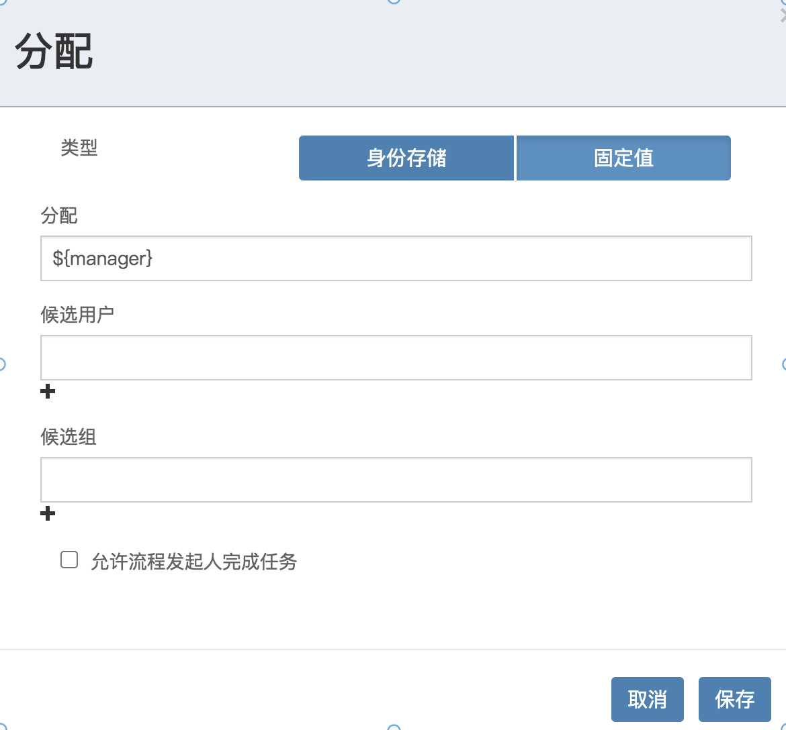
</div>

设置任务的处理人的时候，使用变量，${xxx} 就是一个变量引用。

对应的 XML 内容如下：

```xml
<userTask id="sid-E37FEEFF-D8D5-4450-9D2D-67F9B2EBEE2A" name="用户审批" flowable:assignee="${manager}" flowable:formFieldValidation="true">
  <extensionElements>
    <modeler:initiator-can-complete xmlns:modeler="http://flowable.org/modeler"><![CDATA[false]]></modeler:initiator-can-complete>
  </extensionElements>
</userTask>
```

启动流程，启动的时候顺便指定任务的处理人：

```java
/**
 * 启动一个流程，在启动的时候，指定任务的处理人
 */
@Test
void test05() {
    Map<String, Object> vars = new HashMap<>();
    vars.put("manager", "lisi");
    //在流程启动的时候，通过变量去指定任务的处理人
    ProcessInstance pi = runtimeService.startProcessInstanceByKey("UserTaskDemo", vars);
    logger.info("id:{},name:{}", pi.getId(), pi.getName());
}
```

启动成功之后，在 `ACT_RU_TASK`表中，可以看到任务的处理人已经是 lisi 了。

<div style="text-align:center">
  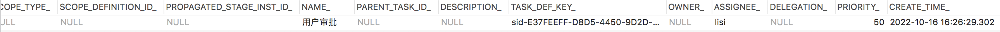
</div>

<br>

#### 通过监听器来设置

利用监听器，我们可以在一个任务创建的时候，为这个任务设置一个处理人。

<div style="text-align:center">
  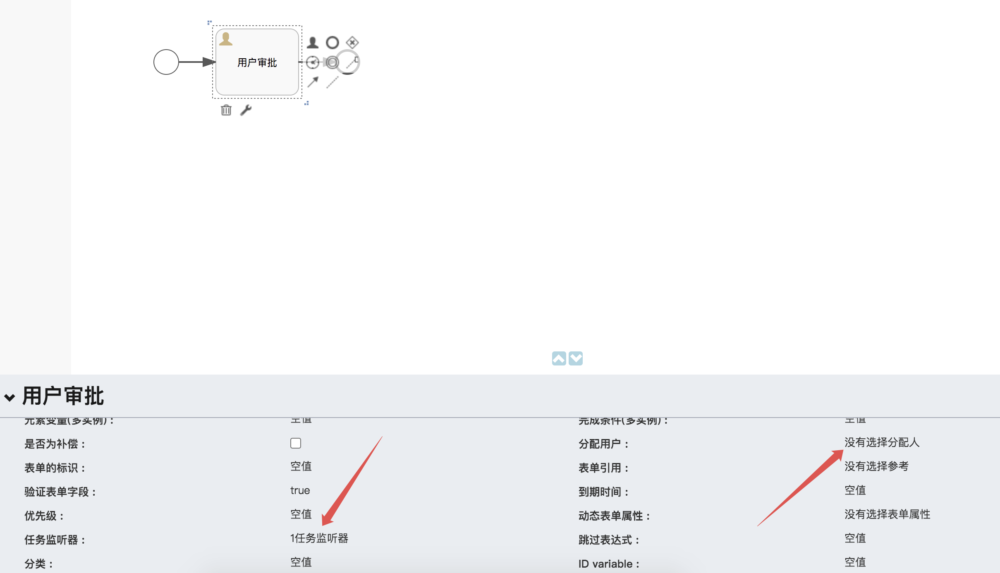
</div>

<div style="text-align:center">
  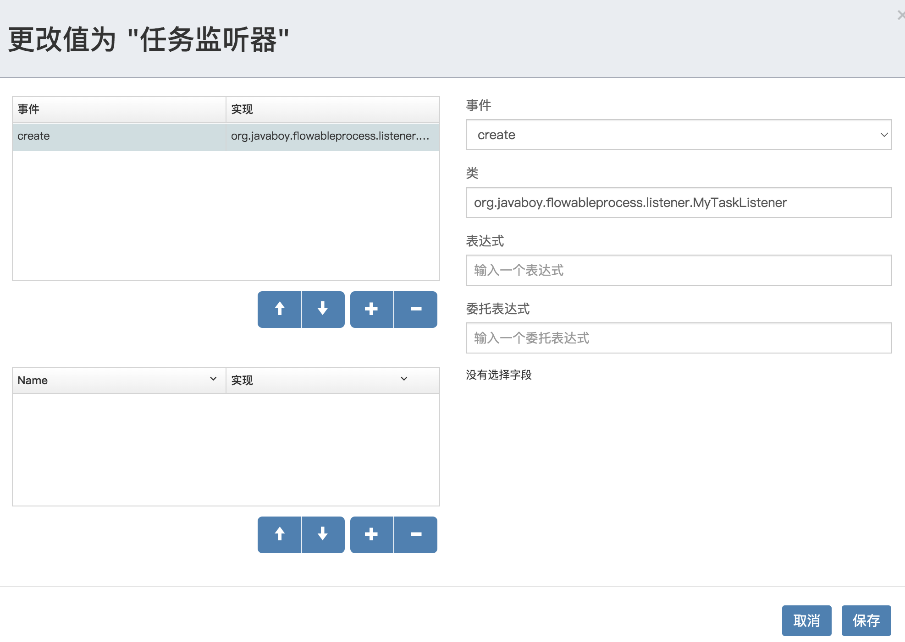
</div>

此时对应的 UserTask 节点内容如下：

```xml
<userTask id="sid-E37FEEFF-D8D5-4450-9D2D-67F9B2EBEE2A" name="用户审批" flowable:formFieldValidation="true">
  <extensionElements>
    <flowable:taskListener event="create" class="org.javaboy.flowableprocess.listener.MyTaskListener"></flowable:taskListener>
  </extensionElements>
</userTask>
```

对应的监听器代码如下：

```java
public class MyTaskListener implements TaskListener {
    /**
     * 当任务被创建的时候，这个方法会被触发
     * @param delegateTask
     */
    @Override
    public void notify(DelegateTask delegateTask) {
        //可以在这里设置任务的处理人
        delegateTask.setAssignee("wangwu");
    }
}
```

<br>


#### 设置为流程的发起人

首先在开始节点上，设置流程的发起人，这个地方给出的流程发起人，实际上是一个变量的名称，所以，这个名字怎么取都行。

<div style="text-align:center">
  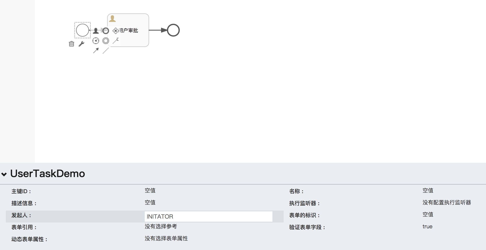
</div>

然后，给 UserTask 设置处理人的时候，采用第二种方案，然后变量的名称就是发起人这个变量名称：

<div style="text-align:center">
  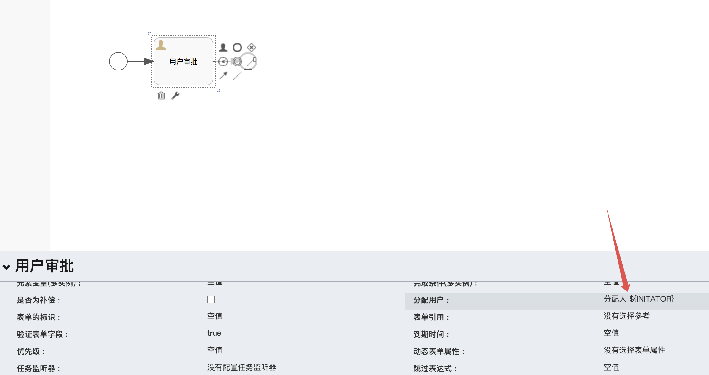
</div>

接下来，在流程启动的时候，需要指定流程的发起人：

```java
/**
 * 启动一个流程，并设置流程的发起人
 *
 * 流程的发起人有两种不同的设置方式：
 *
 * 第一种：
 */
@Test
void test06() {
    //设置流程当前的处理人（一会流程启动的时候，会将这里设置的作为流程的发起人）
    Authentication.setAuthenticatedUserId("zhaoliu");
    ProcessInstance pi = runtimeService.startProcessInstanceByKey("UserTaskDemo");
    logger.info("id:{},name:{}", pi.getId(), pi.getName());
}
```

`Authentication.setAuthenticatedUserId("zhaoliu");`实际上就是用来指定流程的发起人的。

第二种设置流程发起人的方式：

```java
@Autowired
IdentityService identityService;
/**
 * 第二种流程发起人的设置方式
 */
@Test
void test07() {
    identityService.setAuthenticatedUserId("fengqi");
    ProcessInstance pi = runtimeService.startProcessInstanceByKey("UserTaskDemo");
    logger.info("id:{},name:{}", pi.getId(), pi.getName());
}
```

<br><br>

### 设置多个用户

#### 直接指定

直接指定多个候选用户：

<div style="text-align:center">
  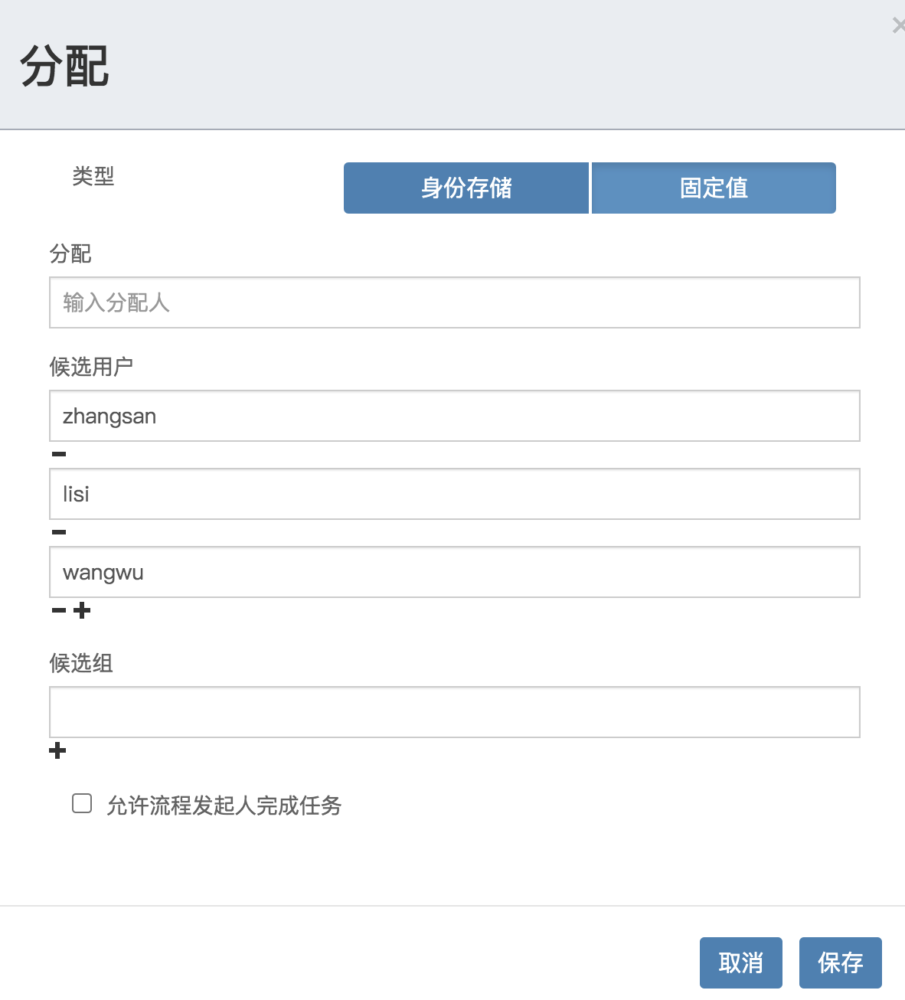
</div>

对应的 XML 内容如下：

```xml
  <process id="UserTaskDemo" name="UserTaskDemo" isExecutable="true">
    <documentation>UserTaskDemo</documentation>
    <startEvent id="startEvent1" flowable:initiator="INITATOR" flowable:formFieldValidation="true"></startEvent>
    <userTask id="sid-E37FEEFF-D8D5-4450-9D2D-67F9B2EBEE2A" name="用户审批" flowable:candidateUsers="zhangsan,lisi,wangwu" flowable:formFieldValidation="true"></userTask>
    <sequenceFlow id="sid-3CC50988-362A-4917-8E96-7DC71CA18A76" sourceRef="startEvent1" targetRef="sid-E37FEEFF-D8D5-4450-9D2D-67F9B2EBEE2A"></sequenceFlow>
    <endEvent id="sid-4691C57C-BABD-4D39-BB14-FA2D78C951AE"></endEvent>
    <sequenceFlow id="sid-098AAEF6-D1F2-4CAB-B365-0C7A85353222" sourceRef="sid-E37FEEFF-D8D5-4450-9D2D-67F9B2EBEE2A" targetRef="sid-4691C57C-BABD-4D39-BB14-FA2D78C951AE"></sequenceFlow>
  </process>
```

`flowable:candidateUsers="zhangsan,lisi,wangwu"`就是设置流程可以由多个用户来处理，多个用户之间使用 `,`隔开。

接下来部署并启动流程。

```java
@Test
    void Test01(){
        ProcessInstance pi = runtimeService.startProcessInstanceByKey("UserTaskDemo");
        logger.info("id:{},name:{}",pi.getId(),pi.getName());
    }
```


接下来，查询某一个用户需要处理的任务的时候，不能再继续使用之前的方案了，因为当一个 UserTask 有多个用户可以处理的时候，那么在 `ACT_RU_TASK`这个表中，是无法完全记录这个 Task 的处理人的，所以此时该表中的 `ASSIGNEE_`字段就为 null。

流程启动之后，如果想要根据用户名去查询该用户能够处理的**任务**，方式如下：

```java
/**
 * 根据候选人去查询任务
 *
 * 对应的 SQL 如下：
 *
 * SELECT RES.* from ACT_RU_TASK RES WHERE RES.ASSIGNEE_ is null and exists(select LINK.ID_ from ACT_RU_IDENTITYLINK LINK 
 * where LINK.TYPE_ = 'candidate' and LINK.TASK_ID_ = RES.ID_ and ( LINK.USER_ID_ = ? ) ) order by RES.ID_ asc
 *
 * 从 SQL 中 ，可以看到，任务由哪些用户来处理，主要是由 ACT_RU_IDENTITYLINK 表来维护。
 *
 */
@Test
void test08() {
    List<Task> tasks = taskService.createTaskQuery().taskCandidateUser("zhangsan").list();
    for (Task task : tasks) {
        logger.info("name:{},CreateTime:{}", task.getName(), task.getCreateTime());
    }
}
```

**上面这个是根据候选人来查询一个任务。**

有的时候，我们已知流程的信息，想去查询流程的参与人，那么可以使用如下方式：

```java
/**
 * 根据流程的 ID 查询流程的参与者
 * 
 * 对应的 SQL：
 * 
 * select * from ACT_RU_IDENTITYLINK where PROC_INST_ID_ = ?
 */
@Test
void test09() {
    ProcessInstance pi = runtimeService.createProcessInstanceQuery().singleResult();
    //根据流程的 ID 去查询流程的参与者
    List<IdentityLink> links = runtimeService.getIdentityLinksForProcessInstance(pi.getId());
    for (IdentityLink link : links) {
        logger.info("流程参与人：{}",link.getUserId());
    }
}
```

从上面这个查询中可以看到，`ACT_RU_IDENTITYLINK`表实际上有两方面的功能：

- 记录了每一个 Task 的候选人 `TASK_ID_`
- 记录了流程的参与人 `PROC_INST_ID_`

根据候选人找到 Task 之后，此时需要首先认领这个任务。认领的本质，其实就是给 `ACT_RU_TASK`表的 `ASSIGNEE_`字段设置值。

任务认领：

```java
/**
 * 认领任务
 *
 * 这个认领，对应的 SQL：
 *
 * update ACT_RU_TASK SET REV_ = ?, ASSIGNEE_ = ?, CLAIM_TIME_ = ? where ID_= ? and REV_ = ?
 */
@Test
void test10() {
    List<Task> tasks = taskService.createTaskQuery().taskCandidateUser("zhangsan").list();
    for (Task task : tasks) {
        //认领，zhangsan 来认领这个任务
        taskService.claim(task.getId(), "zhangsan");
    }
}
```

已经被认领的任务，能不能再次被认领？

已经被认领的任务，无法再次被认领，但是如果你认领了之后，又不想自己处理，可以使用之前说的委派的方式，交给其他人去处理。

如下：

```java
@Test
    void test03() {
        List<Task> list = taskService.createTaskQuery().taskAssignee("zhangsan").list();
        for (Task task : list) {
            //为某一个 Task 设置处理人
            taskService.setAssignee(task.getId(), "lisi");
        }
    }
```

#### 使用变量或者监听器

##### 变量

<div style="text-align:center">
  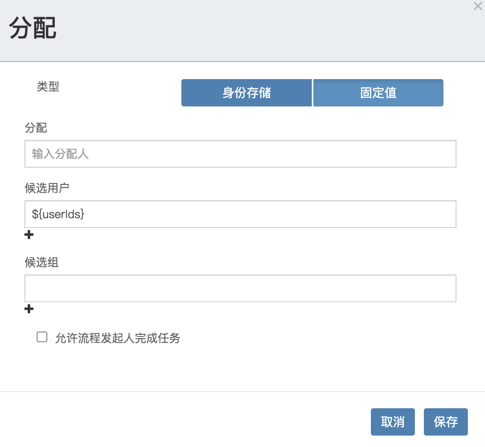
</div>

将来启动流程的时候，必须要指定候选人：

```java
@Test
void test12() {
    Map<String, Object> vars = new HashMap<>();
    //设置多个处理用户，多个处理用户之间用 , 隔开
    vars.put("userIds", "zhangsan,lisi,wangwu");
    runtimeService.startProcessInstanceByKey("UserTaskDemo", vars);
}
```

##### 监听器

也可以通过监听器来设置：

```java
public class MyTaskCandidateUsersListener implements TaskListener {
    @Override
    public void notify(DelegateTask delegateTask) {
        delegateTask.addCandidateUser("zhangsan");
        delegateTask.addCandidateUser("lisi");
        delegateTask.addCandidateUser("wangwu");
    }
}
```

然后删除掉任务的处理人，再为任务设置监听器。

接下来启动处理，和前面基本一致。


#### 任务回退

就是已经认领的任务，再退回去（这样其他人就可以认领了）。

```java
/**
 * 任务回退
 * 
 * 对应的 SQL 如下：
 * 
 * update ACT_RU_TASK SET REV_ = ?, ASSIGNEE_ = ? where ID_= ? and REV_ = ?
 */
@Test
void test13() {
    List<Task> tasks = taskService.createTaskQuery().taskAssignee("lisi").list();
    for (Task task : tasks) {
        //设置任务的处理人为 null，就表示任务回退
        taskService.setAssignee(task.getId(), null);
    }
}
```


<br>

#### 流程候选人的添加与删除

```java
/**
 * 删除一个任务的候选人
 *
 * 对应的 SQL 如下：
 *
 * delete from ACT_RU_IDENTITYLINK where ID_ = ?
 *
 * 实际上，是根据 wangwu + taskId 去 ACT_RU_IDENTITYLINK 表中查询到记录的详细信息 select * from ACT_RU_IDENTITYLINK where TASK_ID_ = ? and USER_ID_ = ? and TYPE_ = ?，然后再去删除
 */
@Test
void test15() {
    Task task = taskService.createTaskQuery().singleResult();
    taskService.deleteCandidateUser(task.getId(),"wangwu");
}
/**
 * 为任务增加候选人
 *
 * 对应的 SQL 如下：
 *
 * insert into ACT_RU_IDENTITYLINK (ID_, REV_, TYPE_, USER_ID_, GROUP_ID_, TASK_ID_, PROC_INST_ID_, PROC_DEF_ID_, SCOPE_ID_, SUB_SCOPE_ID_, SCOPE_TYPE_, SCOPE_DEFINITION_ID_) 
 * values (?, 1, ?, ?, ?, ?, ?, ?, ?, ?, ?, ?) , (?, 1, ?, ?, ?, ?, ?, ?, ?, ?, ?, ?)
 */
@Test
void test14() {
    Task task = taskService.createTaskQuery().singleResult();
    taskService.addCandidateUser(task.getId(), "zhaoliu");
    taskService.addCandidateUser(task.getId(), "javaboy");
}
```

<br><br>

### 按照角色分配任务处理人

先准备数据：

```java
/**
 * 创建 zhangsan 和 lisi 两个用户
 * 创建名为 g1 的用户组
 * 设置 zhangsan 和 lisi 都属于 g1
 */
@Test
void test16() {
    UserEntityImpl u1 = new UserEntityImpl();
    u1.setRevision(0);
    u1.setEmail("zhangsan@qq.com");
    u1.setPassword("123");
    u1.setId("zhangsan");
    u1.setDisplayName("张三");
    identityService.saveUser(u1);
    UserEntityImpl u2 = new UserEntityImpl();
    u2.setRevision(0);
    u2.setEmail("lisi@qq.com");
    u2.setPassword("123");
    u2.setId("lisi");
    u2.setDisplayName("李四");
    identityService.saveUser(u2);
    GroupEntityImpl g1 = new GroupEntityImpl();
    g1.setRevision(0);
    g1.setId("manager");
    g1.setName("经理");
    identityService.saveGroup(g1);
    identityService.createMembership("zhangsan", "manager");
    identityService.createMembership("lisi", "manager");
}   
```


可以直接指定组名称，也可以通过变量来指定。

 直接指定名称 

<div style="text-align:center">
  
</div>


对应的 XML 文件内容如下：

```xml
  <process id="UserTaskDemo" name="UserTaskDemo" isExecutable="true">
    <documentation>UserTaskDemo</documentation>
    <startEvent id="startEvent1" flowable:initiator="INITATOR" flowable:formFieldValidation="true"></startEvent>
    <userTask id="sid-E37FEEFF-D8D5-4450-9D2D-67F9B2EBEE2A" name="用户审批" flowable:candidateGroups="manager" flowable:formFieldValidation="true"></userTask>
    <sequenceFlow id="sid-3CC50988-362A-4917-8E96-7DC71CA18A76" sourceRef="startEvent1" targetRef="sid-E37FEEFF-D8D5-4450-9D2D-67F9B2EBEE2A"></sequenceFlow>
    <endEvent id="sid-4691C57C-BABD-4D39-BB14-FA2D78C951AE"></endEvent>
    <sequenceFlow id="sid-098AAEF6-D1F2-4CAB-B365-0C7A85353222" sourceRef="sid-E37FEEFF-D8D5-4450-9D2D-67F9B2EBEE2A" targetRef="sid-4691C57C-BABD-4D39-BB14-FA2D78C951AE"></sequenceFlow>
  </process>
```

其中，`flowable:candidateGroups="manager"`就是用来指定候选组。

接下来，可以根据候选用户去查询任务：

```java
/**
 * 根据候选人去查询任务（可能 zhangsan 就是候选人，也可能 zhangsan 属于某一个或者某多个用户组，那么此时就需要先查询到 zhangsan 所属的用户组，然后再根据用户组去查询对应的任务）
 *
 * 这个查询实际上分为两步：
 *
 * 1. 执行的 SQL 如下：SELECT RES.* from ACT_ID_GROUP RES WHERE exists(select 1 from ACT_ID_MEMBERSHIP M where M.GROUP_ID_ = RES.ID_ and M.USER_ID_ = ?) order by RES.ID_ asc
 * 第一步这个 SQL 可以查询出来这个 zhangsan 所属的用户组
 *
 * 2. 执行的 SQL 如下：
 * SELECT RES.* from ACT_RU_TASK RES WHERE RES.ASSIGNEE_ is null and
 * exists(select LINK.ID_ from ACT_RU_IDENTITYLINK LINK where LINK.TYPE_ = 'candidate' and LINK.TASK_ID_ = RES.ID_ and
 * ( LINK.USER_ID_ = ? or ( LINK.GROUP_ID_ IN ( ? ) ) ) ) order by RES.ID_ asc
 * 
 * 综上： 【这个 SQL，本质上是查询 zhangsan 或者 zhangsan 所属的用户组的任务】
 * 
 */
@Test
void test17() {
    Task task = taskService.createTaskQuery().taskCandidateUser("zhangsan").singleResult();
    logger.info("name:{},createTime:{}", task.getName(), task.getCreateTime());
}
```

也可以根据候选组去查询任务：

```java
/**
 * 也可以根据候选用户组去查询一个任务
 * 
 * 对应的 SQL 如下：
 * 
 * SELECT RES.* from ACT_RU_TASK RES WHERE RES.ASSIGNEE_ is null and exists(select LINK.ID_ from ACT_RU_IDENTITYLINK LINK where LINK.TYPE_ = 'candidate' 
 * and LINK.TASK_ID_ = RES.ID_ and ( ( LINK.GROUP_ID_ IN ( ? ) ) ) ) order by RES.ID_ asc
 * 
 * 这个查询一步到位，直接指定候选组即可
 * 
 */
@Test
void test18() {
    Task task = taskService.createTaskQuery().taskCandidateGroup("manager").singleResult();
    logger.info("name:{},createTime:{}", task.getName(), task.getCreateTime());
}
```

这种任务在具体执行的过程中，也需要**先认领，再执行**。

```java

    @Test
    void Test19(){
        Task task = taskService.createTaskQuery().taskCandidateGroup("manager").singleResult();
        taskService.claim(task.getId(),"zhangsan");//认领
        taskService.complete(task.getId());//执行
    }
```


<br>

##### 通过变量来指定

<div style="text-align:center">
  
</div>

对应的 XML 如下：

```xml
  <process id="UserTaskDemo" name="UserTaskDemo" isExecutable="true">
    <documentation>UserTaskDemo</documentation>
    <startEvent id="startEvent1" flowable:initiator="INITATOR" flowable:formFieldValidation="true"></startEvent>
    <userTask id="sid-E37FEEFF-D8D5-4450-9D2D-67F9B2EBEE2A" name="用户审批" flowable:candidateGroups="${g}" flowable:formFieldValidation="true"></userTask>
    <sequenceFlow id="sid-3CC50988-362A-4917-8E96-7DC71CA18A76" sourceRef="startEvent1" targetRef="sid-E37FEEFF-D8D5-4450-9D2D-67F9B2EBEE2A"></sequenceFlow>
    <endEvent id="sid-4691C57C-BABD-4D39-BB14-FA2D78C951AE"></endEvent>
    <sequenceFlow id="sid-098AAEF6-D1F2-4CAB-B365-0C7A85353222" sourceRef="sid-E37FEEFF-D8D5-4450-9D2D-67F9B2EBEE2A" targetRef="sid-4691C57C-BABD-4D39-BB14-FA2D78C951AE"></sequenceFlow>
  </process>
```


设置用户组的位置 `flowable:candidateGroups="${g}"`。

启动流程的时候，为用户组设置变量值：

```java
@Test
void test20() {
    Map<String, Object> vars = new HashMap<>();
    vars.put("g", "manager");
    ProcessInstance pi = runtimeService.startProcessInstanceByKey("UserTaskDemo",vars);
    logger.info("id:{},name:{}", pi.getId(), pi.getName());
}
```

## ServiceTask

服务任务：由系统自动完成的任务，流程走到这一步的时候，会自动执行下一步，而不会停下来。

### 监听类

首先定义一个监听器类：

```java
/**
 * 这是我们自定义的监听器类，这个类也就是 ServiceTask 执行到这里的时候，会自动执行该类中的 execute 方法
 */
public class MyServiceTask01 implements JavaDelegate {
    @Override
    public void execute(DelegateExecution execution) {
        System.out.println("=============MyServiceTask01=============");
    }
}
```

在绘制流程图的时候，为 ServiceTask 配置监听器类：

<div style="text-align:center">
  
</div>

 流程对应的XML文件：

```xml
  <process id="ServiceTaskDemo01" name="ServiceTaskDemo01" isExecutable="true">
    <documentation>ServiceTaskDemo01</documentation>
    <startEvent id="startEvent1" flowable:formFieldValidation="true"></startEvent>
    <sequenceFlow id="sid-C6258E73-95C1-44EB-8AE9-8ECEE426833B" sourceRef="startEvent1" targetRef="sid-768328FE-5C7F-4DF5-B145-18F5B206EC9C"></sequenceFlow>
    <serviceTask id="sid-768328FE-5C7F-4DF5-B145-18F5B206EC9C" flowable:class="com.lcdzzz.flowableprocess.servicetask.MyServiceTask01"></serviceTask>
    <endEvent id="sid-0EF3775F-8202-49EB-86CB-8705A50B9E31"></endEvent>
    <sequenceFlow id="sid-98FB240A-C264-4947-9063-9B686A366FF5" sourceRef="sid-768328FE-5C7F-4DF5-B145-18F5B206EC9C" targetRef="sid-0EF3775F-8202-49EB-86CB-8705A50B9E31"></sequenceFlow>
  </process>
```

关键指令： `flowable:class="com.lcdzzz.flowableprocess.servicetask.MyServiceTask01"`。

流程测试：

```java
@SpringBootTest
public class ServiceTaskTest {

    @Autowired
    RuntimeService runtimeService;

    @Test
    void test01() {
        runtimeService.startProcessInstanceByKey("ServiceTaskDemo01");
    }
}
```

上面这个流程测试只有一个 ServiceTask 这个节点，所以流程启动成功之后，就会自动执行完毕！

> 注意，ServiceTask 在执行的过程中，任务的记录是不会保存到 `ACT_RU_TASK`表中的，这一点与 UserTask 不同。

<br>

#### 为类设置字段

<div style="text-align:center">
  
</div>

双击“未选择字段”

<div style="text-align:center">
  
</div>

流程图对应的 XML 文件内容如下：

```xml
 <process id="ServiceTaskDemo01" name="ServiceTaskDemo01" isExecutable="true">
    <documentation>ServiceTaskDemo01</documentation>
    <startEvent id="startEvent1" flowable:formFieldValidation="true"></startEvent>
    <sequenceFlow id="sid-C6258E73-95C1-44EB-8AE9-8ECEE426833B" sourceRef="startEvent1" targetRef="sid-768328FE-5C7F-4DF5-B145-18F5B206EC9C"></sequenceFlow>
    <serviceTask id="sid-768328FE-5C7F-4DF5-B145-18F5B206EC9C" flowable:class="com.lcdzzz.flowableprocess.servicetask.MyServiceTask01">
      <extensionElements>
        <flowable:field name="username">
          <flowable:string><![CDATA[javaboy]]></flowable:string>
        </flowable:field>
      </extensionElements>
    </serviceTask>
    <endEvent id="sid-0EF3775F-8202-49EB-86CB-8705A50B9E31"></endEvent>
    <sequenceFlow id="sid-98FB240A-C264-4947-9063-9B686A366FF5" sourceRef="sid-768328FE-5C7F-4DF5-B145-18F5B206EC9C" targetRef="sid-0EF3775F-8202-49EB-86CB-8705A50B9E31"></sequenceFlow>
  </process>
```

接下来，在这个监听器类中，就可以获取到 username 的值了：

```java
/**
 * 这是我们自定义的监听器类，这个类也就是 ServiceTask 执行到这里的时候，会自动执行该类中的 execute 方法
 */
public class MyServiceTask01 implements JavaDelegate {

    Expression username;
    
    @Override
    public void execute(DelegateExecution execution) {
        //获取 username 的值
        System.out.println("username.getExpressionText() = " + username.getExpressionText());
        System.out.println("username.getValue(execution) = " + username.getValue(execution));
        System.out.println("=============MyServiceTask01=============");
    }
}
```


### 委托表达式

委托表达式类似于监听器类，但是，这种表达式，可以将类注册到 Spring 容器中，然后在给流程图配置的时候，直接配置 Spring 容器中 Bean 的名称即可。

监听器类如下：

```java
@Component
public class MyServiceTask02 implements JavaDelegate {
    @Override
    public void execute(DelegateExecution execution) {
        System.out.println("=============MyServiceTask02==============");
    }
}
```

与上一小节相比，这里通过`@Component`注解将 MyServiceTask02 注册到 Spring 容器中了。这样，在流程图中，可以直接配置 Bean 的名称即可：

<div style="text-align:center">
  
</div>

流程图对应的XML内容：

```xml
 <process id="ServiceTaskDemo01" name="ServiceTaskDemo01" isExecutable="true">
    <documentation>ServiceTaskDemo01</documentation>
    <startEvent id="startEvent1" flowable:formFieldValidation="true"></startEvent>
    <sequenceFlow id="sid-C6258E73-95C1-44EB-8AE9-8ECEE426833B" sourceRef="startEvent1" targetRef="sid-768328FE-5C7F-4DF5-B145-18F5B206EC9C"></sequenceFlow>
    <serviceTask id="sid-768328FE-5C7F-4DF5-B145-18F5B206EC9C" flowable:delegateExpression="${myServiceTask02}"></serviceTask>
    <endEvent id="sid-0EF3775F-8202-49EB-86CB-8705A50B9E31"></endEvent>
    <sequenceFlow id="sid-98FB240A-C264-4947-9063-9B686A366FF5" sourceRef="sid-768328FE-5C7F-4DF5-B145-18F5B206EC9C" targetRef="sid-0EF3775F-8202-49EB-86CB-8705A50B9E31"></sequenceFlow>
  </process>
```

`flowable:delegateExpression="${myServiceTask02}"`则描述了执行对应的 ServiceTask 的 Bean。

###  表达式

前面两种，无论是直接配置类的全路径，还是配置 Bean 的名称，都离不开 `JavaDelegate`


```java

@Component
public class MyServiceTask03 {
    
    public void hello() {
        System.out.println("=============MyServiceTask03=============");
    }
}
```


<div style="text-align:center">
  
</div>

<div style="text-align:center">
  
</div>

```xml
<process id="ServiceTaskDemo01" name="ServiceTaskDemo01" isExecutable="true">
    <documentation>ServiceTaskDemo01</documentation>
    <startEvent id="startEvent1" flowable:formFieldValidation="true"></startEvent>
    <sequenceFlow id="sid-BF8668E7-6CA2-4F17-BD6B-0D0E17FB1C48" sourceRef="startEvent1" targetRef="sid-F580AD28-4492-453D-B359-88F001EE4FB7"></sequenceFlow>
    <serviceTask id="sid-F580AD28-4492-453D-B359-88F001EE4FB7" flowable:expression="${myServiceTask03.hello()}"></serviceTask>
    <endEvent id="sid-E1732394-8FED-4FF8-9372-B62BAD7DA1C7"></endEvent>
    <sequenceFlow id="sid-0EDD436D-7E0D-4D4C-BC67-0CD2BE26AA4B" sourceRef="sid-F580AD28-4492-453D-B359-88F001EE4FB7" targetRef="sid-E1732394-8FED-4FF8-9372-B62BAD7DA1C7"></sequenceFlow>
  </process>
```

>  注意，我们在 6.2.1 小节中介绍的给监听器类设置字段的功能，并不适用于表达式这种情况。

## ScriptTask

脚本任务和 ServiceTask 类似，也是自动执行的。不同的是，脚本任务的逻辑，是通过一些非 Java 的脚本语言来实现的。

### JavaScript

<div style="text-align:center">
  
</div>

<div style="text-align:center">
  
</div>

- 第一行执行一个加法运算。
- 第二行往流程中保存一个名为 sum 的流程变量。

对应的 XML：

```xml
  <process id="ScriptTaskDemo01" name="ScriptTaskDemo01" isExecutable="true">
    <documentation>ScriptTaskDemo01</documentation>
    <startEvent id="startEvent1" flowable:formFieldValidation="true"></startEvent>
    <sequenceFlow id="sid-3B965318-F1BE-4155-A599-69B76A93878A" sourceRef="startEvent1" targetRef="sid-2690302E-6E4C-4C46-A1E3-7B12F446F667"></sequenceFlow>
    <endEvent id="sid-B85B82DB-E801-41EC-ABE2-391947D45055"></endEvent>
    <sequenceFlow id="sid-F9A7C6C2-5734-4E69-9D15-45B55D3A4D18" sourceRef="sid-2690302E-6E4C-4C46-A1E3-7B12F446F667" targetRef="sid-B85B82DB-E801-41EC-ABE2-391947D45055"></sequenceFlow>
    <scriptTask id="sid-2690302E-6E4C-4C46-A1E3-7B12F446F667" scriptFormat="JavaScript" flowable:autoStoreVariables="false">
      <script><![CDATA[var sum=a+b;
execution.setVariable("sum",sum);]]></script>
    </scriptTask>
  </process>
```

>  注意，这个脚本在使用的使用，还不能够使用 let 关键字，可以使用 var 关键字

### Groovy

Groovy 是基于 JVM 的编程语言。

使用 Groovy 需要首先添加依赖：

<div style="text-align:center">
  
</div>

<div style="text-align:center">
  
</div>

对应的XML文件：

```xml
<process id="ScriptTaskDemo01" name="ScriptTaskDemo01" isExecutable="true">
    <documentation>ScriptTaskDemo01</documentation>
    <startEvent id="startEvent1" flowable:formFieldValidation="true"></startEvent>
    <sequenceFlow id="sid-22A421AF-289E-42C2-A68D-0B91A4A7E7C4" sourceRef="startEvent1" targetRef="sid-419BE2B8-7C87-4BF5-98BC-5E535F1D00D0"></sequenceFlow>
    <scriptTask id="sid-419BE2B8-7C87-4BF5-98BC-5E535F1D00D0" scriptFormat="Groovy" flowable:autoStoreVariables="false">
      <script><![CDATA[System.out.println("hello groovy");]]></script>
    </scriptTask>
    <endEvent id="sid-E5DF61BE-B05E-4B4B-A775-F5C3812B132C"></endEvent>
    <sequenceFlow id="sid-B2EB7E48-C6A2-41FB-A660-DAFABF0B8526" sourceRef="sid-419BE2B8-7C87-4BF5-98BC-5E535F1D00D0" targetRef="sid-E5DF61BE-B05E-4B4B-A775-F5C3812B132C"></sequenceFlow>
  </process>
```

### Juel

Juel 全称 Java Unified Expression Language。

之前我们写的表达式 ${xxx} 这就是一个 Juel。

比如我想调用下图MyServiceTask03的hello()方法

<div style="text-align:center">
  
</div>

脚本下

这个脚本就表示执行 Spring 容器中的一个名为 myServiceTask03 的 Bean 的 hello 方法。

<div style="text-align:center">
  
</div>

<div style="text-align:center">
  
</div>

对应的 XML 文件：

```xml
<process id="ScriptTaskDemo01" name="ScriptTaskDemo01" isExecutable="true">
    <documentation>ScriptTaskDemo01</documentation>
    <startEvent id="startEvent1" flowable:formFieldValidation="true"></startEvent>
    <sequenceFlow id="sid-22A421AF-289E-42C2-A68D-0B91A4A7E7C4" sourceRef="startEvent1" targetRef="sid-419BE2B8-7C87-4BF5-98BC-5E535F1D00D0"></sequenceFlow>
    <scriptTask id="sid-419BE2B8-7C87-4BF5-98BC-5E535F1D00D0" scriptFormat="juel" flowable:autoStoreVariables="false">
      <script><![CDATA[${myServiceTask03.hello()}]]></script>
    </scriptTask>
    <endEvent id="sid-E5DF61BE-B05E-4B4B-A775-F5C3812B132C"></endEvent>
    <sequenceFlow id="sid-B2EB7E48-C6A2-41FB-A660-DAFABF0B8526" sourceRef="sid-419BE2B8-7C87-4BF5-98BC-5E535F1D00D0" targetRef="sid-E5DF61BE-B05E-4B4B-A775-F5C3812B132C"></sequenceFlow>
  </process>
```

<br>

<br>

# 网关

## 排他网关

排他网关也叫互斥网关，互斥网关可以有 N 多个入口，但是只有一个有效出口。

假设我们有一个请假流程，这个请假流程执行的过程中，分三种情况：

1. 请假小于等于 1 天，组长审批。
2. 大于 1 天，小于等于 3 天，经理审批。
3. 大于 3 天，总监审批。

<div style="text-align:center">
  
</div>

可以看到，互斥网关可以有 N 多个入口，上图中虽然画出来了三个出口，但是在实际执行中，三个出口只有一个是有效出口。

通过连接线上的流条件，来设置流程的执行：

<div style="text-align:center">
  
</div>

<div style="text-align:center">
  
</div>

<div style="text-align:center">
  
</div>

对应的 XML 文件如下：

```xml
 <process id="ExclusiveGatewayDemo01" name="ExclusiveGatewayDemo01" isExecutable="true">
    <documentation>ExclusiveGatewayDemo01</documentation>
    <startEvent id="startEvent1" flowable:formFieldValidation="true"></startEvent>
    <exclusiveGateway id="sid-A53B391A-3E1C-4622-A546-144B55BC4360"></exclusiveGateway>
    <sequenceFlow id="sid-DF8E49A5-20F5-4BF8-A89F-91B77E83D23A" sourceRef="startEvent1" targetRef="sid-A53B391A-3E1C-4622-A546-144B55BC4360"></sequenceFlow>
    <userTask id="sid-5C7D775C-4893-475D-9C91-F4FE8BF7BAB4" name="组长审批" flowable:formFieldValidation="true"></userTask>
    <userTask id="sid-93654C2E-8373-4DDD-8B37-6268C9E46B00" name="经理审批" flowable:formFieldValidation="true"></userTask>
    <userTask id="sid-13C8B753-6D18-4742-846B-8EE2CA905CE4" name="总监审批" flowable:formFieldValidation="true"></userTask>
    <endEvent id="sid-B71EC429-6213-411B-A761-492224D5ED14"></endEvent>
    <sequenceFlow id="sid-43D5DFA2-3670-4D5F-AEAF-4F02DF05BCF1" sourceRef="sid-5C7D775C-4893-475D-9C91-F4FE8BF7BAB4" targetRef="sid-B71EC429-6213-411B-A761-492224D5ED14"></sequenceFlow>
    <sequenceFlow id="sid-5ED92318-E5FD-4988-BACC-DE195B759CE8" sourceRef="sid-93654C2E-8373-4DDD-8B37-6268C9E46B00" targetRef="sid-B71EC429-6213-411B-A761-492224D5ED14"></sequenceFlow>
    <sequenceFlow id="sid-B17E4938-5ABA-4092-9C26-27AD71FE3BD9" sourceRef="sid-13C8B753-6D18-4742-846B-8EE2CA905CE4" targetRef="sid-B71EC429-6213-411B-A761-492224D5ED14"></sequenceFlow>
    <sequenceFlow id="sid-114747E0-9717-4E59-8254-F2FC8CA8ABF1" name="大于1小于等于3" sourceRef="sid-A53B391A-3E1C-4622-A546-144B55BC4360" targetRef="sid-93654C2E-8373-4DDD-8B37-6268C9E46B00">
      <conditionExpression xsi:type="tFormalExpression"><![CDATA[${days>1 && days<=3}]]></conditionExpression>
    </sequenceFlow>
    <sequenceFlow id="sid-A6412882-BAA1-484F-AD31-912A9FD2CCA3" name="大于3" sourceRef="sid-A53B391A-3E1C-4622-A546-144B55BC4360" targetRef="sid-13C8B753-6D18-4742-846B-8EE2CA905CE4">
      <conditionExpression xsi:type="tFormalExpression"><![CDATA[${days>3}]]></conditionExpression>
    </sequenceFlow>
    <sequenceFlow id="sid-4CCE2748-C505-4457-BE12-96915A5A1EBD" name="小于等于1" sourceRef="sid-A53B391A-3E1C-4622-A546-144B55BC4360" targetRef="sid-5C7D775C-4893-475D-9C91-F4FE8BF7BAB4">
      <conditionExpression xsi:type="tFormalExpression"><![CDATA[${days<=1}]]></conditionExpression>
    </sequenceFlow>
  </process>
```

在 `sequenceFlow`标签中，有一个 `conditionExpression`标签，这个标签专门用来设置流程执行的条件。

流程启动的时候，传入 days 变量即可：

```java
@Test
void test01() {
    HashMap<String, Object> vars = new HashMap<>();
    vars.put("days",10);
    runtimeService.startProcessInstanceByKey("ExclusiveGatewayDemo01",vars);
}
```


## 并行网关

多个任务同时执行，并且多个任务全部都执行完毕的时候，才会进入到下一个任务。

另外还需要注意一点就是，并行网关一般来说是成对出现的。

<div style="text-align:center">
  
</div>

这里大家需要注意的是，并行网关是成对出现的（节点连线上不需要设置条件）。
流程对应的 XML 文件如下：

```xml
<process id="ParallelGatewayDemo01" name="ParallelGatewayDemo01" isExecutable="true">
    <documentation>ParallelGatewayDemo01</documentation>
    <startEvent id="startEvent1" flowable:formFieldValidation="true"></startEvent>
    <sequenceFlow id="sid-A8805B16-FABA-4E1A-A376-B0482F0832B8" sourceRef="startEvent1" targetRef="sid-1E9B605C-4F94-407F-AE6F-36768E04B116"></sequenceFlow>
    <parallelGateway id="sid-1E9B605C-4F94-407F-AE6F-36768E04B116"></parallelGateway>
    <userTask id="sid-4B2B7E70-55A9-4C68-B622-0E041AA81CBF" name="生产屏幕" flowable:assignee="zhangsan" flowable:formFieldValidation="true">
      <extensionElements>
        <modeler:initiator-can-complete xmlns:modeler="http://flowable.org/modeler"><![CDATA[false]]></modeler:initiator-can-complete>
      </extensionElements>
    </userTask>
    <sequenceFlow id="sid-C3E727EC-B5A6-4D01-8CEE-2A67BAB8C2C0" sourceRef="sid-1E9B605C-4F94-407F-AE6F-36768E04B116" targetRef="sid-4B2B7E70-55A9-4C68-B622-0E041AA81CBF"></sequenceFlow>
    <userTask id="sid-F43618C6-213E-4EC0-A6AB-1F31D9B2FD79" name="生产键盘" flowable:assignee="lisi" flowable:formFieldValidation="true">
      <extensionElements>
        <modeler:initiator-can-complete xmlns:modeler="http://flowable.org/modeler"><![CDATA[false]]></modeler:initiator-can-complete>
      </extensionElements>
    </userTask>
    <sequenceFlow id="sid-417FC68C-4759-4186-8978-AABAFC0D3E7B" sourceRef="sid-1E9B605C-4F94-407F-AE6F-36768E04B116" targetRef="sid-F43618C6-213E-4EC0-A6AB-1F31D9B2FD79"></sequenceFlow>
    <sequenceFlow id="sid-A69B4FC7-6E1D-4087-ADF4-F6FFC0319388" sourceRef="sid-4B2B7E70-55A9-4C68-B622-0E041AA81CBF" targetRef="sid-FAE8927E-1F6B-4F80-BB4C-39D5ADF63BED"></sequenceFlow>
    <parallelGateway id="sid-FAE8927E-1F6B-4F80-BB4C-39D5ADF63BED"></parallelGateway>
    <sequenceFlow id="sid-F54298A2-9484-4708-8026-BBAA386686F3" sourceRef="sid-F43618C6-213E-4EC0-A6AB-1F31D9B2FD79" targetRef="sid-FAE8927E-1F6B-4F80-BB4C-39D5ADF63BED"></sequenceFlow>
    <userTask id="sid-EA0ED8A8-FAF3-470B-8E1C-A7594A69F2B5" name="组装" flowable:assignee="wangwu" flowable:formFieldValidation="true">
      <extensionElements>
        <modeler:initiator-can-complete xmlns:modeler="http://flowable.org/modeler"><![CDATA[false]]></modeler:initiator-can-complete>
      </extensionElements>
    </userTask>
    <sequenceFlow id="sid-9CE61BAA-1038-4806-97DC-1DDB26F5F318" sourceRef="sid-FAE8927E-1F6B-4F80-BB4C-39D5ADF63BED" targetRef="sid-EA0ED8A8-FAF3-470B-8E1C-A7594A69F2B5"></sequenceFlow>
    <endEvent id="sid-19015D6D-1A47-4DD5-AEAA-DCC93FD5CAB0"></endEvent>
    <sequenceFlow id="sid-100E5221-CE66-4C2D-802B-DE8717AFE777" sourceRef="sid-EA0ED8A8-FAF3-470B-8E1C-A7594A69F2B5" targetRef="sid-19015D6D-1A47-4DD5-AEAA-DCC93FD5CAB0"></sequenceFlow>
  </process>
```

测试：

不需要参数，所以直接运行

```java
@Test
    void test03() {

        runtimeService.startProcessInstanceByKey("ParallelGatewayDemo01");
    }
```

只有zhangsan和lisi都执行完，才会进入到wangwu部分


## 包容网关

包容官网，有时候也叫兼容网关、相容网关。

包容网关可以根据具体的条件，自动转为排他网关或者是并行网关。

举例：

报销，小于等于 500 元，zhangsan 审批，大于 500 元，zhangsan 和 lisi 同时审批。

流程图如下：

<div style="text-align:center">
  
</div>

设置的流程条件如下：

<div style="text-align:center">
  
</div>

<div style="text-align:center">
  
</div>

1. 报销 400 元的时候，只满足 > 0，所以是 zhangsan 审批，此时是拍他网关。
2. 报销 600 元的时候，既满足 >0，又满足 >500，此时就是 zhangsan 和 lisi 同时审批。

```xml
 <process id="InclusiveGatewayDemo01" name="InclusiveGatewayDemo01" isExecutable="true">
    <documentation>InclusiveGatewayDemo01</documentation>
    <startEvent id="startEvent1" flowable:formFieldValidation="true"></startEvent>
    <sequenceFlow id="sid-8CD8CA6A-3897-4245-9501-42439302DABA" sourceRef="startEvent1" targetRef="sid-C394FFAE-9804-499B-965B-2E75A49180C2"></sequenceFlow>
    <inclusiveGateway id="sid-C394FFAE-9804-499B-965B-2E75A49180C2"></inclusiveGateway>
    <userTask id="sid-E867D477-AEF1-4281-B078-CB507D22951E" name="张三审批" flowable:assignee="zhangsan" flowable:formFieldValidation="true">
      <extensionElements>
        <modeler:initiator-can-complete xmlns:modeler="http://flowable.org/modeler"><![CDATA[false]]></modeler:initiator-can-complete>
      </extensionElements>
    </userTask>
    <userTask id="sid-667FC03A-321D-4DFA-9B07-30434B42058C" name="李四审批" flowable:assignee="lisi" flowable:formFieldValidation="true">
      <extensionElements>
        <modeler:initiator-can-complete xmlns:modeler="http://flowable.org/modeler"><![CDATA[false]]></modeler:initiator-can-complete>
      </extensionElements>
    </userTask>
    <sequenceFlow id="sid-5BC666E9-F5D6-458F-8601-BEBEA786298D" sourceRef="sid-E867D477-AEF1-4281-B078-CB507D22951E" targetRef="sid-A7944F49-D14D-4CCE-AC25-C194A8E89678"></sequenceFlow>
    <inclusiveGateway id="sid-A7944F49-D14D-4CCE-AC25-C194A8E89678"></inclusiveGateway>
    <sequenceFlow id="sid-D78198C3-4023-4724-A3AE-4797304C17A0" sourceRef="sid-667FC03A-321D-4DFA-9B07-30434B42058C" targetRef="sid-A7944F49-D14D-4CCE-AC25-C194A8E89678"></sequenceFlow>
    <userTask id="sid-6FBB65EA-6A83-4CC9-AC6F-CD443D38F7D5" name="王五审批" flowable:formFieldValidation="true"></userTask>
    <sequenceFlow id="sid-795CBE0B-19DA-4B72-A12E-5FB3A4B92A3D" sourceRef="sid-A7944F49-D14D-4CCE-AC25-C194A8E89678" targetRef="sid-6FBB65EA-6A83-4CC9-AC6F-CD443D38F7D5"></sequenceFlow>
    <endEvent id="sid-010A170E-8468-45F9-94D9-962B44F25381"></endEvent>
    <sequenceFlow id="sid-564DEEB3-0778-460E-AEEA-22787300E17E" sourceRef="sid-6FBB65EA-6A83-4CC9-AC6F-CD443D38F7D5" targetRef="sid-010A170E-8468-45F9-94D9-962B44F25381"></sequenceFlow>
    <sequenceFlow id="sid-481CB3EF-5254-4514-AA29-DE268FD6EE32" sourceRef="sid-C394FFAE-9804-499B-965B-2E75A49180C2" targetRef="sid-E867D477-AEF1-4281-B078-CB507D22951E">
      <conditionExpression xsi:type="tFormalExpression"><![CDATA[${money>0}]]></conditionExpression>
    </sequenceFlow>
    <sequenceFlow id="sid-9C2BBBF9-C313-489D-87C4-61AB56415A0C" sourceRef="sid-C394FFAE-9804-499B-965B-2E75A49180C2" targetRef="sid-667FC03A-321D-4DFA-9B07-30434B42058C">
      <conditionExpression xsi:type="tFormalExpression"><![CDATA[${money>500}]]></conditionExpression>
    </sequenceFlow>
  </process>
```

测试：

开始流程。money是1000，大于500并且大于0，所以应该需要zhangsan和lisi都审批（并行），最后王五审批

```java
 @Test
    void test06() {
        HashMap<String, Object> vars = new HashMap<>();
        vars.put("money",1000);
        runtimeService.startProcessInstanceByKey("InclusiveGatewayDemo01",vars);
    }
```

执行。只有zhangsan和lisi都执行了，才轮到wangwu，最后wangwu执行，流程结束

```java
 @Test
    void test04() {
        List<Task> list = taskService.createTaskQuery().taskAssignee("zhangsan").list();
//        List<Task> list = taskService.createTaskQuery().taskAssignee("lisi").list();
//        List<Task> list = taskService.createTaskQuery().taskAssignee("wangwu").list();
        for (Task task : list) {
            //查询到 zhangsan 的任务，并自己处理
            taskService.complete(task.getId());
        }
    }

```


# 流程变量

流程变量的分类：

1. 全局流程变量
2. 本地流程变量
3. 临时流程变量

在之前的案例中，凡是涉及到流程变量的地方，基本上都是全局流程变量。


## 全局流程变量

注意，以下四种方式，都是设置全局流程变量。无论是通过哪种方式设置，本质上都是全局流程变量，这个不会变。全局流程变量，顾名思义，就是和流程实例/执行实例绑定的流程变量，和某个具体的 UserTask 是没有关系的。

### 启动时候设置

流程启动的时候，设置全局流程变量：

```java
    /**
     * 在流程启动的时候，就可以设置流程变量
     *
     * 流程变量将被存入到两个地方：
     *
     * 1. ACT_HI_VARINST：存入到历史信息表中，将来可以从历史表中查询到流程变量
     *
     * insert into ACT_HI_VARINST (ID_, PROC_INST_ID_, EXECUTION_ID_, TASK_ID_, NAME_, REV_, VAR_TYPE_, SCOPE_ID_, SUB_SCOPE_ID_, SCOPE_TYPE_, BYTEARRAY_ID_, DOUBLE_, LONG_ , TEXT_, TEXT2_, CREATE_TIME_, LAST_UPDATED_TIME_) values ( ?, ?, ?, ?, ?, ?, ?, ?, ?, ?, ?, ?, ?, ?, ?, ?, ? ) , ( ?, ?, ?, ?, ?, ?, ?, ?, ?, ?, ?, ?, ?, ?, ?, ?, ? ) , ( ?, ?, ?, ?, ?, ?, ?, ?, ?, ?, ?, ?, ?, ?, ?, ?, ? ) , ( ?, ?, ?, ?, ?, ?, ?, ?, ?, ?, ?, ?, ?, ?, ?, ?, ? )
     *
     * 2. ACT_RU_VARIABLE：流程运行的信息表，流程运行的变量将存入到这个表中
     *
     * INSERT INTO ACT_RU_VARIABLE (ID_, REV_, TYPE_, NAME_, PROC_INST_ID_, EXECUTION_ID_, TASK_ID_, SCOPE_ID_, SUB_SCOPE_ID_, SCOPE_TYPE_, BYTEARRAY_ID_, DOUBLE_, LONG_ , TEXT_, TEXT2_) VALUES ( ?, 1, ?, ?, ?, ?, ?, ?, ?, ?, ?, ?, ?, ?, ? ) , ( ?, 1, ?, ?, ?, ?, ?, ?, ?, ?, ?, ?, ?, ?, ? ) , ( ?, 1, ?, ?, ?, ?, ?, ?, ?, ?, ?, ?, ?, ?, ? ) , ( ?, 1, ?, ?, ?, ?, ?, ?, ?, ?, ?, ?, ?, ?, ? )
     */
    @Test
    void test01() {
        Map<String, Object> vars = new HashMap<>();
        vars.put("days", 10);
        vars.put("reason", "玩一下");
        vars.put("startTime", "2022-10-30");
        vars.put("endTime", "2022-11-09");
        //这个就是在启动的时候设置流程变量，这里设置的流程变量是一个全局的流程变量
        runtimeService.startProcessInstanceByKey("VariableDemo",vars);
    }
```

流程变量会被存入到两个地方，RU 和 HI 表中，然后，我们可以通过流程执行实例 ID【就是`ACT_RU_EXECUTION`表的`ID_`字段】 来查询流程变量信息：中的

```java
/**
 * 通过执行实例 ID  可以查询流程变量
 *
 * 具体的查询 SQL：
 *
 * select * from ACT_RU_VARIABLE WHERE EXECUTION_ID_ = ? AND TASK_ID_ is null AND NAME_ = ?
 */
@Test
void test02() {
    List<Execution> list = runtimeService.createExecutionQuery().list();
    for (Execution execution : list) {
        Object reason = runtimeService.getVariable(execution.getId(), "reason");
        logger.info("execution name：{},reason:{}", execution.getName(), reason);
    }
}
```

查询流程执行实例 ID 对应的所有变量：

```java
/**
 * 根据流程执行实例 ID 查询所有对应的流程变量：
 *
 * select * from ACT_RU_VARIABLE WHERE EXECUTION_ID_ = ? AND TASK_ID_ is null
 *
 */
@Test
void test03() {
    List<Execution> list = runtimeService.createExecutionQuery().list();
    for (Execution execution : list) {
        Map<String, Object> variables = runtimeService.getVariables(execution.getId());
        logger.info("variables:{}", variables);
    }
}
```

### 通过 Task 设置

给 Task 设置流程变量分两种：

- 逐个设置
- 通过 Map 批量设置

无论是哪种方式，本质上都还是往 `ACT_RU_VARABLE`和 `ACT_HI_VARINST`表中插入数据。

```java
/**
 * 我们也可以根据 task 去查询流程变量
 *
 */
@Test
void test05() {
    Task task = taskService.createTaskQuery().taskAssignee("javaboy").singleResult();
    //这里即会根据 taskId 去查询，也会根据 taskId 对应的执行实例 id 去查询
    Object a = taskService.getVariable(task.getId(), "a");
    //这里也是先根据 taskId 先找到执行实例 id，然后根据执行实例的 id 去进行查询
    //select * from ACT_RU_VARIABLE WHERE EXECUTION_ID_ = ? AND TASK_ID_ is null
    Map<String, Object> variables = taskService.getVariables(task.getId());
    logger.info("a:{},variables:{}", a, variables);
}

/**
 * 通过 Task 来设置流程变量
 * <p>
 * 通过 Task 设置，也是插入到两个地方：
 * <p>
 * 1. ACT_HI_VARINST
 * 2. ACT_RU_VARIABLE
 * <p>
 * 在设置的时候，虽然需要传递 TaskId，但是并不是说这个变量跟当前 Task 绑定，通过这个 taskId 可以查询出来这个 Task 对应的 流程实例 id 和执行实例 id，将来插入的时候会用到
 */
@Test
void test04() {
    Task task = taskService.createTaskQuery().taskAssignee("javaboy").singleResult();
    logger.info("taskId:{}", task.getId());
    //第一个参数是 taskId，后面则是流程变量的 key-value
    taskService.setVariable(task.getId(), "result", "同意");
    Map<String, Object> vars = new HashMap<>();
    vars.put("a", "b");
    vars.put("c", "d");
    //批量设置流程变量
    taskService.setVariables(task.getId(), vars);
}
```

### 完成任务时设置

```java
/**
 * 完成任务时设置流程变量
 *
 * 由于流程要执行结束了，因此 ACT_RU_VARIABLE 表要被清空了，所以这里就只向 ACT_HI_VARINST 表中保存数据。
 */
@Test
void test06() {
    Task task = taskService.createTaskQuery().taskAssignee("javaboy").singleResult();
    Map<String, Object> vars = new HashMap<>();
    vars.put("state", "完成");
    taskService.complete(task.getId(),vars);
}
```


#### 通过流程来设置

可以从流程实例的角度来设置全局的流程变量。

```java
/**
 * 由于流程变量是和当前流程实例相关的，所以流程变量也可以直接通过流程实例来设置
 */
@Test
void test07() {
    List<Execution> list = runtimeService.createExecutionQuery().list();
    for (Execution execution : list) {
        runtimeService.setVariable(execution.getId(), "a", "b");
    }
}
```

