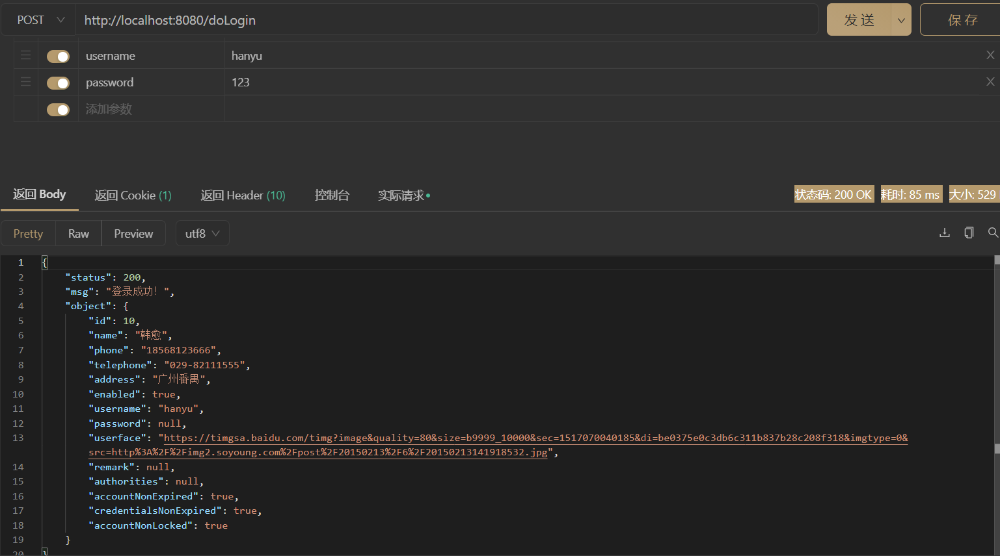
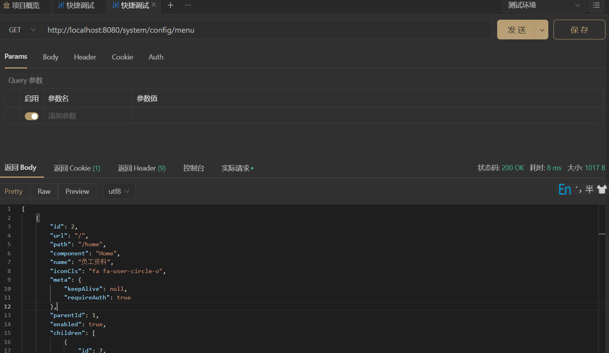
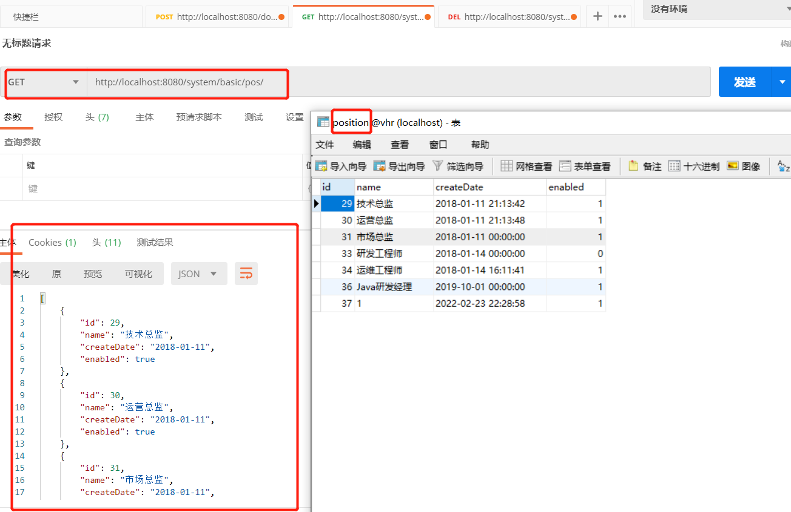
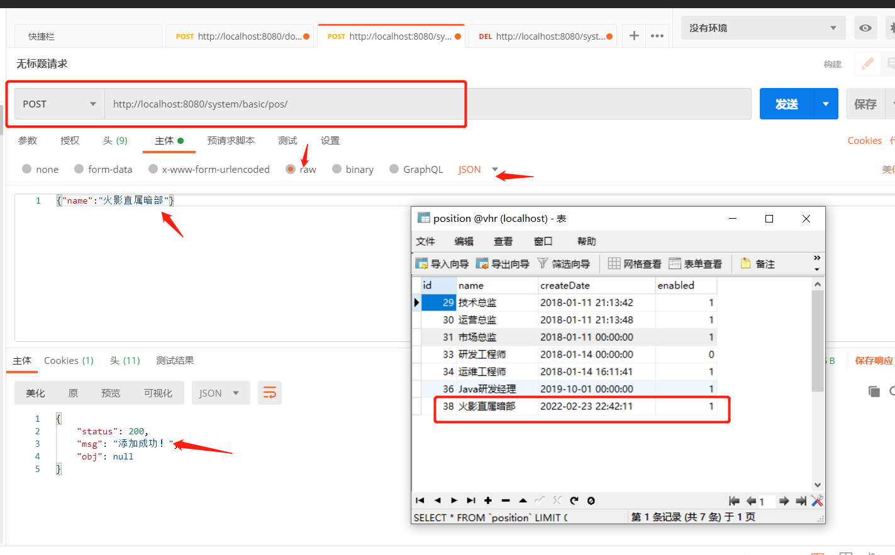
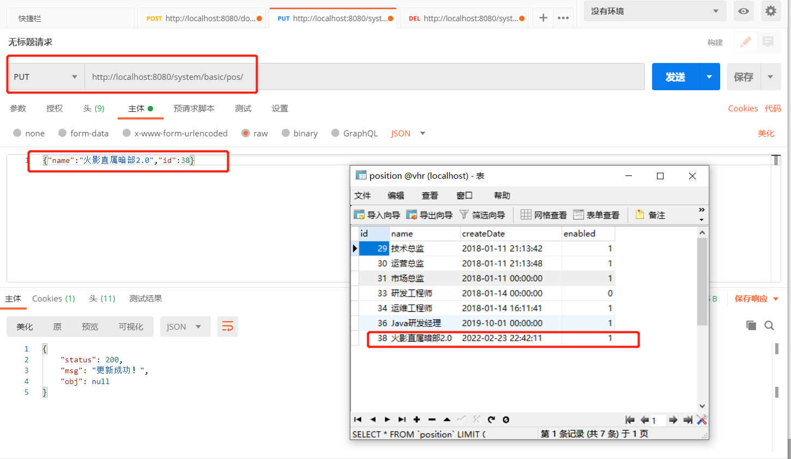
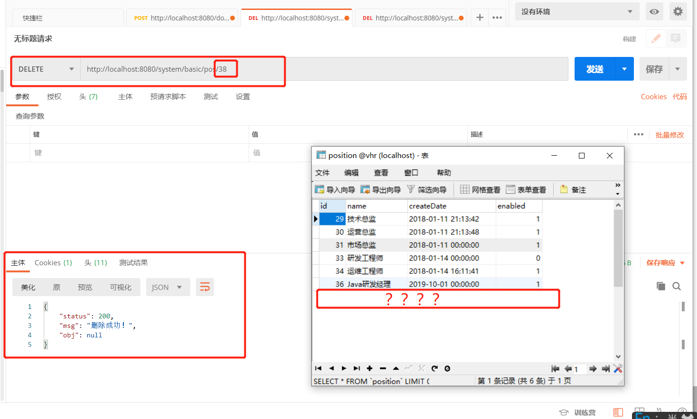
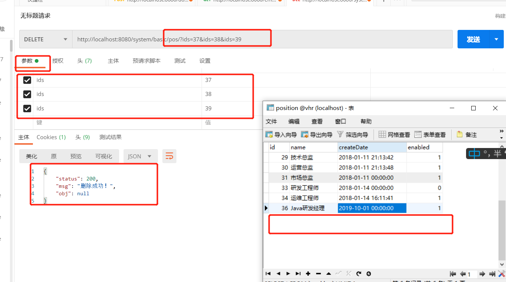
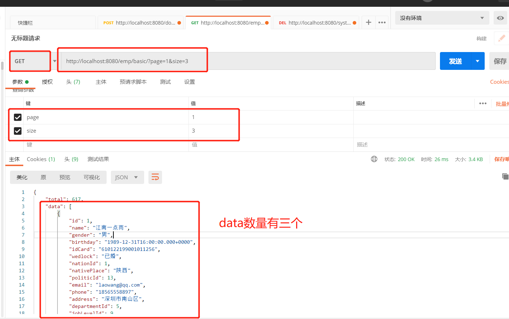
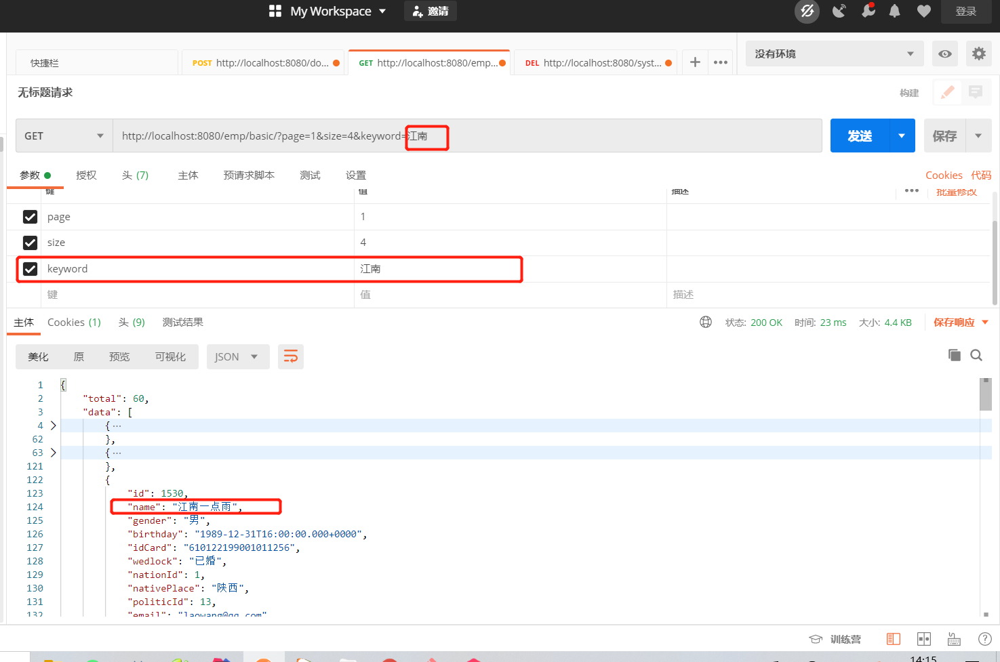

# 服务端菜单接口设计

1. 实体类设计

   1. 菜单menu

      ```java
      package com.lcdzzz.demo.model;
      
      import java.io.Serializable;
      import java.util.List;
      
      public class Menu implements Serializable {
          private Integer id;
      
          private String url;
      
          private String path;
      
          private String component;
      
          private String name;
      
          private String iconCls;
      
          private Meta meta;
      
          private Integer parentId;
      
          private Boolean enabled;
          private List<Menu> children;
          private List<Role> roles;
      
          public List<Role> getRoles() {
              return roles;
          }
      
          public void setRoles(List<Role> roles) {
              this.roles = roles;
          }
      
          public Meta getMeta() {
              return meta;
          }
      
          public void setMeta(Meta meta) {
              this.meta = meta;
          }
      
          public List<Menu> getChildren() {
              return children;
          }
      
          public void setChildren(List<Menu> children) {
              this.children = children;
          }
      
          public Integer getId() {
              return id;
          }
      
          public void setId(Integer id) {
              this.id = id;
          }
      
          public String getUrl() {
              return url;
          }
      
          public void setUrl(String url) {
              this.url = url;
          }
      
          public String getPath() {
              return path;
          }
      
          public void setPath(String path) {
              this.path = path;
          }
      
          public String getComponent() {
              return component;
          }
      
          public void setComponent(String component) {
              this.component = component;
          }
      
          public String getName() {
              return name;
          }
      
          public void setName(String name) {
              this.name = name;
          }
      
          public String getIconCls() {
              return iconCls;
          }
      
          public void setIconCls(String iconCls) {
              this.iconCls = iconCls;
          }
      
          public Integer getParentId() {
              return parentId;
          }
      
          public void setParentId(Integer parentId) {
              this.parentId = parentId;
          }
      
          public Boolean getEnabled() {
              return enabled;
          }
      
          public void setEnabled(Boolean enabled) {
              this.enabled = enabled;
          }
      }
      ```

      

   2. 虽然menu表中有keepAlive和requiredAuth字段，但是一般这种“额外的数据”，会额外地放在一个meta实体类中

      ```java
      package com.lcdzzz.demo.model;
      
      public class Meta {
          private Boolean keepAlive;
      
          private Boolean requireAuth;
      
          public Boolean getKeepAlive() {
              return keepAlive;
          }
      
          public void setKeepAlive(Boolean keepAlive) {
              this.keepAlive = keepAlive;
          }
      
          public Boolean getRequireAuth() {
              return requireAuth;
          }
      
          public void setRequireAuth(Boolean requireAuth) {
              this.requireAuth = requireAuth;
          }
      }
      
      ```

      

2. 创建一个controller去查询所需要的数据,**SystemConfigController**

   ```java
   @RestController
   @RequestMapping("/system/config")
   public class SystemConfigController {
   
       @Autowired
       MenuService menuService;
       @GetMapping("/menu")
       public List<Menu> getMenusByHrId(){
           return menuService.getMenusByHrId();
       }
   }
   ```

   

3. Service类，**MenuService**,先得到当前登录的用户对象，然后通过getId()来得到id值

   ```java
   @Service
   public class MenuService {
       @Autowired
       MenuMapper menuMapper;
   
       public List<Menu> getMenusByHrId() {
           return  menuMapper.getMenusByHrId(((Hr) SecurityContextHolder.getContext().getAuthentication().getPrincipal()).getId());
   
           /*这个Principal就是这个当前登录的用户对象*/
       }
   }
   
   ```

   

4. 所以MenuMapper接口中会有这么一个方法定义

   ```java
   List<Menu> getMenusByHrId(Integer hrid);
   ```

5. 对应的xml文件里的sql语句

   ```xml
     <select id="getMenusByHrId" resultMap="Menus2">
             select distinct m1.*,
         m2.`id` as id2,
         m2.`component` as component2,
         m2.`enabled` as enabled2,
         m2.`iconCls` as iconCls2,
         m2.`keepAlive` as keepAlive2,
         m2.`name` as name2,
         m2.`parentId` as parentId2,
         m2.`requireAuth` as requireAuth2,
         m2.`path` as path2
         from menu m1,menu m2,hr_role hrr,menu_role mr
         where m1.`id`=m2.`parentId`
         and hrr.`hrid`=#{hrid}
         and hrr.`rid`=mr.`rid`
         and mr.`mid`=m2.`id`
         and m2.`enabled`=1
         order by m1.`id`,m2.`id`
     </select>
   ```

6. 里面用到的resultMap有

   ```xml
     <resultMap id="Menus2" type="com.lcdzzz.demo.model.Menu" extends="BaseResultMap">
       <collection property="children" ofType="com.lcdzzz.demo.model.Menu">
         <id column="id2" property="id" jdbcType="INTEGER" />
         <result column="url2" property="url" jdbcType="VARCHAR" />
         <result column="path2" property="path" jdbcType="VARCHAR" />
         <result column="component2" property="component" jdbcType="VARCHAR" />
         <result column="name2" property="name" jdbcType="VARCHAR" />
         <result column="iconCls2" property="iconCls" jdbcType="VARCHAR" />
         <result column="parentId2" property="parentId" jdbcType="INTEGER" />
         <result column="enabled2" property="enabled" jdbcType="BIT" />
         <association property="meta" javaType="com.lcdzzz.demo.model.Meta">
           <result column="keepAlive2" property="keepAlive" jdbcType="BIT" />
           <result column="requireAuth2" property="requireAuth" jdbcType="BIT" />
         </association>
       </collection>
     </resultMap>
   
      <resultMap id="BaseResultMap" type="com.lcdzzz.demo.model.Menu">
           <id column="id" jdbcType="INTEGER" property="id"/>
           <result column="url" jdbcType="VARCHAR" property="url"/>
           <result column="path" jdbcType="VARCHAR" property="path"/>
           <result column="component" jdbcType="VARCHAR" property="component"/>
           <result column="name" jdbcType="VARCHAR" property="name"/>
           <result column="iconCls" jdbcType="VARCHAR" property="iconCls"/>
           <result column="parentId" jdbcType="INTEGER" property="parentId"/>
           <result column="enabled" jdbcType="BIT" property="enabled"/>
           <association property="meta" javaType="com.lcdzzz.demo.model.Meta">
               <result column="keepAlive" jdbcType="BIT" property="keepAlive"/>
               <result column="requireAuth" jdbcType="BIT" property="requireAuth"/>
           </association>
       </resultMap>
   
   ```

7. 测试

   1. 登录

<div style="text-align:center">
  
</div>

   2. 菜单

<div style="text-align:center">
  
</div>

<br><br><br><br>

# ~~后端接口权限设计~~

*注：目前项目不需要用到，暂不学习*

## ~~整体的判断过程~~

1. ~~根据用户发送过来的url地址提取出来它需要的角色~~
2. ~~判断当前用户是否具备相应的角色~~


## ~~代码实现~~

1. ~~根据用户发送过来的url地址提取出来它需要的角色~~
   1. ~~实体类Menu，添加一个这个属性`private List<Role> roles;  //意思是这个菜单项需要哪些角色才可以访问`意思是这个菜单项需要哪些角色才可以访问~~


<br><br><br><br>

# 职位管理后端接口设计

1. 实体类

   ```java
   public class Position implements Serializable {
       private Integer id;
   
       private String name;
   
       @JsonFormat(pattern = "yyyy-MM-dd",timezone = "Asia/Shanghai")
       private Date createDate;
   
       private Boolean enabled;
   
       private static final long serialVersionUID = 1L;
   
       public Integer getId() {
           return id;
       }
   
       public void setId(Integer id) {
           this.id = id;
       }
   
       public String getName() {
           return name;
       }
   
       public void setName(String name) {
           this.name = name;
       }
   
       public Date getCreateDate() {
           return createDate;
       }
   
       public void setCreateDate(Date createDate) {
           this.createDate = createDate;
       }
   
       public Boolean getEnabled() {
           return enabled;
       }
   
       public void setEnabled(Boolean enabled) {
           this.enabled = enabled;
       }
   
       @Override
       public String toString() {
           StringBuilder sb = new StringBuilder();
           sb.append(getClass().getSimpleName());
           sb.append(" [");
           sb.append("Hash = ").append(hashCode());
           sb.append(", id=").append(id);
           sb.append(", name=").append(name);
           sb.append(", createDate=").append(createDate);
           sb.append(", enabled=").append(enabled);
           sb.append(", serialVersionUID=").append(serialVersionUID);
           sb.append("]");
           return sb.toString();
       }
   
   ```

2. controller.system.basic.PositionController（查询，添加，更新，删除）

   ```java
   
   @RestController
   @RequestMapping("/system/basic/pos")
   public class PositionController {//职位管理
       @Autowired
       PositionService positionService;
       @GetMapping("/")//查询接口
       public List<Position> getAllPosition(){
           return positionService.getAllPosition();
       }
   
       @PostMapping("/")
       public RespBean addPosition(@RequestBody Position position){//@RequestBody主要用来接收前端传递给后端的json字符串中的数据的(请求体中的数据的);
           if (positionService.addPosition(position)==1){
               return RespBean.ok("添加成功！");
           }
           return RespBean.error("添加失败！");
       }
   
       @PutMapping("/")
       public RespBean updatePosition(@RequestBody Position position){
           if (positionService.updatePosition(position)==1){
               return RespBean.ok("更新成功！");
           }
           return RespBean.error("更新失败！");
       }
   
       @DeleteMapping("/{id}")
       public RespBean deletePositionById(@PathVariable Integer id){
           if (positionService.deletePositionById(id)==1){
               return RespBean.ok("删除成功！");
           }
           return RespBean.error("删除失败！");
       }
   }
   
   ```

3. 与之对应的service层下的

   ```java
   @Service
   public class PositionService {
       @Autowired
       PositionMapper positionMapper;
       public List<Position> getAllPosition() {
           return positionMapper.getAllPosition();//查询
       }
   
       public Integer addPosition(Position position) {
           position.setEnabled(true);
           position.setCreateDate(new Date());
           return positionMapper.insert(position);//添加
       }
   
       public Integer updatePosition(Position position) {
           return positionMapper.updateByPrimaryKeySelective(position);//更新
       }
   
       public Integer deletePositionById(Integer id) {
           return positionMapper.deleteByPrimaryKey(id);//删除
       }
   }
   
   ```

4. 对应的mapper层下的PositionMapper接口

   ```java
   
   public interface PositionMapper {
       int deleteByPrimaryKey(Integer id);
   
       int insert(Position record);
   
       Position selectByPrimaryKey(Integer id);
   
       List<Position> selectAll();
   
       int updateByPrimaryKey(Position record);
       int updateByPrimaryKeySelective(Position record);
   
       List<Position> getAllPosition();
   }
   ```

5. PositionMapper.xml下的代码大多数是可以mybatis逆向工程自动生成的，这里写自动生成以外的和需要注意的sql语句，关于mybatis逆向工程可以参考https://www.cnblogs.com/youcoding/p/14693096.html 这篇博客。

   ```xml
   <select id="getAllPosition" resultMap="BaseResultMap">
     select * from position
   </select>
   
   <!--这个较之普通的updateByPrimaryKey语句，区别在于这个sql语句不需要所有字段都有，如果一个字段没有值，则默认为null-->
   <update id="updateByPrimaryKeySelective" parameterType="com.lcdzzz.model.Position" >
       update position
       <set >
         <if test="name != null" >
           name = #{name,jdbcType=VARCHAR},
         </if>
         <if test="createDate != null" >
           createDate = #{createDate,jdbcType=TIMESTAMP},
         </if>
         <if test="enabled != null" >
           enabled = #{enabled,jdbcType=BIT},
         </if>
       </set>
       where id = #{id,jdbcType=INTEGER}
     </update>
   ```

6. 测试

   - 登录不演示，和服务端菜单接口设计的登录是一样的

   - 查询接口 http://localhost:8080/system/basic/pos/ 【get】

<div style="text-align:center">
  
</div>

   - 添加接口 http://localhost:8080/system/basic/pos/ 【post】

<div style="text-align:center">
  
</div>

   - 更新接口 http://localhost:8080/system/basic/pos/ 【put】

<div style="text-align:center">
  
</div>

   - 删除接口 http://localhost:8080/system/basic/pos/38 【delete】

<div style="text-align:center">
  
</div>

7. 批量删除

   - Controller层

     ```java
     @DeleteMapping("/")
         public RespBean deletePositionByIds( Integer[] ids){
             if (positionService.deletePositionByIds(ids)==ids.length){
                 return RespBean.ok("删除成功！");
             }
             return RespBean.ok("删除失败！");
     
         }
     ```

   - service层

     ```java
      public Integer deletePositionByIds(Integer[] ids) {
             return positionMapper.deletePositionByIds(ids);
         }
     ```

   - mapper接口

     ```java
         Integer deletePositionByIds(@Param("ids") Integer[] ids);
     ```

   - xml文件

     ```xml
     <delete id="deletePositionByIds">
       delete from position where id in 
       <foreach collection="ids" item="id" separator="," open="(" close=")">
         #{id}
       </foreach>
     </delete>
     ```

   - 测试

<div style="text-align:center">
  
</div>


   <br><br><br><br>

# 员工管理

## 数据分页及搜索

1. 实体类，为了节省篇幅，getset方法就不放上去了（实际上有）

   ```java
   
   public class Employee implements Serializable {
       private Integer id;
   
       private String name;
   
       private String gender;
   
       private Date birthday;
   
       private String idCard;
   
       private String wedlock;
   
       private Integer nationId;
   
       private String nativePlace;
   
       private Integer politicId;
   
       private String email;
   
       private String phone;
   
       private String address;
   
       private Integer departmentId;
   
       private Integer jobLevelId;
   
       private Integer posId;
   
       private String engageForm;
   
       private String tiptopDegree;
   
       private String specialty;
   
       private String school;
   
       private Date beginDate;
   
       private String workState;
   
       private String workID;
   
       private Double contractTerm;
   
       private Date conversionTime;
   
       private Date notWorkDate;
   
       private Date beginContract;
   
       private Date endContract;
   
       private Integer workAge;
       private Nation nation;
       private Politicsstatus politicsstatus;
   
       private Department department;
       private JobLevel jobLevel;
       private Position position;
   ```

2. controller层

   ```java
   @RestController
   @RequestMapping("/emp/basic")
   public class EmpBasicController {
       @Autowired
       EmployeeService employeeService;
       @GetMapping("/")
       public RespPageBean getEmployeeByPage(@RequestParam(defaultValue = "1") Integer page,
   /*默认查询第一页，每页查询10个*/             @RequestParam(defaultValue = "10") Integer size
                                               ,String keyword){
           return employeeService.getEmployeeByPage(page,size,keyword);
       }
   }
   ```

3. service层

   ```java
   @Service
   public class EmployeeService {
       @Autowired
       EmployeeMapper employeeMapper;
       public RespPageBean getEmployeeByPage(Integer page, Integer size, String keyword) {
           if (page != null && size != null) {
               page = (page - 1) * size;
           }
           List<Employee> data =employeeMapper.getEmployeeByPage(page,size,keyword);
           Long total = employeeMapper.getTotal(keyword);
           RespPageBean bean = new RespPageBean();
           bean.setData(data);
           bean.setTotal(total);
           return bean;
       }
   }
   ```

4. mapper接口

   ```xml
   public interface EmployeeMapper {
       int deleteByPrimaryKey(Integer id);
   
       int insert(Employee record);
   
       Employee selectByPrimaryKey(Integer id);
   
       List<Employee> selectAll();
   
       int updateByPrimaryKey(Employee record);
   
       List<Employee> getEmployeeByPage(@Param("page") Integer page, @Param("size") Integer size,@Param("keyword") String keyword);
   
       Long getTotal(String keyword);
   }
   ```

5. xml的sql语句

   ```xml
   <select id="getEmployeeByPage" resultMap="AllEmployeeInfo">
     select e.*,p.`id` as pid,p.`name` as pname,n.`id` as nid,n.`name` as nname,d.`id` as did,d.`name` as
     dname,j.`id` as jid,j.`name` as jname,pos.`id` as posid,pos.`name` as posname from employee e,nation
     n,politicsstatus p,department d,joblevel j,position pos where e.`nationId`=n.`id` and e.`politicId`=p.`id` and
     e.`departmentId`=d.`id` and e.`jobLevelId`=j.`id` and e.`posId`=pos.`id`
         <if test="keyword !=null and keyword!=''">
             and e.name like concat('%',#{keyword},'%')
         </if>
       limit #{page},#{size}
   </select>
   <select id="getTotal" resultType="java.lang.Long">
     select count(*) from employee
     <if test="keyword !=null and keyword!=''">
       where name like concat('%',#{keyword},'%')
     </if>;
   </select>
   ```

6. xml的resultMap定义

   ```xml
   <resultMap id="AllEmployeeInfo" type="com.lcdzzz.model.Employee" extends="BaseResultMap">
     <association property="nation" javaType="com.lcdzzz.model.Nation">
       <id column="nid" property="id"/>
       <result column="nname" property="name"/>
     </association>
     <association property="politicsstatus" javaType="com.lcdzzz.model.Politicsstatus">
       <id column="pid" property="id"/>
       <result column="pname" property="name"/>
     </association>
     <association property="department" javaType="com.lcdzzz.model.Department">
       <id column="did" property="id"/>
       <result column="dname" property="name"/>
     </association>
     <association property="jobLevel" javaType="com.lcdzzz.model.JobLevel">
       <id column="jid" property="id"/>
       <result column="jname" property="name"/>
     </association>
     <association property="position" javaType="com.lcdzzz.model.Position">
       <id column="posid" property="id"/>
       <result column="posname" property="name"/>
     </association>
   </resultMap>
   ```

7. 分页测试

<div style="text-align:center">
  
</div>

8. 搜索＋分页测试

<div style="text-align:center">
  
</div>


   


# 搭建邮件服务以及消息中间件

   

   

   


