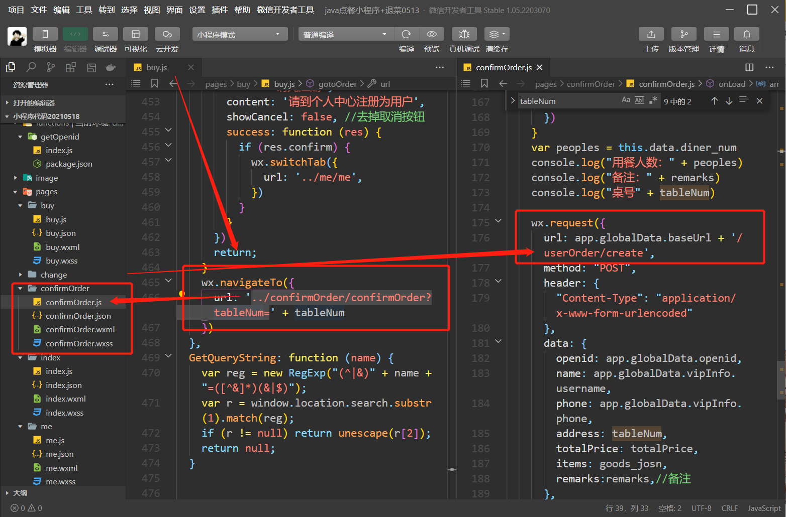
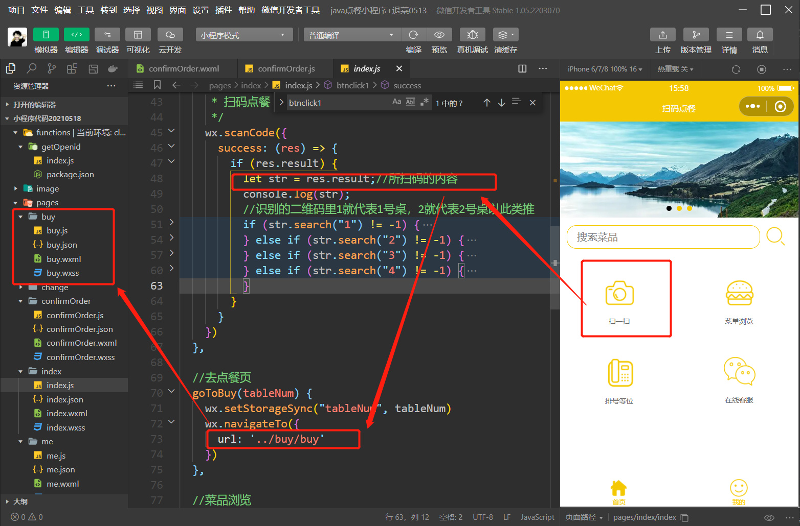
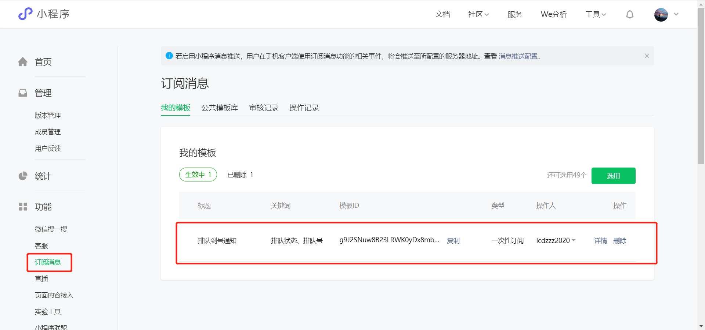
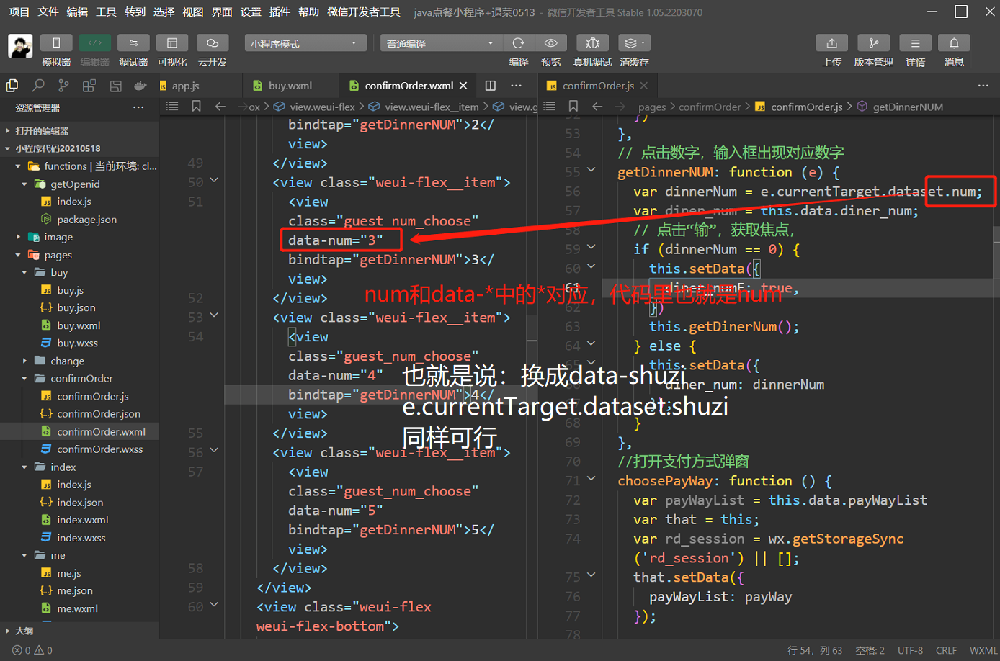

# 流程分析（小程序后端）

  

  

<!--于是下单，和创建订单的功能就开始了。在后端的`WxOrderController`中具体实现。-->

## 下单模块

在首页进行扫码，入桌，然后会跳转到buy页面，点击选好了，如果没有问题的话，则跳转到confirmOrder页面，点击最下面的总计xxx,弹窗出现。经过一系列判断和对数据的处理，向/userOrder/create接口发送请求，对应后端的`WxOrderUtils`的`createOrder`方法

## me页面

- me界面，点击注册用户，跳转到change界面

  点击提交修改按钮，对数据进行处理后，向/user/save接口发送请求。对应后端的`WxUserController`

- me页面，点击会员充值，跳转到vip页面

  点击充值一、二年向/user/payVip接口发送请求，对应后端的`WxUserController`

- 在app.js里，通过向/use,r/getUserInfo接口发送请求，拿到用户的数据，对应后端的`WxUserController`

- me界面，点击我的订单，跳转到myOrder页面

  根据顶上的待上餐、已取消、待评价、已完成四个选项得到对应的`orderStatus`属性并请求/userOrder/listByStatus接口，对应后端的`WxOrderController`

- 在myOrder页面里，待上餐模块，点击催上餐，向/userOrder/cuidan接口发送请求，对应后端的`WxOrderController`

- myOrder页面里，待评价模块，点击去评价，isShowComment变为true，跳出窗口，点击确认，对一系列数据进行处理后，对comment接口发送请求，对应后端`CommentController`

- myOrder页面里，已完成模块，点击查看评价，跳转到mycomment页面，因为传过去的type为1，所以先显示“我的评价”

  内容，通过导航栏可以切换成全部评价

  全部评价同理，不赘述了，对应的后端都是`CommentController`，分别对应两个方法`userCommentList`和`commentList`

- myOrder页面里，已取消模块同理。

## 排号模块

### 取号

- 排号页面下，点击排小桌，传入值为0的type，并向/paihao/quhao接口发送请求

  

- /paihao/quhao接口对应后端的`WxPaihaoController`

### 查询我的排号

- 排号页面下，会首先执行getNum()方法查询排号
- 向/paihao/getNum接口发送请求，对应后端的`WxPaihaoController`
- 得到排号的VO类，包含大、小桌当前就位号码，当前客户的桌型和号

# 后端

### StringUtils.pathEquals

相对equals来说，这个方法能避免空指针异常

### java8特性 .stream()的使用

https://blog.csdn.net/Hathwayoung/article/details/113514840

### Collectors.toList()

https://blog.csdn.net/L_fly_J/article/details/120099739

### @EntityListeners(AuditingEntityListener.class)

https://blog.csdn.net/XU906722/article/details/84778788?spm=1001.2101.3001.6650.1&utm_medium=distribute.pc_relevant.none-task-blog-2%7Edefault%7ECTRLIST%7Edefault-1-84778788-blog-91438971.pc_relevant_default&depth_1-utm_source=distribute.pc_relevant.none-task-blog-2%7Edefault%7ECTRLIST%7Edefault-1-84778788-blog-91438971.pc_relevant_default&utm_relevant_index=2

### BeanUtils.copyProperties()

https://blog.csdn.net/dfshsdr/article/details/90513676

### @Transactional

数据库事务

### bindingResult.getFieldError().getDefaultMessage())

https://blog.csdn.net/qq78442761/article/details/99209359

### T each : enumClass.getEnumConstants()

JAVA 枚举详解(枚举基本使用高级用法枚举扩展)

https://blog.csdn.net/July_whj/article/details/88081010?spm=1001.2101.3001.6650.1&utm_medium=distribute.pc_relevant.none-task-blog-2%7Edefault%7ECTRLIST%7ERate-1-88081010-blog-108746279.pc_relevant_antiscanv3&depth_1-utm_source=distribute.pc_relevant.none-task-blog-2%7Edefault%7ECTRLIST%7ERate-1-88081010-blog-108746279.pc_relevant_antiscanv3&utm_relevant_index=2

# 前端（小程序）

### e.currentTarget.dataset

https://blog.csdn.net/qq_41219586/article/details/103542804

  

