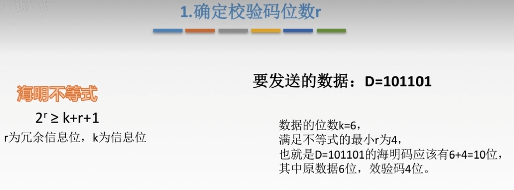
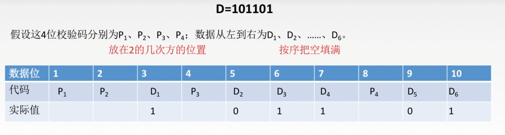
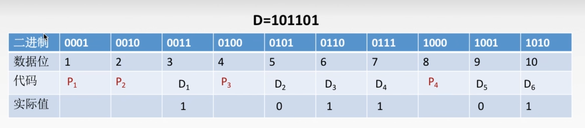
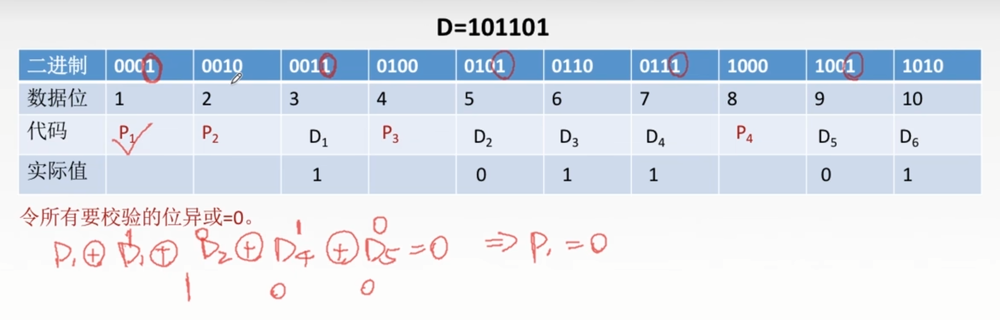
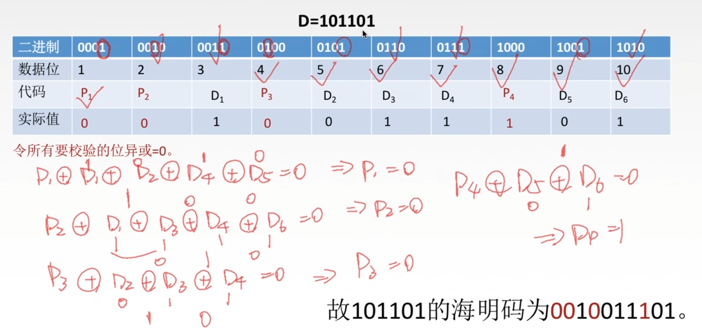
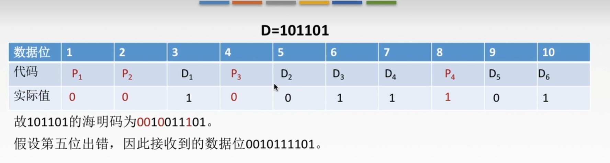
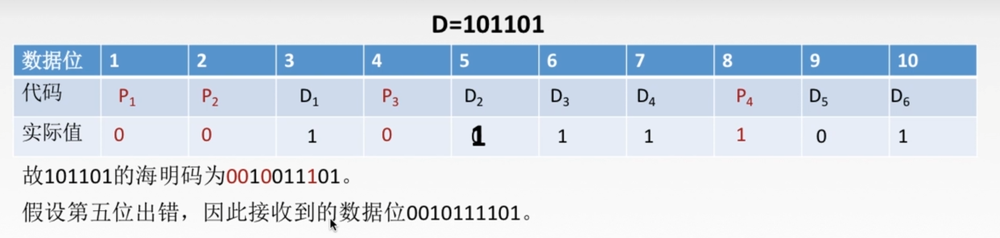
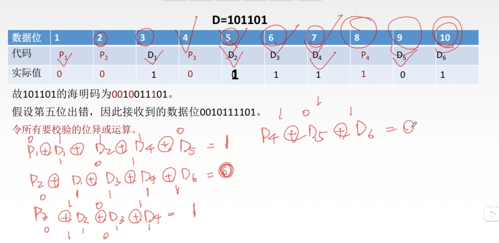
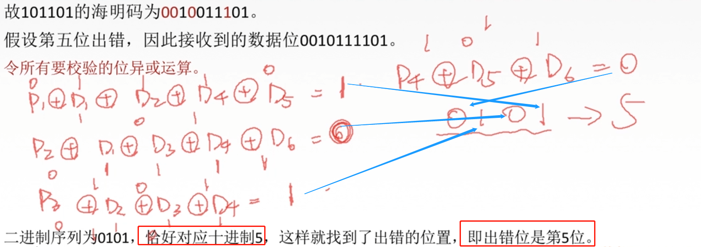

>  分为4步

# 第一步 确认校验码位数r

  

 

# 第二步 确定校验码和数据的位置

 1. 为什么是10为数据位？因为4位校验码+6位信息位=10位

 2. 校验码放到2的几次方的位置，其他的地方按顺序放已知的信息位

  

# 第三步 求出校验码的值

## 一

  

 - 数据位是1，那么二进制就是0001，至于二进制有几位，取决于最后一位数，比如这边最后一位是10，它的二进制为1010，四位，所以二进制需要四位

 

## 二

  

如何求校验码的值：

我们知道每一位校验位都可以校验几位数据，对于P1来说，它可以校验哪几位呢？

- 它数据所对应的2进制位 `0001`，"1"所在的位置是末尾，也就是第一位

- 那么我们就看接下来，还有哪些位的第一位是1，即D1,D2,D4,D5 

  因此，P1的代码可以校验的数据就是P1,D1,D2,D4,D5

- 如何处理这几位数据呢？

  只需要让所有的要校验的位异或为0，如上图

同理：

- P2所对应的2进制位第2位是1，那么我们就去找谁的第2位是1，即D1,D3,D4,D6

- 因此，P2的代码可以校验的数据就是P2,D1,D3,D4,D6
- 以此类推...

以下为具体步骤

  

# 第四步 检测并纠错

  

↓↓↓↓↓↓↓↓↓↓↓↓↓↓↓↓↓↓↓↓↓↓↓↓↓↓↓↓↓↓↓↓↓↓↓↓↓↓↓↓↓↓↓↓↓↓↓↓↓↓↓↓↓↓↓↓↓↓↓↓↓↓↓↓↓↓↓↓↓↓↓↓↓↓↓↓↓↓↓↓↓↓↓↓↓↓↓↓↓↓↓↓↓↓↓↓↓↓↓↓↓↓↓↓↓↓↓↓↓↓↓↓↓↓↓

  

> 假设在传输过程中发生了错误 ，第五位出错，由0变成1。
>
> 但是接收端是不知道哪一位发生错误的，所以需要找出错误的位，并把它纠正

  

其实步骤和刚才刚好相反

**令所有要校验的位做异或运算**

运算过程如下

  

然后，从P4往P1写

  

最后得到出错的位数是5，即出错位是第5位，然后直接把出错的位数改正成它的反码，这里就是把1变成0

