>  [项目地址](https://gitee.com/lcdzzz/dynamic_datasource)

# 准备

依赖：

- Web
  - Spring Web
- SQL
  - MyBatis Framework
  - MySQL Driver


- [关于@Retention注解作用可以看这个](https://blog.csdn.net/m0_37840000/article/details/80921775)
- [@Target:注解的作用目标](https://blog.csdn.net/fengcai0123/article/details/90544338)


配置文件

```yml
# 数据源配置
spring:
  datasource:
    type: com.alibaba.druid.pool.DruidDataSource
    driverClassName: com.mysql.cj.jdbc.Driver
    ds:
      # 主库数据源
      master:
        url: jdbc:mysql://localhost:3306/test01?useUnicode=true&characterEncoding=utf8&zeroDateTimeBehavior=convertToNull&useSSL=true&serverTimezone=GMT%2B8
        username: root
        password: wqeq
      # 从库数据源
      slave:
        # 从数据源开关/默认关闭
        url: jdbc:mysql://localhost:3306/test02?useUnicode=true&characterEncoding=utf8&zeroDateTimeBehavior=convertToNull&useSSL=true&serverTimezone=GMT%2B8
        username: root
        password: wqeq
    # 初始连接数
    initialSize: 5
    # 最小连接池数量
    minIdle: 10
    # 最大连接池数量
    maxActive: 20
    # 配置获取连接等待超时的时间
    maxWait: 60000
    # 配置间隔多久才进行一次检测，检测需要关闭的空闲连接，单位是毫秒
    timeBetweenEvictionRunsMillis: 60000
    # 配置一个连接在池中最小生存的时间，单位是毫秒
    minEvictableIdleTimeMillis: 300000
    # 配置一个连接在池中最大生存的时间，单位是毫秒
    maxEvictableIdleTimeMillis: 900000
    # 配置检测连接是否有效
    validationQuery: SELECT 1 FROM DUAL
    testWhileIdle: true
    testOnBorrow: false
    testOnReturn: false
    webStatFilter:
      enabled: true
    statViewServlet:
      enabled: true
      # 设置白名单，不填则允许所有访问
      allow:
      url-pattern: /druid/*
      # 控制台管理用户名和密码
      login-username: tienchin
      login-password: 123456
    filter:
      stat:
        enabled: true
        # 慢SQL记录
        log-slow-sql: true
        slow-sql-millis: 1000
        merge-sql: true
      wall:
        config:
          multi-statement-allow: true
```


# 步骤

1. 自定义一个注解@DataSource,将来可以将该注解加service层在方法或者类上面，表示方法或者类中的所有方法都使用某一个数据源
2. 对于第一步，如果某个方法上面有@DataSource注解，那么就将该方法需要使用的数据源名称存入ThreadLocal。
3. 自定义切面，在切面中解析@DataSource注解的时候，将@DataSource注解所标记的数据源存入到ThreadLocal中。
4. 最后，当Mapper执行的时候，需要DataSource，他会自动去AbstractRoutingDataSource类中查找需要的数据源，我们只需要在AbstractRoutingDataSource中返回ThreadLocal中的值

综上：用@DataSource注解，在一个方法或者一个类上面，去标注你想使用哪个数据源。然后将来在这个AOP(切面)里面解析这个注解，把想使用的数据源的名字找出来，存在ThreadLocal里面去。当以后真正需要用的时候，人家会自动的从AbstractRoutingDataSource里面去查找需要的数据源。

所以，我们要做的就是：重写（自己写一个类继承）AbstractRoutingDataSource，然后在它的方法里面去返回ThreadLocal里边所存储的数据源的名字。最后它会根据名字找到对应的数据源

## 步骤1：@DataSource

自定义一个注解@DataSource,将来可以将该注解加service层在方法或者类上面，表示方法或者类中的所有方法都使用某一个数据源

```java
import java.lang.annotation.ElementType;
import java.lang.annotation.Retention;
import java.lang.annotation.RetentionPolicy;
import java.lang.annotation.Target;

@Retention(RetentionPolicy.RUNTIME)
@Target({ElementType.TYPE,ElementType.METHOD})
public @interface DataSource {
    String value();
}
```


## 步骤2：DynamicDataSourceContextHolder

对于第一步，如果某个方法上面有@DataSource注解，那么就将该方法需要使用的数据源名称存入ThreadLocal。

```java
/**
 * 这个类用来存储当前线程所使用的的数据源名称
 */
public class DynamicDataSourceContextHolder {

    private static ThreadLocal<String> CONTEXT_HOLDER = new ThreadLocal<>();

    public static void setDataSourceType(String dsType){
        CONTEXT_HOLDER.set(dsType);
    }
    public static String getDataSourceType(){
        return CONTEXT_HOLDER.get();
    }

    /**
     * ThreadLocal里面的数据用完之后记得把它清空掉，不然这个线程去搞其他事情，就容易发生内存溢出【泄漏】
     */
    public static void clearDataSourceType(){
        CONTEXT_HOLDER.remove();
    }
}
```


## 步骤3：DataSourceAspect

自定义切面，在切面中解析@DataSource注解的时候，将@DataSource注解所标记的数据源存入到ThreadLocal中。

用到了切面，自然需要引入AOP的依赖

```xml
 <dependency>
         <groupId>org.springframework.boot</groupId>
         <artifactId>spring-boot-starter-aop</artifactId>
 </dependency>
```

【注】学习一下，如何拿到注解里的值

```java
import com.lcdzzz.dd.annotation.DataSource;
import com.lcdzzz.dd.datasource.DynamicDataSourceContextHolder;
import org.aspectj.lang.ProceedingJoinPoint;
import org.aspectj.lang.annotation.Around;
import org.aspectj.lang.annotation.Aspect;
import org.aspectj.lang.annotation.Pointcut;
import org.aspectj.lang.reflect.MethodSignature;
import org.springframework.core.annotation.AnnotationUtils;
import org.springframework.stereotype.Component;

@Component
@Aspect
public class DataSourceAspect {
    /**
     * @annotation(com.lcdzzz.dd.annotation.DataSource) 表示如果方法上有@DataSource 注解，就把方法拦截下来
     * @within(com.lcdzzz.dd.annotation.DataSource) 表示如果类上面有这个注解，那么就将类中的方法拦截下来
     */
    //定义切点
    @Pointcut("@annotation(com.lcdzzz.dd.annotation.DataSource) || @within(com.lcdzzz.dd.annotation.DataSource)")
    public void pc(){

    }

    //环绕通知
    @Around("pc()")
    public Object around(ProceedingJoinPoint pjp){
        //获取方法上面的有效注解
        DataSource dataSource=getDataSource(pjp);//获取自己的DataSource注解
        if (dataSource!=null){
            String value=dataSource.value();//获取注解里面数据源的名称
            DynamicDataSourceContextHolder.setDataSourceType(value);
        }
        try {
            return pjp.proceed();
        } catch (Throwable throwable) {
            throwable.printStackTrace();
        } finally {
            DynamicDataSourceContextHolder.clearDataSourceType();//数据源清除
        }
        return null;
    }

    //pjp里面有当前的方法的信息。核心思路：现在方法上面找，没有找到再到类上面找

    private DataSource getDataSource(ProceedingJoinPoint pjp) {
        MethodSignature signature = (MethodSignature) pjp.getSignature();

        //查找方法上的注解,AnnotationUtils是spring提供的注解操作工具类
        DataSource annotation = AnnotationUtils.findAnnotation(signature.getMethod(), DataSource.class);
        if (annotation!=null){//说明方法上有@DataSource注解
            return annotation;
        }
        //signature.getDeclaringType(),DataSource.class意思是获取这个方法所在的类的类型，然后看他上面有没有@DataSource注解
        return AnnotationUtils.findAnnotation(signature.getDeclaringType(),DataSource.class);
    }

}
```


## 步骤4

最后，当Mapper执行的时候，需要DataSource，他会自动去AbstractRoutingDataSource类中查找需要的数据源，我们只需要在AbstractRoutingDataSource中返回ThreadLocal中的值

### DruidProperties

```java
@ConfigurationProperties(prefix ="spring.datasource" )//类型安全的属性注入
public class DruidProperties {
    private String type;
    private String driverClassName;
    private Map<String,Map<String,String>> ds;
    private Integer initialSize;
    private Integer minIdle;
    private Integer maxActive;
    private Integer maxWait;

    /**
     * 一会在外部构造好一个 DruidDataSource 对象，但是这个对象只包含三个核心属性：url username password
     * 在这个方法中，给这个对象设置公共属性
     * @param druidDataSource
     * @return
     */
    public DataSource dataSource(DruidDataSource druidDataSource){
        druidDataSource.setInitialSize(initialSize);
        druidDataSource.setMinIdle(minIdle);
        druidDataSource.setMaxActive(maxActive);
        druidDataSource.setMaxWait(maxWait);
        return druidDataSource;
    }
    
    /**
    省略getset方法
    */
```


### LoadDataSource

定义一个类去加载所有的数据源

```java
@Component
@EnableConfigurationProperties(DruidProperties.class)
public class LoadDataSource {
    @Autowired
    DruidProperties druidProperties;//需要用DruidProperties里面的ds属性

    public Map<String, DataSource> loadAllDataSource(){
        Map<String,DataSource> map=new HashMap<>();
        Map<String, Map<String, String>> ds = druidProperties.getDs();
        try {
            Set<String> strings = ds.keySet();
            for (String key : strings) {//key是数据源的名字，value是数据源的各种信息
                map.put(key, druidProperties.dataSource((DruidDataSource) DruidDataSourceFactory.createDataSource(ds.get(key))));//根据value创建一个数据源


            }
        } catch (Exception e) {
            e.printStackTrace();
        }
        return map;
    }
}
```


### DynamicDataSource【核心！】

当Mapper执行的时候，需要DataSource，他会自动去AbstractRoutingDataSource类中查找。这里继承的就是AbstractRoutingDataSource类

<u>框架会调用determineCurrentLookupKey来获取数据源的名称，并且这个方法获取到的数据，会存到DynamicDataSourceContextHolder里面去</u>。

**因此，如果设计一个按钮，可以把DynamicDataSourceContextHolder里的数据修改了，就可以达到手动在网页上切换数据源的功能**，请看一级标题：【手动实现网页上切换数据源】

```java
@Component
public class DynamicDataSource extends AbstractRoutingDataSource {
    public DynamicDataSource(LoadDataSource loadDataSource) {
        //1.设置所有的数据源
        Map<String, DataSource> allDs = loadDataSource.loadAllDataSource();
        super.setTargetDataSources(new HashMap<>(allDs));
        //2.设置默认的数据源
        //将来，并不是所有的方法上都有@DataSource注解，对于那些没有@DataSource注解的方法，该使用哪个数据源
        super.setDefaultTargetDataSource(allDs.get(DataSourceType.DEFAULT_DS_NAME));
        //3.
        super.afterPropertiesSet();
    }

    /**
     * 这个方法用来返回数据源名称，当系统需要获取数据源时，会自动调用该方法获取数据源的名称
     * @return
     */
    @Override
    protected Object determineCurrentLookupKey() {
        return DynamicDataSourceContextHolder.getDataSourceType();
    }
}
```

### DataSourceType

把默认的数据源名称设置为常量

```java
public interface DataSourceType {
    String DEFAULT_DS_NAME="master";
}
```


## 测试

实现准备两个数据源【方便起见就是两个数据库，名为test01和test02】

<div style="text-align:center">
  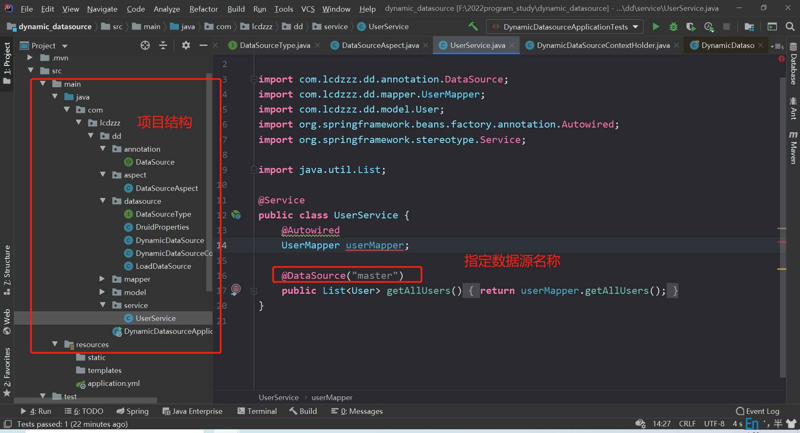
</div>

最后再测试类中使用测试，代码就是常见的mapper中写sql语句，serivce层调用，最后测试类使用service层的方法测试。

测试结果：不同名称的数据源，会查找对应不同的数据库，内容也有所不同

sql文件如下，意思意思

```sql

SET NAMES utf8mb4;
SET FOREIGN_KEY_CHECKS = 0;

-- ----------------------------
-- Table structure for user
-- ----------------------------
DROP TABLE IF EXISTS `user`;
CREATE TABLE `user`  (
  `id` int(0) NOT NULL,
  `username` varchar(255) CHARACTER SET utf8mb4 COLLATE utf8mb4_general_ci NULL DEFAULT NULL,
  `age` int(0) NULL DEFAULT NULL,
  PRIMARY KEY (`id`) USING BTREE
) ENGINE = InnoDB CHARACTER SET = utf8mb4 COLLATE = utf8mb4_general_ci ROW_FORMAT = Dynamic;

-- ----------------------------
-- Records of user
-- ----------------------------
INSERT INTO `user` VALUES (1, 'lcdzzz', 22);

SET FOREIGN_KEY_CHECKS = 1;

```


# 总结

## 自定义数据源的使用分为两种情况

1. 用@DataSource注解

   - @DataSource  没有参数，默认用下面定义的

<div style="text-align:center">
  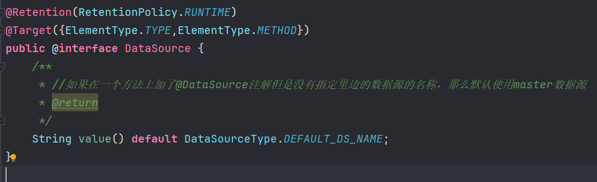
</div>

<div style="text-align:center">
  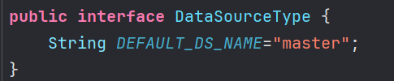
</div>

   - @DataSource 有参数，就用改参数名字的数据源

     `@DataSource("slave")`

<div style="text-align:center">
  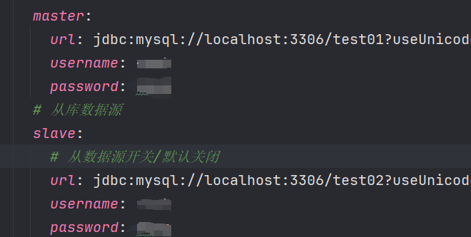
</div>

2. 不用@DataSource注解

   默认使用master

## 不用@DataSource，和用了但是没有加参数，两者都是“默认”，但是在逻辑是有区别

- 不用@DataSource时，是在这里上默认的

<div style="text-align:center">
  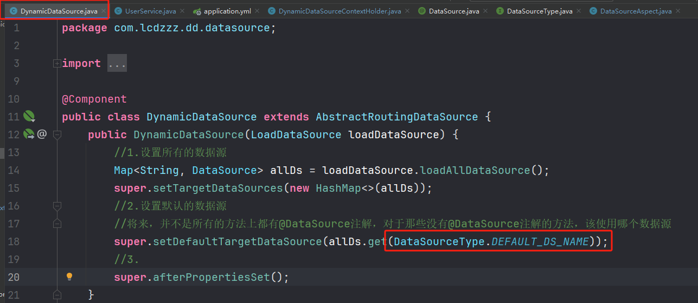
</div>

<div style="text-align:center">
  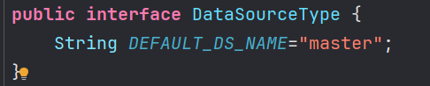
</div>

- 用了但是没有加参数，是在这里上默认的

<div style="text-align:center">
  
</div>

<div style="text-align:center">
  
</div>

ps：idea 导出项目结构树：

- 输入命令： `tree >> E:\workTreeTemp\tree.txt`


## ruoyi脚手架的写法

<div style="text-align:center">
  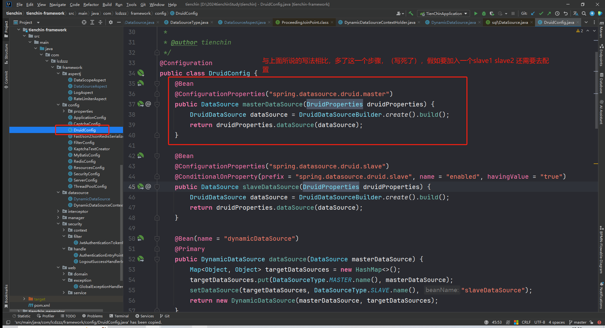
</div>

<div style="text-align:center">
  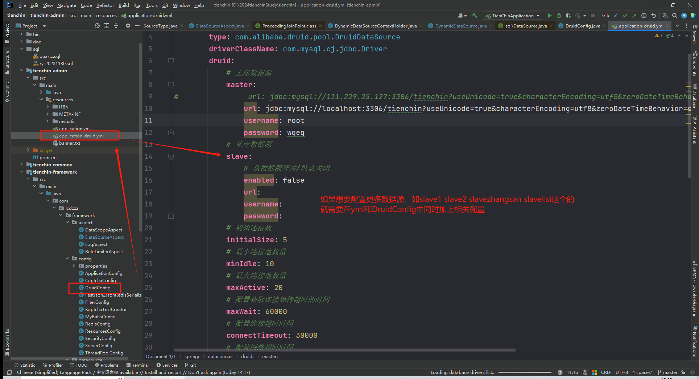
</div>

联系如下

<div style="text-align:center">
  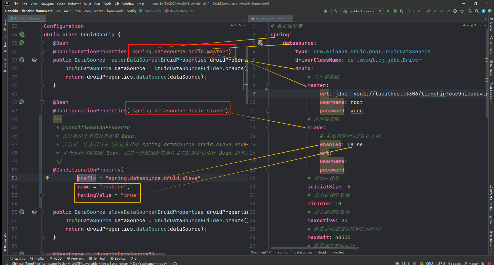
</div>

然后之前的写法是不用这样的，在<u>步骤4中的DynamicDataSource</u>中已经把所有的数据源读进来了【相比之下ruoyi写法没有这么灵活】


# 拓展：手动实现网页上切换数据源

## 步骤1：controller.DataSourceController


setDsType目的是打日志，真正有作用的是存在session里面的数据源名字

getAllUser为测试接口，测试数据源是否真的改变。方便起见，讲从数据库select出来的数据直接打印到控制台

```java
package com.lcdzzz.dd.controller;

import com.lcdzzz.dd.datasource.DataSourceType;
import com.lcdzzz.dd.model.User;
import com.lcdzzz.dd.service.UserService;
import org.slf4j.Logger;
import org.slf4j.LoggerFactory;
import org.springframework.beans.factory.annotation.Autowired;
import org.springframework.web.bind.annotation.GetMapping;
import org.springframework.web.bind.annotation.PostMapping;
import org.springframework.web.bind.annotation.RestController;

import javax.servlet.http.HttpSession;
import java.util.List;

@RestController
public class DataSourceController {
    private static final Logger logger = LoggerFactory.getLogger(DataSourceController.class);

    @Autowired
    UserService userService;

    /**
     * 修改数据源
     * @param dsType
     */
    @PostMapping("/dstype")
    public void setDsType(String dsType, HttpSession session){//修改后存入session中去，与当前会话绑定，这样一来当前整个会话都可以统一使用这个数据源了
        session.setAttribute(DataSourceType.DS_SESSION_KEY,dsType);
        logger.info("数据源切换为 {}",dsType);
    }

    @GetMapping("/users")
    public List<User> getAllUser(){
        List<User> allUsers = userService.getAllUsers();
        allUsers.forEach(System.out::println);
        return allUsers;
    }

}

```

## 步骤2：aspect.GlobalDataSourceAspect.java

和之前的`DataSourceAspect`一样，定义切面

【注】@Order值越小，优先级越高。但这里值得注意的是，优先级越低的，越后面执行；后面执行的，就能覆盖前面的。所以优先级越低的，才是最后真正起作用的那个。

这里定义的切点不是像之前的一样的在注解@DataSource上了。归根结底，手动实现网页上切换数据源关联的是一个service层的一个方法，所以切点应该设置如下。

环绕通知，拦截下来，设置最新（从session中）得到的数据源

```java
package com.lcdzzz.dd.aspect;

import com.lcdzzz.dd.datasource.DataSourceType;
import com.lcdzzz.dd.datasource.DynamicDataSourceContextHolder;
import org.aspectj.lang.ProceedingJoinPoint;
import org.aspectj.lang.annotation.Around;
import org.aspectj.lang.annotation.Aspect;
import org.aspectj.lang.annotation.Pointcut;
import org.springframework.beans.factory.annotation.Autowired;
import org.springframework.core.annotation.Order;
import org.springframework.stereotype.Component;

import javax.servlet.http.HttpSession;

@Aspect
@Component
@Order(10)

public class GlobalDataSourceAspect {

    @Autowired
    HttpSession session;

    @Pointcut("execution(* com.lcdzzz.dd.service.*.*(..))")
    public void pc(){

    }

    @Around("pc()")
    public Object around(ProceedingJoinPoint pjp){
        //变化：原来从@DataSource注解里面找的，现在从session里面找了
        DynamicDataSourceContextHolder.setDataSourceType((String) session.getAttribute(DataSourceType.DS_SESSION_KEY));
        try {
            return pjp.proceed();//让被拦截的方法继续往下走
        } catch (Throwable throwable) {
            throwable.printStackTrace();
        } finally {
            DynamicDataSourceContextHolder.clearDataSourceType();
        }
        return null;
    }
}

```

与此同时，为了让两种设置数据源的方法有合理的先后顺序,要在`@DataSource`直接上给11，在`GlobalDataSourceAspect`给10。达到的效果就是，全局，即先以<u>全局手动设置的数据源</u>为准，若某个service层的方法用了`@DataSource`注解，就以<u>注解定义</u>的为准

```java
@Order(11)
public class DataSourceAspect {
```

## 步骤3：简单写一个网页

`loadData()`是讲select出来的数据显示在网页上，但是不知道为什么我这里不行，应该是JSON转换的原因，不过这个不是本篇的重点，所以把它打印在控制台也行。

`dsChange(value)`是为了把选择的数据源名，打印出来。

```html
<!DOCTYPE html>
<html lang="en">
<head>
    <meta charset="UTF-8">
    <title>Title</title>
    <script src="jquery-3.6.0.js"></script>
</head>
<body>
<div>
    请选择数据源
    <select name="" id="" onchange="dsChange(this.options[this.options.selectedIndex].value)"><!--this.options[]是个数组，
                                                                                                【.value】是取值-->
        <option value="请选择">请选择</option>
        <option value="master">master</option>
        <option value="slave">slave</option>
    </select>
</div>
<div id="result" ></div>

<button onclick="loadData()">加载数据</button>
<script>
    function loadData(){
        $.get("/users",function (data){
            $("#result").html(JSON.stringify(data));
        })
    }
    function dsChange(value) {
        $.post("/dstype",{dsType:value})
    }
</script>
</body>
</html>
```

用jQuery，这里就不放上来了，而且因为是简单的用，直接把文件复制过来即可。jQuery地址：https://code.jquery.com/jquery-3.6.0.js

目录结构：

<div style="text-align:center">
  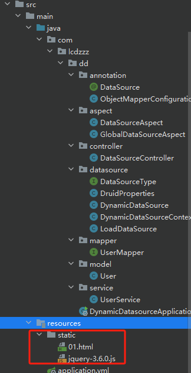
</div>


## 测试

<div style="text-align:center">
  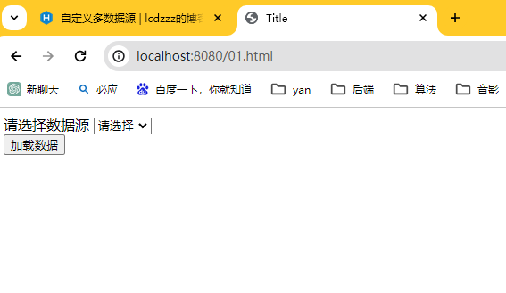
</div>

<div style="text-align:center">
  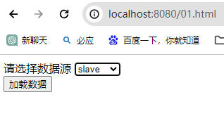
</div>

<div style="text-align:center">
  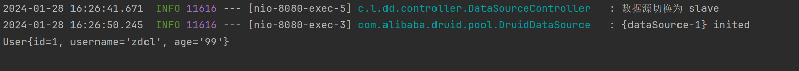
</div>
