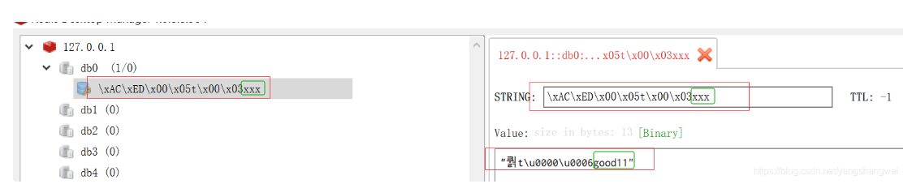
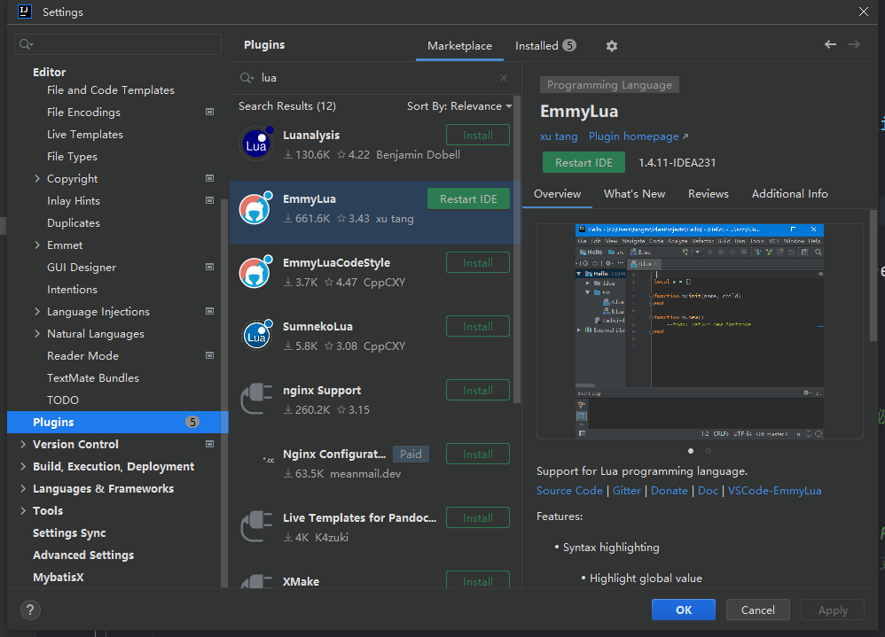
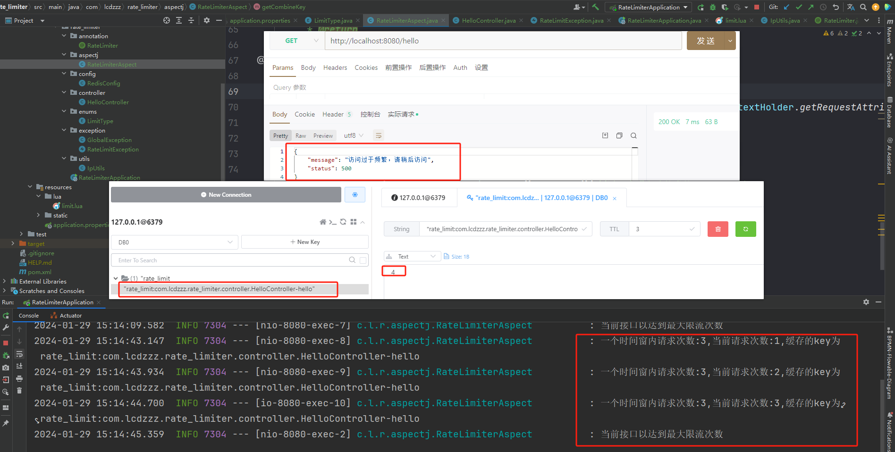
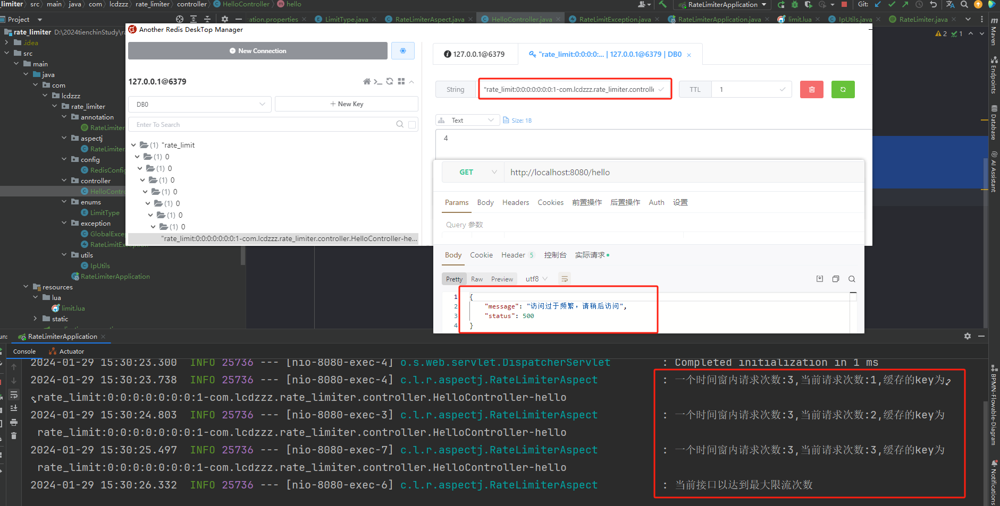

> [代码地址](https://gitee.com/lcdzzz/rate_limiter)

# 依赖

依赖：springweb、nosql的redis、aop

```xml
<dependency>
    <groupId>org.springframework.boot</groupId>
    <artifactId>spring-boot-starter-data-redis</artifactId>
</dependency>
<dependency>
    <groupId>org.springframework.boot</groupId>
    <artifactId>spring-boot-starter-web</artifactId>
</dependency>
<dependency>
    <groupId>org.springframework.boot</groupId>
    <artifactId>spring-boot-starter-aop</artifactId>
</dependency>
```

application.properties：

```properties
spring.redis.host=localhost
spring.redis.port=6379
```

# 准备工作

## step1：限流类型

```java
package com.lcdzzz.rate_limiter.enums;

/**
 * 限流的类型
 */
public enum LimitType {
    /**
     * 默认的限流策略，针对某一个接口进行限流
     */
    DEFAULT,

    /**
     * 针对某一个IP进行限流
     */
    IP
}

```

## step2：定义注解

```java
package com.lcdzzz.rate_limiter.annotation;

import com.lcdzzz.rate_limiter.enums.LimitType;

public @interface RateLimiter {

    /**
     * 限流的key，主要是指前缀
     * @return
     */
    String key() default "rate_limit";

    /**
     * 限流时间窗
     * @return
     */
    int time() default 60;

    /**
     * 在时间窗内的限流次数
     * @return
     */
    int count() default 100;

    /**
     * 限流类型
     * @return
     */
    LimitType limitType() default LimitType.DEFAULT;
}
```

## step3：配置redis

### 原因

因为待会去操作限流时需要lua表达式，所以先要对redis进行简单的配置

> 【问】
>
> 为什么要对redis进行配置？
>
> 【答】
>
> 在springDataRedis里面提供了两个我们可以直接操作redis的类：`RedisTemplate`、`StringRedisTemplate` 。
>
> 区别在于前者的key和value可以操作对象，而后者不可以是对象（只能是字符串）。
>
> 但是！虽然说`RedisTemplate`更方便，但是也存在问题。它的序列化方案是`org.springframework.data.redis.serializer.JdkSerializationRedisSerializer`。有兴趣深入了解的可以看https://cloud.tencent.com/developer/article/1863347 这篇博客。同时，想要用其他的序列化方式，也可以看这篇。
>
> 以下简单来说

假如我加入一个   key：xxx    value：good11

<div style="text-align:center">
  
</div>

虽然在get时，如果依然用的是`RedisTemplate`，那它自己会帮忙转回去，但是如果用redis命令行去`get xxx`，那是行不通的。


### 办法

所以！！！**要修改的它的序列化方案，用JSON的**，java代码如下

```java
package com.lcdzzz.rate_limiter.config;

import org.springframework.context.annotation.Bean;
import org.springframework.context.annotation.Configuration;
import org.springframework.data.redis.connection.RedisConnectionFactory;
import org.springframework.data.redis.core.RedisTemplate;
import org.springframework.data.redis.serializer.Jackson2JsonRedisSerializer;

@Configuration
public class RedisConfig {
    @Bean
    RedisTemplate<Object, Object> redisTemplate(RedisConnectionFactory redisConnectionFactory) {

        // 创建 RedisTemplate 对象
        RedisTemplate<Object, Object> template = new RedisTemplate<>();

        // 设置 RedisConnection 工厂。 它就是实现多种 Java Redis 客户端接入的秘密工厂
        template.setConnectionFactory(redisConnectionFactory);

        /**
         * org.springframework.data.redis.serializer.GenericJackson2JsonRedisSerializer
         * 使用 Jackson 实现 JSON 的序列化方式，并且从 Generic 单词可以看出，是支持所有类。
         */

        //各种序列化的方案。实际线上场景，还是使用 JSON 序列化居多。
        Jackson2JsonRedisSerializer<Object> serializer = new Jackson2JsonRedisSerializer<>(Object.class);
        //设置key的序列化
        template.setKeySerializer(serializer);
        template.setHashKeySerializer(serializer);
        //设置value的序列化
        template.setValueSerializer(serializer);
        template.setHashValueSerializer(serializer);
        return template;
    }


}

```

## step4：lua脚本

<div style="text-align:center">
  
</div>


> 简说lua脚本
>
> 到时候会传入两个参数进来
>
> - 传key：这个key就是一个list集合，就是可能传多个key进来
> - 传多个参数进来，多个参数也是数组


```lua
--注意，这里的下标是从1开始的，而不是0。
--以下的意思：一会把KEYS数组里面的第一项拿出来，交给key这个变量
--tonumber是把字符串转成数字
local key = KEYS[1]
local time =tonumber(ARGV[1])
local count=tonumber(ARGV[2])
--[[当看到这行Lua脚本时，可以理解为它是用在Redis数据库上的脚本。让我们逐步解释这行代码：
    1. local current: 这行声明了一个本地变量 current。
        在Lua中，local 关键字用于声明局部变量，其作用范围仅限于当前代码块。
    2. redis.call('get', key): 这是一个Redis命令，用于执行Redis数据库的GET操作。
        具体来说，它是通过Lua脚本中的 redis.call 函数来调用Redis命令的。
        在这里，'get' 是Redis的GET命令，而 key 是作为参数传递给GET命令的键。

  所以，整体而言，这行代码的目的是从Redis数据库中获取键为 key 的值，
  并将其存储在本地变量 current 中。在这之后，你可以通过对 current 变量的操作来处理从Redis中获取的值。
  例如，你可能会检查是否成功获取了值，然后进行相应的逻辑处理。
    ]]
--这里的key，就是当前要限流的那一个接口，其存在redis里面的那个key，把它先拎出来，放进current变量中
local current=redis.call('get',key)
--但是如果这个key没有调用过，那么这个current没有值。比如第一次调用这个接口，那么current是会不存在的。所以下面还要做一个判断
if current and tonumber(current)>count then--[[意思是current存在，并且它的值大于count。说明已经超过限流的阈值了]]
    return tonumber(current)
end--[[否则就是current没有值，意味着是第一次访问]]
current=redis.call('incr',key)--[[给current自增1。因为有可能存在并发操作，所以不能用set操作，用incr会更准确一些]]

--但是在并发环境下，有可能另外一个操作也执行了current自增1的操作，所以以下需要判断，即如果对方已经设置过过期时间了，那我们就不需要多次一举了
if tonumber(current)==1 then--[[等于1代表还没有其他的进程操作过current]]
    redis.call('expire',key,time)--[[设置过期时间]]
end
return tonumber(current)--[[最后我们需要在java代码中看current的值，判断是否需要限流/放行]]
```


## step5：加载lua脚本

上一步写的lua脚本是需要加载的，springDataRedis中也为加载lua脚本提供了方法，只要定义一个bean就行了，如下 

```java
package com.lcdzzz.rate_limiter.config;

import org.springframework.context.annotation.Bean;
import org.springframework.context.annotation.Configuration;
import org.springframework.core.io.ClassPathResource;
import org.springframework.data.redis.connection.RedisConnectionFactory;
import org.springframework.data.redis.core.RedisTemplate;
import org.springframework.data.redis.core.script.DefaultRedisScript;
import org.springframework.data.redis.serializer.Jackson2JsonRedisSerializer;
import org.springframework.scripting.support.ResourceScriptSource;

@Configuration
public class RedisConfig {
    @Bean
    RedisTemplate<Object, Object> redisTemplate(RedisConnectionFactory redisConnectionFactory) {

        // 创建 RedisTemplate 对象
        RedisTemplate<Object, Object> template = new RedisTemplate<>();

        // 设置 RedisConnection 工厂。 它就是实现多种 Java Redis 客户端接入的秘密工厂
        template.setConnectionFactory(redisConnectionFactory);

        /**
         * org.springframework.data.redis.serializer.GenericJackson2JsonRedisSerializer
         * 使用 Jackson 实现 JSON 的序列化方式，并且从 Generic 单词可以看出，是支持所有类。
         */

        //各种序列化的方案。实际线上场景，还是使用 JSON 序列化居多。
        Jackson2JsonRedisSerializer<Object> serializer = new Jackson2JsonRedisSerializer<>(Object.class);
        //设置key的序列化
        template.setKeySerializer(serializer);
        template.setHashKeySerializer(serializer);
        //设置value的序列化
        template.setValueSerializer(serializer);
        template.setHashValueSerializer(serializer);
        return template;
    }

    //这个bean是一个泛型，这里的泛型对应的是返回数据的类型
    @Bean
    DefaultRedisScript<Long> limitScript(){
        DefaultRedisScript<Long> script = new DefaultRedisScript<>();
        script.setResultType(Long.class);//返回的类型

        /*以下这行代码看起来是用于设置Lua脚本的源代码。让我们逐步解释：
            1. new ClassPathResource("lua/limit.lua"): 这部分创建了一个 ClassPathResource 对象，
            该对象用于表示类路径下的资源。在这里，"lua/limit.lua" 是资源的路径，
            这意味着要在类路径下找到名为 limit.lua 的Lua脚本文件。

            2. new ResourceScriptSource(...): 这部分创建了一个 ResourceScriptSource 对象，
            用于表示脚本的源代码来源。ResourceScriptSource 通常用于从文件、URL等资源加载脚本。

            3. script.setScriptSource(...): 这部分应该是将创建好的脚本源代码对象设置到某个脚本对象中。
            根据命名和上下文来看，可能是设置到一个名为 script 的Lua脚本对象中。

        综合起来，这行代码的作用是将位于类路径下的 lua/limit.lua 文件的Lua脚本设置为某个脚本对象
        （可能是 script）的源代码。这样做的目的是为了后续执行该脚本时能够使用该源代码。*/
        script.setScriptSource(new ResourceScriptSource
                (new ClassPathResource("lua/limit.lua")));/*告诉spring我的脚本搁哪呢*/
        return script;
    }
}

```

## step6：自定义异常

`@RestControllerAdvice` 是Spring Framework中的注解，用于定义一个全局性的异常处理器（Global Exception Handler）。

在Spring应用中，`@RestControllerAdvice` 通常用于集中处理所有控制器（Controller）中抛出的异常。它的主要作用包括：

1. **全局异常处理：** 允许开发者定义一个全局的异常处理逻辑，捕获并处理整个应用中的异常，而不仅仅是在单个控制器中。这有助于提高代码的一致性和可维护性。
2. **统一响应：** 可以在全局异常处理器中定义统一的响应格式，使得应用的异常返回给客户端时具有一致的结构和格式。
3. **异常日志记录：** 可以在全局异常处理器中集中处理异常的日志记录，方便监控和排查问题。

一个简单的例子如下：

```java
javaCopy code@RestControllerAdvice
public class GlobalExceptionHandler {

    @ExceptionHandler(Exception.class)
    public ResponseEntity<String> handleException(Exception e) {
        // 处理异常逻辑
        // 可以返回自定义的错误信息
        return ResponseEntity.status(HttpStatus.INTERNAL_SERVER_ERROR).body("Internal Server Error");
    }

    // 其他异常处理方法可以继续添加
}
```

在上述例子中，`@ExceptionHandler` 注解用于指定处理的异常类型，这里是 `Exception.class`，表示处理所有类型的异常。然后，定义了一个处理异常的方法 `handleException`，在这个方法中可以实现自定义的异常处理逻辑。在实际应用中，可以根据需要添加更多的 `@ExceptionHandler` 方法来处理不同类型的异常。


此项目中，全局异常处理如下：

```java
package com.lcdzzz.rate_limiter.exception;


import org.springframework.web.bind.annotation.ExceptionHandler;
import org.springframework.web.bind.annotation.RestControllerAdvice;

import java.util.HashMap;
import java.util.Map;

@RestControllerAdvice
public class GlobalException {
    @ExceptionHandler(RateLimitException.class)
    public Map<String,Object> rateLimitException(RateLimitException e){
        HashMap<String, Object> map = new HashMap<>();
        map.put("status",500);
        map.put("message",e.getMessage());
        return map;
    }
}
```

自定义的异常如下：

```java
package com.lcdzzz.rate_limiter.exception;


public class RateLimitException extends Exception {
    public RateLimitException(String message) {
        super(message);
    }
}
```


> 至此准备工作算是完成了，接下来就可以去写切面，去解析注解

# 定义切面

## IpUtils

请看：https://lcdzzz.github.io/2022/04/26/java-chang-yong-util-gong-ju-lei/

## RateLimiterAspect

```java
package com.lcdzzz.rate_limiter.aspectj;

import com.lcdzzz.rate_limiter.annotation.RateLimiter;
import com.lcdzzz.rate_limiter.enums.LimitType;
import com.lcdzzz.rate_limiter.exception.RateLimitException;
import com.lcdzzz.rate_limiter.utils.IpUtils;
import org.aspectj.lang.JoinPoint;
import org.aspectj.lang.annotation.Aspect;
import org.aspectj.lang.annotation.Before;
import org.aspectj.lang.reflect.MethodSignature;
import org.slf4j.Logger;
import org.slf4j.LoggerFactory;
import org.springframework.beans.factory.annotation.Autowired;
import org.springframework.data.redis.core.RedisTemplate;
import org.springframework.data.redis.core.script.RedisScript;
import org.springframework.stereotype.Component;
import org.springframework.web.context.request.RequestContextHolder;
import org.springframework.web.context.request.ServletRequestAttributes;

import java.lang.reflect.Method;
import java.util.Collections;

@Aspect
@Component
public class RateLimiterAspect {
    private static final Logger logger = LoggerFactory.getLogger(RateLimiterAspect.class);
    @Autowired
    RedisTemplate<Object, Object> redisTemplate;
    @Autowired
    RedisScript<Long> redisScript;

    //@Before 用于定义前置通知，即在目标方法执行前执行的代码。
   /* "@annotation(rateLimiter)": 这是一个切点表达式，它指定了在被 rateLimiter 注解标注的方法上执行切面逻辑。
     @annotation 是一个用于匹配带有特定注解的方法的切点函数，
     其中 rateLimiter 是一个注解的名字，用于匹配使用该注解的方法。*/
    @Before("@annotation(rateLimiter)")//到时候加了@rateLimiter注解的方法，通通都会被洒家拦截下来
    public void before(JoinPoint jp, RateLimiter rateLimiter) throws RateLimitException{
        int time = rateLimiter.time();
        int count = rateLimiter.count();
        String combineKey = getCombineKey(rateLimiter, jp);

        //Collections.singletonList 是 Java 中 Collections 类提供的一个静态方法，用于创建包含单个元素的不可变列表（List）
        try {
            Long number = redisTemplate.execute(redisScript, Collections.singletonList(combineKey), time, count);
            //根据number的值去判断发生啥事了
            if (number==null||number.intValue()>count){
                //超过阈值，需要限流
                logger.info("当前接口以达到最大限流次数");
                throw new RateLimitException("访问过于频繁，请稍后访问");
            }
            logger.info("一个时间窗内请求次数:{},当前请求次数:{},缓存的key为{}",count,number,combineKey);
        } catch (Exception e) {
            throw e;
        }

    }

    /**
     * 这个key其实就是接口调用次数缓存在redis里面的key
     * 如果基于ip限流，那combineKey就会形如：rate_limit:127.0.0.1-com.lcdzzz.rate_limiter.controller.HelloController-hello
     * 如果不基于ip限流，那combineKey就会形如：rate_limit:com.lcdzzz.rate_limiter.controller.HelloController-hello
     *
     * @param rateLimiter
     * @param jp
     * @return
     */
    private String getCombineKey(RateLimiter rateLimiter, JoinPoint jp) {
        StringBuffer key = new StringBuffer(rateLimiter.key());
        if (rateLimiter.limitType() == LimitType.IP) {//意思是限流的类型是基于ip限流
            key.append(IpUtils.getClientIp(((ServletRequestAttributes) RequestContextHolder.getRequestAttributes()).getRequest()))
                    .append("-");
        }
        MethodSignature signature = (MethodSignature) jp.getSignature();
        Method method = signature.getMethod();
        key.append(method.getDeclaringClass().getName())//返回声明方法的类的 Class 对象
                .append("-")
                .append(method.getName());
        return key.toString();
    }


}

```


# 测试

## 不限制ip地址

### controller层

```java
import com.lcdzzz.rate_limiter.annotation.RateLimiter;
import org.springframework.web.bind.annotation.GetMapping;
import org.springframework.web.bind.annotation.RestController;

/**
 * @RestController 注解告诉 Spring 框架，这个类的每个方法的返回值都直接作为 HTTP 响应体返回给客户端，
 * 而不是通过视图解析器来解析成视图。因此，@RestController 通常用于构建 RESTful Web 服务，
 * 其中控制器的方法返回 JSON、XML 等数据格式而不是 HTML 视图。
 */
@RestController
public class HelloController {
    @GetMapping("/hello")
    /**
     * 限流，10秒之内，这个接口可以访问三次
     */
    @RateLimiter(time = 10,count=3)
    public String hello(){
        return "hello";
    }
}
```

### 结果

<div style="text-align:center">
  
</div>


## 限制ip地址

### controller层

```java
@RateLimiter(time = 10,count=3,limitType = LimitType.IP)
public String hello(){
    return "hello";
}
```

### 结果

<div style="text-align:center">
  
</div>


# 对标tienchin/ruoyi

- `tienchin-common/src/main/java/com/lcdzzz/common/annotation/RateLimiter.java` 自定义注解

- `tienchin-common/src/main/java/com/lcdzzz/common/annotation/RateLimiter.java` 切面，解析注解

- `tienchin-framework/src/main/java/com/lcdzzz/framework/config/RedisConfig.java` 序列化+限流脚本

  不同点：ruoyi是拼接字符串，而上面的方法是用lua脚本，但殊途同归


