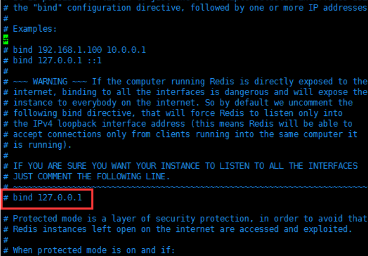
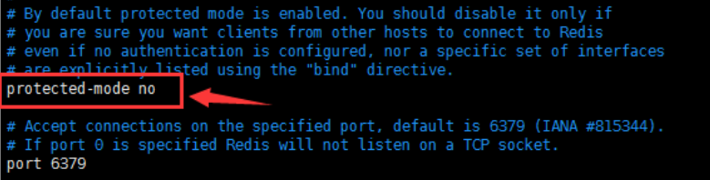

## 解决主机java项目无法连接linux上redis服务的问题

1. 若远程主机需要访问redis服务器，可以修改redis.conf配置文件。如我的linux服务上的redis.config文件存放在 `/usr/local/bin/zhouconfig`下

2. bind字段默认为： `bind 127.0.0.1` 这样只能本机访问redis

   若允许远程主机访问，可注释掉bind行  或者  将bind 127.0.0.1改为： bind 0.0.0.0

  

3. .将`protected-mod yes` 修改为`protected-mod no` ；意思是将redis的保护模式关闭掉，这样可以供外部来访问redis访问

  

4. 去服务器的控制台开启6379端口

