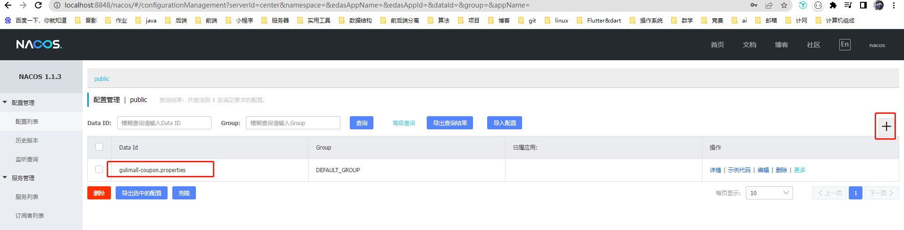
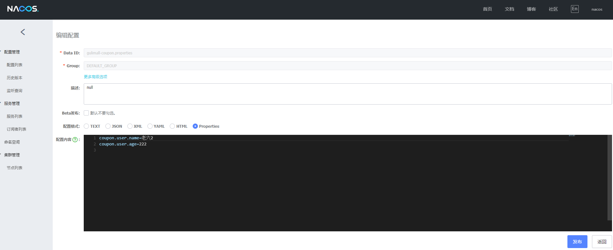
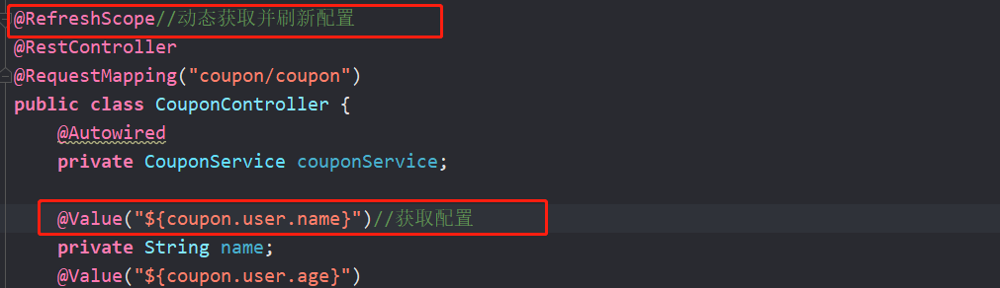
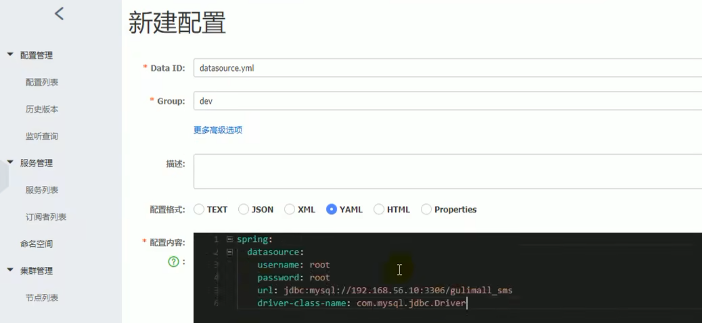
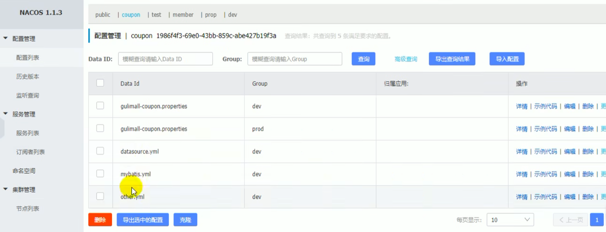
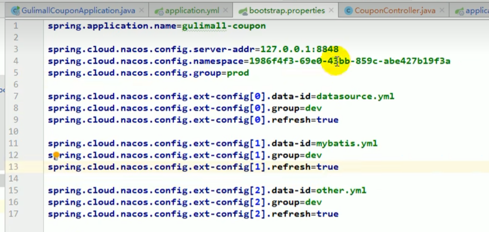

# 微服务

## SpringCloud Alibaba-Nacos[**作为配置中心**]

### 如何使用Nacos作为配置中心同意管理配置：

1. 引入依赖

   ```xml
   <!--配置中心来做配置管理-->
   <dependency>
       <groupId>com.alibaba.cloud</groupId>
       <artifactId>spring-cloud-starter-alibaba-nacos-config</artifactId>
   </dependency>
   ```

2. 创建一个bootstrap.properties文件

   ```properties
   spring.application.name=gulimall-coupon
   spring.cloud.nacos.config.server-addr=127.0.0.1:8848
   ```

   

3. 需要给配置中心默认添加一个叫数据集的(Data Id) gulimall-coupon.properties.。默认规则：应用名.properties

<div style="text-align:center">
  
</div>

<div style="text-align:center">
  
</div>

4. 给应用名.properties添加任何配置

5. 动态获取配置

   ```java
   @RefreshScope//动态获取并刷新配置
   @Value("${coupon.user.name}")//获取配置
   ```

<div style="text-align:center">
  
</div>

   如果配置中心和当前应用的配置文件中都配置了相同的项，优先使用配置中心的配置

### 细节

1. 命名空间:配置隔离;

   默认: public(保留空间);默认新增的所有配置都在public空间。

   1. 开发，测试，生产:利用命名空间来做环境隔离。注意:在bootstrap.properties;配置上，需要使用哪个命名空间下的配置，spring,cloud,nacos,config,namespace=67c0dde5-2912-4dd0-bd98-6d87307f5758
   2. 每一个微服务之间互相隔离配置，每一个微服务都创建自己的命名空间，只加载自己命名空间下的所有配置

2. 配置集

   所有配置的结合

3. 配置集ID：类似文件名

   Data ID:文件名

4. 配置分组

   默认所有的配置集都属于: DEFAULT GROUP;1111，618，1212
   <u>每个微服务创建自己的命名空间，使用配置分组区分环境，dev，test，prod</u>


### 同时加载多个配置集

1. 微服务任何配置信息，任何配置文件都可以放在配置中心中

2. 只需要在bootstrap.properties说明加载配置中心中哪些配置文件即可

3. @Value, @ConfigurationProperties。 

   以前SpringBoot任何方法从配置文件中获取值，都能使用

   配置中心有的优先使用配置中心中的

<div style="text-align:center">
  
</div>

<div style="text-align:center">
  
</div>


<div style="text-align:center">
  
</div>
