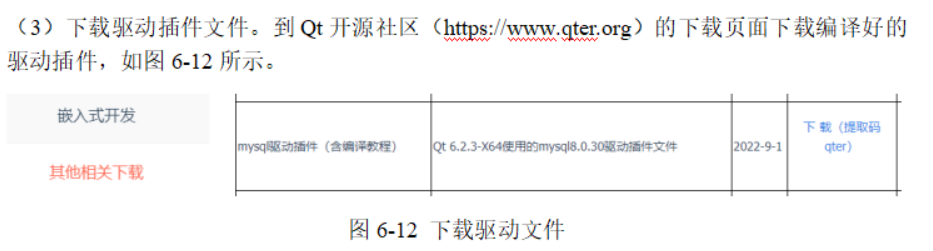
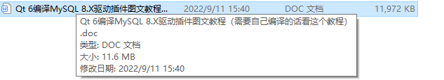
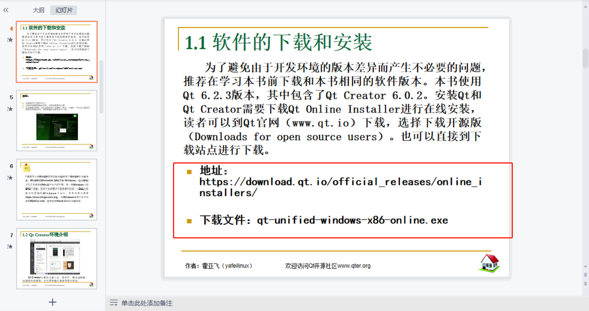
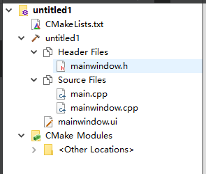
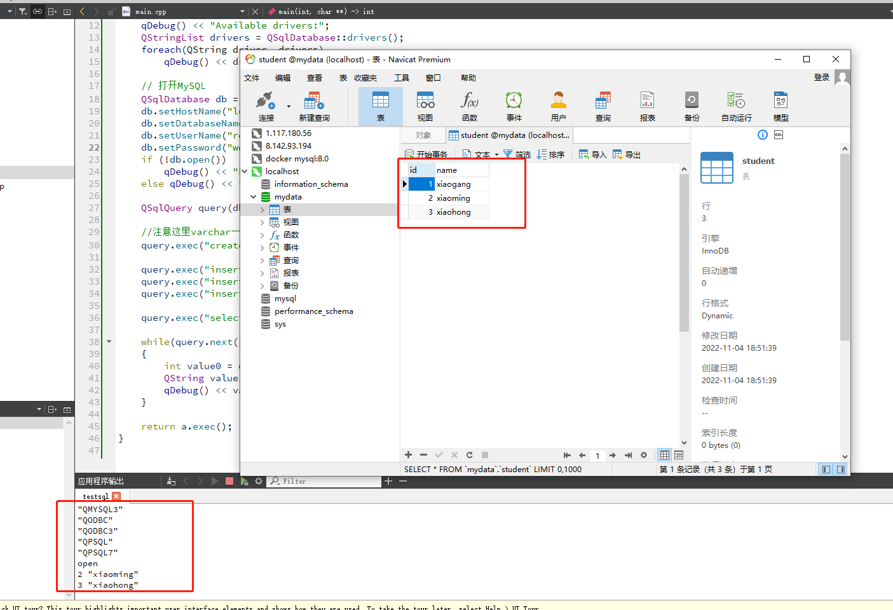

# 《这该死的qt》

- 最开始我看着老师给的word文档，那边mysql版本是8.0，我是5.7，那边qt版本是6.2.3，我是5.14.2。差别这么大？应该不能跟着做吧。

- 然后先看了看波波给的博客，四个人中，就我出现了问题，其他人都正确连通了。这个问题貌似是说，整个百度没有什么解决方法，好像是说1: error: cannot open output file F:\Git\plugins\sqldrivers\qsqlmysql.dll 有问题还是咋滴。可是qt和我自己装的Git有什么关系啊？

- 当时发现我的mysql版本是5.7，博客里的是5.5，我寻思着这版本差的不大吧？难道是qt的问题？

- 当时就准备重装下qt

  前面的是前一天晚上花了一个多小时

- 到了第二天，我先重装了两遍qt，发现依然是同一个原因，于是继续百度找解决办法，弄着弄着，报错往我不可掌控的方向发展下去了，我眼看远走越远，准备换一条路。

- 既然mysql版本不匹配，那我重装下mysql吧

- 后来就把mysql5.7换成了mysql8

- 好吧，继续，还是有问题

- 这时候再看看老师给word

  

- 当时觉得我俩的qt版本还是不一样，要不我手动编译去吧

  

- 好家伙，用cmake编译一样出了奇奇怪怪的问题，上网差了查，发现基本上全是linux上的报错，好吧，看来这条路走不通

- 继续，现在摆在我面前的还有几条路，我慢慢的试

- 于是上网去找准备下一个6.2.3的版本，但是怎么找都找不到，就连老师发的课件里面

  

真正弄下来也是6.2.4的版本，很奇怪，而6.2.4的版本进去，它的项目结构是这样的

  

我寻思着和我这学期学的差别有点大呀，了解了下才知道是由于我创建的是一个基于CMake的项目，因此相应的项目文件名为CMakeLists.txt，而不是.pro文件。

- 好吧，看起来路又走远了

这一套流程走下来已经是晚上七点了

难道真的没有办法了吗，我得用学妹的电脑重新来一遍吗？

最后我愣着头皮按老师word里写的那样

牛头对着马头，牛腿对着马腿走了一遍流程

- 教程里说的是把编译文件复制到C:\Qt\6.2.3\mingw_64\plugins\sqldrivers里面去，我没有，我就复制到F:\QT\Qt5.14.2\5.14.2\mingw73_64\plugins\sqldrivers。
- 说复制到C:\Qt\6.2.3\mingw_64\bin，我没有，我就复制到F:\QT\Qt5.14.2\5.14.2\mingw73_64\bin里面。

然后直接运行，啥也没干

走通了

  

  

  

  

  

  

  

我* * * * * * * *的 * * * * 去* *

